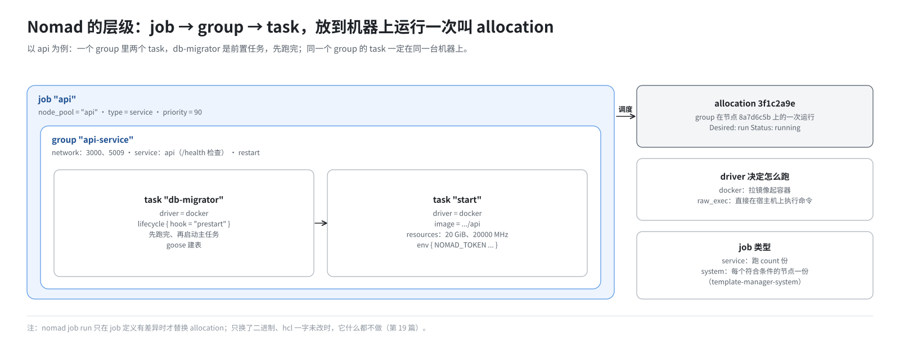
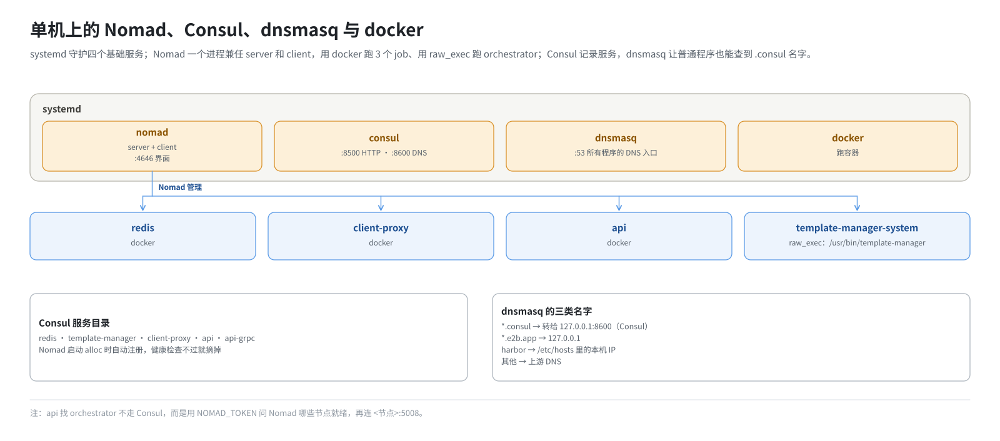

# 第 4 篇｜部署基础（二）：调度与服务发现——Nomad 和 Consul

> **本篇目标**：E2B 的 4 个业务服务不是由 systemd 或手工 `docker run` 启动的，而是交给调度器 Nomad；它们之间按名字互相找到，靠的是服务目录 Consul。本篇讲清楚这两个工具的基本概念：job、group、task、allocation、driver、节点池、健康检查、ACL token、服务目录、Consul DNS，以及它们在“只有一台机器”时的特殊用法。读完你能看懂第 15 篇的 job 文件，也能看懂 `nomad job status` 的输出。

---

## 一、服务多了以后的新问题

第 3 篇讲了 systemd 和 docker 怎么管一个服务。当服务多起来、机器也多起来时，会冒出三个新问题：

1. **跑在哪**：有 50 台机器、20 种服务，谁决定哪个服务放哪台？某台机器挂了，上面的服务挪到哪？
2. **谁来管**：服务崩了要重启，升级时要先起新的再停旧的，这些谁负责？
3. **怎么找**：服务 A 要访问服务 B，可 B 今天在这台机器、明天被挪到那台，A 怎么知道 B 的地址？

前两个问题由**调度器**解决，E2B 用的是 HashiCorp 的 **Nomad**。第三个问题由**服务发现**解决，E2B 用同一家公司的 **Consul**。

你可能会想：本环境只有一台机器，哪来“跑在哪”的问题？确实没有。但 E2B 上游的代码和部署文件都是按集群写的，api 甚至直接调用 Nomad 的接口查“有哪些节点”。保留 Nomad，就能少改大量代码，单机和多机也能用同一套 job 文件。这是一个“为了少改而保留”的选择，第 5 篇会再提到。

---

## 二、Nomad 的基本概念

### 2.1 server 和 client

用工厂排班来类比：

- **server** 是排班的人：接收任务、决定派给谁、记录所有状态；
- **client** 是干活的人：在自己的机器上真正启动进程，并汇报情况。

一个集群通常有 3 或 5 个 server，加上很多 client。

本环境只有一台机器，这台机器上的**同一个 Nomad 进程既是 server 也是 client**。它的配置文件 `/etc/nomad.d/default.hcl` 里同时有两段：

```hcl
server {
  enabled = true
  bootstrap_expect = 1     # 只等 1 个 server 就开始工作
}

client {
  enabled = true
  node_pool = "api"
}
```

### 2.2 job、group、task



交给 Nomad 的东西叫 **job**，用一个 `.hcl` 文件描述。它有三层：

| 层 | 类比 | 说明 |
|---|---|---|
| job | 一张排班单 | 一个完整的服务，如 `api` |
| group | 一组必须在一起干的活 | 同一个 group 里的 task 一定被放在同一台机器上 |
| task | 一件具体的活 | 一个进程或一个容器 |

本环境 api 的 job 结构（简化）：

```hcl
job "api" {
  node_pool = "api"

  group "api-service" {
    network { port "api" { static = 3000 } }
    service { name = "api" ... }

    task "start" {          # 主任务：api 本身
      driver = "docker"
      ...
    }
    task "db-migrator" {    # 前置任务：先建表
      driver = "docker"
      lifecycle { hook = "prestart" }
    }
  }
}
```

### 2.3 allocation：一次实际的运行

Nomad 把一个 group 放到某台机器上运行，这一次放置叫一个 **allocation**（简称 alloc），有一个 ID。job 改了、进程崩了重新调度了，都会产生新的 alloc。

常用命令：

```bash
export NOMAD_TOKEN=<token>            # 后面讲 ACL 时解释

nomad job status                      # 所有 job 和状态
nomad job status api                  # 某个 job 的详情，最下面列出它的 alloc
nomad alloc status <alloc-id>         # 某个 alloc 的详情：哪个 task 在跑、最近事件
nomad alloc logs <alloc-id> start     # 看 task "start" 的标准输出
nomad alloc logs -stderr <alloc-id> start
```

`nomad job status api` 的输出末尾大致是这样：

```
Allocations
ID        Node ID   Task Group   Version  Desired  Status   Created  Modified
3f1c2a9e  8a7d6c5b  api-service  0        run      running  5m ago   4m ago
```

`Desired` 是 Nomad 想要的状态，`Status` 是实际状态。两者不一致，就说明出了问题。

alloc 的文件放在 Nomad 数据目录下，本环境是 `/data/nomad/alloc/<alloc-id>/`。旧的 alloc 目录会留一段时间，排查时要注意别看错了（第 20 篇）。

### 2.4 driver：用什么方式跑

task 用什么方式运行，由 **driver** 决定。本环境用了两种：

| driver | 怎么跑 | 用在 |
|---|---|---|
| `docker` | 拉镜像、启动容器 | api、client-proxy、redis、db-migrator |
| `raw_exec` | 直接在宿主机上执行一条命令，不隔离 | template-manager（orchestrator） |

为什么 orchestrator 必须用 `raw_exec`？第 2 篇说过，它要：

- 建网络命名空间；
- 写宿主机的 iptables；
- 打开 `/dev/nbd*`；
- 映射大页；
- 启动 Firecracker。

这些操作在普通容器里都做不了。`raw_exec` 让它以 root 身份直接跑在宿主机上，等于“Nomad 帮你在宿主机上执行一条命令，并负责重启它”。

`raw_exec` 权限很大，Nomad 默认关闭，要在 client 配置里显式打开：

```hcl
plugin "raw_exec" {
  config { enabled = true }
}
```

### 2.5 job 的类型：service 和 system

| 类型 | 含义 | 本环境 |
|---|---|---|
| `service` | 长期运行的服务，跑几份由 `count` 决定 | api、client-proxy、redis |
| `system` | 在**每一台**符合条件的节点上各跑一份 | template-manager-system |
| `batch` | 跑完就结束的任务 | 未使用 |

orchestrator 的职责是“管理本机的沙箱”，所以每台计算节点都要有一份，天然适合 `system` 类型。这也是它的 job 名字叫 `template-manager-system` 的原因。单机时，“每一台”就是这一台。

### 2.6 节点池

集群里的机器往往分工不同：有的跑 api，有的专门建模板，有的跑沙箱。Nomad 用 **节点池**（node pool）给机器分组。每台 client 在配置里声明自己属于哪个池，每个 job 声明自己要去哪个池。

上游 E2B 有三个池：

| 池 | 放什么 |
|---|---|
| `api` | api、client-proxy、redis 等 |
| `build` | 模板构建 |
| `default` | 跑沙箱的计算节点 |

本环境只有一台机器，它只能属于一个池：`api`。于是 `.env` 里把所有 job 要去的池都指向 `api`：

```bash
export API_NODE_POOL=api
export BUILD_NODE_POOL=api
export CLICKHOUSE_NODE_POOL=api
```

否则 template-manager 会去找 `build` 池里的机器，永远找不到，一直处于等待调度的状态。

### 2.7 资源声明

每个 task 要声明自己需要多少资源：

```hcl
resources {
  cpu    = 2048     # 单位 MHz
  memory = 32768    # 单位 MiB
}
```

这个声明有两个作用：

1. **调度**：Nomad 只会把 task 放到剩余资源够的机器上。声明得比机器还大，就永远调度不上，报 `Dimension "memory" exhausted`。
2. **限制**：task 启动后，内存声明会变成它所在 cgroup 的上限。超过了，进程会被内核杀掉（OOM，退出码 137）。

这两个作用方向相反：声明太大调度不上，太小会被 OOM。template-manager 的 32 GiB 就是在两者之间找的值（第 15 篇）。

### 2.8 健康检查、重启和停止

几个和“守护”有关的配置：

| 配置 | 作用 |
|---|---|
| `service { check { ... } }` | 健康检查：定期访问某个端口或路径，判断服务是否正常 |
| `restart { attempts, interval, delay, mode }` | 进程退出后在本机重启几次、隔多久 |
| `reschedule { ... }` | 本机重启次数用完后，要不要换台机器重新调度 |
| `kill_signal`、`kill_timeout` | 停止时先发什么信号，等多久后强制杀掉 |
| `lifecycle { hook = "prestart" }` | 这个 task 要在主任务启动前跑完 |

其中 `kill_timeout` 在本环境有特殊意义：orchestrator 收到 SIGTERM 后要拆掉几百个网络槽位，30 秒可能不够（第 15、18 篇）。

### 2.9 怎么提交 job

```bash
nomad job run api.hcl          # 提交或更新
nomad job stop api             # 停止
```

`nomad job run` 会比较新提交的定义和正在运行的定义：

- 有差异，就按新定义替换 alloc；
- **没有差异，什么都不做**。

这一点在第 19 篇很关键：如果你只是换了二进制文件，hcl 内容一个字没变，`nomad job run` 会认为“没有变更”，旧进程继续用旧二进制跑。

---

## 三、Consul：服务目录

### 3.1 服务注册与健康检查

Consul 的核心是一份**服务目录**：哪个服务、在哪个地址和端口、现在健不健康。

服务不需要自己去注册。Nomad 和 Consul 是配套的：job 里写了 `service` 块，Nomad 启动 alloc 时就自动把它注册进 Consul，并把健康检查交给 Consul 执行。比如 redis 的 job：

```hcl
service {
  name = "redis"
  port = "redis"
  check {
    type     = "tcp"
    interval = "10s"
    timeout  = "2s"
  }
}
```

redis 启动后，Consul 目录里就多了一个叫 `redis` 的服务。健康检查不通过的实例，会被从“健康”列表里摘掉。

### 3.2 用 DNS 查服务

别的程序怎么从目录里查到 redis 的地址？Consul 提供了一个 **DNS 接口**，默认在 8600 端口。按约定格式的域名去问它就行：

```bash
dig @127.0.0.1 -p 8600 redis.service.consul +short
# 192.168.10.23
```

格式是 `<服务名>.service.consul`。只返回健康的实例。

本环境中，api 和 client-proxy 的 Redis 地址就是这么写的：

```bash
export REDIS_URL="redis.service.consul"
```

### 3.3 让普通程序也能查到 `.consul`

问题来了：api 里用的是普通的 DNS 解析，它只会去问 `/etc/resolv.conf` 里写的 DNS 服务器（默认 53 端口），不知道 Consul 在 8600。

本环境的解法是在中间加一个 **dnsmasq**：

1. `/etc/resolv.conf` 的第一行写 `nameserver 127.0.0.1`，让所有程序先问本机的 dnsmasq；
2. dnsmasq 配置一条转发规则，凡是 `.consul` 结尾的名字都转给 Consul：

   ```
   server=/consul/127.0.0.1#8600
   ```

3. 其他名字由 dnsmasq 自己作答或转给上游。

容器里的程序也一样：api 和 client-proxy 的 job 里写了 `dns_servers = ["127.0.0.1"]`，并且用宿主机网络（`network_mode = "host"`），所以它们的 `127.0.0.1` 就是宿主机的 dnsmasq。

dnsmasq 还顺带承担了另外两项工作：

- 把 `*.e2b.app` 解析到本机（第 11 篇）；
- 把 `harbor` 解析到本机（第 14 篇）。

---

## 四、ACL：访问令牌

Nomad 和 Consul 都开了 **ACL**（访问控制）。开了以后，任何操作都要带一个**令牌**（token），否则被拒绝：

```
Error querying jobs: Unexpected response code: 403 (Permission denied)
```

令牌从哪来？集群刚建好时，执行一次 **bootstrap**，系统会生成一个拥有全部权限的管理令牌，并且**只给这一次**：

```bash
nomad acl bootstrap
# Accessor ID  = ...
# Secret ID    = 1b2c3d4e-....      ← 这就是令牌
```

再执行一次 bootstrap 会报错，因为集群已经初始化过了。

这带来一个部署上的难题：令牌只出现一次，必须存好。本环境的做法（第 12 篇详讲）：

- Nomad 的令牌存到 `/data/nomad/acl.token`，Consul 的存到 `/opt/consul/acl.token`；
- 同时写回 `/opt/e2b-infra/.env` 的 `NOMAD_ACL_TOKEN`、`CONSUL_ACL_TOKEN`；
- 后面 `deploy.sh` 提交 job 时，从 `.env` 读令牌。

如果 `.env` 里的令牌和集群里的对不上，就会报上面那个 403。这是本环境最常见的部署错误之一（第 20 篇）。

日常用命令行操作 Nomad 时，先设好环境变量：

```bash
export NOMAD_TOKEN=$(cat /data/nomad/acl.token)
```

---

## 五、单机上的全貌



把本篇的东西放回一台机器上：

- **systemd** 守护 nomad、consul、dnsmasq、docker 四个服务。
- **Nomad**（server + client 合一，HTTP 端口 4646，网页界面 `http://<IP>:4646/ui`）：
  - 管 4 个 job；
  - 其中 3 个通过 docker 跑容器，1 个通过 `raw_exec` 直接跑宿主机程序。
- **Consul**（HTTP 端口 8500，DNS 端口 8600）：
  - 记录 4 个服务的地址和健康状态；
  - Nomad 也通过它（8500）注册服务。
- **dnsmasq**（53 端口）：
  - 所有程序的 DNS 入口；
  - `.consul` 转给 Consul，`.e2b.app` 和 `harbor` 自己回答本机地址。

另外，api 找 orchestrator 不走 Consul，而是直接调 Nomad 的接口，问“现在有哪些状态为就绪的节点”，再去每个节点的 5008 端口连接。这就是为什么 api 的 job 里要传 `NOMAD_TOKEN`。

---

## 本篇小结

| 概念 | 一句话解释 |
|---|---|
| Nomad server / client | 排班的人 / 干活的人；本环境同一个进程兼任 |
| job → group → task | 排班单 → 一组在一起的活 → 一个进程或容器 |
| allocation | 一个 group 的一次实际运行，有 ID，有日志 |
| driver | `docker` 跑容器；`raw_exec` 直接跑宿主机程序（orchestrator 用） |
| `system` job | 每台符合条件的节点各跑一份 |
| 节点池 | 给机器分组；单机时全部指向 `api` |
| `resources` | 既决定能否调度，也是 cgroup 上限 |
| `nomad job run` | 定义没变就什么都不做 |
| Consul 服务目录 | 服务名 → 地址 + 健康状态，Nomad 自动注册 |
| `xxx.service.consul` | 通过 Consul DNS（8600）查服务地址 |
| dnsmasq | 本机 DNS 入口，把 `.consul` 转给 Consul |
| ACL token | 访问令牌；bootstrap 只给一次，要存好 |

**下一篇预告**：[《原版 E2B 是怎么部署的：从云上集群到一台机器》](05-upstream-deployment.md)。有了这些基础，回头看 E2B 官方的部署方式：Terraform、Packer、GCP 上的多个节点池和各种云服务。然后看这套环境把它们一一换成了什么，以及本仓库支持的三种部署形态。
