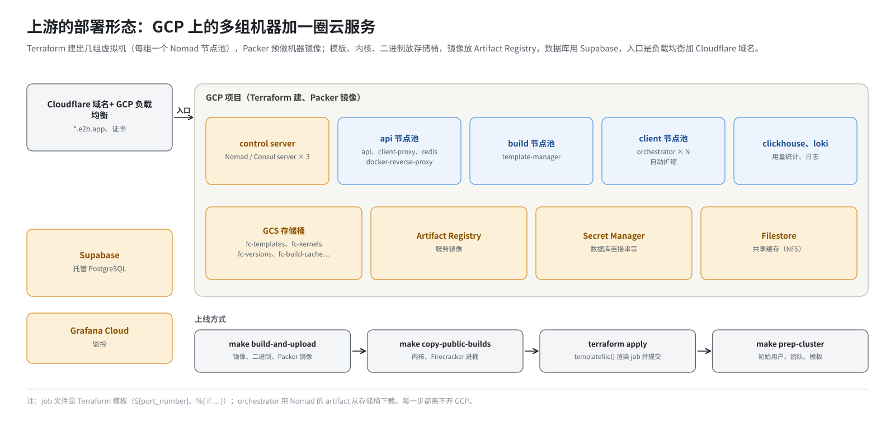
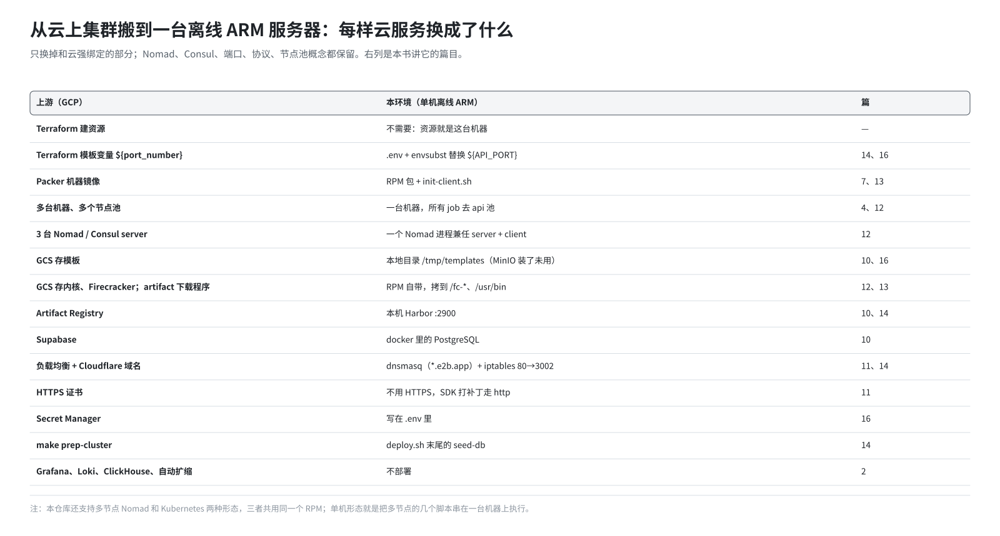

# 第 5 篇｜原版 E2B 是怎么部署的：从云上集群到一台机器

> **本篇目标**：回头看 E2B 官方的部署方式：在 Google Cloud 上用 Terraform 建资源、用 Packer 做机器镜像、多个节点池分工、云服务提供存储和数据库。然后看这套环境把它们一一换成了什么、为什么这么换；本仓库实际支持的三种部署形态（多节点 Nomad、Kubernetes、单机）各自是什么样；ARM 补丁里有哪些和部署相关的改动。读完你会明白，这个仓库里的“部署代码”是从哪里来、为了解决什么问题。

---

## 一、上游的部署形态

E2B 官方在自己的仓库里提供了“自托管”文档，主推的是 Google Cloud（GCP），另有一套不太完整的 AWS 版。下面以 GCP 为例。



### 1.1 用到的工具

| 工具 | 作用 |
|---|---|
| **Terraform** | “基础设施即代码”：用配置文件描述要哪些云资源（虚拟机、网络、存储桶、证书、密钥），一条命令创建出来 |
| **Packer** | 预先做好一个机器镜像：装好 Nomad、Consul、Docker 和内核参数。以后新开的机器都从这个镜像启动 |
| **gcloud** | GCP 的命令行工具，登录和推送用 |
| **Go、Docker** | 编译服务、构建镜像 |

### 1.2 部署步骤（官方文档的简化版）

1. 在 GCP 建项目，写一份 `.env.prod`，填好域名、数据库地址等。
2. `make init`：Terraform 开通各种云服务的接口，建存储桶、密钥容器。
3. `make build-and-upload`：
   - 编译各服务，构建镜像，推到 GCP 的镜像仓库（Artifact Registry）；
   - orchestrator、template-manager、envd 这类直接跑在机器上的二进制，上传到存储桶；
   - 用 Packer 做好机器镜像。
4. `make copy-public-builds`：把官方编好的客户机内核和 Firecracker 拷进自己的存储桶。
5. 在 GCP 的密钥管理里手工填入数据库连接串、Cloudflare 令牌等。
6. `make plan` 和 `make apply`：Terraform 一次性建出整个集群，并把 Nomad job 提交上去。
7. 在 `packages/shared` 下 `make prep-cluster`：造初始用户、团队，建一个基础模板。

### 1.3 集群长什么样

Terraform 建出来的是几组虚拟机，每组是一个 Nomad 节点池：

| 机器组 | 跑什么 |
|---|---|
| control server | Nomad server、Consul server（3 台左右） |
| api | api、client-proxy、redis、docker-reverse-proxy 等 |
| build | template-manager，专门建模板 |
| client（orchestrator） | orchestrator，跑沙箱，数量最多，可自动扩缩 |
| clickhouse、loki | 用量统计、日志 |

前面再挂一个 GCP 负载均衡，配上 Cloudflare 的域名和证书。

### 1.4 依赖的云服务

| 需要 | 上游用的云服务 |
|---|---|
| 存模板、内核、Firecracker、二进制 | GCS 存储桶（`fc-templates`、`fc-kernels`、`fc-versions`、`fc-build-cache` 等十来个） |
| 存镜像 | Artifact Registry |
| 关系数据库 | Supabase 托管的 PostgreSQL |
| Redis | GCP Memorystore，或集群里的 redis job |
| 共享文件缓存 | Filestore（NFS） |
| 域名、证书 | Cloudflare、GCP 证书管理 |
| 密钥 | GCP Secret Manager |
| 监控日志 | Grafana Cloud、自建 Loki、ClickHouse |

### 1.5 服务是怎么“上线”的

上游的 job 文件是 **Terraform 模板**，变量写成 Terraform 的语法，例如 api 的端口：

```hcl
port "api" {
  static = "${port_number}"
}
```

还夹着条件判断：

```hcl
%{ if update_stanza }
  update { ... }
%{ endif }
```

Terraform 用 `templatefile()` 把这些变量填好，再通过 Nomad 的接口提交。

直接跑在机器上的程序（orchestrator、template-manager）用 Nomad 的 `artifact` 功能，启动前从存储桶下载：

```hcl
artifact {
  source = "gcs::https://www.googleapis.com/storage/v1/${bucket_name}/template-manager"
}
```

机器开机时，Packer 镜像里的启动脚本 `start-client.sh` 从存储桶下载 `run-consul.sh`、`run-nomad.sh`，从 GCP 元数据服务查 DNS 服务器地址，然后加入集群。

可以看出：**上游的部署从头到尾离不开 GCP**。存储桶、元数据服务、镜像仓库、密钥管理，每一步都有它的身影。

---

## 二、为什么改成单机离线

这套环境要部署的地方，和上游的设想差得很远：

| 上游假设 | 实际情况 |
|---|---|
| 在 GCP 上 | 自己机房里的物理服务器 |
| 能访问互联网 | 内网，不能直接上外网 |
| x86 机器 | 鲲鹏 ARM（aarch64） |
| 很多台中小型虚拟机 | 一台大内存（TB 级）的服务器就够用 |
| Ubuntu | openEuler |

每一条都意味着一批改动：

- **没有 GCP**：所有云服务要换成本地替代品；
- **离线**：依赖要提前备好，部署过程中不能从互联网下载东西（`yum` 和 `pip` 用内网的镜像源）；
- **ARM**：要重新编译，Firecracker 和客户机内核要用 ARM 版，还要修一批只在 ARM 上出现的问题；
- **单机**：多个节点池要合并到一台机器上；
- **openEuler**：包管理是 yum/dnf，系统默认配置和 Ubuntu 不同（第 8、13 篇会遇到好几个这样的坑）。

---

## 三、一张对照表：云服务换成了什么



| 上游 | 本环境 | 在哪一篇 |
|---|---|---|
| Terraform 建资源 | 不需要：只有一台机器，资源就是它本身 | — |
| Terraform 模板变量 `${port_number}` | `.env` 加 `envsubst` 替换 `${API_PORT}` | 第 14、16 篇 |
| Packer 机器镜像 | RPM 包，加上 `build.sh -s` 里的 `init-client.sh` | 第 7、13 篇 |
| 多台机器、多个节点池 | 一台机器，所有 job 都去 `api` 池 | 第 4、12 篇 |
| 3 台 Nomad/Consul server | 一个 Nomad 进程兼任 server 和 client | 第 12 篇 |
| GCS 存模板 | 本地目录（MinIO 装了但未启用） | 第 16 篇 |
| GCS 存内核、Firecracker | RPM 自带，`init-client.sh` 拷到 `/fc-kernels`、`/fc-versions` | 第 13 篇 |
| `artifact` 从存储桶下载程序 | `start-client.sh` 把 RPM 里的二进制拷到 `/usr/bin` | 第 12 篇 |
| Artifact Registry | 本机 Harbor | 第 10、14 篇 |
| Supabase 托管数据库 | docker 里的 PostgreSQL | 第 10 篇 |
| 负载均衡、Cloudflare 域名 | dnsmasq 解析 `*.e2b.app` 到本机，iptables 把 80 端口转给 client-proxy | 第 11、14 篇 |
| Cloudflare 证书 | 不用 HTTPS；SDK 打补丁改成明文 HTTP | 第 11 篇 |
| Secret Manager | 密码和令牌直接写在 `.env` 里 | 第 16 篇 |
| `make prep-cluster` 初始化数据 | `deploy.sh` 末尾运行 seed-db | 第 14 篇 |
| Grafana、Loki、ClickHouse | 不部署 | 第 2 篇 |
| 自动扩缩容 | 不需要 | — |

最后一列的篇目，就是本书第二、三部分的主要内容。

---

## 四、本仓库支持的三种部署形态

本仓库（AustinJiangg/e2b-infra）在去掉 GCP 依赖的同时，实际上整理出了三种部署方式。它们共用同一个 RPM 包、同一套二进制，区别在于**谁来调用这些脚本、有几台机器**。

### 4.1 多节点 Nomad

仓库根目录 `README.md` 里写的就是这种。至少 4 台机器，分别承担 api、build、default 三个节点池和 Nomad server：

1. 每台机器都装 RPM；
2. 在 server 节点填好 `.env`，执行 `start-server.sh <本机 IP>`，装好 Consul、Nomad，生成 ACL 令牌写进 `.env`；
3. 把 `.env` 分发给各节点，在每个 client 节点执行 `start-client.sh <节点池> <本机 IP>` 加入集群；
4. build 和 default 节点再执行 `init-client.sh` 做宿主机准备；
5. 在 server 节点执行 `deploy.sh`，构建镜像、提交 job、初始化数据。

数据库、Harbor、MinIO 要另外自建。

### 4.2 Kubernetes

机器已经组成了 Kubernetes 集群时用这种：

1. 每台机器装 RPM，build 和 default 节点执行 `init-client.sh`；
2. 给节点打标签，标明属于哪个池；
3. 执行 `deploy.sh --type k8s`：用 `helm/` 下的 chart 部署。

api 发现 orchestrator 的方式也随之切换：从“问 Nomad”变成“问 Kubernetes”。代码里有两套实现。

### 4.3 单机（本书的主角）

一台机器，三步走完。它其实是把上面多节点 Nomad 的步骤**串起来、在同一台机器上执行**，再补上数据库、Harbor 等依赖的安装：

| 多节点的步骤 | 单机里由谁执行 |
|---|---|
| 自建数据库、Harbor、MinIO | `build.sh -i` |
| 在 server 节点 `start-server.sh` | `build.sh -s` 调用 |
| 在 client 节点 `start-client.sh` | `build.sh -s` 调用，节点池固定为 `api` |
| 在计算节点 `init-client.sh` | `build.sh -s` 调用 |
| 在 server 节点 `deploy.sh` | `build.sh -s` 调用 |

这就是为什么第三部分讲 `build.sh -s` 时，大部分篇幅其实在讲它调用的那几个子脚本。单机形态的脚本放在 `e2b-deploy/` 下，是在多节点脚本基础上专门为单机修改过的版本（第 8 篇的“覆盖”）。

---

## 五、ARM 补丁里和部署有关的改动

ARM 补丁 `0001-adapted-for-arm-architecture.patch` 将近 900 KB，大部分是 orchestrator 的功能改动（ARM 适配、快照回滚等），本书不涉及。和部署有关的改动可以归成五类：

**1. job 文件：从 Terraform 模板改成 `envsubst` 能填的形式。**

```hcl
# 上游
static = "${port_number}"
# 补丁后
static = "${API_PORT}"
```

- 变量名统一改成大写，和 `.env` 里的名字一致；
- `%{ if ... }` 这类 Terraform 专有的条件语句全部删掉；
- 资源配额等改成写死的数值；
- 上游从存储桶下载程序的 `artifact` 块去掉，改成直接执行 `/usr/bin/template-manager`。

**2. Dockerfile：从“容器里编译”改成“拷贝现成二进制”。**

上游的 api Dockerfile 先在 golang 镜像里下载依赖、编译源码，再拷到 alpine 镜像。补丁改成 debian 精简镜像加一行 `COPY`，二进制在打 RPM 时就编译好了。

**3. Makefile：支持 arm64、离线构建。**

用 `vendor/` 目录里的依赖编译，不联网下载。

**4. 机器初始化脚本：去掉 GCP 依赖。**

`start-client.sh`、`run-nomad.sh`、`run-consul.sh`、`install-nomad.sh` 等：

- 不再从存储桶下载脚本；
- 不再查 GCP 元数据；
- 安装包从 `/tmp` 取。

`init-client.sh` 原本是上游 CI 用来准备测试机的脚本，被改造成宿主机准备的主力。

**5. Helm chart：Kubernetes 形态用的部署文件。**

这些改动加上 `e2b-deploy/` 目录、`e2b-infra.spec`，构成了这个仓库的“部署代码”。用一句话概括它们的目标：

> 让 E2B 在一台离线的 ARM 服务器上，不依赖任何云服务，用一个 RPM 包加一个脚本就能跑起来。

---

## 六、保留了什么

最后说说**没改**的部分，它们同样重要：

- **Nomad 和 Consul 保留了。** 单机其实可以用 systemd 直接管 4 个服务，但 api 的代码依赖 Nomad 接口来发现 orchestrator，client-proxy 依赖 Consul DNS 找 Redis。保留它们，代码几乎不用动，多节点形态也能用同一套 job 文件。
- **服务之间的协议、端口全部保留。** api 还是 3000，orchestrator 还是 5008。熟悉上游的人看这套环境不会迷路。
- **节点池的概念保留。** 只是单机时全部指向同一个池。

这是一种“外科手术式”的改造：只换掉和云强绑定的部分，其余尽量不动。好处是跟进上游新版本时冲突少；代价是单机上留着一些“为集群设计”的东西，比如：

- 一个人兼任 server 和 client 的 Nomad；
- 三个节点池指向同一个；
- 一份 `.env` 里有大量用不上的配置项。

读到后面看到这些时，你就知道它们是从哪来的了。

---

## 本篇小结

| 概念 | 一句话解释 |
|---|---|
| Terraform | 用配置文件建云资源；上游 job 文件也是它的模板 |
| Packer | 预做机器镜像；本环境由 RPM 加 `init-client.sh` 代替 |
| 上游节点池 | control server、api、build、client，各一组机器 |
| 上游依赖 | GCS、Artifact Registry、Supabase、Cloudflare、Secret Manager 等 |
| 搬家的原因 | 没有云、离线、ARM、单机、openEuler |
| 三种形态 | 多节点 Nomad、Kubernetes、单机；共用同一 RPM |
| 单机 = 串起来的多节点 | `build.sh` 依次调用 start-server、start-client、init-client、deploy |
| 补丁里的部署改动 | job 文件、Dockerfile、Makefile、初始化脚本、Helm |
| 保留 Nomad/Consul | 为了少改代码，多机单机共用 job 文件 |

**下一篇预告**：[《仓库里有什么：补丁、原料与配方》](06-repo-map.md)。进入第二部分，从第一步“下载仓库”开始。这个仓库不是普通的源码仓库，而是一个“打包仓库”：上游源码包、补丁、预编译的内核和 Firecracker、离线工具链、部署脚本。逐个认识它们。
