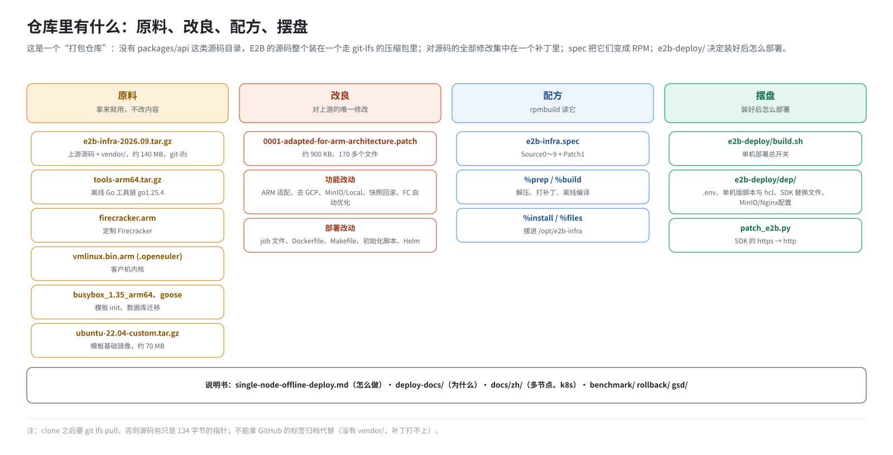

# 第 6 篇｜仓库里有什么：补丁、原料与配方

> **本篇目标**：进入第二部分，从第一步“下载仓库”开始。这个仓库和你平时见到的源码仓库不一样，它是一个“打包仓库”：里面几乎没有 E2B 的 Go 源码，而是放着上游源码包、一个补丁、一堆预编译文件和部署脚本。本篇先建立“原料、改良、配方、摆盘”的心智模型，再逐个过一遍仓库根目录的文件，说清楚每一个是什么、从哪来、谁会用到它。

---

## 一、先看一眼

`git clone` 下来后，仓库根目录大概是这样：

```
e2b-infra/
├── e2b-infra-2026.09.tar.gz              ← 上游源码包（git-lfs）
├── 0001-adapted-for-arm-architecture.patch ← ARM 补丁
├── e2b-infra.spec                         ← RPM 配方
├── tools-arm64.tar.gz / tools-amd64.tar.gz← 离线 Go 工具链
├── firecracker.arm                        ← 定制 Firecracker
├── vmlinux.bin.arm / .arm.openeuler / .x86← 客户机内核
├── busybox_1.35_arm64 (及备用版本)        ← 模板构建用的 busybox
├── goose_3.24.2_linux_arm64 / _x86        ← 数据库迁移工具
├── ubuntu-22.04-custom.tar.gz             ← 模板基础镜像
├── patch_e2b.py                           ← SDK 补丁脚本
├── e2b-deploy/                            ← 部署包（build.sh + dep/）
├── single-node-offline-deploy.md          ← 单机部署操作手册
├── deploy-docs/  docs/                    ← 部署原理文档、上游风格文档
├── benchmark/  rollback/  gsd/            ← 压测、快照回滚相关
└── README.md
```

注意里面**没有** `packages/api`、`packages/orchestrator` 这些源码目录。E2B 的源码整个装在第一行那个压缩包里。

---

## 二、心智模型：一道菜的四样东西



把“打 RPM”想象成做一道菜：

| 角色 | 仓库里对应的东西 | 说明 |
|---|---|---|
| **原料** | 上游源码包；预编译的 Firecracker、内核、busybox、goose；Go 工具链；基础镜像 | 拿来就用，本仓库不修改它们的内容 |
| **改良** | `0001-adapted-for-arm-architecture.patch` | 对上游源码的全部修改，集中在一个补丁里 |
| **配方** | `e2b-infra.spec` | 告诉 rpmbuild：先解压哪个、打什么补丁、怎么编译、成品摆哪里 |
| **摆盘** | `e2b-deploy/` | 菜做好之后怎么端上桌：部署脚本和配置 |

再加上一些“菜谱说明书”：各种文档。

---

## 三、原料

### 3.1 上游源码包

`e2b-infra-2026.09.tar.gz` 是上游 E2B 仓库 tag `2026.09` 的源码，约 140 MB（143753275 字节）。

它有两个特别之处。

**第一，它存在 git-lfs 里。** 大文件不适合直接放进 git，仓库用 git-lfs 管理它：

```
# .gitattributes
e2b-infra-2026.09.tar.gz filter=lfs diff=lfs merge=lfs -text

# .lfsconfig
[lfs]
    url = https://artlfs.openeuler.openatom.cn/src-openeuler/e2b-infra
```

LFS 服务器是 openEuler 的。如果 clone 时没装 git-lfs，或者访问不到这个服务器，你拿到的只是一个 134 字节的“指针文件”：

```
version https://git-lfs.github.com/spec/v1
oid sha256:59f05d43eb5d6e44759ab0e51f35d99d359698f9aeb97c61030f7f3ea8b95ea9
size 143753275
```

这时要从能访问的机器拷一份真文件过来，并用 `sha256sum` 对一下 oid。

**第二，它自带了全部 Go 依赖（`vendor/` 目录）。** Go 项目编译时通常要联网下载依赖。这个源码包把每个模块用到的依赖都放进了各自的 `vendor/` 目录，编译时加 `-mod=vendor` 就完全不需要网络。

所以**不能拿 GitHub 上的标签归档代替它**。部署文档里记了一次实测：上游已改名为 `e2b-dev/runtime`，它的 `2026.09` 标签归档：

- 只有 2.8 MB；
- 顶层目录名是 `runtime-2026.09/`；
- 没有任何 `vendor/`。

用它顶替，打补丁那一步就会失败，因为补丁本身也要修改 `vendor/` 下的文件。

### 3.2 离线 Go 工具链

`tools-arm64.tar.gz`（约 57 MB）解开是一个完整的 `go/` 目录，版本 go1.25.4。编译时把它设为 `GOROOT`，机器上不需要预装 Go。x86 版是 `tools-amd64.tar.gz`。

它在 spec 里没有写成 `SourceN`，而是在 `%prep` 里按架构直接解压（第 7 篇）。

### 3.3 预编译的运行时文件

| 文件 | 是什么 | 最终去向 |
|---|---|---|
| `firecracker.arm` | 定制版 Firecracker（约 2.6 MB，静态链接）。比官方版多了快照回滚需要的接口 | `/opt/e2b-infra/bin/firecracker` → `/fc-versions/v1.13.1/firecracker` |
| `vmlinux.bin.arm` | ARM 客户机内核，主用 | `bin/vmlinux.bin` → `/fc-kernels/vmlinux-6.1.158/` 等 |
| `vmlinux.bin.arm.openeuler` | openEuler 内核做的客户机内核，备用 | `bin/vmlinux.bin.openeuler` → `/fc-kernels/vmlinux-6.6.0-132.0.0/` |
| `vmlinux.bin.x86` | x86 客户机内核 | 只在 x86 打包时用 |
| `busybox_1.35_arm64` | glibc 版 busybox。上游用的 musl 版在鲲鹏上有兼容问题 | 编译前拷进 orchestrator 源码树，被嵌进二进制 |
| `goose_3.24.2_linux_*` | 数据库迁移工具 | `bin/goose` |

这里有一个值得注意的点：Firecracker 和内核这类“运行时文件”，上游是放在存储桶里、机器启动时下载的。本环境直接**打进 RPM**，部署时从 `/opt/e2b-infra/bin` 拷到位。这是“离线”的直接体现。

### 3.4 模板基础镜像

`ubuntu-22.04-custom.tar.gz`（约 70 MB）是一个 docker 镜像的导出文件。在 Ubuntu 22.04 的基础上加装了沙箱需要的工具（systemd、sudo、chrony、socat 等）。

建模板时，Dockerfile 的第一行 `FROM harbor:443/e2b-orchestration/ubuntu:22.04-custom` 指的就是它。部署时它会被 `docker load` 进来，再推进本机 Harbor（第 14 篇）。

### 3.5 SDK 补丁脚本

`patch_e2b.py` 把 Python SDK 里所有对外连接从 https 改成 http，因为本环境全程不用证书（第 11 篇）。

---

## 四、改良：一个补丁

`0001-adapted-for-arm-architecture.patch` 约 900 KB、两万多行，改了 170 多个文件（不算 `vendor/` 里的）。它是本仓库**对上游源码的唯一修改方式**。

它改的东西可以分成两大类：

| 类别 | 内容 | 本书是否涉及 |
|---|---|---|
| 功能改动 | ARM 适配；去掉 GCP 依赖；MinIO、Local 存储后端；快照回滚（checkpoint / restore）；Firecracker 启动优化；准入限流等 | 只在影响部署时提一句 |
| 部署改动 | Nomad job 文件；Dockerfile；Makefile；机器初始化脚本；Helm chart | 是本书重点（第 5 篇已列过清单） |

### 为什么用“源码包 + 补丁”，而不是直接 fork 改代码？

这是 Linux 发行版打包的传统做法，openEuler 的软件包也是这样组织的：

- **上游是什么、改了什么，一目了然。** 想知道“我们到底改了上游哪些地方”，看补丁就行。
- **跟进新版本时更清楚。** 换一个新的上游源码包，把补丁重新打一遍，冲突的地方就是需要重新适配的地方。
- **符合发行版的打包规范。** spec 里 `Source0` 加 `Patch1` 是标准写法。

代价是改代码的流程绕了一些：

1. 先把源码包解开、打上补丁，得到一个工作目录；
2. 在工作目录里改代码、编译、测试；
3. 改完再重新生成补丁文件，提交到仓库。

这个流程在第 19 篇讲“改了源码怎么生效”时会再提到。

---

## 五、配方：`e2b-infra.spec`

spec 文件约 200 行，是把上面所有原料变成一个 RPM 包的说明书。下一篇（第 7 篇）专门逐段精读，这里只看它怎么“点名”原料：

```spec
Source0:  ...#/%{name}-%{tag}.tar.gz        # 上游源码包
Source1:  busybox_1.35_arm64
Source2:  goose_3.24.2_linux_arm64
Source3:  goose_3.24.2_linux_x86
Source4:  vmlinux.bin.arm
Source5:  vmlinux.bin.x86
Source6:  vmlinux.bin.arm.openeuler
Source7:  patch_e2b.py
Source8:  firecracker.arm
Source9:  ubuntu-22.04-custom.tar.gz
Patch1:   0001-adapted-for-arm-architecture.patch
```

除了 Go 工具链和 `e2b-deploy/` 目录，根目录的每个原料都在这里有一个编号。

---

## 六、摆盘：`e2b-deploy/`

`e2b-deploy/` 是单机部署包，RPM 会把它整个铺进 `/opt/e2b-infra/`：

```
e2b-deploy/
├── build.sh            ← 单机部署的总开关（第三部分的主角）
├── build_prod.py       ← 建模板的示例脚本
└── dep/                ← 部署依赖与“覆盖”文件
    ├── .env                         全部配置
    ├── template-manager.hcl         改过的 job 文件
    ├── start-server.sh  start-client.sh  init-client.sh
    ├── run-nomad.sh  run-consul.sh  install-*.sh  uninstall-*.sh
    ├── deploy.sh
    ├── minio.service  minio.yml     MinIO 的 unit 和配置
    ├── nginx.conf  harbor.cnf       Nginx 配置、证书参数
    ├── daemon.json  default.hcl     docker、nomad 配置的参考样例
    ├── *.py                         替换进 SDK 的 5 个文件
    └── e2b-sdk-checkpoint/          快照回滚的 SDK 覆盖层
```

`dep/` 里有一批脚本和上游源码里的同名脚本重复，比如 `start-client.sh`、`init-client.sh`、`deploy.sh`。这不是冗余：`dep/` 里的是**为单机改过的版本**，部署时会覆盖上游版本。这层“覆盖”关系是理解整个部署的关键之一，第 8、11 篇详讲。

还有一些大文件没有提交进仓库，但部署前要手工放进 `dep/`：

- Harbor 离线安装包；
- MinIO 二进制；
- Nomad、Consul 的 zip。

这是“第 0 步”的一部分（第 8 篇）。

`e2b-deploy/` 的历史也值得一提：它以前是以一个约 70 MB 的 `e2b-deploy.tar.gz` 提交的，每改一行脚本就要重新打包，仓库因此越来越大。后来改成直接提交目录，压缩包也从 git 历史里清掉了。现在改部署脚本只要改目录里的文件、提交即可。

---

## 七、说明书和其他目录

| 路径 | 是什么 | 和部署的关系 |
|---|---|---|
| `single-node-offline-deploy.md` | 单机部署的操作手册：装机步骤、改动后怎么生效、故障排查 | 动手时照着做的“怎么做” |
| `deploy-docs/` | 单机部署原理文档，十几篇 | “为什么这么做”，本书的重要事实来源 |
| `docs/zh/` | 上游风格的中文文档：多节点、k8s 安装，SDK 用法 | 了解另外两种部署形态 |
| `README.md` | 项目介绍、多节点安装教程、依赖自建教程 | 概览 |
| `benchmark/` | 沙箱启动耗时压测脚本和分析 | 部署后做性能测试 |
| `rollback/` | 沙箱级快照回滚手册与验证工具 | 功能文档，和部署关系不大 |
| `gsd/` | 进程级快照回滚手册与验证工具 | 同上 |

本书和这些文档的分工：仓库里的文档面向“已经知道大概、要动手操作”的人，按操作顺序组织；本书面向新手，按理解顺序组织，把分散在各处的原理串起来。

---

## 八、第一步到底做了什么

回到“三步”里的第一步：

```bash
git clone https://github.com/AustinJiangg/e2b-infra.git
cd e2b-infra
git lfs pull            # 确保源码包是真文件，不是指针
```

做完这一步，你手里有了全部原料、补丁、配方和部署包。机器本身没有任何变化。

动手进入第二步之前，还有一件事要在仓库里做：**改 `e2b-deploy/dep/.env` 里的 `SERVER_IP`**，改成这台机器的 IP。原因是 spec 会把 `e2b-deploy/` 整个打进 RPM，装到 `/opt/e2b-infra/dep/.env`。在仓库里改好，装出来就是对的。第 7 篇会再强调这一点。

---

## 本篇小结

| 东西 | 角色 | 一句话 |
|---|---|---|
| `e2b-infra-2026.09.tar.gz` | 原料 | 上游源码，带 `vendor/`，走 git-lfs，不能用 GitHub 归档代替 |
| `tools-*.tar.gz` | 原料 | 离线 Go 工具链 go1.25.4 |
| `firecracker.arm`、`vmlinux.bin.*` | 原料 | 定制 Firecracker 和客户机内核，直接打进 RPM |
| `busybox`、`goose` | 原料 | 模板构建用的 init 工具、数据库迁移工具 |
| `ubuntu-22.04-custom.tar.gz` | 原料 | 模板基础镜像 |
| `0001-...patch` | 改良 | 对上游源码的唯一修改，功能改动 + 部署改动 |
| `e2b-infra.spec` | 配方 | 把原料和补丁变成 RPM |
| `e2b-deploy/` | 摆盘 | `build.sh` 和 `dep/`；`dep/` 会覆盖上游同名文件 |
| 第一步 | | clone + `git lfs pull`，再改好 `.env` 的 `SERVER_IP` |

**下一篇预告**：[《RPM 与 spec：一个包是怎么打出来的》](07-rpm-and-spec.md)。第二步的上半场：RPM 是什么、为什么用它；spec 文件逐段精读，看原料怎么在 `%prep`、`%build`、`%install`、`%files` 几个阶段里变成一个装到 `/opt/e2b-infra` 的包。
