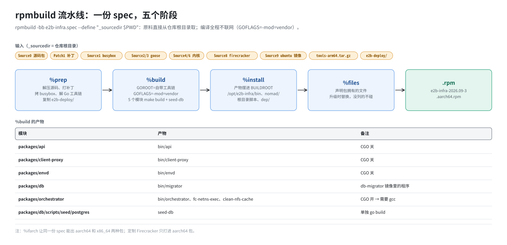

# 第 7 篇｜RPM 与 spec：一个包是怎么打出来的

> **本篇目标**：第二步的上半场。先讲 RPM 是什么、为什么这套部署选择用它交付；再把 `e2b-infra.spec` 从头到尾精读一遍，看原料在 `%prep`、`%build`、`%install`、`%files` 几个阶段里怎么一步步变成一个装到 `/opt/e2b-infra` 的包；最后给出第二步的实际命令和几个常见的坑。读完你能看懂 spec 里每一行，也能自己判断“改了某个东西要不要重新打包”。

---

## 一、RPM 是什么

### 1.1 软件包

在 Linux 上装软件，最原始的办法是把文件一个个拷到该去的位置。问题是：

- 装了哪些文件，过几个月就记不清了；
- 卸载时删不干净；
- 升级时不知道哪些该替换；
- 换一台机器还得重来一遍。

**软件包**把“一组文件 + 它们该放在哪 + 版本信息 + 装卸时要执行的动作”打成一个文件。包管理器负责安装、记账、卸载、升级。

openEuler、CentOS、Fedora 这一系发行版用的包格式叫 **RPM**，文件扩展名是 `.rpm`。日常用的 `yum`、`dnf` 在 RPM 之上加了“自动下载、自动解决依赖”的功能。

### 1.2 常用命令

```bash
rpm -ivh  xxx.rpm          # 安装（i=install，v=详细，h=进度条）
rpm -Uvh  xxx.rpm          # 升级（没装过则安装）
rpm -Uvh --force xxx.rpm   # 版本号相同也强制覆盖
rpm -e    e2b-infra        # 卸载
rpm -q    e2b-infra        # 查询是否已安装、什么版本
rpm -ql   e2b-infra        # 列出这个包装了哪些文件
rpm -qf   /opt/e2b-infra/build.sh   # 反查：这个文件属于哪个包
```

### 1.3 版本号的三段

一个 RPM 的全名形如：

```
e2b-infra-2026.09-3.aarch64.rpm
└─Name──┘ └Version┘ └Release┘ └架构┘
```

- **Name**：包名；
- **Version**：软件本身的版本，这里跟着上游 tag `2026.09`；
- **Release**：同一个软件版本被打包的第几次。上游版本没变、只是补丁或脚本改了，就把 Release 加一。

### 1.4 为什么这套部署用 RPM 交付

| 需要 | RPM 怎么满足 |
|---|---|
| 离线 | 一个 `.rpm` 文件拷过去就能装，不需要联网 |
| 一次交付 | 二进制、内核、Firecracker、脚本、job 模板、数据库迁移文件全在一个包里 |
| 版本可追踪 | `rpm -q` 一看就知道装的是哪一版 |
| 升级语义清楚 | 包里有的文件，升级时一律替换；包里没有的，永远不碰（后面会看到这点非常关键） |
| 符合 openEuler 习惯 | 发行版自己的软件也这样打包 |
| 多架构 | 同一个 spec 能打 aarch64 和 x86_64 两种包 |

---

## 二、怎么打包：rpmbuild 和 spec

打 RPM 用的工具是 `rpmbuild`，它读一个 **spec 文件**，按里面的说明一步步执行。spec 就是第 6 篇说的“配方”。



rpmbuild 在 `~/rpmbuild/` 下用几个固定目录：

| 目录 | 放什么 |
|---|---|
| `SOURCES/` | 原料：源码包、补丁、其他文件（本仓库用 `_sourcedir` 改成了仓库根目录，见后文） |
| `BUILD/` | 解压出来的源码，在这里打补丁、编译 |
| `BUILDROOT/` | 一个“假的根目录”，`%install` 把成品摆在这里，路径和真机一样 |
| `RPMS/<架构>/` | 打好的二进制 RPM |

spec 的主体是几个阶段，按顺序执行：

| 阶段 | 做什么 | 类比 |
|---|---|---|
| 头部 | 包名、版本、原料清单 | 菜名和食材表 |
| `%prep` | 解压源码、打补丁、摆好原料 | 洗菜切菜 |
| `%build` | 编译 | 下锅 |
| `%install` | 把成品摆进 `BUILDROOT` | 装盘 |
| `%files` | 声明包里有哪些文件 | 列出这盘菜包含什么 |
| `%changelog` | 历次修改记录 | 菜谱修订记录 |

下面逐段读 `e2b-infra.spec`。

---

## 三、spec 逐段精读

### 3.1 头部

```spec
%define debug_package %{nil}
%global tag 2026.09

Name:           e2b-infra
Version:        %{tag}
Release:        3
Summary:        E2B Infra – sandbox runtime (ARM-adapted)
License:        MIT
URL:            https://github.com/e2b-dev/infra
Source0:        https://github.com/e2b-dev/infra/archive/refs/tags/%{tag}.tar.gz#/%{name}-%{tag}.tar.gz
Source1:        busybox_1.35_arm64
...
Source9:        ubuntu-22.04-custom.tar.gz
Patch1:         0001-adapted-for-arm-architecture.patch

BuildRequires:  make
BuildRequires:  gcc
```

几个要点：

- `%define debug_package %{nil}`：不生成调试信息包，省时间和空间。
- `Source0` 写成了 GitHub 的地址，但末尾的 `#/%{name}-%{tag}.tar.gz` 表示“文件名就叫 `e2b-infra-2026.09.tar.gz`”。rpmbuild 不会去下载它，而是在原料目录里找这个文件名。实际用的是仓库里那个带 `vendor/` 的大源码包，**不是**这个地址能下到的东西（第 6 篇）。
- `Source1`～`Source9`、`Patch1` 和仓库根目录的文件一一对应。
- `BuildRequires` 是打包机需要预装的工具。注意这里没有 Go：Go 工具链是自带的。

### 3.2 `%prep`：洗菜切菜

```spec
%prep
%autosetup -p1 -n e2b-infra-%{tag}
cp %{SOURCE1} packages/orchestrator/internal/template/build/core/systeminit/
mkdir -p %{_builddir}/go-toolchain
%ifarch aarch64
    tar -xf %{_sourcedir}/tools-arm64.tar.gz -C %{_builddir}/go-toolchain
%endif
%ifarch x86_64
    tar -xf %{_sourcedir}/tools-amd64.tar.gz -C %{_builddir}/go-toolchain
%endif

rm -rf %{_builddir}/e2b-deploy
cp -a %{_sourcedir}/e2b-deploy %{_builddir}/e2b-deploy
cp %{SOURCE9} %{_builddir}/e2b-deploy/dep/
```

逐行看：

1. **`%autosetup -p1 -n e2b-infra-2026.09`**：一条宏做两件事：
   - 解压 `Source0`，进入解压出来的目录 `e2b-infra-2026.09/`；
   - 依次打上所有 `PatchN`。`-p1` 表示补丁里的路径要去掉第一层（`a/`、`b/` 前缀）。

   补丁打不上（源码和补丁对不上），这一步就会报 `Hunk #N FAILED` 并中止。

2. **拷 busybox**：把 glibc 版 busybox 放进 orchestrator 源码的 `systeminit/` 目录。编译时它会被嵌进 orchestrator 二进制，建模板时用作虚拟机第一次开机的 init。

3. **解压 Go 工具链**：用 `%ifarch` 按当前架构选择 arm64 或 amd64 版，解到 `go-toolchain/`。注意它用的是 `%{_sourcedir}` 路径直接引用，没有 `SourceN` 编号，所以这个文件**必须和其他原料放在同一个目录**。

4. **拷部署包**：把仓库里的 `e2b-deploy/` 整个拷过来，再把 `Source9`（ubuntu 基础镜像）放进它的 `dep/`。

`%ifarch` 是 spec 里的条件判断，后面还会多次出现。它让同一个 spec 既能在鲲鹏上打 aarch64 包，也能在 x86 机器上打 x86_64 包。

### 3.3 `%build`：下锅

```spec
%build
export GOROOT=%{_builddir}/go-toolchain/go
export PATH=$GOROOT/bin:$PATH
export GOFLAGS=-mod=vendor
rm -f go.work go.work.sum

pushd packages/db/scripts/seed/postgres
CGO_ENABLED=0 go build -o seed-db seed-db.go
popd

for d in packages/api packages/client-proxy \
         packages/envd packages/db \
         packages/orchestrator; do
    pushd $d
    make build
    popd
done
```

1. **设好 Go 环境**：
   - `GOROOT` 指向刚解压的工具链；
   - `GOFLAGS=-mod=vendor` 让所有 `go build` 只用 `vendor/` 里的依赖，**不联网**。
2. **删 `go.work`**：上游用 Go workspace 把多个模块串起来开发，但 workspace 模式和 `-mod=vendor` 冲突，删掉后每个模块各自用自己的 vendor。
3. **编译 seed-db**：`CGO_ENABLED=0` 表示纯 Go 编译，生成静态二进制，不依赖系统的 C 库。
4. **逐个模块 `make build`**：五个模块，每个模块的 Makefile 里写好了怎么编译。产物落在各自的 `bin/` 下：

| 模块 | 产物 |
|---|---|
| `packages/api` | `bin/api` |
| `packages/client-proxy` | `bin/client-proxy` |
| `packages/envd` | `bin/envd` |
| `packages/db` | `bin/migrator`（db-migrator 镜像里的程序） |
| `packages/orchestrator` | `bin/orchestrator`，以及辅助程序 `bin/fc-netns-exec`、`bin/clean-nfs-cache` |

orchestrator 是这几个里唯一用 `CGO_ENABLED=1` 编译的，要调用 C 编译器，这就是头部 `BuildRequires: gcc` 的原因。

这一步是整个打包里最耗时的，几分钟到十几分钟不等。

### 3.4 `%install`：装盘

`%install` 把成品摆进 `%{buildroot}`，路径和最终装到真机上的路径一致。核心几段：

```spec
# 所有模块的编译产物 → /opt/e2b-infra/bin/
install -D -m 755 packages/db/scripts/seed/postgres/seed-db %{buildroot}/opt/e2b-infra/bin/seed-db
for exe in packages/*/bin/*; do
    install -D -m 755 "$exe" %{buildroot}/opt/e2b-infra/bin/$(basename "$exe")
done

# 各模块的 Dockerfile → bin/<模块>.Dockerfile（db 的改名为 db-migrator.Dockerfile）

# 上游的 Nomad job 模板 → /opt/e2b-infra/nomad/
for hcl in iac/provider-gcp/nomad/jobs/*.hcl; do
    install -D -m 644 "$hcl" %{buildroot}/opt/e2b-infra/nomad/$(basename "$hcl")
done

# 上游的运维脚本 → 扁平放到 /opt/e2b-infra/ 根下
install -D -m 755 ./iac/provider-gcp/nomad-cluster/scripts/start-client.sh %{buildroot}/opt/e2b-infra/start-client.sh
install -D -m 755 ./.github/actions/host-init/init-client.sh            %{buildroot}/opt/e2b-infra/init-client.sh
install -D -m 755 ./iac/provider-gcp/nomad/jobs/deploy.sh               %{buildroot}/opt/e2b-infra/deploy.sh
...

# 数据库迁移文件
cp -a ./packages/db/migrations %{buildroot}/opt/e2b-infra/bin/migrations

# 部署包整个铺进去
cp -rp %{_builddir}/e2b-deploy/* %{buildroot}/opt/e2b-infra/

# 按架构放 goose、内核、Firecracker
%ifarch aarch64
    install -D -m 755 %{SOURCE4} %{buildroot}/opt/e2b-infra/bin/vmlinux.bin
    install -D -m 755 %{SOURCE6} %{buildroot}/opt/e2b-infra/bin/vmlinux.bin.openeuler
    install -D -m 755 %{SOURCE8} %{buildroot}/opt/e2b-infra/bin/firecracker
%endif

install -D -m 755 %{SOURCE7} %{buildroot}/opt/e2b-infra/patch_e2b.py
cp -rp helm %{buildroot}/opt/e2b-infra/
```

`install -D -m 755 源 目标` 等于“建好目标所在的目录，拷过去，权限设为 755”。

这一段有两个值得留意的地方：

**一是“同名不同源”。** 根目录的 `start-client.sh`、`init-client.sh`、`deploy.sh` 来自上游源码（打过补丁），而 `cp -rp e2b-deploy/*` 又把 `dep/start-client.sh` 等放进 `/opt/e2b-infra/dep/`。于是装好之后，同一个脚本有两份：根目录一份上游版，`dep/` 下一份单机版。谁覆盖谁，第 8、11 篇讲。

**二是 Firecracker 只在 aarch64 包里有。** x86 包不带定制 Firecracker，所以 x86 机器上的 `init-client.sh` 会因为找不到它而报错。本仓库的部署实际只面向 ARM。

`%install` 怎样把每个文件放到 `/opt/e2b-infra` 的哪里，第 8 篇有一张完整的对照表。

### 3.5 `%files`：声明“这些归我管”

```spec
%files
%license LICENSE
%doc README.md

/opt/e2b-infra/bin/*
/opt/e2b-infra/start-client.sh
/opt/e2b-infra/init-client.sh
/opt/e2b-infra/deploy.sh
...
/opt/e2b-infra/nomad/*.hcl
/opt/e2b-infra/helm/*
/opt/e2b-infra/build.sh
/opt/e2b-infra/*.py
/opt/e2b-infra/dep/*
/opt/e2b-infra/dep/.env
%ifarch aarch64
/opt/e2b-infra/bin/firecracker
%endif
```

`%files` 列出这个包“拥有”的文件。它决定了两件事：

1. **什么会被打进包里**：`BUILDROOT` 里有、但 `%files` 没列的文件，rpmbuild 会报错。
2. **升级和卸载时动哪些文件**：
   - 列了的，`rpm -Uvh` 时一律用新包的内容替换，`rpm -e` 时删除；
   - 没列的，RPM 永远不碰。

第二点对后面的运维至关重要，这里先列个表，第 19 篇会反复用到：

| 在 `%files` 里（升级会被替换） | 不在 `%files` 里（升级不动） |
|---|---|
| `/opt/e2b-infra/bin/*`：所有二进制 | `/opt/e2b-infra/.env`：根目录这份（由 `build.sh -i` 从 `dep/.env` 拷来） |
| `/opt/e2b-infra/nomad/*.hcl`：job 模板 | `/opt/e2b-infra/rendered/`：渲染出来的 job |
| 根目录的 `deploy.sh`、`start-*.sh` 等脚本 | `/opt/e2b-infra/harbor/`：Harbor 安装目录 |
| `/opt/e2b-infra/dep/*`（含 `dep/.env`） | `/usr/bin/orchestrator`、`/usr/bin/template-manager` |
| `build.sh`、`*.py`、`helm/*` | `/etc`、`/data/nomad`、`/opt/consul` 等系统位置 |

左边一列有一个隐患：**升级 RPM 后，根目录的 `deploy.sh`、`nomad/template-manager.hcl` 等会被换回上游版**，`-i` 当初用 `dep/` 盖上去的单机版就丢了。这就是为什么升级后要“重放覆盖”（第 19 篇）。

### 3.6 `%changelog`

```spec
%changelog
* Fri Apr 24 2026 fly_1997 <...> - 2026.09-3
- add auto-deploy

* Fri Mar 27 2026 zhourenjian <...> - 2026.09-2
- adapt for 2026.09

* Sun Dec 07 2025 zhourenjian <...> - 2025.36-1
- Adapt E2B to the arm64 architecture, remove its dependency on GCP,
  and add a one-click local installation script. ...
```

从下往上读，就是这个包的演进史：

1. 2025 年底：基于上游 `2025.36` 做 ARM 适配，去掉 GCP 依赖，加入本地一键安装脚本，用 dnsmasq 替换 systemd-resolved，换用 glibc 版 busybox；
2. 2026 年 3 月：跟进到上游 `2026.09`；
3. 2026 年 4 月：加入自动部署（`build.sh` 这一套）。

每次发新包，在最上面加一条，并把 `Release` 加一。

---

## 四、第二步的实际命令

```bash
cd e2b-infra                        # 仓库根目录

# 0) 确认源码包是真文件
ls -l e2b-infra-2026.09.tar.gz      # 应约 143 MB，不是 134 字节

# 1) 改 SERVER_IP（必须在打包之前）
sed -i "s/^SERVER_IP=.*/SERVER_IP=192.168.10.23/" e2b-deploy/dep/.env

# 2) 打包
rpmbuild -bb e2b-infra.spec --define "_sourcedir $PWD"

# 3) 安装
rpm -ivh ~/rpmbuild/RPMS/aarch64/e2b-infra-2026.09-3.aarch64.rpm
```

几个参数的含义：

- `-bb`：只打二进制包（binary），不打源码包。
- `--define "_sourcedir $PWD"`：告诉 rpmbuild“原料就在当前目录”，不用把文件一个个拷进 `~/rpmbuild/SOURCES/`。

**为什么改 `SERVER_IP` 要在打包之前？** 因为 `e2b-deploy/` 是在 `%prep` 时整个拷进包里的。装出来的 `/opt/e2b-infra/dep/.env` 就是你打包时仓库里的那份。打包后再改，就得去部署机上改 `/opt/e2b-infra/dep/.env`，而这份文件下次升级 RPM 又会被换回仓库里的版本。

也可以在一台有 rpmbuild 的机器上打好包，再把 `.rpm` 拷到目标机安装。

---

## 五、装完怎么验收

```bash
rpm -q e2b-infra
# e2b-infra-2026.09-3.aarch64

ls /opt/e2b-infra/bin/
# api  client-proxy  envd  orchestrator  fc-netns-exec  seed-db  goose
# vmlinux.bin  vmlinux.bin.openeuler  firecracker
# api.Dockerfile  client-proxy.Dockerfile  db-migrator.Dockerfile  orchestrator.Dockerfile
# migrations/  migrations-clickhouse/  ...
```

缺任何一个都说明包有问题。其中 `fc-netns-exec` 是补丁里带进来的 Firecracker 启动辅助程序。缺了它，沙箱启动时会报 `exit status 127`（找不到命令）。

此时 `/opt/e2b-infra` 已经装满了东西，但**机器本身还没有任何变化**：

- 没有新进程；
- 没改任何系统配置；
- `/usr/bin` 里也还没有 orchestrator。

这些都是第三步的事。

---

## 六、常见的坑

| 现象 | 原因 | 办法 |
|---|---|---|
| `Bad source`，或 tar 报“不是 gzip 格式” | 源码包还是 134 字节的 LFS 指针 | `git lfs pull`，或从别的机器拷真文件 |
| `%prep` 阶段 `Hunk #N FAILED` | 补丁和源码包对不上：用错了源码包，或补丁是手工改坏的 | 换回正确的源码包；补丁按正规流程重新生成 |
| `cannot find module providing package ...` | `vendor/` 不全 | 源码包不对，或补丁新增了依赖却没带上 vendor |
| `tools-arm64.tar.gz: No such file` | 工具链不在 `_sourcedir` 指定的目录 | 在仓库根目录执行 rpmbuild |
| 安装时 `package ... is already installed` | 同一个 Release 重复安装 | 用 `rpm -Uvh --force` |
| 安装时 `file ... conflicts with file from package ...` | 用了 `e2b-infra-*.rpm` 通配符，把 `RPMS/` 里的旧包一起匹配进来 | 写明确的文件名 |

---

## 本篇小结

| 概念 | 一句话解释 |
|---|---|
| RPM | openEuler 的软件包格式；一个文件，记账、可升级、离线可装 |
| Version / Release | 上游版本 `2026.09` / 第几次打包 `3` |
| spec | 打包配方：头部、`%prep`、`%build`、`%install`、`%files`、`%changelog` |
| `%autosetup -p1` | 解压源码包并打上补丁 |
| `%ifarch` | 按架构分支，同一 spec 出 aarch64 和 x86_64 包 |
| `GOFLAGS=-mod=vendor` | 只用源码包自带的依赖，编译全程不联网 |
| `make build` × 5 | api、client-proxy、envd、db、orchestrator |
| `%files` | 包拥有的文件；升级时替换，没列的永远不碰 |
| `_sourcedir $PWD` | 原料直接从仓库根目录取 |
| 先改 `.env` 再打包 | `e2b-deploy/` 打包时整个进 RPM |

**下一篇预告**：[《装好之后的 `/opt/e2b-infra`，以及动手前机器要备好什么》](08-opt-layout-and-prerequisites.md)。看看包装出来的目录里每个文件从哪来，理解“RPM 底座 + `dep/` 覆盖”这两层；再把执行 `build.sh` 之前、机器必须自己准备好的东西逐一列出来：Docker、nbd 模块、IP 转发、SELinux、DNS、离线安装包。
