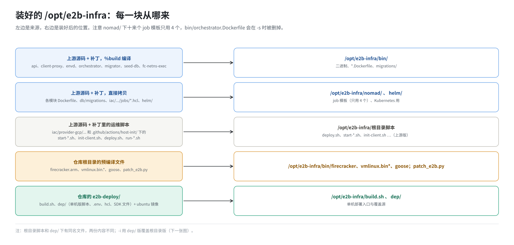
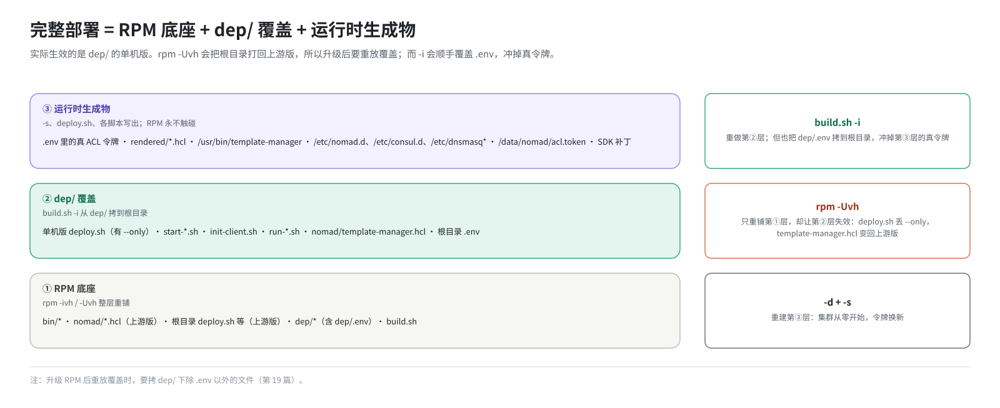
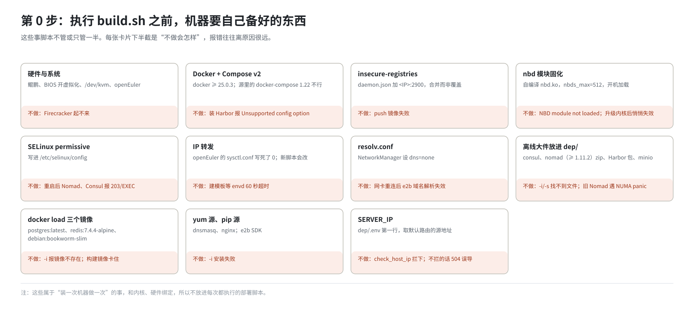

# 第 8 篇｜装好之后的 `/opt/e2b-infra`，以及动手前机器要备好什么

> **本篇目标**：第二步的下半场。先把 RPM 装出来的 `/opt/e2b-infra` 逐个目录看一遍，每个文件都追到它在 spec 里的来源；然后讲这套部署最重要的结构之一：“RPM 底座 + `dep/` 覆盖”两层，以及它带来的后果。后半篇列出执行 `build.sh` 之前、机器必须自己准备好的东西，也就是“第 0 步”。这些事脚本不管，漏掉任何一样，后面都会以奇怪的方式失败。

---

## 一、`/opt/e2b-infra` 长什么样



装完 RPM 后：

```
/opt/e2b-infra/
├── bin/
│   ├── api  client-proxy  envd  orchestrator  migrator  seed-db  goose
│   ├── fc-netns-exec  clean-nfs-cache
│   ├── firecracker  vmlinux.bin  vmlinux.bin.openeuler
│   ├── api.Dockerfile  client-proxy.Dockerfile  db-migrator.Dockerfile  orchestrator.Dockerfile
│   ├── migrations/  migrations-clickhouse/
├── nomad/                        ← 上游（+补丁）的 job 模板
│   ├── api.hcl  edge.hcl  redis.hcl  template-manager.hcl  orchestrator.hcl
│   └── clickhouse.hcl  loki.hcl  otel-collector.hcl  logs-collector.hcl ...
├── deploy.sh  start-server.sh  start-client.sh  init-client.sh   ← 上游版脚本
├── run-nomad.sh  run-consul.sh  install-*.sh  uninstall-*.sh  start-api.sh
├── nomad.service  env.template
├── helm/                         ← Kubernetes 形态用
├── patch_e2b.py
├── build.sh  build_prod.py       ← 来自 e2b-deploy/
└── dep/                          ← 来自 e2b-deploy/dep/
    ├── .env  template-manager.hcl  deploy.sh  start-*.sh  init-client.sh ...
    └── ubuntu-22.04-custom.tar.gz
```

每一块的来源：

| 路径 | spec 里的来源 | 原始位置 |
|---|---|---|
| `bin/` 下的二进制 | `%build` 编译，`%install` 拷入 | 上游源码各模块的 `bin/` |
| `bin/*.Dockerfile` | `%install` 拷入并改名 | 各模块的 `Dockerfile`（补丁改过） |
| `bin/migrations/` | `%install` 拷入 | `packages/db/migrations` |
| `bin/firecracker`、`vmlinux.bin*`、`goose` | `%install` 按架构拷入 | 仓库根目录的预编译文件 |
| `nomad/*.hcl` | `%install` 遍历拷入 | `iac/provider-gcp/nomad/jobs/`（补丁改过） |
| 根目录的 `deploy.sh`、`start-*.sh` 等 | `%install` 逐个拷入 | `iac/provider-gcp/...`、`.github/actions/host-init/` |
| `helm/` | `%install` 拷入 | 上游源码的 `helm/`（补丁改过） |
| `patch_e2b.py` | `Source7` | 仓库根目录 |
| `build.sh`、`dep/` | `%prep` 拷 `e2b-deploy/`，`%install` 铺入 | 仓库的 `e2b-deploy/` |

这里有几个容易困惑的点：

- **`nomad/` 下有十来个 job 模板，但只会用到 4 个**：`redis`、`template-manager`、`edge`、`api`。其余的（clickhouse、loki 等）随上游一起装进来，`deploy.sh` 不提交它们。
- **`nomad/orchestrator.hcl` 也不用**。orchestrator 的角色由 `template-manager.hcl` 里那个进程兼任（第 2 篇）。
- **`bin/orchestrator.Dockerfile` 会被删掉**。`build.sh -s` 在构建镜像前把它删了，因为 orchestrator 不进容器（第 14 篇）。

---

## 二、两层结构：RPM 底座 + `dep/` 覆盖

### 2.1 同一个脚本，两份

对比一下根目录和 `dep/`：

| 根目录（上游版） | `dep/`（单机版） |
|---|---|
| `deploy.sh` | `dep/deploy.sh` |
| `start-server.sh`、`start-client.sh` | `dep/start-server.sh`、`dep/start-client.sh` |
| `init-client.sh` | `dep/init-client.sh` |
| `run-nomad.sh`、`run-consul.sh` | `dep/run-nomad.sh`、`dep/run-consul.sh` |
| `install-*.sh`、`uninstall-*.sh` | `dep/install-*.sh`、`dep/uninstall-*.sh` |
| `nomad/template-manager.hcl` | `dep/template-manager.hcl` |
| `env.template` | `dep/.env` |

左边一列是上游脚本加上补丁的版本，按多节点集群的思路写的。右边一列是在左边基础上**专门为单机修改**的版本，比如：

- `dep/deploy.sh` 多了 `--only` 参数，可以只重跑一个 job；
- `dep/init-client.sh` 多了打开 IP 转发、大页上限等处理；
- `dep/run-nomad.sh` 能找回已经存过的 ACL 令牌；
- `dep/template-manager.hcl` 写死了 `STORAGE_PROVIDER = "Local"` 和一批单机用的环境变量。

### 2.2 谁覆盖谁

`build.sh -i` 里有一段，把右边一列逐个拷到左边的位置：

```bash
cp -fv "$DEP_DIR/.env"                 "$E2B_DIR/.env"
cp -fv "$DEP_DIR/template-manager.hcl" "$E2B_DIR/nomad/template-manager.hcl"
cp -fv "$DEP_DIR/start-client.sh"      "$E2B_DIR/start-client.sh"
cp -fv $DEP_DIR/start-server.sh        $E2B_DIR/start-server.sh
cp -fv $DEP_DIR/init-client.sh         $E2B_DIR/init-client.sh
cp -fv $DEP_DIR/run-nomad.sh           $E2B_DIR/run-nomad.sh
cp -fv $DEP_DIR/run-consul.sh          $E2B_DIR/run-consul.sh
cp -fv $DEP_DIR/deploy.sh              $E2B_DIR/deploy.sh
```

`-i` 之后，根目录的这些文件就变成了单机版。`-s` 执行的是根目录的文件，所以实际生效的是 `dep/` 那一份。



### 2.3 为什么要这样设计

直接改上游脚本、不要 `dep/` 不行吗？可以，但要改补丁。这个设计的考虑是：

- **补丁只管“上游能接受的修改”**：去掉 GCP 依赖、ARM 适配这类，多节点和 Kubernetes 形态也要用。
- **单机特有的东西放在 `dep/`**：改起来不用重新生成补丁，直接改目录、提交即可。

### 2.4 代价：升级后要重放

第 7 篇讲过，`%files` 里列出的文件在 `rpm -Uvh` 时会被新包内容替换。根目录的 `deploy.sh`、`nomad/template-manager.hcl` 等都在 `%files` 里。于是：

1. 第一次部署：RPM 铺上游版 → `-i` 盖上单机版 → 一切正常；
2. 改了 Go 源码，重新打包，`rpm -Uvh --force` 升级 → **根目录又变回上游版**；
3. 这时直接 `build.sh -r template-manager`（只重跑一个 job），用的是上游版的 `deploy.sh`，它不认识 `--only` 参数，报 `Unknown parameter`。

所以升级 RPM 之后，要把覆盖重新做一遍。但不能简单地重跑 `-i`，因为 `-i` 也会把 `dep/.env` 拷到根目录，而根目录的 `.env` 里此时存着真实的 Nomad 令牌，一盖就没了。正确做法是只拷除 `.env` 以外的文件（第 19 篇）。

### 2.5 第三层：运行时生成的东西

严格说，部署好的机器上还有第三层：脚本运行时生成、RPM 和 `dep/` 都不管的东西：

| 东西 | 谁生成 | 在哪 |
|---|---|---|
| 真实的 ACL 令牌 | `-s` 里的 `run-nomad.sh`、`run-consul.sh` | 根目录 `.env`、`/data/nomad/acl.token`、`/opt/consul/acl.token` |
| 渲染好的 job | `deploy.sh` | `/opt/e2b-infra/rendered/` |
| Harbor 安装目录 | `-i` 解压，`-s` 安装 | `/opt/e2b-infra/harbor/` |
| orchestrator 的“安装位置” | `start-client.sh` | `/usr/bin/orchestrator`、`/usr/bin/template-manager` |
| 系统配置 | 各个脚本 | `/etc/nomad.d`、`/etc/consul.d`、`/etc/dnsmasq.conf`、`/etc/sysctl.conf`、`/etc/hosts` 等 |

这三层合起来，才是一套完整的部署：

```
完整部署 = RPM 底座 + dep/ 覆盖 + 运行时生成物
```

第 19 篇讲“改了东西怎么生效”时，会用这个模型判断每种改动要动哪一层。

---

## 三、第 0 步：机器要自己备好的东西



下面这些事 `build.sh` 不做，或者只做了一半。按“不做会怎样”的严重程度排列。

### 3.1 硬件和系统

- **鲲鹏 ARM CPU**，BIOS 里打开虚拟化。检查：`ls /dev/kvm` 要存在。
- **openEuler**（本环境是 24.03）。
- **内存**：越大越好。客户机内存全部用大页，大页从物理内存里预留（第 13 篇）。
- **磁盘**：建议 200 GB 以上，镜像、模板缓存都要占地方。

### 3.2 Docker：自己装，而且要带 Compose v2

`build.sh` 里本来有一个 `install_docker` 函数，但在 `install()` 里被注释掉了。**docker 由你自己安装维护**，要求：

```bash
docker --version          # >= 25.0.3
runc --version            # >= 1.0.2
docker compose version    # 必须是 Compose v2 插件
```

最后一条是个坑。openEuler 24.03 的软件源里有一个 `docker-compose`，版本是 1.22（2018 年的）。它能通过 Harbor 安装脚本的版本检查，却解析不了 Harbor 2.13 生成的配置文件，`build.sh -s` 装 Harbor 时会报：

```
The Compose file './docker-compose.yml' is invalid because:
Unsupported config option for services: 'core'
```

要装 Compose v2：从 docker/compose 的发布页下载 `docker-compose-linux-aarch64`，放到 `/usr/libexec/docker/cli-plugins/docker-compose`。

还要把本机 Harbor 加进 docker 的 `insecure-registries`，让 docker 能用明文 HTTP 推拉镜像（第 3 篇）：

```json
// /etc/docker/daemon.json，合并进去，不要整个覆盖
{
  "insecure-registries": ["192.168.10.23:2900"]
}
```

改完 `systemctl restart docker`。注意这会重启机器上现有的所有容器。

仓库里的 `dep/daemon.json` 只是样例。它除了 `insecure-registries` 还带了五个国内镜像加速地址，在只能通过代理上网的机器上这些地址连不通，`docker pull` 会一个个去试，表现为长时间卡住、不报错。

### 3.3 nbd 内核模块：一次性固化

每个运行中的沙箱需要一块 NBD 虚拟硬盘（第 2 篇）。NBD 设备由内核模块 `nbd` 提供，数量由模块参数 `nbds_max` 决定，内核默认只有 16 个。

这套环境用的是**自己编译的优化版 nbd 模块**，要求 `nbds_max=512`。部署脚本不加载它，需要你一次性固化到系统里，之后每次开机自动加载：

```bash
# 1. 确认模块和当前内核版本一致
modinfo nbd.ko | grep vermagic        # 要和 uname -r 完全一致

# 2. 替换系统自带的模块（先备份）
cp /lib/modules/$(uname -r)/kernel/drivers/block/nbd.ko{,.orig}
cp nbd.ko /lib/modules/$(uname -r)/kernel/drivers/block/nbd.ko
depmod -a

# 3. 开机自动加载，并带上参数
echo nbd                          > /etc/modules-load.d/nbd.conf
echo "options nbd nbds_max=512"   > /etc/modprobe.d/nbd.conf
modprobe nbd
```

验证：

```bash
cat /sys/module/nbd/parameters/nbds_max   # 512
ls /dev/nbd* | wc -l                      # 512
```

几个注意点：

- **没有优化版模块时**，可以只做第 3 步，用内核自带的模块，功能上能跑。
- **模块不加载**，orchestrator 启动时报 `NBD module not loaded`，直接起不来。
- **升级内核后固化会悄悄失效**：新内核目录里是发行版原版模块，开机照样加载、数量照样是 512，表面上看不出来。升级内核后要用 `sha256sum` 核对，并在新内核上重新编译、重新替换。
- **`nbds_max` 就是单机同时运行沙箱数的上限之一**。

为什么部署脚本不做这件事？因为它和内核版本绑定，属于“装一次机器做一次”的事，不属于“每次部署都做”的事。

### 3.4 SELinux：持久设为 permissive

`build.sh -i` 会执行 `setenforce 0`，但这只在本次开机内有效。机器重启后 SELinux 回到 enforcing，Nomad 和 Consul 会因为二进制文件的安全标签不对而起不来（systemd 报 `203/EXEC`）。

专门跑沙箱的机器，直接持久化：

```bash
setenforce 0
sed -i 's/^SELINUX=enforcing/SELINUX=permissive/' /etc/selinux/config
```

permissive 是“只记录、不拦截”。不要改成 disabled，那样以后想再打开，要给整个文件系统重新打标签。

### 3.5 IP 转发：现在脚本会处理，但要知道这个坑

沙箱的网络包要在宿主机的几块虚拟网卡之间转发，必须打开 `net.ipv4.ip_forward`。openEuler 24.03 自带的 `/etc/sysctl.conf` 里**写死了 `net.ipv4.ip_forward=0`**。

现在的 `init-client.sh` 会改掉这一行并立即生效（第 13 篇）。如果你用的是更早的脚本，或者手工部署，必须在 `build.sh -s` 之前自己改。否则症状非常有迷惑性：

- 部署全部成功，四个 job 都在跑；
- 建模板时却在“等 envd 就绪”那一步 60 秒超时，报 `build was cancelled`。

### 3.6 `/etc/resolv.conf` 和 NetworkManager

部署脚本会把 `nameserver 127.0.0.1` 写到 `/etc/resolv.conf` 第一行，让所有 DNS 查询先经过本机 dnsmasq（第 4 篇）。文件不存在也没关系，脚本会建一个。

要注意的是 NetworkManager：如果它在管这个文件，网卡重连时会把文件重写掉，E2B 的域名解析就失效了，要等下次 `build.sh -s` 才恢复。可以让它别管 DNS：

```bash
printf '[main]\ndns=none\n' > /etc/NetworkManager/conf.d/90-dns-none.conf
systemctl reload NetworkManager
```

### 3.7 离线大件：放进 `/opt/e2b-infra/dep/`

几个体积大、没有提交进仓库的安装包，要在有网的机器上下载好，拷到 `dep/`。**文件名必须完全一致**，脚本是按名字找的：

| 文件 | 用途 | 来源说明 |
|---|---|---|
| `consul_1.21.4_linux_arm64.zip` | Consul | HashiCorp 官方发布站 |
| `nomad_1.11.2_linux_arm64.zip` | Nomad。**至少 1.11.2** | 同上 |
| `harbor-offline-installer-aarch64-v2.13.0.tgz` | Harbor 离线安装包 | 官方不发 ARM 版，用社区项目 wise2c-devops/build-harbor-aarch64 的构建 |
| `minio` | MinIO 二进制 | 官方下载站已失效，从 quay.io 的 arm64 镜像里取出来 |

Nomad 版本为什么至少 1.11.2？1.10.x 在 NUMA 节点编号不连续的机器上（例如开了某些内存特性的鲲鹏，节点编号是 0-3、10、19）一启动就崩溃（`panic: index out of range`），`build.sh -s` 会卡在等待 4646 端口。

### 3.8 docker 镜像：提前 `docker load`

三个镜像要提前在有网的机器上 `docker save` 导出，拷过来 `docker load`：

| 镜像 | 谁用它 |
|---|---|
| `postgres:latest` | `build.sh -i` 启动 PostgreSQL |
| `redis:7.4.4-alpine` | `deploy.sh` 推进 Harbor，给 redis job 用 |
| `debian:bookworm-slim` | `deploy.sh` 构建 api、client-proxy、db-migrator 镜像时的基础镜像 |

这三个是**最容易漏的**。脚本里的标签是写死的，名字不一样也不行：

```bash
for t in postgres:latest redis:7.4.4-alpine debian:bookworm-slim; do
  docker image inspect "$t" >/dev/null 2>&1 && echo "OK  $t" || echo "缺失 $t"
done
```

模板基础镜像 `ubuntu-22.04-custom.tar.gz` 不用管，RPM 已经把它放进 `dep/` 了，`build.sh -s` 会自动 load 和推送。

### 3.9 软件源：yum 和 pip

这套部署不是百分之百离线。有两处要一个可用的软件源（在线源或内网镜像源）：

- `build.sh -i` 执行 `yum install`：dnsmasq、nginx、curl、unzip、jq、tar、rsync；
- `build.sh -i` 执行 `pip install`：`e2b==2.20.0`、`e2b_code_interpreter==2.4.1`、`python-dotenv`。

### 3.10 `.env` 里的 `SERVER_IP`

最后，也是最重要的一项：`/opt/e2b-infra/dep/.env` 的第一行

```bash
SERVER_IP=192.168.10.23
```

必须是本机的实际 IP。Harbor 地址、镜像仓库地址、Nomad 地址全都由它推出来。第 7 篇建议在打包前就在仓库里改好，打包后改就改 `/opt/e2b-infra/dep/.env`。

怎么取本机 IP？用默认路由的源地址：

```bash
ip route get 1.1.1.1 | awk '{for(i=1;i<=NF;i++) if($i=="src") print $(i+1)}'
```

不要用 `hostname -I` 的第一个地址：机器上有残留的沙箱网卡时，它可能返回一个 `10.x` 的沙箱地址。

`build.sh -i` 一开头的 `check_host_ip` 会检查 `SERVER_IP` 是不是本机网卡上的地址，不是就直接退出。之所以要这样提前拦截，是因为配错时的报错极具误导性：各组件的健康检查会把请求发到别的机器，如果机器配了 HTTP 代理，还会收到代理返回的 504，让人以为是网络问题。

---

## 四、同机还有别的沙箱系统时

如果这台机器上已经跑着 AgentENV 之类的沙箱系统，要特别小心。它的网络设计和上游 E2B 几乎一样：

- 网卡都叫 `veth-<n>`；
- 地址池都是 `10.11/10.12`。

默认配置下两边会互相打坏。本仓库已经在 E2B 一侧做了避让：

- 网卡改名为 `e2bv-<n>`；
- 地址池改为 `10.13/10.14`；
- 清理脚本只认自己的名字和地址；
- 80 端口的转发规则只接管目的地址是本机的流量。

部署前要确认这两个地址段在本机和内网都没人用。细节在仓库的 `deploy-docs/13-与AgentENV同机部署.md`，网络原理见《E2B 沙箱网络从零讲透》。

---

## 本篇小结

| 概念 | 一句话解释 |
|---|---|
| `bin/` | 编译产物、Dockerfile、迁移文件、内核、Firecracker |
| `nomad/` | 上游 job 模板，十来个，只用 4 个 |
| `dep/` | 单机版脚本和配置，`-i` 时覆盖到根目录 |
| 两层结构 | RPM 铺上游版，`-i` 盖单机版；实际生效的是 `dep/` 那份 |
| 升级的代价 | `rpm -Uvh` 把根目录换回上游版，要重放覆盖，但不能盖 `.env` |
| 第三层 | 令牌、`rendered/`、`/usr/bin`、`/etc` 下的配置，运行时生成 |
| Docker | 自备，带 Compose v2，配 `insecure-registries` |
| nbd | 自编译模块，`nbds_max=512`，一次性固化；升级内核要重做 |
| SELinux | 持久设为 permissive |
| IP 转发 | openEuler 默认写死 0；新脚本会改，老脚本要手工改 |
| 离线大件 | Consul、Nomad（≥1.11.2）、Harbor、MinIO 放进 `dep/` |
| 离线镜像 | postgres、redis、debian:bookworm-slim 先 `docker load` |
| 软件源 | `yum`、`pip` 要能用 |
| `SERVER_IP` | 必须是本机 IP，`check_host_ip` 会拦 |

**下一篇预告**：[《`build.sh` 总览：一个脚本，几种模式》](09-build-sh-overview.md)。进入第三部分。先从高处看 `build.sh`：它有哪些参数，每个模式调用了哪些函数和子脚本，贯穿其中的两条设计原则，以及哪些改动会在重启后消失。
