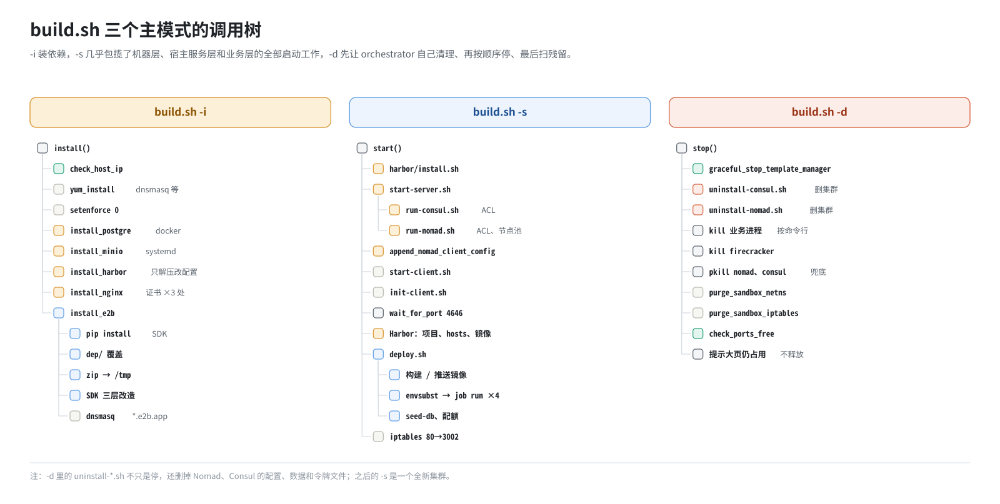
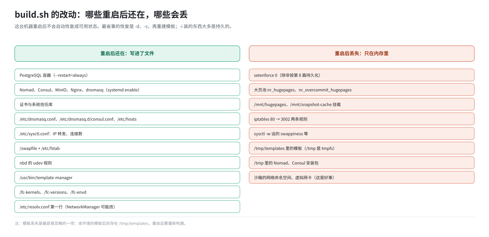

# 第 9 篇｜`build.sh` 总览：一个脚本，几种模式

> **本篇目标**：进入第三部分。先从高处看 `build.sh`：它在整个部署里是什么角色；有哪些参数，各自做什么；三个主模式 `-i`、`-s`、`-d` 分别调用了哪些函数和子脚本；脚本里反复出现的两条设计原则；哪些改动写进了文件、重启还在，哪些只写进了内存、重启就没了。后面七篇逐段展开时，你可以随时回到这一篇的调用树找位置。

---

## 一、它是什么

`/opt/e2b-infra/build.sh` 约 1300 行，是单机部署的总开关。

第 5 篇说过，单机部署其实是把多节点部署的步骤串起来，在同一台机器上执行，再补上依赖的安装。`build.sh` 就是那根“串起来的线”：

- 它自己做一部分事：装依赖、加 iptables 规则、清理残留；
- 更多的事交给子脚本：`start-server.sh`、`start-client.sh`、`init-client.sh`、`deploy.sh`。

一开头它读取配置：

```bash
WORK_DIR=$(cd $(dirname "$0") && pwd)     # /opt/e2b-infra
DEP_DIR="$WORK_DIR/dep"
E2B_DIR="/opt/e2b-infra"

PG_PORT=5432
MINIO_PORT=9000
HARBOR_HTTP_PORT=2900
NOMAD_PORT=4646
HARBOR_USER="admin"
HARBOR_PASSWORD="Harbor12345"

source $DEP_DIR/.env
HOST_IP=$SERVER_IP
```

注意两点：

- 它读的是 **`dep/.env`**，不是根目录的 `.env`。`SERVER_IP` 从这里来。
- 几个端口和 Harbor 的账号密码**写死在脚本里**，不在 `.env` 里。改它们要改脚本（第 16 篇）。

---

## 二、所有参数

| 参数 | 长参数 | 做什么 | 在哪一篇 |
|---|---|---|---|
| `-i` | `--install` | 安装周边依赖、SDK，铺好 `dep/` 覆盖 | 第 10、11 篇 |
| `-s` | `--start` | 启动 Harbor、Consul、Nomad；准备宿主机；构建镜像、提交 job、初始化数据；加 iptables 入口 | 第 12～15 篇 |
| `-d` | `--stop` | 停掉所有服务，清理网络残留 | 第 18 篇 |
| `-u` | `--uninstall` | 卸载 E2B、Nginx、Harbor、PostgreSQL，并 `rpm -e` | 第 18 篇 |
| `-f` | `--deploy` | 只执行一遍 `deploy.sh`（构建镜像 + 提交全部 job） | 第 19 篇 |
| `-r <job>` | `--redeploy <job>` | 只重新渲染并提交一个 job，跳过镜像构建 | 第 19 篇 |
| | `--recycle-netns` | 停 template-manager → 清网络残留 → 再拉起来 | 第 18 篇 |
| | `--purge-hugepages` | 释放静态大页池 | 第 18 篇 |
| `-m <参数>` | `--make <参数>` | 给某个镜像补装工具后推进 Harbor（专用于某个定制镜像，与主流程无关） | — |

不带参数执行会打印用法。

参数的解析用的是 `getopt`：

```bash
OPTIONS="iusdfm:r:"
LONGOPTIONS="install,uninstall,start,stop,deploy,make:,redeploy:,purge-hugepages,recycle-netns"
PARSED=$(getopt -o "$OPTIONS" -l "$LONGOPTIONS" --name "$0" -- "$@")
```

字母后面带冒号的（`m:`、`r:`）表示要跟一个值。可以一次传多个参数，按顺序执行，但一般不这么用，习惯上还是一个一个执行，每步看清结果再往下。

---

## 三、三个主模式的调用树



### 3.1 `-i`：安装

```
install()
├── check_host_ip               检查 SERVER_IP 是不是本机地址
├── yum_install                 yum 装 curl unzip jq tar rsync dnsmasq
├── setenforce 0                SELinux 临时设为 permissive
├── install_postgre             docker 跑 PostgreSQL
├── install_minio               systemd 跑 MinIO
├── install_harbor              解压 Harbor 安装包、改 harbor.yml（还不启动）
├── install_nginx               yum 装 Nginx、生成自签证书、装进信任库
└── install_e2b
    ├── pip install e2b、e2b_code_interpreter、python-dotenv
    ├── 把 dep/ 下的脚本和配置覆盖到 /opt/e2b-infra
    ├── 把 Consul、Nomad 安装包拷到 /tmp
    ├── 替换 SDK 里的 5 个文件
    ├── 装 checkpoint SDK 覆盖层
    ├── patch_e2b.py：SDK 的 https → http
    └── dnsmasq：*.e2b.app → 127.0.0.1
```

### 3.2 `-s`：启动

```
start()
├── harbor/install.sh                     启动 Harbor（docker compose）
├── start-server.sh <IP>
│   ├── install-consul.sh、install-nomad.sh
│   ├── run-consul.sh --server            生成配置、启动、ACL bootstrap
│   └── run-nomad.sh --server             生成配置、启动、ACL bootstrap、建节点池
├── append_nomad_client_config            让同一个 Nomad 也当 client
├── systemctl restart nomad
├── start-client.sh api <IP>              拷 orchestrator 二进制、建目录、swap、tmpfs、DNS……
├── init-client.sh                        IP 转发、NBD、内核、Firecracker、envd、大页……
├── wait_for_port 4646                    等 Nomad 就绪
├── docker login Harbor；建项目 e2b-orchestration
├── ensure_harbor_hostname                /etc/hosts 写入 harbor
├── push_base_image                       推送模板基础镜像
├── 删除 bin/orchestrator.Dockerfile
├── deploy.sh
│   ├── 构建 api、client-proxy、db-migrator 镜像并推送；推送 redis 镜像
│   ├── envsubst 渲染 nomad/*.hcl → rendered/
│   ├── nomad job run：redis、template-manager、edge、api
│   └── seed-db 初始化数据；放开配额
└── iptables：80 → 3002（PREROUTING 和 OUTPUT 各一条）
```

一眼能看出 `-s` 有多重：它几乎包揽了“机器层”“宿主服务层”“业务层”的全部启动工作。第 12～15 篇按这个树的顺序一段一段讲。

### 3.3 `-d`：停止

```
stop()
├── graceful_stop_template_manager        通过 Nomad 优雅停，让它自己拆网络
├── uninstall-consul.sh --force           停 Consul
├── uninstall-nomad.sh --force            停 Nomad
├── 按命令行杀 redis、client-proxy、api、template-manager、orchestrator
├── 杀残留的 firecracker
├── pkill nomad、consul                   兜底
├── purge_sandbox_netns                   清网络命名空间和虚拟网卡
├── purge_sandbox_iptables                清沙箱的 iptables 规则
├── check_ports_free                      检查端口是否都释放了
└── 提示大页池仍占用（不自动释放）
```

注意 `-d` 里的 `uninstall-consul.sh`、`uninstall-nomad.sh`，它们不只是“停”，还会删掉 Nomad、Consul 的配置和数据（包括 ACL 令牌）。所以每次 `-d` 之后再 `-s`，都是一个全新的集群，会重新 bootstrap。第 18 篇详讲。

---

## 四、两条设计原则

读 `build.sh` 和它的子脚本，会发现两种写法反复出现。

### 4.1 幂等：反复执行，结果一样

部署脚本经常要重跑：失败了重跑，改了参数重跑。如果每跑一次就往配置文件里多追加一行，几次之后文件就乱了。所以脚本到处是“先检查、没有才做”的写法：

| 场景 | 写法 |
|---|---|
| 往配置文件追加一行 | `grep -qxF "$line" file \|\| echo "$line" >> file` |
| 挂载 | `mountpoint -q /mnt/hugepages \|\| mount -t hugetlbfs none /mnt/hugepages` |
| 加 iptables 规则 | `iptables -C ... \|\| iptables -A ...`（`-C` 是“检查是否存在”） |
| 追加 Nomad 配置 | 先 grep 标记行 `# === 自动追加的客户端配置 ===`，有就跳过 |
| 推镜像 | 先查 Harbor 里有没有这个 tag，有就跳过 |
| 建 swap 文件 | 文件已存在就跳过 |

脚本里很多注释都写着 “Idempotent: ...”，记录的是曾经因为不幂等而踩过的坑。比如：

- `resolv.conf` 每跑一次就多一行 `nameserver 127.0.0.1`；
- hugetlbfs 每跑一次就多挂一层。

### 4.2 先拦截，再执行

有些配置错误不会立刻报错，而是在很后面、以一个看似无关的症状爆发出来。脚本的应对是：**在最前面把这类错误拦住，给出准确的提示**。

| 检查 | 拦住的是什么 | 不拦的话会怎样 |
|---|---|---|
| `check_host_ip` | `SERVER_IP` 不是本机地址 | 各组件健康检查把请求发到别处；配了代理还会收到 504，让人误以为是网络问题 |
| `check_ports_free`（`-d` 末尾） | 端口没释放 | 下次 `-s` 时 orchestrator 起不来，最后表现为 api 一直 503、部署 10 分钟后超时 |
| `ensure_harbor_hostname` 结尾的 `getent hosts harbor` | `harbor` 解析不了 | 建模板时报 `lookup harbor ... server misbehaving` |
| `install_postgre` 开头检查镜像 | 没提前 `docker load` postgres | 启动容器时去 Docker Hub 拉，离线环境卡住 |

这条原则背后的道理是：**报错离原因越近越好**。部署失败最难的不是修，而是找到原因。

---

## 五、哪些改动重启后还在

`build.sh` 改了机器上很多东西。有的写进了文件，重启后还在；有的只改了内核在内存里的状态，重启就没了。把它们分清楚，机器重启后你才知道要补什么。



| 改动 | 谁做的 | 重启后 |
|---|---|---|
| PostgreSQL 容器 | `-i` | 在（`--restart=always`） |
| MinIO、Nginx、Nomad、Consul、dnsmasq 服务 | `-i`、`-s` | 在（systemd `enable`） |
| Nginx 证书、系统信任库 | `-i` | 在 |
| `/etc/dnsmasq.conf` 里的 `*.e2b.app` | `-i` | 在 |
| `/etc/dnsmasq.d/consul.conf` | `-s` | 在 |
| `/etc/hosts` 里的 `harbor` | `-s` | 在 |
| `/etc/sysctl.conf` 里的 IP 转发、连接数等 | `-s`（init-client） | 在（开机自动加载） |
| `/swapfile` 及 `/etc/fstab` 条目 | `-s` | 在 |
| nbd 的 udev 规则文件 | `-s` | 在 |
| `/usr/bin/template-manager` 等二进制 | `-s` | 在 |
| `/fc-kernels`、`/fc-versions`、`/fc-envd` | `-s` | 在 |
| `/etc/resolv.conf` 第一行 | `-s` | 一般在；NetworkManager 可能重写 |
| `setenforce 0` | `-i` | **没了**，回到 enforcing（除非按第 8 篇持久化） |
| 大页池（`nr_hugepages`） | `-s` | **没了**，归零 |
| `/mnt/hugepages`、`/mnt/snapshot-cache` 挂载 | `-s` | **没了**（没写进 fstab） |
| iptables 80 → 3002 两条规则 | `-s` | **没了**（没保存） |
| `sysctl -w` 设的 swappiness 等 | `-s` | **没了** |
| 沙箱的网络命名空间、虚拟网卡 | orchestrator 运行时 | 没了（这是好事） |
| `/tmp/templates` 里的模板 | 建模板时 | **没了**：openEuler 的 `/tmp` 是内存文件系统 |

最后一行值得特别说明：这套环境的模板实际存在 `/tmp/templates` 下（第 16 篇），而 `/tmp` 在 openEuler 上是 tmpfs，放在内存里。**机器重启后，所有模板都会丢失**，要重新构建。

结论：**这台机器重启后，不会自动恢复成可用状态**。最省事的恢复办法是重新走一遍 `-d`、`-s`（`-i` 装的东西大多是持久的，一般不用重跑），再重新建模板。第 20 篇的排障表里也收录了这一条。

---

## 六、一次完整执行要多久、输出长什么样

一次 `-d`、`-i`、`-s` 在一台正常的机器上大约要十几分钟，大头在：

- `-i` 的 `yum install` 和 `pip install`；
- `-s` 里 Harbor 的启动；
- `-s` 里 `deploy.sh` 构建镜像；
- 等 api 健康。

输出里用了颜色和符号区分级别：

```
ℹ️ 开始启动 e2b-infra 服务（本机IP：192.168.10.23）...    ← info，蓝色
✅ Harbor 安装成功！访问地址：http://192.168.10.23:2900   ← success，绿色
⚠️ Harbor 登录失败（可能凭证错误或Harbor未就绪）...        ← warn，黄色，继续执行
❌ 启动 Nomad 服务端失败                                  ← error，红色，立即退出
```

`error` 会让整个脚本退出，`warn` 只是提醒。部署结束后建议往回翻一遍，看看有没有被刷过去的 `⚠️`。

---

## 本篇小结

| 概念 | 一句话解释 |
|---|---|
| `build.sh` | 单机部署总开关，把多节点的步骤串起来，再补上依赖安装 |
| 配置来源 | `dep/.env`；部分端口和 Harbor 账号写死在脚本里 |
| `-i` / `-s` / `-d` | 装依赖 / 启动部署 / 停止清理 |
| `-f` / `-r <job>` | 重跑 `deploy.sh` / 只重跑一个 job |
| `--recycle-netns` / `--purge-hugepages` | 回收网络残留 / 释放大页池 |
| `-d` 会删集群数据 | 之后的 `-s` 是全新的集群，重新 bootstrap |
| 幂等 | “先检查、没有才做”，反复执行结果一样 |
| 先拦截 | 把会在后面以奇怪症状爆发的错误提前拦住 |
| 重启后丢失 | SELinux 设置、大页池、两个挂载点、iptables 入口、`/tmp/templates` 里的模板 |

**下一篇预告**：[《`build.sh -i`（一）：周边依赖——数据库、对象存储、镜像仓库》](10-install-dependencies.md)。逐个拆开 `-i` 前半段装的东西：PostgreSQL 容器、MinIO 服务、Harbor 的两段式安装，以及 Nginx 和自签证书为什么要装进三个地方。
