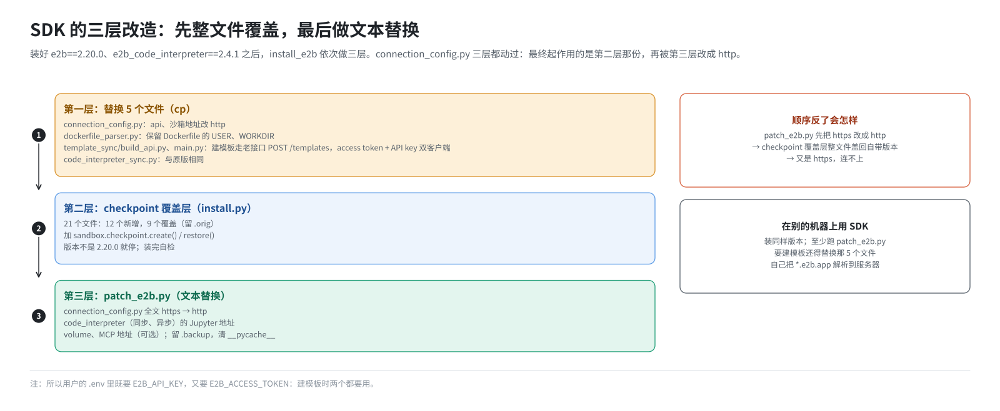

# 第 11 篇｜`build.sh -i`（二）：E2B 本体与 SDK

> **本篇目标**：拆开 `-i` 的最后一步 `install_e2b`。它做了四件事：装 Python SDK 并对它做三层改造；把 `dep/` 里的单机版脚本覆盖到位；把 Consul、Nomad 的安装包放到离线安装要用的位置；给 dnsmasq 加两行配置。每件事都讲清楚“为什么要这样”，尤其是 SDK 为什么要改、三层改造的顺序为什么不能反，以及一行 `local=/e2b.app/` 怎么省下每条命令 15 秒。

---

## 一、为什么部署脚本要管 SDK

SDK 是给用户用的客户端，按理说和服务端部署无关。但这套环境有三个原因，必须在部署时把 SDK 一起装好、改好：

1. **服务端和 SDK 的版本要配套。** 服务端是上游 `2026.09`，SDK 的接口一直在演进，只有特定版本能配合。本仓库验证过的组合是 `e2b==2.20.0` 加 `e2b_code_interpreter==2.4.1`。
2. **官方 SDK 默认用 HTTPS 访问 api 和沙箱**，而这套环境全程明文 HTTP，不改 SDK 根本连不上。
3. **部署后要用 SDK 验证**：建第一个模板、开第一台沙箱（第 17 篇），都要在这台机器上用 SDK 执行。

所以 `install_e2b` 的第一件事就是装 SDK：

```bash
pip install e2b==2.20.0
pip install e2b_code_interpreter==2.4.1
pip install python-dotenv
```

`python-dotenv` 让脚本能从 `.env` 文件读取 `E2B_API_KEY` 这类配置。

这三行需要能访问 pip 源（第 8 篇）。

---

## 二、SDK 的三层改造

装好的 SDK 在 Python 的 `site-packages` 目录下。`install_e2b` 接着对它做了三层改造，**顺序固定**：



### 2.1 第一层：替换 5 个文件

```bash
SITE=$(python3 -c "import e2b,os;print(os.path.dirname(os.path.dirname(e2b.__file__)))")
cp -fv $DEP_DIR/code_interpreter_sync.py $SITE/e2b_code_interpreter/
cp -fv $DEP_DIR/connection_config.py     $SITE/e2b/
cp -fv $DEP_DIR/dockerfile_parser.py     $SITE/e2b/template/
cp -fv $DEP_DIR/build_api.py             $SITE/e2b/template_sync/
cp -fv $DEP_DIR/main.py                  $SITE/e2b/template_sync/
```

第一行先问 Python “e2b 装在哪”，再把 `dep/` 下的 5 个文件整个拷过去，覆盖原文件。把它们和官方 2.20.0 的原文件对比，改动是这样的：

| 文件 | 改了什么 | 为什么 |
|---|---|---|
| `e2b/connection_config.py` | api 地址和沙箱地址从 `https://` 改成 `http://` | 本环境不用 HTTPS |
| `e2b/template/dockerfile_parser.py` | 不再强行把用户切成 `root`/`user`、工作目录切成 `/`、`/home/user`；`COPY` 支持更多写法 | 保留 Dockerfile 里自己写的 `USER`、`WORKDIR`，自定义镜像不会被改坏 |
| `e2b/template_sync/build_api.py` | 建模板改用服务端支持的老一版接口（`POST /templates`，按别名），固定 Dockerfile 名 | SDK 2.20.0 默认用更新的 v3 接口，和这版服务端对不上 |
| `e2b/template_sync/main.py` | 建模板时同时创建两个客户端：一个带 access token，一个带 API key，分别调用不同的接口 | 老接口里“发起构建”要 access token，其余要 API key |
| `e2b_code_interpreter/code_interpreter_sync.py` | 与原版相同 | 后面由 `patch_e2b.py` 改成 http |

第三、四行解释了为什么用户的 `.env` 里**既要有 `E2B_API_KEY`，又要有 `E2B_ACCESS_TOKEN`**：建模板时两个都要用（第 17 篇）。

### 2.2 第二层：checkpoint SDK 覆盖层

```bash
PY=$(command -v python || command -v python3)
"$PY" "$DEP_DIR/e2b-sdk-checkpoint/install.py"
```

这一层给 SDK 加上快照回滚能力：`sandbox.checkpoint.create()`、`sandbox.checkpoint.restore()` 等。服务端的对应功能在 ARM 补丁里。

覆盖层一共 21 个文件：

- 12 个是新增的；
- 9 个覆盖 SDK 原有文件，原文件留一份 `.orig` 备份，`--uninstall` 可以还原。

`install.py` 有几个保护措施：

- 先核对 SDK 版本，不是 2.20.0 就停下，不会装出一个“半新半旧”的 SDK；
- 装完另开一个干净的 Python 进程自检一遍，不通过就报错退出。

排查时可以手工运行：

```bash
python3 /opt/e2b-infra/dep/e2b-sdk-checkpoint/install.py --check      # 看状态
python3 /opt/e2b-infra/dep/e2b-sdk-checkpoint/install.py --uninstall  # 还原
```

这里用 `command -v python || command -v python3` 找解释器，是因为 openEuler 上往往只有 `python3`，没有 `python` 这个名字。写死 `python` 会直接找不到命令。

### 2.3 第三层：`patch_e2b.py`，全面改成 http

```bash
"$PY" /opt/e2b-infra/patch_e2b.py
```

这个脚本把 SDK 里**所有**对外连接从 https 改成 http：

| 文件 | 改法 |
|---|---|
| `e2b/connection_config.py` | 全文 `https` → `http` |
| `e2b_code_interpreter/code_interpreter_sync.py` | 访问沙箱里 Jupyter 的地址改成 http |
| `e2b_code_interpreter/code_interpreter_async.py` | 同上，异步版 |
| `e2b/volume/connection_config.py`（可选） | volume 接口的地址 |
| `e2b/sandbox/main.py`（可选） | MCP 地址 |

它会给每个改动的文件留一份 `.backup`，并清理 `__pycache__`，避免 Python 加载旧的字节码。可以重复执行。

### 2.4 顺序为什么不能反

注意 `connection_config.py` 被三层都动过：第一层用 `dep/` 的版本覆盖它，第二层（checkpoint 覆盖层）又用自己带的版本整个覆盖一遍（所以最终起作用的是第二层那份），第三层再在上面做文本替换。三者的关系是：

- 第一、二层是**整文件覆盖**：不管原来是什么，直接换成自己那份；
- 第三层是**在现有内容上做替换**。

所以必须先做覆盖、最后做替换。如果顺序反了，`patch_e2b.py` 先把 https 改成了 http，接着 checkpoint 覆盖层又把整个文件换成自带的版本，里面又是 https，前功尽弃。`build.sh` 里专门有一段注释提醒这一点。

### 2.5 不在这台机器上用 SDK 时

这三层改造只作用于**这台机器**的 Python 环境。如果要在另一台机器上用 SDK 访问这套 E2B，那台机器也要：

1. 装同样版本的 `e2b` 和 `e2b_code_interpreter`；
2. 至少执行一遍 `patch_e2b.py`（要建模板的话，还要替换那 5 个文件）；
3. 自己把 `*.e2b.app` 解析到这台服务器的 IP（第 17 篇）。

---

## 三、`dep/` 覆盖到位

接下来是第 8 篇讲过的“覆盖”：

```bash
local E2B_DIR="/opt/e2b-infra"
cp -fv $DEP_DIR/install-nomad.sh     /opt/e2b-infra
cp -fv $DEP_DIR/install-consul.sh    /opt/e2b-infra
cp -fv $DEP_DIR/uninstall-nomad.sh   /opt/e2b-infra
cp -fv $DEP_DIR/uninstall-consul.sh  /opt/e2b-infra

cp -fv "$DEP_DIR/.env"                 "$E2B_DIR/.env"
cp -fv "$DEP_DIR/template-manager.hcl" "$E2B_DIR/nomad/template-manager.hcl"
cp -fv "$DEP_DIR/start-client.sh"      "$E2B_DIR/start-client.sh"
cp -fv $DEP_DIR/start-server.sh        $E2B_DIR/start-server.sh
cp -fv $DEP_DIR/init-client.sh         $E2B_DIR/init-client.sh
cp -fv $DEP_DIR/run-nomad.sh           $E2B_DIR/run-nomad.sh
cp -fv $DEP_DIR/run-consul.sh          $E2B_DIR/run-consul.sh
cp -fv $DEP_DIR/deploy.sh              $E2B_DIR/deploy.sh
```

覆盖完成后，每个被覆盖的文件分别在后面哪一篇讲：

| 文件 | 单机版主要改了什么 | 在哪一篇 |
|---|---|---|
| `.env` | 本机 IP、单机的节点池、地址池、端口等全部配置 | 第 16 篇 |
| `nomad/template-manager.hcl` | 双角色、`raw_exec`、存储后端、资源配额、单机用的环境变量 | 第 15 篇 |
| `start-server.sh` | 从 `.env` 读配置，装并启动 Consul、Nomad server | 第 12 篇 |
| `start-client.sh` | 拷 orchestrator 二进制，准备目录、swap、DNS 等；不再自己起 Nomad client | 第 12、13 篇 |
| `init-client.sh` | IP 转发、内核、Firecracker、大页上限等 | 第 13 篇 |
| `run-nomad.sh`、`run-consul.sh` | ACL 令牌的持久化与找回 | 第 12 篇 |
| `install-*.sh`、`uninstall-*.sh` | 从 `/tmp` 取安装包；卸载时清掉令牌文件 | 第 12、18 篇 |
| `deploy.sh` | `--only` 快速重跑；seed-db 自动化；放开配额 | 第 14 篇 |

**注意第一行 `.env` 的覆盖。** 它把 `dep/.env` 拷到根目录的 `.env`，根目录那份里原有的东西会被冲掉。第一次部署时这没问题；但如果集群已经在跑、根目录 `.env` 里存着真实的 ACL 令牌，这一覆盖就会让令牌丢失（重新变回 `dep/.env` 里的占位值），之后 `deploy.sh` 提交 job 就会报 403。好在 `-s` 时 `run-nomad.sh` 会从 `/data/nomad/acl.token` 把真令牌找回来、重新写进 `.env`（第 12 篇）。但如果你单独跑了 `-i`、没有跑 `-s` 就去 `-r` 重跑某个 job，就会撞上 403。

---

## 四、离线安装包放到 `/tmp`

```bash
cp -fv $DEP_DIR/consul_1.21.4_linux_arm64.zip   /tmp/consul.zip
cp -fv "$DEP_DIR/nomad_${NOMAD_VERSION}_linux_arm64.zip" /tmp
```

Consul 和 Nomad 的安装脚本原本是从 HashiCorp 官网下载安装包的。单机版改成了“先看 `/tmp` 里有没有，有就直接用”：

```bash
# install-nomad.sh 里
local -r download_path="/tmp/nomad_${version}_linux_${arch}.zip"
if [[ -f "$download_path" ]]; then
    log_info "Download file $download_path already exists, skipping download."
else
    curl -o "$download_path" "$url" ...
fi
unzip -d /tmp -o "$download_path"
```

所以 `-i` 把安装包提前拷到 `/tmp`，`-s` 安装时就不会联网了。`-s` 的日志里会看到 `Downloading Nomad ... skipping download`，它看起来像在下载，其实没有，只是日志措辞的问题。

Nomad 的文件名里带着 `.env` 里的 `NOMAD_VERSION`（1.11.2）。改版本要两边一起改：`.env` 的变量和 `dep/` 下的安装包文件名。

有一点要留意：`/tmp` 在 openEuler 上是 tmpfs，重启就清空。所以“`-i` 之后重启机器再 `-s`”会因为找不到安装包而去联网下载，离线环境下失败。这种情况重跑一次 `-i` 即可。

---

## 五、dnsmasq：让 `*.e2b.app` 指向本机

`install_e2b` 的最后一段：

```bash
for line in "address=/.e2b.app/127.0.0.1" "local=/e2b.app/"; do
    if ! grep -qxF "$line" /etc/dnsmasq.conf; then
        echo "$line" >> /etc/dnsmasq.conf
        dnsmasq_changed=1
    fi
done
[ "$dnsmasq_changed" = 1 ] && systemctl restart dnsmasq
```

往 `/etc/dnsmasq.conf` 追加两行（已经有了就不加），再重启 dnsmasq。

### 5.1 第一行：`address=/.e2b.app/127.0.0.1`

意思是：`e2b.app` 以及它的所有子域名，一律解析成 `127.0.0.1`。

为什么需要？第 2 篇说过，SDK 访问沙箱时用的地址形如 `49983-<沙箱ID>.e2b.app`。上游在 Cloudflare 上配了一个通配符域名 `*.e2b.app`，指向负载均衡。本环境没有这些，就用本机的 dnsmasq 冒充：

```
SDK 要访问 49983-ixxxx.e2b.app
 → 问 /etc/resolv.conf 里的 127.0.0.1（dnsmasq）
 → dnsmasq 回答 127.0.0.1
 → SDK 连 127.0.0.1:80
 → iptables 把 80 改到 3002（第 14 篇）
 → client-proxy
```

这里有个前提：`/etc/resolv.conf` 的第一行要是 `nameserver 127.0.0.1`。这一步在 `-s` 的 `start-client.sh` 里做（第 12 篇）。

为什么用 `/etc/hosts` 不行？因为 `/etc/hosts` 不支持通配符，没法写“所有子域名”。

为什么解析成 `127.0.0.1` 而不是本机 IP？对本机上的 SDK 来说两者都行，`127.0.0.1` 更简单，也不依赖 IP。代价是：其他机器不能共用这条配置，它们要自己把 `*.e2b.app` 解析到服务器的真实 IP。

### 5.2 第二行：`local=/e2b.app/`，省下 15 秒

这一行是踩坑踩出来的。

现在的程序解析域名时，往往**同时**查两种记录：

- A 记录（IPv4 地址）；
- AAAA 记录（IPv6 地址）。

第一行 `address=` 只给了 IPv4 地址。对 AAAA 查询，dnsmasq 会认为“我这里没有，转给上游 DNS 问问”。如果上游 DNS 不通或者不回（离线环境很常见），客户端就要等到超时：默认 5 秒、重试 3 次，一共 15 秒。

表现就是：**每个沙箱的第一条命令都莫名其妙慢 15 秒**，后续命令又很快（连接被复用了）。

`local=/e2b.app/` 的意思是：`e2b.app` 这个域由本地全权负责，查不到就直接回答“没有”，不要转给上游。于是 AAAA 查询立刻得到一个空结果，客户端马上改用 IPv4 地址。

```
没有 local=：AAAA 查询 → 转发上游 → 等 15 秒超时 → 才用 A 记录
有 local=：  AAAA 查询 → 立即返回“无记录” → 立刻用 A 记录
```

如果你还在 dnsmasq 里给别的域名配了 `address=`（比如屏蔽某个外部服务），记得也补一条对应的 `local=`。

### 5.3 dnsmasq 的另一项工作

dnsmasq 还要负责把 `.consul` 结尾的名字转给 Consul，这一行（`server=/consul/127.0.0.1#8600`）在 `-s` 的 `start-client.sh` 里写到 `/etc/dnsmasq.d/consul.conf`（第 12 篇）。`-s` 还会往 `/etc/hosts` 写 `harbor`，dnsmasq 从那里回答（第 14 篇）。

到 `-s` 结束时，dnsmasq 一共负责三类名字：

| 名字 | 怎么回答 | 谁配的 |
|---|---|---|
| `*.e2b.app` | 127.0.0.1 | `-i`，`/etc/dnsmasq.conf` |
| `*.consul` | 转给 Consul 的 8600 | `-s`，`/etc/dnsmasq.d/consul.conf` |
| `harbor` | 从 `/etc/hosts` 读到本机 IP | `-s`，`/etc/hosts` |

其他名字照常转给上游 DNS。

---

## 六、`-i` 结束时机器上多了什么

把第 10 篇和本篇合起来：

| 类别 | 内容 |
|---|---|
| 运行中的服务 | PostgreSQL 容器、MinIO、Nginx、dnsmasq |
| 已准备、未启动 | Harbor（`/opt/e2b-infra/harbor/`） |
| 证书 | `/etc/nginx/ssl/harbor.{crt,key}`，已装进系统信任库和 docker 目录 |
| Python | e2b、e2b_code_interpreter 及三层改造 |
| 覆盖 | 根目录的脚本、`.env`、`nomad/template-manager.hcl` 都换成了单机版 |
| 离线包 | `/tmp/consul.zip`、`/tmp/nomad_1.11.2_linux_arm64.zip` |
| DNS | `*.e2b.app` → 127.0.0.1 |

还没有的：Nomad、Consul、E2B 的任何服务、大页、IP 转发、iptables 入口。这些都在 `-s`。

---

## 本篇小结

| 概念 | 一句话解释 |
|---|---|
| SDK 版本锁死 | `e2b==2.20.0`、`e2b_code_interpreter==2.4.1`，与服务端配套 |
| 第一层：替换 5 个文件 | http、保留 Dockerfile 的用户和工作目录、建模板走老接口 |
| 第二层：checkpoint 覆盖层 | 21 个文件，加快照回滚能力；版本不对就停 |
| 第三层：`patch_e2b.py` | 所有连接 https → http |
| 顺序 | 先整文件覆盖，最后做替换，反了会被盖回 https |
| `dep/` 覆盖 | 根目录换成单机版；`.env` 也被覆盖，会冲掉真令牌 |
| `/tmp` 里的安装包 | 让 `-s` 装 Nomad、Consul 时跳过下载；重启会丢 |
| `address=/.e2b.app/127.0.0.1` | 沙箱域名全部指向本机 |
| `local=/e2b.app/` | AAAA 查询立即答空，避免每条首个命令慢 15 秒 |

**下一篇预告**：[《`build.sh -s`（一）：拉起 Harbor、Consul 与 Nomad》](12-start-harbor-consul-nomad.md)。进入最重的 `-s`。先看前半段：Harbor 的真正安装、Consul 和 Nomad 的安装与 ACL 初始化、让一个 Nomad 同时当 server 和 client，以及 `start-client.sh` 把 orchestrator 安装到 `/usr/bin` 的方式。
