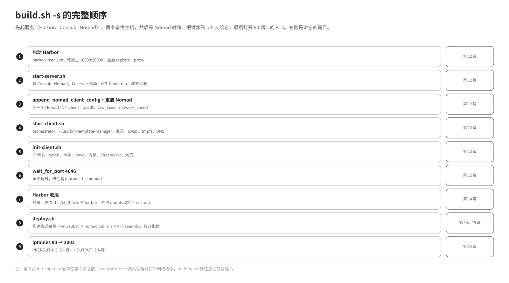
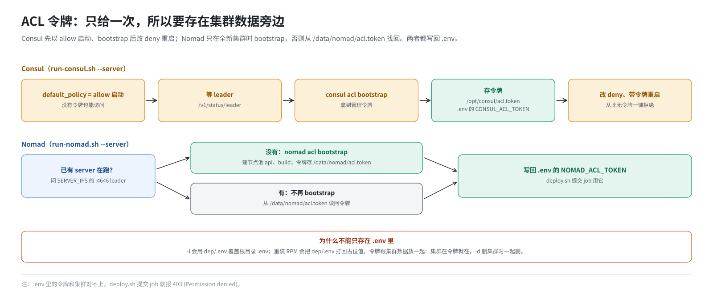

# 第 12 篇｜`build.sh -s`（一）：拉起 Harbor、Consul 与 Nomad

> **本篇目标**：进入最重的 `-s`。本篇讲它的前半段：Harbor 的真正安装；`start-server.sh` 怎么装好并启动 Consul 和 Nomad，ACL 令牌怎么生成、保存、找回；一个 Nomad 怎么同时当 server 和 client；`start-client.sh` 怎么把 orchestrator 安装到 `/usr/bin`、准备目录和 DNS；最后是“等 4646”这一步为什么会卡、卡了看什么。

---

## 一、`start()` 全景



`-s` 的主函数 `start()` 按顺序做这些事：

| 序号 | 动作 | 本书位置 |
|---|---|---|
| 1 | 启动 Harbor | 本篇 §二 |
| 2 | `start-server.sh`：装并启动 Consul、Nomad（server） | 本篇 §三 |
| 3 | `append_nomad_client_config` + 重启 Nomad：同一个 Nomad 也当 client | 本篇 §四 |
| 4 | `start-client.sh`：安装 orchestrator 二进制、目录、swap、DNS 等 | 本篇 §五 |
| 5 | `init-client.sh`：IP 转发、NBD、内核、Firecracker、大页等 | 第 13 篇 |
| 6 | 等 Nomad 的 4646 端口 | 本篇 §六 |
| 7 | Harbor 登录、建项目、写 hosts、推基础镜像 | 第 14 篇 |
| 8 | `deploy.sh`：构建镜像、提交 job、初始化数据 | 第 14、15 篇 |
| 9 | iptables 80 → 3002 | 第 14 篇 |

开始之前，`start()` 先检查 `/opt/e2b-infra` 和 `dep/.env` 在不在，不在就退出。

---

## 二、启动 Harbor

```bash
cd $WORK_DIR/harbor
bash install.sh || error "Harbor 安装脚本执行失败"

chown -R 10000:10000 "$WORK_DIR/harbor/common/config/registry" \
                     "$WORK_DIR/harbor/common/config/nginx" || true
docker compose -f "$WORK_DIR/harbor/docker-compose.yml" restart registry proxy || true
```

**`install.sh`** 是 Harbor 安装包自带的脚本。它读取 `-i` 改好的 `harbor.yml`，生成各组件的配置文件和一个 `docker-compose.yml`，再用 docker compose 拉起十来个容器：

- 数据库 `harbor-db`；
- 存镜像的 `registry`；
- 核心服务 `harbor-core`；
- 网页界面 `harbor-portal`；
- Harbor 自己的入口 `nginx`（容器名 `proxy`，就是它在 2900 端口监听）；
- 等等。

这一步要求 Docker Compose v2。用 openEuler 源里的老版本，会在这里报 `Unsupported config option`（第 8 篇）。

**`chown 10000:10000`** 修的是一个权限问题：`install.sh` 生成的部分配置文件属主是 root，而 Harbor 的 registry 和 proxy 容器内部以 UID 10000 运行，读不了这些文件。改完属主后重启这两个容器。

Harbor 已经起来了，但还没有项目、还没有镜像，这些在第 14 篇。

---

## 三、`start-server.sh`：Consul 和 Nomad 的 server

```bash
bash "$E2B_DIR/start-server.sh" "$HOST_IP"
```

`start-server.sh` 本身很短：

```bash
set -a; source .env; set +a      # 读配置，并导出为环境变量

ulimit -n 65536
./install-consul.sh --version ${CONSUL_VERSION}     # 1.21.4
./install-nomad.sh  --version ${NOMAD_VERSION}      # 1.11.2

./run-consul.sh --server --server-ips "${SERVER_IPS}" --instance-ip-address "${INSTANCE_IP_ADDRESS}"

set -a; source .env; set +a      # 再读一次：上一步可能把新的 Consul 令牌写进了 .env

./run-nomad.sh --server --num-servers "${NUM_SERVERS}" \
               --consul-token "${CONSUL_ACL_TOKEN}" --instance-ip-address "${INSTANCE_IP_ADDRESS}"
```

注意中间那次“再读一次 `.env`”：`run-consul.sh` 生成了 Consul 的令牌并写回 `.env`，`run-nomad.sh` 要用这个新令牌去连 Consul，所以必须重新读。

### 3.1 安装

`install-consul.sh` 和 `install-nomad.sh` 做的事情差不多：

1. 从 `/tmp` 取安装包（`-i` 放好的），解压出二进制，放到 `/usr/local/bin`；
2. 创建配置目录、数据目录。

### 3.2 `run-consul.sh --server`

它生成 Consul 的配置文件 `/etc/consul.d/default.json`，主要内容：

```json
{
  "server": true,
  "bootstrap_expect": 1,
  "bind_addr": "192.168.10.23",
  "advertise_addr": "192.168.10.23",
  "client_addr": "0.0.0.0",
  "datacenter": "dc1",
  "ui": true,
  "acl": {
    "enabled": true,
    "default_policy": "allow",
    "enable_token_persistence": true,
    "tokens": { "default": "" }
  }
}
```

- `server: true`、`bootstrap_expect: 1`：自己就是 server，只等 1 个 server 就开始工作；
- `bind_addr`、`advertise_addr`：用本机 IP 和别的节点通信；
- `client_addr: 0.0.0.0`：HTTP 接口（8500）和 DNS 接口（8600）对所有网卡开放；
- 数据目录 `/data/consul`。

然后生成 systemd unit `/etc/systemd/system/consul.service`，`enable` 并 `start`。

### 3.3 Consul 的 ACL 初始化

第 4 篇说过，ACL 的管理令牌只在 bootstrap 时给一次。`run-consul.sh` 的处理分两轮：



1. **第一轮**：用 `default_policy: allow` 启动。此时没有令牌也能访问，方便做 bootstrap。
2. 等 Consul 选出 leader（`/v1/status/leader` 有返回）。
3. 执行 `consul acl bootstrap`，拿到管理令牌。
4. **保存令牌**：
   - 写到 `/opt/consul/acl.token`（权限 600）；
   - 写回 `/opt/e2b-infra/.env` 的 `CONSUL_ACL_TOKEN`。
5. **第二轮**：重新生成配置，`default_policy` 改成 `deny`，并把令牌写进配置作为 Consul 自己的默认令牌，然后重启 Consul。

从此以后，没有令牌的请求一律被拒绝。

### 3.4 `run-nomad.sh --server`

它生成 `/etc/nomad.d/default.hcl`：

```hcl
name       = "<主机名>"
bind_addr  = "0.0.0.0"

advertise {
  http = "192.168.10.23"
  rpc  = "192.168.10.23"
  serf = "192.168.10.23"
}

server {
  enabled = true
  bootstrap_expect = 1
}

plugin "docker" {
  config {
    volumes { enabled = true }
    auth    { config = "/root/docker/config.json" }
  }
}

acl { enabled = true }

consul {
  address = "127.0.0.1:8500"
  token   = "<Consul 令牌>"
  ...
}
```

几个要点：

- **`plugin "docker"`**：允许容器挂载宿主机目录（`volumes`）；拉镜像时的登录信息从 `/root/docker/config.json` 读。
- **`consul` 块**：Nomad 通过本机 Consul 的 8500 注册服务，用刚生成的 Consul 令牌。
- **数据目录** `/data/nomad`，alloc 的文件都在下面。
- **端口**：4646 HTTP（命令行和网页界面）、4647 RPC、4648 节点间通信。

然后生成 systemd unit，`enable` 并 `start`。

### 3.5 Nomad 的 ACL 初始化与令牌找回

Nomad 这边的流程类似，但多了一层“找回”逻辑：

```
有没有已经在跑的 Nomad server（能问到 leader）？
├── 没有（全新集群）：
│     等 Nomad 就绪 → nomad acl bootstrap → 拿到令牌
│     → 建节点池 api、build
│     → 令牌存到 /data/nomad/acl.token
└── 有（集群已存在）：
      不再 bootstrap → 从 /data/nomad/acl.token 读回令牌
最后：把令牌写回 /opt/e2b-infra/.env 的 NOMAD_ACL_TOKEN
```

为什么要“找回”？因为根目录 `.env` 很容易被覆盖：

- `build.sh -i` 会用 `dep/.env` 覆盖它（第 11 篇）；
- 重新安装 RPM 也会让 `dep/.env` 回到仓库里的占位值。

而令牌只在 bootstrap 时给一次。如果不存一份到 `.env` 之外，集群还在、令牌却丢了，以后所有 Nomad 操作都会 403。所以令牌放在 `/data/nomad/acl.token`，跟集群数据放在一起：集群在，令牌就在；`-d` 删掉集群数据时，令牌文件也一起删掉（第 18 篇）。Consul 的 `/opt/consul/acl.token` 也是同样的道理。

建的两个节点池 `api` 和 `build` 是上游多节点时的遗留。单机时实际只用 `api`。

---

## 四、单机上的 server 和 client

### 4.1 让同一个 Nomad 也当 client

`run-nomad.sh --server` 只配了 server。干活的 client 由 `build.sh` 里的 `append_nomad_client_config` 追加到同一个配置文件：

```hcl
# === 自动追加的客户端配置 ===
client {
  enabled = true
  node_pool = "api"
  network_interface = "enp125s0f0"     # 持有 SERVER_IP 的那块网卡
  network_speed = 1000
  meta {
    node_pool = "api"
  }
}

plugin "raw_exec" {
  config {
    enabled = true
  }
}
# === 客户端配置结束 ===
```

追加前先 grep 开头那行标记，已经有了就跳过（幂等）。追加完 `systemctl restart nomad`，Nomad 以 server + client 的身份重新启动。

几个配置项：

| 配置 | 作用 |
|---|---|
| `node_pool = "api"` | 这台机器属于 `api` 池。所有 job 都声明去 `api` 池（第 4 篇） |
| `raw_exec` | 打开直接执行宿主机程序的 driver，orchestrator 要用 |
| `network_interface` | 指定 Nomad 用哪块网卡的地址，从 `SERVER_IP` 反查出来 |
| `network_speed = 1000` | 直接告诉 Nomad 网卡速度，不让它自己去探测 |

### 4.2 最后两项为什么重要

Nomad client 启动时要做“指纹采集”：枚举宿主机上的**每一块**网卡，逐个探测速度。正常机器上几块网卡，一眨眼就完成了。

但这台机器上可能有几千块网卡：

- 每个沙箱槽位一对虚拟网卡，orchestrator 预先建好几百个槽位；
- 上一轮没清干净的残留（第 18 篇）；
- 同机别的系统（如 AgentENV、容器）的虚拟网卡。

几千块网卡逐个探测速度要好几分钟。**而 Nomad 的 HTTP 接口（4646）要等指纹采集完成后才开放**，于是表现为 `build.sh -s` 卡在“等待 4646”很久。

`network_interface` 让 Nomad 直接用指定网卡，不再自己去找默认网卡；`network_speed` 让它跳过逐块测速。两者合起来，把这一步从几分钟缩短到几秒。

### 4.3 start-client.sh 也会调用 Nomad 吗

在多节点部署里，`start-client.sh <节点池> <IP>` 会以 client 身份启动一个新的 Nomad 加入集群。单机版把那两行注释掉了：

```bash
#./run-consul.sh --client ...
#./run-nomad.sh --client ...
```

因为 client 已经由上面的 `append_nomad_client_config` 合并到 server 进程里了。单机版 `start-client.sh` 只保留了宿主机准备的部分，参数里的 `api` 和 IP 实际上已经用不到了。

---

## 五、`start-client.sh`：安装 orchestrator 和准备宿主机

```bash
bash "$E2B_DIR/start-client.sh" api "$HOST_IP"
```

### 5.1 安装 orchestrator 二进制

脚本的第一件事：

```bash
cp -f "$(dirname "$0")/bin/orchestrator" /usr/bin/orchestrator
cp -f "$(dirname "$0")/bin/orchestrator" /usr/bin/template-manager
chmod +x /usr/bin/orchestrator /usr/bin/template-manager
```

同一个二进制拷成两个名字。第 2 篇说过，orchestrator 和 template-manager 本来就是同一个程序，靠环境变量 `ORCHESTRATOR_SERVICES` 决定扮演哪个角色。本环境的 job 只启动 `/usr/bin/template-manager`，让它同时扮演两个角色；`/usr/bin/orchestrator` 没有 job 去启动它，只是保留了上游的布局。

这里有两个后果，后面会反复遇到：

- **`/usr/bin` 不归 RPM 管**。升级 RPM 只更新 `/opt/e2b-infra/bin/orchestrator`，`/usr/bin` 里的还是旧版，要手工再拷一次（第 19 篇）。
- **进程名是 `template-manager`**。用 `ps`、`pgrep` 找 orchestrator 时要找 `/usr/bin/template-manager`。

### 5.2 目录、swap、tmpfs

```bash
mkdir -p /orchestrator/sandbox /orchestrator/template /orchestrator/build
```

orchestrator 的本地缓存目录：

| 目录 | 放什么 |
|---|---|
| `/orchestrator/template` | 从存储取来的模板文件的本地缓存 |
| `/orchestrator/sandbox` | 每个运行中沙箱自己的写时复制文件 |
| `/orchestrator/build` | 构建、快照过程中的文件 |

接着是 swap：

```bash
SWAPFILE="/swapfile"; SWAP_SIZE="1G"
# 不存在才创建：fallocate → chmod 600 → mkswap → swapon
# 并写进 /etc/fstab，重启后自动启用
sysctl vm.swappiness=10
sysctl vm.vfs_cache_pressure=50
```

1 GB 的 swap 只是一个兜底的缓冲，`swappiness=10` 让内核尽量少用它。

然后是一块 tmpfs：

```bash
mkdir -p /mnt/snapshot-cache
mountpoint -q /mnt/snapshot-cache || mount -t tmpfs -o size=65G tmpfs /mnt/snapshot-cache
```

这是上游给快照用的内存盘，上限 65 GB。tmpfs 只在真正写入时才占内存，本环境这一版代码其实不往里写，所以它不占内存（详见《E2B 沙箱存储从零讲透》）。

### 5.3 宿主机调优（和 init-client.sh 重叠的部分）

`start-client.sh` 接下来还做了一批宿主机调优：

- 连接数相关的 `sysctl -w`；
- NBD 的 udev 规则；
- 大页；
- `/fc-vm` 目录；
- 一份 gcsfuse 的配置文件（上游遗留，本环境用不到）。

这些和紧接着执行的 `init-client.sh` 有大量重复：两个脚本来自上游的不同地方（`start-client.sh` 是 GCP 集群机器的开机脚本，`init-client.sh` 是 CI 准备测试机的脚本），都包含宿主机准备的逻辑。因为两边都写成了幂等的，重复执行不会出问题，大页的数字也是按同一个公式算的。第 13 篇统一讲这些调优，以 `init-client.sh` 为准。

### 5.4 DNS：把本机 dnsmasq 放到第一位

`start-client.sh` 的最后一段负责 DNS：

```bash
# /etc/resolv.conf：删掉已有的 nameserver 127.0.0.1，再插到第一行
if [ -s /etc/resolv.conf ]; then
    sed -i '/^nameserver 127\.0\.0\.1$/d' /etc/resolv.conf
    sed -i '1i nameserver 127.0.0.1' /etc/resolv.conf
else
    rm -f /etc/resolv.conf
    echo 'nameserver 127.0.0.1' > /etc/resolv.conf
fi

# dnsmasq：.consul 结尾的名字转给 Consul
mkdir -p /etc/dnsmasq.d
grep -qxF 'server=/consul/127.0.0.1#8600' /etc/dnsmasq.d/consul.conf 2>/dev/null \
  || echo 'server=/consul/127.0.0.1#8600' >> /etc/dnsmasq.d/consul.conf
systemctl restart dnsmasq
```

做完以后，DNS 的完整路径是：

```
程序 → /etc/resolv.conf 第一行 → 127.0.0.1:53（dnsmasq）
       ├── *.e2b.app   → 127.0.0.1                  （-i 配的）
       ├── *.consul    → 127.0.0.1:8600（Consul）    （这里配的）
       └── 其他        → resolv.conf 里其余的上游 DNS
```

“先删再插”是为了幂等：老版本每跑一次就多插一行 `nameserver 127.0.0.1`。文件不存在或为空时（有的机器上外网靠 HTTP 代理、根本没配 DNS），直接写一个只有这一行的文件。

---

## 六、等 Nomad 的 4646 端口

`init-client.sh` 执行完（第 13 篇），`start()` 调用：

```bash
wait_for_port 4646 tcp 1 0
```

意思是：每 1 秒用 `ss -tln` 看一次 4646 端口有没有在监听，超时时间 0 表示**永不超时**。

正常情况下这一步几秒就过。如果一直卡在：

```
⏳ 端口未启动，继续等待...（永不超时）
```

按这个顺序排查：

1. **Nomad 是否在运行**：`systemctl status nomad`。如果在反复重启，看日志 `journalctl -u nomad -n 100`。
2. **是否 panic**：日志里有 `panic: runtime error: index out of range`，是 Nomad 版本太老，在 NUMA 节点编号不连续的机器上崩溃，换 1.11.2 以上（第 8 篇）。
3. **是否在做指纹采集**：日志停在 fingerprint 相关的行，同时 `ip -o link | wc -l` 有几千，是网卡太多。确认 `/etc/nomad.d/default.hcl` 的 client 块里有 `network_interface` 和 `network_speed`；再用 `build.sh --recycle-netns` 清掉残留的网卡（第 18 篇）。
4. **SELinux**：机器重启过且没持久化 permissive，Nomad 会报 `203/EXEC` 起不来（第 8 篇）。

因为永不超时，卡住时要自己 Ctrl+C 中断，修好后从 `-d` 重来。

---

## 七、几条“看起来像错误”的正常输出

`-s` 前半段有几条输出容易吓人，其实是正常的：

| 输出 | 为什么正常 |
|---|---|
| `curl: (7) Failed to connect to 192.168.10.23 port 8500` | `run-consul.sh` 在启动前先探测“有没有已经在跑的 Consul server”，全新部署时当然连不上 |
| `Downloading Nomad 1.11.2 ... skipping download` | 安装包已在 `/tmp`，跳过下载（第 11 篇） |
| `Nomad not yet started. Waiting for 1 second.` 重复几次 | 在等 Nomad 启动完成，准备做 ACL bootstrap |

---

## 本篇小结

| 概念 | 一句话解释 |
|---|---|
| Harbor 启动 | `install.sh` 用 docker compose 拉起；之后修权限、重启 registry 和 proxy |
| `start-server.sh` | 装 Consul、Nomad；以 server 身份启动；中间重读 `.env` 拿新令牌 |
| Consul ACL | 先 allow 启动 → bootstrap → 存令牌 → 改 deny 重启 |
| Nomad ACL | 全新集群才 bootstrap；否则从 `/data/nomad/acl.token` 找回；都写回 `.env` |
| 令牌存在集群数据旁边 | 集群在令牌就在，`.env` 被覆盖也能找回 |
| `append_nomad_client_config` | 给同一个 Nomad 追加 client 配置：`api` 池、`raw_exec` |
| `network_interface`、`network_speed` | 跳过逐块网卡测速，避免几千块网卡时 4646 迟迟不开 |
| `start-client.sh` | 拷 orchestrator 为 `/usr/bin/template-manager`；建目录、swap、tmpfs；配 DNS |
| `/usr/bin` 不归 RPM 管 | 升级 RPM 后要手工再拷 |
| `wait_for_port 4646` | 永不超时；卡住时看 Nomad 日志 |

**下一篇预告**：[《`build.sh -s`（二）：把宿主机调成能跑沙箱的样子》](13-host-preparation.md)。`init-client.sh` 逐项讲：IP 转发为什么必须在 orchestrator 启动前打开；NBD 的 udev 规则；客户机内核、Firecracker、envd 放到哪里；大页怎么切分，一台 TB 级内存的机器上各算出多少。
