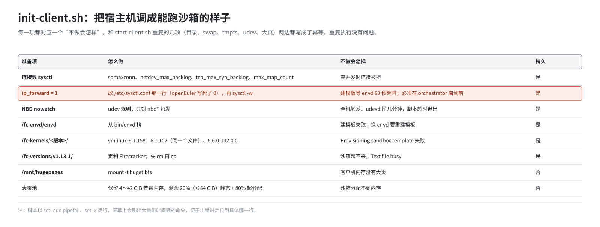
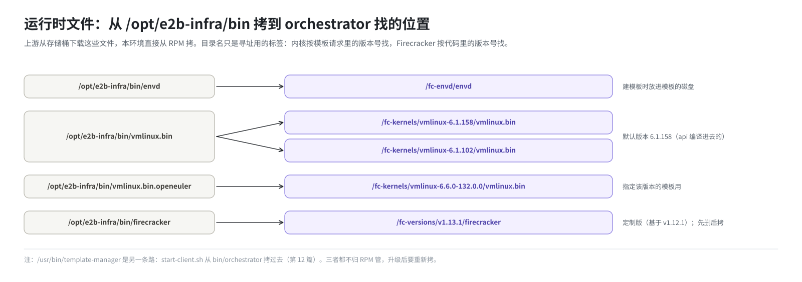

# 第 13 篇｜`build.sh -s`（二）：把宿主机调成能跑沙箱的样子

> **本篇目标**：讲“机器层”的主要准备者 `init-client.sh`。它逐项调整宿主机：打开 IP 转发、调大连接数、处理 NBD 设备、放好客户机内核、Firecracker 和 envd、预留大页。每一项都讲清楚三件事：为什么要做、怎么做的、不做会怎样。大页一节会用两台不同内存的机器算一遍，看静态池、超分配池各是多少。这些机制本身的原理，在网络和存储两本书里有详细讲解，本篇讲到“部署要做什么”为止。

---

## 一、`init-client.sh` 是什么

这个脚本在上游源码里的位置是 `.github/actions/host-init/init-client.sh`，原本是上游 CI 用来把一台测试机准备成“能跑沙箱”的脚本。本仓库把它改造成了单机部署里宿主机准备的主力，单机版在 `dep/init-client.sh`。

它由 `build.sh -s` 在 `start-client.sh` 之后调用：

```bash
bash "$E2B_DIR/init-client.sh" || error "初始化客户端失败"
```

调用位置有讲究：**在 Nomad 已经启动之后、`deploy.sh` 提交 job 之前**。也就是说，等 orchestrator 第一次启动时，这里准备的一切都已就绪。下面会看到，有一项准备（IP 转发）必须在 orchestrator 启动之前完成，晚了就无效。

脚本开头是：

```bash
set -euo pipefail     # 任何命令失败、未定义变量、管道中失败，都立即退出
PS4='[\D{%Y-%m-%d %H:%M:%S}] '
set -x                # 每条命令执行前打印出来，前面带时间戳
```

所以 `-s` 执行到这里时，屏幕上会刷出大量以时间戳开头的命令。这是正常的，方便出错时定位到具体哪一行。



和 `start-client.sh` 重复的几项（`/orchestrator` 目录、swap、`/mnt/snapshot-cache`、udev 规则）第 12 篇已经讲过，这里不再重复。下面按脚本顺序讲其余各项。

---

## 二、网络：sysctl 与 IP 转发

### 2.1 连接数相关的参数

```bash
if ! grep -q '^net.core.somaxconn = 65535' /etc/sysctl.conf; then
sudo tee -a /etc/sysctl.conf <<EOF
net.core.somaxconn = 65535
net.core.netdev_max_backlog = 65535
net.ipv4.tcp_max_syn_backlog = 65535
vm.max_map_count=1048576
EOF
fi
```

| 参数 | 含义 | 为什么调大 |
|---|---|---|
| `net.core.somaxconn` | 一个监听端口最多排队多少个等待接受的连接 | client-proxy、orchestrator 代理要同时承接大量沙箱连接 |
| `net.core.netdev_max_backlog` | 网卡收到、内核还没来得及处理的包，最多排多少 | 几百个沙箱同时收发包 |
| `net.ipv4.tcp_max_syn_backlog` | 正在握手中的连接最多多少 | 同上 |
| `vm.max_map_count` | 一个进程最多能有多少块内存映射 | orchestrator 为每个沙箱映射大量内存区域和文件 |

写进 `/etc/sysctl.conf` 是持久的，重启后自动生效。写之前先 grep，保证只追加一次。

### 2.2 IP 转发：最容易出错的一项

```bash
if grep -qE '^[[:space:]]*net\.ipv4\.ip_forward[[:space:]]*=' /etc/sysctl.conf; then
    sed -i -E 's|^[[:space:]]*net\.ipv4\.ip_forward[[:space:]]*=.*|net.ipv4.ip_forward = 1|' /etc/sysctl.conf
else
    echo 'net.ipv4.ip_forward = 1' >> /etc/sysctl.conf
fi
sysctl -p
sysctl -w net.ipv4.ip_forward=1
```

**为什么要打开。** 每个沙箱的网络是一个网络命名空间，里面有两块网卡：一块连宿主机（veth），一块连虚拟机（tap）。宿主机要访问沙箱里的 envd，包必须在这两块网卡之间**转发**。Linux 默认不转发，要打开 `net.ipv4.ip_forward`。原理见《E2B 沙箱网络从零讲透》第 11、13 篇。

**为什么要改 `/etc/sysctl.conf` 那一行。** openEuler 24.03 自带的 `/etc/sysctl.conf` 里**写死了 `net.ipv4.ip_forward=0`**。而上面那句 `sysctl -p`（不带参数）只读这个文件，会把 docker 启动时设好的 1 又压回 0。所以写到 `/etc/sysctl.d/` 下的新文件是没用的，必须直接改这一行。改完再 `sysctl -w` 一次，确保立即生效。

**为什么必须在 orchestrator 启动前。** 网络命名空间创建时，会从宿主机**复制一份**当时的 `ip_forward` 值，之后宿主机再改，已经建好的命名空间不受影响。而 orchestrator 一启动就会预先建好几百个网络槽位（“暖池”），用来加快开沙箱的速度。如果此时 `ip_forward` 还是 0，这几百个槽位就全是“不转发”的。

**不做会怎样。** 症状极具迷惑性：

- `build.sh -s` 全部成功，4 个 job 都在跑；
- 建模板时，虚拟机里 systemd 一路正常，甚至打出了 `Started Env Daemon Service`；
- 但宿主机就是连不上 envd，60 秒后超时，报 `build was cancelled`。

事后才发现时，光改宿主机的值不够，要重启 template-manager，让整池槽位按新值重建：

```bash
nomad job stop  template-manager-system
nomad job run   /opt/e2b-infra/rendered/template-manager.hcl
```

核对槽位里的值：

```bash
for ns in $(ip netns list | awk '{print $1}' | head -5); do
  echo "$ns $(ip netns exec $ns sysctl -n net.ipv4.ip_forward)"
done
```

---

## 三、存储：NBD 设备

```bash
cat <<EOH >/etc/udev/rules.d/97-nbd-device.rules
ACTION=="add|change", KERNEL=="nbd*", OPTIONS:="nowatch"
EOH

udevadm control --reload-rules || echo "⚠️ ...跳过；规则稍后自动生效"
udevadm trigger --action=change --subsystem-match=block --sysname-match='nbd*' || true
```

**为什么要这条规则。** udev 是 Linux 管理设备事件的服务。默认情况下，它会“盯着”每块磁盘：磁盘一被写完关闭，udev 就去重新扫描它的内容（比如看看上面有没有分区）。对普通磁盘这没问题，但 NBD 设备背后是 orchestrator 实时作答的“虚拟硬盘”（第 2 篇），udev 的扫描会制造大量多余的读请求，还可能和 orchestrator 的操作冲突。`OPTIONS:="nowatch"` 让 udev 别盯 NBD 设备。

**为什么只对 nbd 触发。** 改完规则要“触发”一次，让已经存在的设备按新规则处理。最初写的是不带参数的 `udevadm trigger`，它会给**全机每个设备**发事件。在大机器上：

- 几百个 CPU；
- 上千个内存块；
- 512 个 nbd 设备；
- 再加上别的容器的虚拟网卡。

udevd 和 systemd 要被这波事件占住好几分钟，期间 `systemctl` 都会超时，脚本在 `set -e` 下直接退出，表现为“启动 Nomad 客户端失败”。所以现在只对 `nbd*` 触发。`reload-rules` 超时也不算失败：规则文件已经写好，udevd 处理下一个事件前会自己重新加载。

**nbd 模块本身不在这里加载。** 它已经在第 0 步固化好了（第 8 篇）。

```bash
mkdir -p /fc-vm
```

顺便建一个 `/fc-vm` 目录，Firecracker 运行时用。

---

## 四、运行时文件：envd、内核、Firecracker

这三样是 orchestrator 启动虚拟机时要用的文件。上游从存储桶下载，本环境从 RPM 装好的 `/opt/e2b-infra/bin` 拷过去。



### 4.1 envd

```bash
mkdir -p /fc-envd
cp ./bin/envd /fc-envd/.
```

建模板时，template-manager 从 `/fc-envd/envd` 取出 envd，放进模板的磁盘里。之后从这个模板开出的每台沙箱，开机都会运行它。

这意味着：**换了 envd 之后，要重建模板才能生效**。已有的模板里装的还是旧的 envd。

### 4.2 客户机内核

```bash
KERNEL_VERSIONS=(vmlinux-6.1.158 vmlinux-6.1.102)
for kv in "${KERNEL_VERSIONS[@]}"; do
    mkdir -p "/fc-kernels/${kv}/"
    cp ./bin/vmlinux.bin "/fc-kernels/${kv}/"
done

if [ -f ./bin/vmlinux.bin.openeuler ]; then
    mkdir -p "/fc-kernels/vmlinux-6.6.0-132.0.0/"
    cp ./bin/vmlinux.bin.openeuler "/fc-kernels/vmlinux-6.6.0-132.0.0/vmlinux.bin"
fi
```

orchestrator 按 `/fc-kernels/<内核版本>/vmlinux.bin` 找内核。“内核版本”来自建模板的请求，请求里没写就用 api 编译进去的默认值 `vmlinux-6.1.158`。

这里有个容易让人困惑的地方：**目录名只是一个寻址用的标签**。`vmlinux-6.1.158` 和 `vmlinux-6.1.102` 两个目录里放的是同一个内核文件（RPM 里的 `vmlinux.bin`），它的真实版本不一定是 6.1.158。这样做是为了让带着这两个版本号的模板请求都能找到内核。第三个目录放的是 openEuler 内核做的客户机内核，给明确指定该版本的模板用。

少了这个目录，建模板会在 `Provisioning sandbox template` 那一步立即失败。

### 4.3 Firecracker

```bash
FIRECRACKER_VERSION=1.13.1
mkdir -p /fc-versions/v${FIRECRACKER_VERSION}

rm -f "/fc-versions/v1.13.1/firecracker"
cp ./bin/firecracker "/fc-versions/v1.13.1/firecracker"
chmod +x /fc-versions/v1.13.1/firecracker
```

和内核一样，orchestrator 按 `/fc-versions/<版本>/firecracker` 找 Firecracker。目录名 `v1.13.1` 对应代码运行时查找的版本号；实际放进去的是 RPM 自带的定制版（基于官方 v1.12.1，加了快照回滚需要的接口）。

**先删后拷**是一个值得学习的细节。重新部署时，上一轮残留的沙箱进程可能还在运行这个 Firecracker 二进制。直接 `cp` 覆盖会报：

```
cp: cannot create regular file '.../firecracker': Text file busy
```

Linux 不允许以写方式打开一个正在被执行的文件。但允许**删除**它：删掉的只是目录里的名字，正在运行的进程继续使用旧文件的内容；新拷进来的是一个全新的文件，两者互不影响。

x86 的 RPM 不带定制 Firecracker，脚本在这里会报错退出（第 7 篇）。

---

## 五、大页：给沙箱准备“内存条”

### 5.1 为什么要大页

客户机的内存不是用普通的 4 KB 页，而是用 2 MB 的**大页**（hugepage）。好处是页表小得多、内存访问更快，快照恢复时按需加载的粒度也更合适。原理见《E2B 沙箱存储从零讲透》第 4、13 篇。

大页有一个特点：**要提前预留**。内核运行久了，内存会变得零碎，要凑出一整块连续的 2 MB 越来越难。所以最好在开机后、内存还完整的时候，一次性划出来。

### 5.2 挂载 hugetlbfs

```bash
mkdir -p /mnt/hugepages
mountpoint -q /mnt/hugepages || mount -t hugetlbfs none /mnt/hugepages
```

hugetlbfs 是使用大页的文件系统入口。这个挂载没有写进 `/etc/fstab`，重启后就没了，下次 `-s` 会重新挂上。

### 5.3 切分算法


脚本先读总内存，然后分三刀：

**第一刀：给系统留普通内存。**

```
保留的普通内存 = max(4 GiB, 总内存 × 16%)，再与 42 GiB 取较小值
```

操作系统、各服务、orchestrator 自身、页缓存都要用普通内存。留得太少，宿主机会因为内存不足而杀进程。

**第二刀：剩下的全部算作“可用于大页的内存”。**

```
大页内存 = 总内存 − 保留的普通内存
大页数   = 大页内存 ÷ 大页大小（通常 2 MiB）
```

**第三刀：大页再分成两个池。**

| 池 | 比例 | 写到哪里 | 特点 |
|---|---|---|---|
| 静态池 | 20%，但不超过 `HUGEPAGES_BASE_MAX_MIB`（默认 64 GiB） | `/proc/sys/vm/nr_hugepages` | 立即从内存里划走，一直占着，不管有没有沙箱 |
| 超分配池 | 80% | `/proc/sys/vm/nr_overcommit_hugepages` | 只是一个上限；用到时才去分配，用完归还 |

为什么分两个池？

- 静态池保证了“至少有这么多大页一定拿得到”，开机就划走，不会因为内存零碎而分配失败；
- 超分配池给了弹性：沙箱多的时候可以用更多，沙箱少的时候内存还给系统。

### 5.4 64 GiB 的上限

静态池原本就是 20%。但内存特别大的机器上，20% 可能是几百 GB，开机就被划走、一直占着，同机的其他程序（比如 AgentENV）完全用不了。所以单机版加了一道上限：

```bash
base_hugepages_max_mib=${HUGEPAGES_BASE_MAX_MIB:-65536}
```

`HUGEPAGES_BASE_MAX_MIB` 在 `.env` 里，默认 65536（64 GiB）。超出上限的部分并不会转进超分配池，只是不预留。

### 5.5 算两个例子

**例一：总内存 256 GiB（262144 MiB）。**

| 步骤 | 计算 | 结果 |
|---|---|---|
| 16% | 262144 × 16% | 41943 MiB |
| 保留普通内存 | max(4096, 41943)，再与 43008 取小 | 41943 MiB ≈ 41 GiB |
| 大页内存 | 262144 − 41943，取偶数 | 220200 MiB |
| 大页数 | ÷ 2 | 110100 页 |
| 静态池 | 20% = 22020 页 = 43 GiB，没超过 64 GiB | **22020 页（约 43 GiB）** |
| 超分配池 | 80% | **88080 页（约 172 GiB）** |

**例二：总内存 1.5 TiB（1572864 MiB）。**

| 步骤 | 计算 | 结果 |
|---|---|---|
| 16% | 1572864 × 16% | 251658 MiB |
| 保留普通内存 | 与 43008 取小 | **43008 MiB = 42 GiB** |
| 大页内存 | 1572864 − 43008 | 1529856 MiB |
| 大页数 | ÷ 2 | 764928 页 |
| 静态池 | 20% = 152985 页 ≈ 299 GiB，超过上限 | **32768 页（64 GiB）** |
| 超分配池 | 80% | **611942 页（约 1195 GiB）** |

例二中，静态池加超分配池约 1259 GiB，比“大页内存”少了约 235 GiB，这就是上限截掉的部分，它们留作普通内存。

脚本执行时会打印这些数字：

```
- Total memory: 1572864 MiB
- Reserved RAM: 43008 MiB
- RAM for hugepages: 1529856 MiB
- Huge page size: 2048 KiB
- Base pool capped at 65536 MiB (20% would be 305970 MiB)
- Allocating 32768 huge pages (min of 20% and 65536 MiB) for base usage
- Allocating 611942 huge pages (80%) for overcommitment
```

部署后可以这样核对：

```bash
grep -E 'HugePages_(Total|Free|Rsvd|Surp)|Hugepagesize' /proc/meminfo
cat /proc/sys/vm/nr_overcommit_hugepages
```

### 5.6 几个细节

脚本里有几处防御性的写法，每一处都对应一个真实踩过的坑：

- **读 `/proc/meminfo` 时精确匹配字段名。** 鲲鹏上的 openEuler 内核会多出一行 `RemoteMemTotal: 0 kB`，它的名字里也含 `MemTotal`。用普通的 `grep MemTotal` 会取到两行，后面的算术全部出错。
- **大页大小不写死 2 MiB。** ARM 内核如果用 64 KB 的基础页，默认大页是 512 MiB。所以先从 `/proc/meminfo` 读 `Hugepagesize`，并全程用 KiB 计算，避免换算成 MiB 时被取整成 0。
- **内存比保留量还小时归零。** 小内存的机器上“总内存 − 保留量”会是负数，写进 `nr_hugepages` 会报错。

### 5.7 大页的生命周期

- 写在 `/proc/sys/vm/` 下，**不是持久配置**，重启就归零，下次 `-s` 重新预留。
- `build.sh -d` **故意不释放**静态池：下次 `-s` 时，内存可能已经零碎，重新凑连续大页更难。
- 真要把内存还给系统，用 `build.sh --purge-hugepages`（第 18 篇）。

`start-client.sh` 里也有一段一模一样的大页计算（第 12 篇提过），两次写进去的是同一个数字。

---

## 六、做完之后宿主机多了什么

| 类别 | 内容 | 持久吗 |
|---|---|---|
| sysctl | `/etc/sysctl.conf`：连接数、`max_map_count`、`ip_forward = 1` | 是 |
| udev | `/etc/udev/rules.d/97-nbd-device.rules` | 是 |
| 目录 | `/orchestrator/{sandbox,template,build}`、`/fc-vm` | 是 |
| 运行时文件 | `/fc-envd/envd`、`/fc-kernels/*/vmlinux.bin`、`/fc-versions/v1.13.1/firecracker` | 是 |
| swap | `/swapfile`，写进 fstab | 是 |
| 挂载 | `/mnt/snapshot-cache`（tmpfs 65G）、`/mnt/hugepages`（hugetlbfs） | 否 |
| 大页 | `nr_hugepages`、`nr_overcommit_hugepages` | 否 |

到这里，“机器层”已经准备完毕。下一步就是把 E2B 的服务交给 Nomad 了。

---

## 本篇小结

| 准备项 | 为什么 | 不做会怎样 |
|---|---|---|
| 连接数 sysctl | 承接大量并发连接 | 高并发时连接被拒 |
| `ip_forward = 1` | 沙箱槽位内两块网卡之间转发 | 建模板等 envd 60 秒超时；必须在 orchestrator 启动前生效 |
| NBD `nowatch` | 别让 udev 扫描虚拟硬盘 | 多余读请求、冲突 |
| 只对 nbd `trigger` | 避免全机设备事件风暴 | udevd 忙几分钟，脚本超时退出 |
| `/fc-envd` | 建模板时放进模板 | 建模板失败；换 envd 要重建模板 |
| `/fc-kernels/<版本>/` | 按模板请求的版本找内核 | `Provisioning sandbox template` 失败 |
| `/fc-versions/v1.13.1/` | 定制 Firecracker；先删后拷 | 沙箱起不来；`Text file busy` |
| 大页 | 客户机内存用 2 MiB 大页 | 沙箱分配不到内存 |
| 静态池 20%（≤64 GiB）+ 超分配 80% | 保底 + 弹性 | — |

**下一篇预告**：[《`build.sh -s`（三）：镜像入库、渲染 job、提交上线》](14-deploy-sh.md)。宿主机准备好了，接下来把服务交给 Nomad：往 Harbor 推镜像，`deploy.sh` 现场构建 api、client-proxy 的镜像，用 `envsubst` 把 `.env` 填进 job 模板，按顺序提交 4 个 job，造出第一个团队和密钥，最后加上 80 端口的入口规则。
