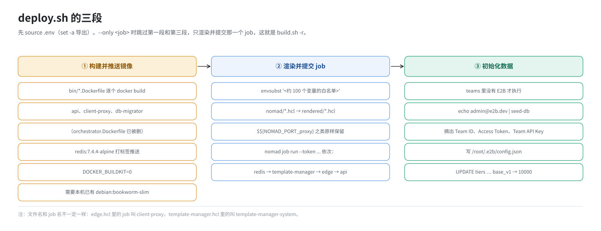
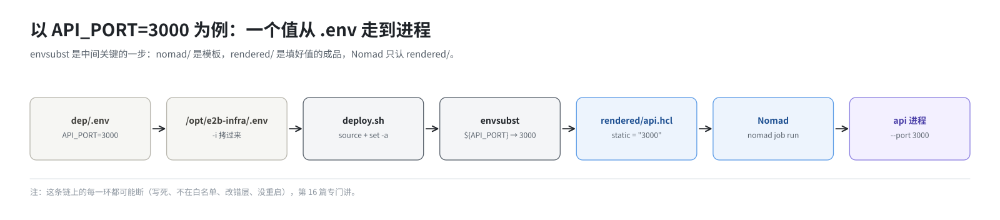
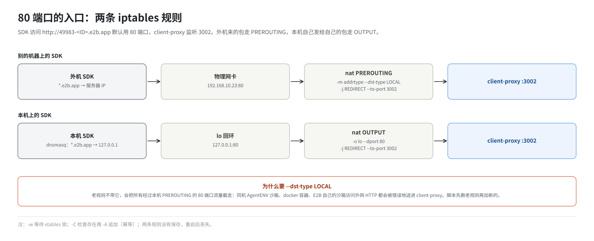

# 第 14 篇｜`build.sh -s`（三）：镜像入库、渲染 job、提交上线

> **本篇目标**：`-s` 的后半段，把 E2B 的服务真正交给 Nomad。先做几件和 Harbor 有关的准备：登录、建项目、让 `harbor` 这个名字能解析、推送模板基础镜像。然后是 `deploy.sh` 的三段：现场构建并推送镜像；用 `envsubst` 把 `.env` 填进 job 模板再提交；造出第一个团队和密钥。最后是两条 iptables 规则，把 80 端口交给 client-proxy。读完你会知道一个 `.env` 里的值是怎么一路走进进程的。

---

## 一、Harbor 的收尾工作

第 12 篇等到 Nomad 的 4646 端口就绪后，`start()` 接着处理 Harbor。

### 1.1 登录和建项目

```bash
docker login -u "$HARBOR_USER" -p "$HARBOR_PASSWORD" "$HOST_IP:$HARBOR_HTTP_PORT" \
    || warn "Harbor 登录失败（可能凭证错误或Harbor未就绪），继续执行部署..."

curl -X POST "http://localhost:2900/api/v2.0/projects" -k -u "admin:Harbor12345" \
     -H "Content-Type: application/json" \
     -d '{"project_name": "e2b-orchestration", "public": true}'
```

- **登录**：让 docker 记住 Harbor 的账号，后面 `docker push` 才有权限。登录信息保存在 `/root/.docker/config.json`。失败只告警、不退出，后面推送时会再次暴露问题。
- **建项目**：Harbor 里的镜像按“项目”组织。建一个公开的项目 `e2b-orchestration`，后面所有镜像都放这里。公开意味着拉取时不需要登录，Nomad 和 template-manager 拉镜像就省了认证的麻烦。重复执行时项目已存在，接口会返回错误，但不影响后续。

### 1.2 让 `harbor` 这个名字能解析

第 10 篇讲过，建模板时要从 `harbor:443` 拉基础镜像，`harbor` 这个名字必须解析到本机。`ensure_harbor_hostname` 负责这件事：

```bash
existing=$(awk '!/^[[:space:]]*#/ { for (i = 2; i <= NF; i++) if ($i == "harbor") { print $1; exit } }' /etc/hosts)
if [ -z "$existing" ]; then
    echo "$HOST_IP harbor" >> /etc/hosts
    systemctl restart dnsmasq          # dnsmasq 只在启动时读 /etc/hosts
elif [ "$existing" != "$HOST_IP" ]; then
    warn "/etc/hosts 里 harbor 指向 $existing，不是本机 $HOST_IP；..."
fi
getent hosts harbor >/dev/null || warn "harbor 主机名仍解析不了，建模板会报 lookup harbor ... server misbehaving"
```

三个分支：

- 没有 `harbor` 条目：追加一行，**并重启 dnsmasq**；
- 有条目但指向别的地址：只告警，不擅自修改（也许是有意指向另一台 Harbor）；
- 已经指向本机：什么都不做。

为什么要重启 dnsmasq？template-manager 拉镜像时问的是 dnsmasq，而 dnsmasq 只在启动时读一次 `/etc/hosts`。前面 `start-client.sh` 重启它的时候还没有这一行。

最后用 `getent hosts harbor` 验证一次，这是第 9 篇说的“先拦截”：解析不了就现在告警，而不是等建模板时才报错。

### 1.3 推送模板基础镜像

`push_base_image` 把 RPM 带来的 `dep/ubuntu-22.04-custom.tar.gz` 推进 Harbor：

```bash
# Harbor 里已经有这个 tag 就跳过
curl -sf --noproxy '*' -u "$HARBOR_USER:$HARBOR_PASSWORD" \
    "http://127.0.0.1:2900/v2/e2b-orchestration/ubuntu/tags/list" | grep -q '"22.04-custom"' && return 0

docker load -i "$DEP_DIR/ubuntu-22.04-custom.tar.gz"     # 得到 ubuntu:22.04-custom
docker tag  ubuntu:22.04-custom  192.168.10.23:2900/e2b-orchestration/ubuntu:22.04-custom
docker push 192.168.10.23:2900/e2b-orchestration/ubuntu:22.04-custom
```

一个值得注意的细节：**推送用的是 `IP:2900`，而建模板时拉取用的是 `harbor:443`。** 两个地址指向同一个仓库（443 的 Nginx 转发给 2900），推进去的镜像两边都能看到。

为什么推送不用 `harbor:443`？因为 docker daemon 如果配了 HTTP 代理，它的“不走代理”名单里通常只有本机 IP，没有 `harbor` 这个只存在于本机 `/etc/hosts` 的名字。用 `harbor:443` 推送，请求会被交给代理，代理找不到 `harbor`，返回 504。

推送失败只告警、不中断部署，因为基础镜像只影响建模板，不影响服务启动。

### 1.4 删掉 orchestrator 的 Dockerfile

```bash
rm -fv $E2B_DIR/bin/orchestrator.Dockerfile
```

下一步 `deploy.sh` 会把 `bin/` 下**所有** `*.Dockerfile` 都构建成镜像。orchestrator 不进容器（第 4 篇），构建它的镜像既浪费时间又没用，所以先删掉。

---

## 二、`deploy.sh`：开头

```bash
bash "$E2B_DIR/deploy.sh" || error "执行部署脚本失败"
```

`deploy.sh` 是从上游 `iac/provider-gcp/nomad/jobs/deploy.sh` 改来的单机版（`dep/deploy.sh`）。它支持两个参数：

| 参数 | 作用 |
|---|---|
| `--type nomad`（默认）/ `--type k8s` | 部署到 Nomad 还是 Kubernetes |
| `--only <job>` | 只重跑一个 job，跳过镜像构建和数据初始化（`build.sh -r` 用的就是它） |

开头读配置：

```bash
set -a
source .env          # 根目录的 .env，此时里面已经有真实的 ACL 令牌
set +a

export DOCKER_BUILDKIT=0
```

`set -a` 让后面读进来的变量自动导出为环境变量，这样后面的 `envsubst` 才能看到它们。

`DOCKER_BUILDKIT=0` 是一个兼容性处理：机器上的 buildx 插件版本太老，和新版 docker daemon 不兼容，所以强制使用传统构建方式。



---

## 三、第一段：构建并推送镜像

```bash
cd ./bin
for dockerfile in *.Dockerfile; do
    name=${dockerfile%.Dockerfile}                 # api、client-proxy、db-migrator
    tag="${REGISTRY_URL}/${name,,}"                # 192.168.10.23:2900/e2b-orchestration/api
    docker build -t "$tag" -f "$dockerfile" .
    docker push "$tag"
done
```

`bin/` 下现在有三个 Dockerfile（orchestrator 的已删）：

| Dockerfile | 镜像 | 内容 |
|---|---|---|
| `api.Dockerfile` | `.../e2b-orchestration/api` | debian 精简版 + `bin/api` |
| `client-proxy.Dockerfile` | `.../e2b-orchestration/client-proxy` | debian 精简版 + `bin/client-proxy` |
| `db-migrator.Dockerfile` | `.../e2b-orchestration/db-migrator` | debian 精简版 + `bin/migrator` + `migrations/` |

构建上下文是 `bin/` 目录，所以 Dockerfile 里的 `COPY api /api` 拷的就是 RPM 装好的 `bin/api`。

这就回答了一个常见的疑问：**容器里的 api 是哪来的？** 就是 RPM 编译好的那个二进制，被现场装进了镜像。所以改了 api 的代码、重新打 RPM 之后，还要重新构建镜像，容器里才会是新的（第 19 篇）。

镜像不带版本标签，默认就是 `latest`。

这一步要求本机已经有 `debian:bookworm-slim` 镜像（第 8 篇提前 `docker load` 的），否则 docker 会去 Docker Hub 拉，离线环境就卡住了。

然后是 Redis：

```bash
declare -A IMGS=(
  [redis]="redis:${REDIS_VERSION}"         # redis:7.4.4-alpine
  # [loki]=...  [otel]=...  [clickhouse]=...   ← 都注释掉了
)
for name in "${!IMGS[@]}"; do
  src=${IMGS[$name]}
  tag="${REGISTRY_URL}/${src}"             # 192.168.10.23:2900/e2b-orchestration/redis:7.4.4-alpine
  docker image inspect "$src" >/dev/null 2>&1 || docker pull "$src"
  docker tag  "$src" "$tag"
  docker push "$tag"
done
```

第三方镜像也要推进 Harbor，因为 Nomad 的 job 文件里写的是从 Harbor 拉。注释掉的几项就是第 2 篇说的“上游有、本环境没部署”的组件。

---

## 四、第二段：渲染并提交 job

### 4.1 `envsubst` 填模板

```bash
mkdir -p rendered
for hcl in nomad/*.hcl; do
    outfile=rendered/$(basename "$hcl")
    envsubst '$ENVIRONMENT $DOMAIN_NAME $GCP_ZONE $CONSUL_ACL_TOKEN $NOMAD_ACL_TOKEN ...
              $API_PORT $API_GRPC_PORT ... $SANDBOXES_HOST_NETWORK_CIDR $SANDBOXES_VRT_NETWORK_CIDR' \
        < "$hcl" > "$outfile"
done
```

`envsubst` 是一个很简单的工具：读入文本，把里面的 `${变量名}` 替换成同名环境变量的值，输出。比如 `nomad/api.hcl` 里的：

```hcl
port "api" {
  static = "${API_PORT}"
}
```

经过 `envsubst` 后，`rendered/api.hcl` 里变成：

```hcl
port "api" {
  static = "3000"
}
```

`nomad/` 是模板，`rendered/` 是填好的成品。`nomad/` 下十来个模板全部渲染，但只有 4 个会被提交。

### 4.2 为什么要列一个白名单

注意 `envsubst` 后面跟了一长串用单引号括起来的变量名，大约一百个。这是一个**白名单**：只替换列出的变量，其他的 `${...}` 原样保留。

为什么不让它全部替换？因为 job 文件里还有一类 `${...}` 是**给 Nomad 自己用的**，要等 Nomad 运行时才填值。比如 client-proxy 的 job 里：

```hcl
env {
  NODE_ID     = "$${node.unique.id}"
  HEALTH_PORT = "$${NOMAD_PORT_health}"
  PROXY_PORT  = "$${NOMAD_PORT_proxy}"
}
```

`NOMAD_PORT_proxy` 是 Nomad 在启动任务时才知道的端口号。如果 `envsubst` 不带白名单，它会发现环境里没有 `NOMAD_PORT_proxy` 这个变量，就把它替换成空字符串，job 就坏了。带上白名单，这些 Nomad 运行时变量就能原样留下来。

（`$$` 是 HCL 的转义写法，表示“这是一个字面的 `$`，不要在解析 job 文件时插值”。这是上游用 Terraform 模板时留下的写法，到了 Nomad 这一层依然有效。）

白名单带来一个副作用，第 16 篇会专门讲：**新加的变量如果忘了加进白名单，它在 hcl 里就会原样保留成 `${XXX}`**，而不是你在 `.env` 里写的值。

### 4.3 提交 job

```bash
JOBS=(redis template-manager edge api)
[[ -n "$ONLY_JOB" ]] && JOBS=("$ONLY_JOB")

for j in "${JOBS[@]}"; do
    nomad job run --token $NOMAD_ACL_TOKEN rendered/${j}.hcl
done
```

四个 job，按固定顺序提交：

| 顺序 | 文件 | Nomad 里的 job 名 |
|---|---|---|
| 1 | `rendered/redis.hcl` | `redis` |
| 2 | `rendered/template-manager.hcl` | `template-manager-system` |
| 3 | `rendered/edge.hcl` | `client-proxy` |
| 4 | `rendered/api.hcl` | `api` |

注意文件名和 job 名不一定一样：`edge.hcl` 里定义的 job 叫 `client-proxy`，`template-manager.hcl` 里的叫 `template-manager-system`。`build.sh -r` 后面跟的是**文件名**（不带 `.hcl`），`nomad job status` 里看到的是 **job 名**。

为什么是这个顺序？因为后面的依赖前面的：

- redis 最先，api 和 client-proxy 都要用它；
- template-manager 其次，api 要等它注册后才会变健康；
- api 最后。

不过 `nomad job run` 只是“提交”，它会等这个 job 的部署结果，但服务之间真正的就绪顺序是由各自的重试和健康检查保证的（第 15 篇）。

带 `--token` 是因为 Nomad 开了 ACL。令牌从 `.env` 读，如果和集群里的不一致，这里就会报 `403 (Permission denied)`（第 20 篇）。

### 4.4 从 `.env` 到进程



把这一段串起来，以 `API_PORT=3000` 为例：

```
dep/.env 里写 API_PORT=3000
  → build.sh -i 拷到 /opt/e2b-infra/.env
  → deploy.sh 用 source 读入，set -a 导出为环境变量
  → envsubst 把 nomad/api.hcl 里的 ${API_PORT} 换成 3000，写到 rendered/api.hcl
  → nomad job run 提交 rendered/api.hcl
  → Nomad 按 job 定义启动容器，命令行参数 --port 3000
  → api 进程监听 3000
```

这条链上的每一个环节都可能出问题，第 16 篇会逐个讲。

---

## 五、第三段：初始化数据

### 5.1 造第一个团队和密钥

```bash
RESULT=$(docker exec postgres psql -U postgres -d mydatabase -q --tuples-only \
         -c "SELECT EXISTS (SELECT 1 FROM teams WHERE name = 'E2B');" | xargs)

if [ "$RESULT" != "t" ]; then
    SEED_EMAIL="${SEED_EMAIL:-admin@e2b.dev}"
    SEED_OUT=$(echo "$SEED_EMAIL" | POSTGRES_CONNECTION_STRING=$POSTGRES_CONNECTION_STRING ./bin/seed-db)

    TEAM_ID=$(grep 'Team ID:'       <<<"$SEED_OUT" | awk '{print $NF}')
    ACCESS_TOKEN=$(grep 'Access Token:' <<<"$SEED_OUT" | awk '{print $NF}')
    TEAM_API_KEY=$(grep 'Team API Key:' <<<"$SEED_OUT" | awk '{print $NF}')

    cat >/root/.e2b/config.json <<EOF
{
  "email": "$SEED_EMAIL",
  "teamName": "E2B",
  "teamId": "$TEAM_ID",
  "accessToken": "$ACCESS_TOKEN",
  "teamApiKey": "$TEAM_API_KEY"
}
EOF
fi
```

1. **先查数据库里有没有名叫 E2B 的团队**，有就跳过，避免重复造。注意这一查要求表已经存在，而表是 api 的前置任务 db-migrator 建的（第 15 篇）。
2. **运行 seed-db**。它本来是一个交互式程序，会提示 `Email:` 让你输入。这里用管道把邮箱喂给它（默认 `admin@e2b.dev`，可以用环境变量 `SEED_EMAIL` 改），免去手工输入。
3. **从 seed-db 的输出里摘出三个值**：团队 ID、access token、team API key。seed-db 的输出格式是：

   ```
   Seeding database with:
     Email: admin@e2b.dev
     Team ID: 0b8a3c1e-....
     Access Token: sk_e2b_....
     Team API Key: e2b_....
   ```

4. **写进 `/root/.e2b/config.json`**。这是 E2B 命令行工具默认读的配置文件。用 SDK 时，你要从这里取出 key（第 17 篇）。

这两个 key 的区别：

| | 前缀 | 代表 | 用在 |
|---|---|---|---|
| Access Token | `sk_e2b_` | 一个用户 | 建模板等管理操作 |
| Team API Key | `e2b_` | 一个团队 | 开沙箱、用沙箱 |

每次 `-i` 都会重建 PostgreSQL（第 10 篇），数据清空，所以每次 `-i` + `-s` 之后，这两个 key 都是**新生成的**，旧的失效。

### 5.2 放开配额

```bash
docker exec postgres psql -U postgres -d mydatabase \
  -c "UPDATE tiers SET concurrent_instances=10000, max_length_hours=10000 WHERE id='base_v1';"
```

E2B 的团队属于某个“套餐”（tier），套餐规定了最多同时开多少台沙箱、每台最多活多久。seed-db 造的团队属于 `base_v1`，默认限制是按免费用户设的，很低，压测或稍多一点的并发就会被拒绝。这一句把它放到 1 万台、1 万小时，等于不限制。

---

## 六、最后两条 iptables 规则

`deploy.sh` 返回后，`start()` 的最后一件事是加入口规则：

```bash
# 先删掉老版本的规则（不带 --dst-type LOCAL 的）
while iptables -w -t nat -C PREROUTING -p tcp --dport 80 -j REDIRECT --to-port 3002 2>/dev/null; do
    iptables -w -t nat -D PREROUTING -p tcp --dport 80 -j REDIRECT --to-port 3002
done

# 别的机器访问本机 80 端口 → 3002
iptables -w -t nat -C PREROUTING -p tcp --dport 80 -m addrtype --dst-type LOCAL -j REDIRECT --to-port 3002 \
 || iptables -w -t nat -A PREROUTING -p tcp --dport 80 -m addrtype --dst-type LOCAL -j REDIRECT --to-port 3002

# 本机程序访问本机 80 端口 → 3002
iptables -w -t nat -C OUTPUT -p tcp -o lo --dport 80 -j REDIRECT --to-port 3002 \
 || iptables -w -t nat -A OUTPUT -p tcp -o lo --dport 80 -j REDIRECT --to-port 3002
```



**为什么需要。** SDK 访问沙箱用的是 `http://49983-xxx.e2b.app`，默认 80 端口。而 client-proxy 监听的是 3002。这两条规则在内核里把“目标端口 80”改写成“3002”。

**为什么是两条。** Linux 的包过滤分几个阶段，不同来源的包走不同的阶段：

| 包从哪来 | 经过哪个阶段 | 规则 |
|---|---|---|
| 别的机器，经物理网卡进来 | PREROUTING | 第一条 |
| 本机程序发给本机（走 `lo` 回环） | OUTPUT | 第二条 |

本机上的 SDK 把 `*.e2b.app` 解析成 127.0.0.1，它的包走的是第二条。原理见《E2B 沙箱网络从零讲透》第 7、17 篇。

**为什么加 `--dst-type LOCAL`。** 老版本的第一条规则没有这个条件，会把**所有**经过本机 PREROUTING 的 80 端口流量都截走，包括：

- 同机 AgentENV 沙箱访问外网的 HTTP；
- docker 容器访问外网的 HTTP；
- E2B 自己的沙箱访问外网 HTTP（它们的包也经过宿主机的 PREROUTING）。

加上 `--dst-type LOCAL`，只有“目的地址是本机”的才改写。脚本先用 `while` 循环把老规则删干净，再加新的。

**`-w`** 表示等待 iptables 的锁。同机有 docker、k3s 等也在改 iptables 时，不加 `-w` 可能因为抢不到锁而失败。

**`-C ... || -A ...`** 是第 9 篇说的幂等写法：先检查规则在不在，不在才追加。

**这两条规则没有保存**，重启后就没了（第 9 篇的表）。

至此，`build.sh -s` 结束：

```
✅ e2b-infra 服务启动完成！所有组件健康检查通过✅
```

---

## 本篇小结

| 步骤 | 做什么 | 要点 |
|---|---|---|
| docker login、建项目 | Harbor 账号、公开项目 `e2b-orchestration` | 公开项目拉取免认证 |
| `ensure_harbor_hostname` | `/etc/hosts` 写 `harbor`，重启 dnsmasq | dnsmasq 只在启动时读 hosts |
| `push_base_image` | `ubuntu:22.04-custom` 推进 Harbor | 推用 `IP:2900`，拉用 `harbor:443`，同一个仓库 |
| 删 orchestrator.Dockerfile | 不构建它的镜像 | orchestrator 不进容器 |
| 构建镜像 | api、client-proxy、db-migrator；debian + RPM 里的二进制 | 改代码后要重建镜像 |
| `envsubst` 白名单 | 只替换列出的变量 | 保留 Nomad 运行时变量；漏列的不会被替换 |
| 提交顺序 | redis → template-manager → edge（client-proxy）→ api | 文件名和 job 名不同 |
| seed-db | 团队 E2B、access token、team API key → `/root/.e2b/config.json` | 每次重建数据库都是新 key |
| 放开配额 | `base_v1` 并发和时长都改成 10000 | |
| iptables | 外机走 PREROUTING，本机走 OUTPUT，80 → 3002 | `--dst-type LOCAL`；重启丢失 |

**下一篇预告**：[《四个 job 逐个读：谁先起、谁等谁》](15-four-jobs.md)。打开 `rendered/` 下的四个 job 文件，逐个读懂：驱动、网络、资源、环境变量、健康检查。重点是 template-manager 的 job，以及一条贯穿四个 job 的启动依赖链：为什么链上任何一环断了，最后都表现为“api 一直 503”。
