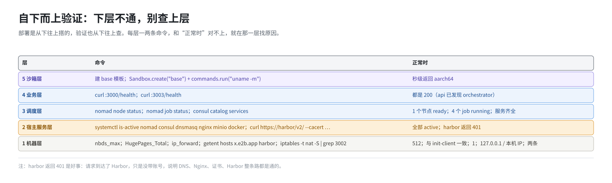
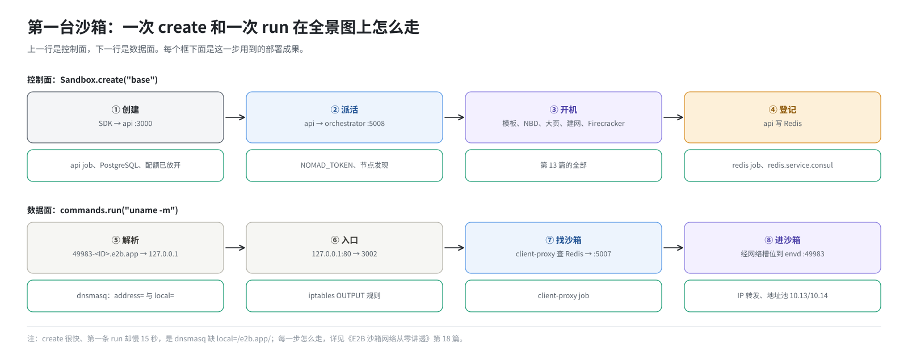

# 第 17 篇｜部署好了没有：验证与第一台沙箱

> **本篇目标**：进入第四部分。`build.sh -s` 打印“启动完成”，不等于这套环境真能用。本篇给出一套自下而上的验证顺序：机器层、宿主服务层、调度层、业务层、沙箱层，每层一两条命令，配上正常时的样子。然后用 SDK 准备好凭据，建第一个模板、开第一台沙箱，把这两次请求在全景图上走一遍，标出每一步用到了部署的哪一部分。最后讲从别的机器访问要补什么，以及快照回滚功能怎么确认就绪。

---

## 一、验证的思路：自下而上



部署是从下往上搭的，验证也从下往上查。下层不通，上层的检查没有意义；下层都通，上层出问题的范围就小了。

| 层 | 查什么 | 对应部署的哪一步 |
|---|---|---|
| 1. 机器层 | 内核模块、大页、IP 转发、DNS | 第 0 步、`init-client.sh` |
| 2. 宿主服务层 | systemd 服务、docker 容器、Harbor | `-i`、`-s` 前半 |
| 3. 调度层 | Nomad、Consul、4 个 job | `-s` 中段 |
| 4. 业务层 | api 健康、client-proxy 健康 | `deploy.sh` |
| 5. 沙箱层 | 建模板、开沙箱、执行命令 | 全部 |

下面每条命令都给出“正常时的样子”。和它不一样，就在那一层找原因。

---

## 二、第 1 层：机器层

```bash
# NBD 模块：512 个设备
cat /sys/module/nbd/parameters/nbds_max          # 512
ls /dev/nbd* | wc -l                             # 512

# 大页
grep -E 'HugePages_Total|HugePages_Free|Hugepagesize' /proc/meminfo
#   HugePages_Total:   32768        ← 静态池，和 init-client.sh 打印的一致
#   HugePages_Free:    32768        ← 还没有沙箱，全部空闲
#   Hugepagesize:       2048 kB
cat /proc/sys/vm/nr_overcommit_hugepages         # 超分配池上限
mountpoint /mnt/hugepages                        # /mnt/hugepages is a mountpoint

# IP 转发
sysctl -n net.ipv4.ip_forward                    # 1

# DNS
head -1 /etc/resolv.conf                         # nameserver 127.0.0.1
getent hosts abc.e2b.app                         # 127.0.0.1  abc.e2b.app
getent hosts harbor                              # 192.168.10.23  harbor

# 运行时文件
ls /fc-kernels/ /fc-versions/ /fc-envd/
#   /fc-kernels: vmlinux-6.1.102  vmlinux-6.1.158  vmlinux-6.6.0-132.0.0
#   /fc-versions: v1.13.1
#   /fc-envd: envd

# iptables 入口
iptables -t nat -S | grep 3002
#   -A PREROUTING -p tcp -m tcp --dport 80 -m addrtype --dst-type LOCAL -j REDIRECT --to-ports 3002
#   -A OUTPUT -o lo -p tcp -m tcp --dport 80 -j REDIRECT --to-ports 3002
```

---

## 三、第 2 层：宿主服务层

```bash
systemctl is-active nomad consul dnsmasq nginx minio docker
#   active（六行都是）

docker ps --format '{{.Names}}\t{{.Status}}'
#   postgres         Up 20 minutes (healthy)
#   harbor-core      Up 15 minutes (healthy)
#   registry         Up 15 minutes (healthy)
#   ...（Harbor 的一组）
#   以及 Nomad 起的 api、client-proxy、redis 容器（名字带 alloc ID）

# Harbor 里的镜像
curl -s -u admin:Harbor12345 http://127.0.0.1:2900/v2/_catalog
#   {"repositories":["e2b-orchestration/api","e2b-orchestration/client-proxy",
#    "e2b-orchestration/db-migrator","e2b-orchestration/redis","e2b-orchestration/ubuntu"]}

# harbor:443 这条路通不通（模板构建要用）
curl -s --cacert /etc/docker/certs.d/harbor:443/ca.crt https://harbor/v2/ -o /dev/null -w '%{http_code}\n'
#   401（要求登录，说明 HTTPS、证书、Nginx、Harbor 整条路都通了）
```

最后一条返回 401 是好事：它说明请求到达了 Harbor，只是没带账号。如果是证书错误、连不上、或 502，说明这条路有问题（第 10 篇的表）。

---

## 四、第 3 层：调度层

```bash
export NOMAD_TOKEN=$(cat /data/nomad/acl.token)

nomad node status
#   ID        Node Pool  DC   Name       Class   Drain  Eligibility  Status
#   8a7d6c5b  api        dc1  kunpeng01  <none>  false  eligible     ready

nomad job status
#   ID                       Type     Priority  Status
#   api                      service  90        running
#   client-proxy             service  80        running
#   redis                    service  95        running
#   template-manager-system  system   70        running
```

一台节点、ready；四个 job、running。

在浏览器打开 Nomad 的界面 `http://192.168.10.23:4646/ui`，用令牌登录，可以看到每个 job 的 alloc、日志、资源使用。

Consul 这边：

```bash
export CONSUL_HTTP_TOKEN=$(cat /opt/consul/acl.token)
consul catalog services
#   api  api-grpc  client-proxy  consul  redis  template-manager

dig @127.0.0.1 redis.service.consul +short       # 经 dnsmasq 转给 Consul
#   192.168.10.23
```

Consul 界面在 `http://192.168.10.23:8500/ui`，每个服务的健康检查都应该是绿色。

---

## 五、第 4 层：业务层

```bash
curl -s -o /dev/null -w '%{http_code}\n' http://127.0.0.1:3000/health    # 200
curl -s -o /dev/null -w '%{http_code}\n' http://127.0.0.1:3003/health    # 200

ss -lntp | grep -E ':(3000|3002|5007|5008) '
#   四个端口都在监听
```

api 返回 200 意味着它已经发现了 orchestrator（第 15 篇）。如果是 503，回到第 15 篇的依赖链，先查 template-manager-system。

---

## 六、第 5 层：用 SDK 开第一台沙箱

### 6.1 准备凭据

`deploy.sh` 末尾把 seed-db 生成的凭据写进了 `/root/.e2b/config.json`：

```bash
cat /root/.e2b/config.json
# {
#   "email": "admin@e2b.dev",
#   "teamName": "E2B",
#   "teamId": "...",
#   "accessToken": "sk_e2b_...",
#   "teamApiKey": "e2b_..."
# }
```

**把这个文件备份好。** 数据库里存的是这两个 key 的哈希，明文只出现在这个文件里。而且这个文件只在“数据库里还没有 E2B 团队”时写一次，下次 `-s` 发现团队已存在，就不会再写。文件丢了、数据库还在，就再也拿不到明文 key，只能清库重新生成。

在工作目录建一个 `.env` 给 SDK 用：

```bash
E2B_ACCESS_TOKEN="sk_e2b_..."              # config.json 的 accessToken
E2B_API_KEY="e2b_..."                      # config.json 的 teamApiKey
E2B_API_URL="http://192.168.10.23:3000"    # 控制面入口
E2B_DOMAIN="e2b.app"                       # 数据面域名后缀
E2B_HTTP_SSL="false"
```

| 变量 | 作用 |
|---|---|
| `E2B_ACCESS_TOKEN` | 建模板时“发起构建”用（第 11 篇） |
| `E2B_API_KEY` | 开沙箱、查状态等 |
| `E2B_API_URL` | api 地址。不设的话，SDK 会用 `http://api.<E2B_DOMAIN>` |
| `E2B_DOMAIN` | SDK 用它拼沙箱地址 `49983-<ID>.e2b.app` |
| `E2B_HTTP_SSL` | 不用 HTTPS |

仓库的 `benchmark/sync-env.sh` 可以自动从 `config.json` 和 `/data/nomad/acl.token` 同步这些值。

### 6.2 建第一个模板

```python
# build_base.py
from dotenv import load_dotenv
load_dotenv()
from e2b import Template, default_build_logger

Template.build(
    Template().from_dockerfile('FROM harbor:443/e2b-orchestration/ubuntu:22.04-custom'),
    alias="base",
    cpu_count=2,
    memory_mb=2048,
    on_build_logs=default_build_logger(),
)
```

```bash
python3 build_base.py
```

成功时会持续打印构建日志，最后显示构建完成。第一次大约需要一两分钟。


这一个调用，用到了前面几乎每一篇准备的东西：

| 步骤 | 用到的部署成果 | 在哪一篇 |
|---|---|---|
| SDK 发请求到 `http://...:3000` | SDK 的三层改造（http、老版接口、双客户端） | 第 11 篇 |
| api 验证 access token、记录构建 | PostgreSQL、db-migrator 建的表、seed-db 造的账号 | 第 10、14、15 篇 |
| api 把构建任务交给 template-manager | api 发现了 orchestrator（同一个进程） | 第 15 篇 |
| template-manager 拉 `harbor:443/...` | `/etc/hosts` 的 harbor、dnsmasq、Nginx、证书、`SSL_CERT_FILE`、Harbor 里的基础镜像 | 第 10、14 篇 |
| 把镜像做成磁盘、注入 envd 和 busybox | `/fc-envd/envd`；编进二进制的 busybox | 第 7、13 篇 |
| 用磁盘启动一台构建用的虚拟机 | `/fc-kernels/vmlinux-6.1.158/`、`/fc-versions/v1.13.1/`、NBD、大页、网络槽位 | 第 8、13 篇 |
| 等虚拟机里的 envd 就绪 | **IP 转发** | 第 13 篇 |
| 打内存快照，存成模板 | `/orchestrator/build`、`/tmp/templates` | 第 12 篇 |

常见失败，按出现的阶段：

| 报错 | 原因 |
|---|---|
| `401` / `403` | key 不对，或者 `.env` 里漏了 `E2B_ACCESS_TOKEN` |
| `lookup harbor ... server misbehaving` | `/etc/hosts` 里没有 harbor，或 dnsmasq 没重启 |
| `x509: certificate ...` | 证书没被信任或已过期 |
| `manifest unknown` | Harbor 里没有基础镜像 |
| `Provisioning sandbox template` 处失败 | `/fc-kernels` 下没有对应版本的目录 |
| 等 envd 60 秒后 `build was cancelled` | IP 转发是 0 |
| `Alias 'base' already used` | 上一次构建失败，别名没释放（第 20 篇） |

### 6.3 开第一台沙箱

```python
# hello.py
from dotenv import load_dotenv
load_dotenv()
from e2b import Sandbox

sbx = Sandbox.create("base")
print(sbx.sandbox_id)
print(sbx.commands.run("uname -m").stdout)      # aarch64
print(sbx.commands.run("whoami").stdout)
sbx.kill()
```

`Sandbox.create()` 走控制面，`commands.run()` 走数据面（第 2 篇）：



| 步骤 | 路径 | 用到的部署成果 |
|---|---|---|
| ① 创建 | SDK → `:3000` api | api job、PostgreSQL、配额已放开 |
| ② 派活 | api → `:5008` orchestrator | api 的 `NOMAD_TOKEN`、节点发现 |
| ③ 开机 | orchestrator 从 `/tmp/templates` 取模板，挂 NBD、映射大页、建网、起 Firecracker | 第 13 篇的全部 |
| ④ 登记 | api 把沙箱位置写进 Redis | redis job、`redis.service.consul` |
| ⑤ 执行命令 | SDK 解析 `49983-<ID>.e2b.app` → 127.0.0.1 | dnsmasq 的 `address=` 和 `local=` |
| ⑥ 入口 | 127.0.0.1:80 → 3002 | iptables 的 OUTPUT 规则 |
| ⑦ 找沙箱 | client-proxy 查 Redis → orchestrator 代理 `:5007` | client-proxy job |
| ⑧ 进沙箱 | 经网络槽位到 envd `:49983` | IP 转发、网络地址池 |

每一步具体怎么走的，《E2B 沙箱网络从零讲透》第 18 篇有详细讲解。

如果 `create` 很快、但第一条 `run` 慢了 15 秒，是 dnsmasq 缺了 `local=/e2b.app/`（第 11 篇）。

---

## 七、从别的机器访问

本机能用了，团队里的其他人要从自己的电脑访问，还差三件事：

**1. DNS。** 本机的 dnsmasq 把 `*.e2b.app` 解析成 `127.0.0.1`，这条规则对别的机器没用（127.0.0.1 是它们自己）。别的机器要自己把 `*.e2b.app` 解析到服务器的真实 IP。`/etc/hosts` 不支持通配符，一般在那台机器上也用 dnsmasq：

```
address=/.e2b.app/192.168.10.23
local=/e2b.app/
```

**2. 防火墙。** 服务器要放行 80（沙箱流量）和 3000（api）两个端口。如果用 firewalld：

```bash
firewall-cmd --list-ports
firewall-cmd --permanent --add-port=80/tcp --add-port=3000/tcp && firewall-cmd --reload
```

**3. SDK。** 那台机器要装同样版本的 SDK，并做至少 `patch_e2b.py` 那一层改造（第 11 篇）；要建模板的话，5 个文件也要替换。

从别的机器来的请求，在服务器上走的是 PREROUTING 那条 iptables 规则（第 14 篇）。全程是明文 HTTP，只适合在可信的内网里用。

---

## 八、快照回滚功能是否就绪

这套环境的一个特色功能是沙箱级快照回滚（checkpoint / restore），由三样东西共同提供：补丁里的 orchestrator、定制 Firecracker、SDK 覆盖层。分别核对：

```bash
# ① 定制 Firecracker 已经拷到运行位置，两份一致
sha256sum /opt/e2b-infra/bin/firecracker /fc-versions/v1.13.1/firecracker

# ② SDK 覆盖层装好且自检通过
python3 /opt/e2b-infra/dep/e2b-sdk-checkpoint/install.py --check

# ③ orchestrator 启动时报告的能力
cat /orchestrator/build/checkpoint-capabilities.json
```

第 ③ 项的文件里有一个 `pid` 字段，要和当前 template-manager 进程的 PID 一致，否则是以前某次启动留下的旧文件。

增量快照依赖“脏页跟踪”。本部署默认跟着硬件走：有硬件脏页跟踪能力的鲲鹏 950 上自动打开；没有这项能力的机器（如鲲鹏 920B）上默认关闭，每次快照都是全量的，功能正确但更慢、更大。要在后者上强制打开，可以给 template-manager 加环境变量 `FC_TRACK_DIRTY_PAGES=true`（改法见第 19 篇的“改一个 job 的环境变量”）。原理见《E2B 沙箱存储从零讲透》第 15～17 篇。

---

## 九、一张验证清单

| 层 | 命令 | 正常 |
|---|---|---|
| 机器 | `cat /sys/module/nbd/parameters/nbds_max` | 512 |
| 机器 | `grep HugePages_Total /proc/meminfo` | 和 init-client 打印的一致 |
| 机器 | `sysctl -n net.ipv4.ip_forward` | 1 |
| 机器 | `getent hosts x.e2b.app harbor` | 127.0.0.1 / 本机 IP |
| 机器 | `iptables -t nat -S \| grep 3002` | 两条 |
| 服务 | `systemctl is-active nomad consul dnsmasq nginx minio docker` | 全 active |
| 服务 | `curl https://harbor/v2/ --cacert ...` | 401 |
| 调度 | `nomad node status` | 1 个 ready |
| 调度 | `nomad job status` | 4 个 running |
| 调度 | `consul catalog services` | 有 redis、template-manager、api、client-proxy |
| 业务 | `curl :3000/health`、`curl :3003/health` | 200 |
| 沙箱 | 建 `base` 模板 | 成功 |
| 沙箱 | `Sandbox.create("base")` + `commands.run` | 秒级返回 |

---

## 本篇小结

| 概念 | 一句话解释 |
|---|---|
| 自下而上 | 机器 → 宿主服务 → 调度 → 业务 → 沙箱，下层不通别查上层 |
| `https://harbor/v2/` 返回 401 | 证明证书、Nginx、Harbor 整条路是通的 |
| api 200 | 说明它已经发现了 orchestrator |
| `/root/.e2b/config.json` | 唯一保存明文 key 的地方，只写一次，务必备份 |
| SDK 的 `.env` | 两个 key、`E2B_API_URL`、`E2B_DOMAIN`、`E2B_HTTP_SSL=false` |
| 第一个模板 | 用到 Harbor、证书、hosts、内核、Firecracker、envd、NBD、大页、IP 转发 |
| 第一台沙箱 | 控制面经 api、orchestrator；数据面经 dnsmasq、iptables、client-proxy、Redis |
| 外机访问 | 自配 DNS、放行 80 和 3000、装并改造 SDK |
| 快照回滚 | 核对 Firecracker 哈希、SDK 覆盖层、能力文件 |

**下一篇预告**：[《`build.sh -d`：怎么停干净》](18-stop-cleanly.md)。“停”比“起”难：网络槽位、Firecracker 进程、大页、端口，都不会因为进程退出而自动消失。本篇讲 `-d` 每一步的顺序为什么是这样，槽位泄漏怎么产生、怎么回收，以及 `-d`、`-u`、`--recycle-netns`、`--purge-hugepages` 的区别。
