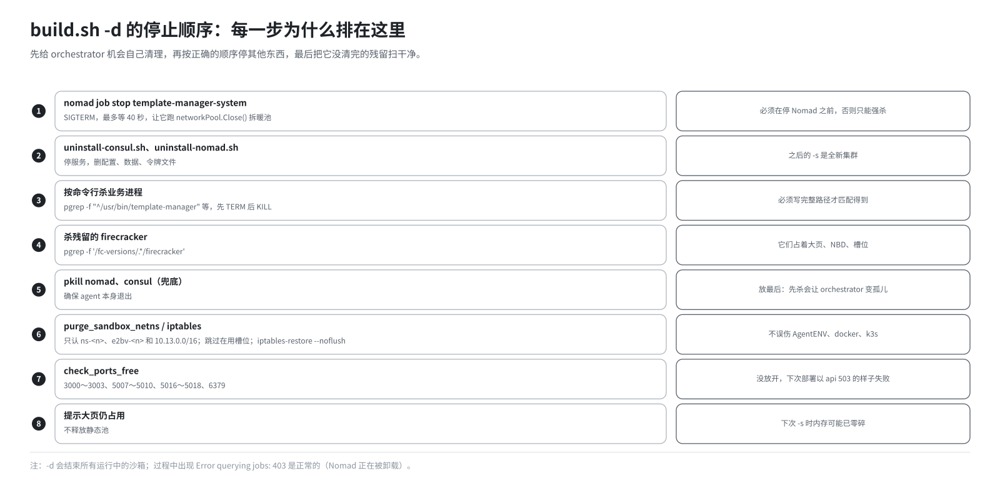
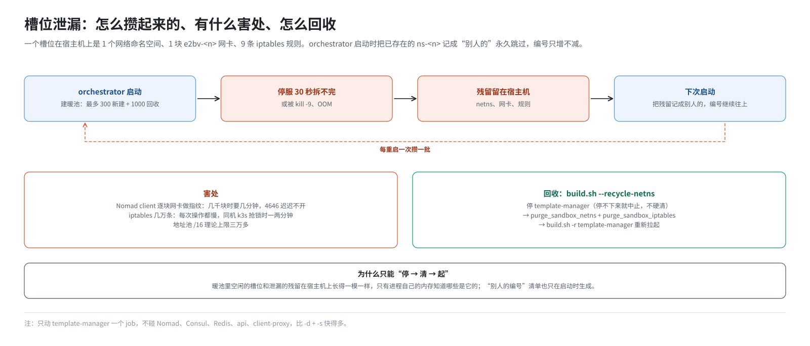

# 第 18 篇｜`build.sh -d`：怎么停干净

> **本篇目标**：讲部署的反方向。停一套 E2B 比启动它更难，因为有好几样东西不会随着进程退出而自动消失：网络槽位、Firecracker 进程、端口、大页。本篇按 `stop()` 的执行顺序，逐步讲每一步做什么、为什么排在这个位置；然后专门讲“槽位泄漏”是怎么一点点积累起来、积累多了会怎样、`--recycle-netns` 怎么回收；最后对比 `-d`、`-u`、`--recycle-netns`、`--purge-hugepages` 四个清理命令的范围。

---

## 一、为什么“停”比“起”难

启动时，每样东西都是脚本或程序主动建出来的，建的人知道自己建了什么。停止时，情况不一样：

| 东西 | 谁建的 | 进程退出后会怎样 |
|---|---|---|
| 网络命名空间、虚拟网卡 | orchestrator 运行时 | **留在宿主机上**，要有人主动删 |
| 每个槽位的 iptables 规则 | orchestrator 运行时 | **留在内核里**，网卡没了也不会自动消失 |
| Firecracker 进程 | orchestrator 启动的子进程 | 父进程被强杀时，子进程**可能变成孤儿继续跑** |
| 端口 | 各服务 | 进程没退干净，端口就一直被占着 |
| 静态大页池 | `init-client.sh` 写进 `/proc` | **一直占着**，和进程无关 |

orchestrator 本来会在收到 SIGTERM 后自己清理网络槽位（第 15 篇）。但它只有 30 秒，而且如果是被 `kill -9` 或者它的父进程先被杀，清理代码一行都跑不到。

所以 `-d` 的核心思路是：**先给 orchestrator 机会自己清理，再按正确的顺序停其他东西，最后把它没清完的残留扫干净。**

---

## 二、`stop()` 一步一步



### 第 1 步：通过 Nomad 优雅停 template-manager

```bash
graceful_stop_template_manager
```

```bash
token=$(source /opt/e2b-infra/.env; printf '%s' "$NOMAD_ACL_TOKEN")
nomad job stop -token "$token" template-manager-system

# 等进程退出，最多 40 秒
while [ $waited -lt 40 ]; do
    pgrep -f '^/usr/bin/template-manager' >/dev/null || break
    sleep 2; waited=$((waited + 2))
done
```

用 `nomad job stop` 而不是直接 `kill`，是因为 Nomad 会按 job 定义里的 `kill_signal = "SIGTERM"` 和 `kill_timeout = "30s"` 来停：先发 SIGTERM，给它 30 秒自己收拾。orchestrator 在这 30 秒里执行 `networkPool.Close()`，逐个拆掉暖池里的网络槽位。

**为什么必须是第一步？** 后面第 2 步会停掉 Nomad。Nomad 一停，就没人能“优雅地”停这个 job 了，只能靠 `pkill` 强杀，清理代码就完全没机会执行，整池几百个槽位当场变成泄漏。

等了 40 秒（30 秒超时再加 10 秒余量）还没退，就告警继续，后面的步骤会兜底。

**一个副作用：** 正在运行的沙箱都会在这一步被结束。`-d` 不区分“有没有人在用”。

### 第 2 步：停 Consul 和 Nomad

```bash
bash "$E2B_DIR/uninstall-consul.sh" --force
bash "$E2B_DIR/uninstall-nomad.sh"  --force
```

名字叫 uninstall，做的事情确实不止是“停”：

| 脚本 | 做了什么 |
|---|---|
| `uninstall-consul.sh` | 停服务、取消开机自启；删 unit 文件、`/etc/consul.d`、`/data/consul`、`/opt/consul` 下的二进制和**令牌文件** |
| `uninstall-nomad.sh` | 停服务、取消开机自启；卸载并删除 `/data/nomad/alloc`；删 unit、`/etc/nomad.d`、`/data/nomad`（含**令牌文件**）、二进制、插件目录、`/root/docker` |

也就是说，**`-d` 之后整个集群都没了**，包括 ACL 令牌、所有 job 定义、所有 alloc 的日志。下一次 `-s` 会从零建一个新集群，重新 bootstrap 出新令牌。

这正是第 12 篇讲的令牌持久化设计：令牌和集群数据放在一起，`-d` 删集群时一起删，不会出现“集群是新的、令牌却是旧的”。

因为 Nomad 被停掉了，`-d` 过程中如果看到 `Error querying jobs: 403` 之类的输出，属于正常现象。

### 第 3 步：按命令行杀业务进程

```bash
tasks=("redis" "/client-proxy" "/api" "/usr/bin/template-manager" "/usr/bin/orchestrator")
for task in "${tasks[@]}"; do
    pids=$(pgrep -f "^$task" | grep -v $$)
    [ -n "$pids" ] && kill $pids          # 先 SIGTERM
    sleep 1
    remaining=$(pgrep -f "^$task" | grep -v $$)
    [ -n "$remaining" ] && kill -9 $remaining   # 没退就强杀
done
```

Nomad 停了以后，它管的进程不一定跟着退出（容器里的进程、raw_exec 的进程都可能残留）。这一步按**完整命令行开头**精确匹配，把它们找出来杀掉。

两个细节：

- **`pgrep -f "^..."`** 匹配的是完整命令行，`^` 表示从开头匹配，所以要写进程实际启动时的路径。orchestrator 的命令行是 `/usr/bin/template-manager --port 5008`，早期的脚本写成 `template-manager`（没有路径），永远匹配不到，`-d` 报告“停止成功”但进程其实还活着。
- **`grep -v $$`** 排除脚本自己的 PID，免得误杀自己。

### 第 4 步：杀残留的 Firecracker

```bash
fc_pids=$(pgrep -f '/fc-versions/.*/firecracker')
kill $fc_pids; sleep 2
fc_pids=$(pgrep -f '/fc-versions/.*/firecracker')
[ -n "$fc_pids" ] && kill -9 $fc_pids
```

每个运行中的沙箱、每个正在进行的模板构建，都是一个独立的 Firecracker 进程。它们的命令行以 `/fc-versions/...` 开头，第 3 步的列表匹配不到。

不清掉的话，下一次 `-s` 里 `init-client.sh` 往 `/fc-versions/v1.13.1/` 拷新的 Firecracker 时会报 `Text file busy`（第 13 篇讲过，现在脚本已经用“先删后拷”规避了这个问题，但残留的虚拟机本身也占着大页、NBD 设备和网络槽位）。

### 第 5 步：兜底杀 Nomad 和 Consul

```bash
pkill nomad
pkill consul
```

确保 Nomad、Consul 的进程本身都退出了。

**为什么这一步放在业务进程之后，而不是一开始？** 因为 `raw_exec` 启动的任务，是 Nomad 内部一个叫 executor 的子进程的子进程，而 executor 的进程名**也叫 nomad**。如果一开始就 `pkill nomad`，executor 被杀，orchestrator 就变成了孤儿进程，继续运行、继续占着端口，而且脱离了任何人的管理。先把业务进程杀干净，再兜底杀 Nomad，就没有这个问题。

### 第 6 步：清理网络残留

```bash
purge_sandbox_netns
purge_sandbox_iptables
```

把第 1 步 orchestrator 没来得及拆完的网络槽位扫干净。下一节专门讲。

### 第 7 步：检查端口

```bash
check_ports_free
```

检查 E2B 用到的端口是否都释放了：

```
3000 3001 3002 3003 5007 5008 5009 5010 5016 5017 5018 6379
```

有任何一个还被占着，就打印占用者，并警告：

```
⚠️ 以下端口仍被占用：5008
⚠️ 处置：确认是上一轮的残留后 kill -9 掉，再跑 -s；否则 orchestrator 会 bind 失败，
⚠️       表现为部署最后卡在 api 的 deployment 并超时失败。
```

这是第 9 篇说的“先拦截”。端口没放开的后果不是“下次启动慢一点”，而是：

```
orchestrator 启动时 bind 5008 失败 → 退出
→ Nomad 重试 2 次后放弃
→ api 发现不了节点，/health 一直 503
→ deploy.sh 卡在 api 上 10 分钟后失败
```

报错全在 api 上，和真正的原因毫无字面关联（第 15 篇）。所以要在 `-d` 结束时就把它指出来。

### 第 8 步：提示大页

```bash
info "静态大页池仍占用 65536 MiB（不随服务停止释放）；要回收执行：build.sh --purge-hugepages"
```

`-d` **故意不释放大页**。下一次 `-s` 要重新预留静态池，而那时内存可能已经零碎，凑不齐连续的 2 MiB 页。保留着反而更稳。真要把内存还给系统，显式执行 `--purge-hugepages`。

---

## 三、网络槽位的清理

### 3.1 一个槽位在宿主机上留下什么

每个网络槽位在宿主机上有：

| 东西 | 名字 |
|---|---|
| 网络命名空间 | `ns-<编号>` |
| 宿主机一侧的虚拟网卡 | `e2bv-<编号>`（上游叫 `veth-<编号>`，本仓库改名，避开同机 AgentENV） |
| nat 表的 PREROUTING 规则 | 6 条，都带 `-i e2bv-<编号>` |
| nat 表的 POSTROUTING 规则 | 1 条 MASQUERADE，按槽位的宿主机地址 `-s 10.13.x.x/32` 匹配 |
| filter 表的 FORWARD 规则 | 2 条，`-i`/`-o e2bv-<编号>` |

也就是说，每个槽位 1 个命名空间、1 块网卡、9 条 iptables 规则。规则的作用见《E2B 沙箱网络从零讲透》第 12、16、19 篇。

### 3.2 `purge_sandbox_netns`

```bash
ns_list=$(ip netns list | awk '{print $1}' | grep -E '^ns-[0-9]+$')
veth_list=$(ip -o link | ... | grep -E "^e2bv-[0-9]+$")

# 跳过正在运行的槽位：命名空间里还有进程，说明沙箱在跑
busy=$(busy_slot_indexes)
...
for n in $ns_list;   do ip netns delete "$n"; done
for l in $veth_list; do ip link show "$l" >/dev/null 2>&1 && ip link delete "$l"; done
```

两个要点：

**名字严格锚定。** 只匹配 `ns-<数字>` 和 `e2bv-<数字>`。同一台机器上可能还有：

- AgentENV 的 `veth-<n>`；
- flannel 的 `vethXXXX`；
- containerd 的 `cni-<uuid>`；
- docker 的 `docker0`、libvirt 的 `virbr0`。

误删任何一个，都会把别人的网络搞坏。

**跳过在用的槽位。** “在用”的判断依据是：这个命名空间里还有进程（就是 Firecracker）。走到这一步时 Firecracker 应该都已经被杀了，所以一般不会有在用的槽位；但这个函数也被 `--recycle-netns` 复用，那时可能有沙箱在跑。

### 3.3 `purge_sandbox_iptables`

网卡删了，iptables 规则不会跟着消失，只是再也匹配不到任何包。积累到几万条之后，每一次 `iptables` 命令都要把整张表读出来、改完、再写回去，部署收尾时加那两条 80 端口规则都会明显变慢。

清理分两步：

**挑出要删的规则。**

- nat 和 filter 表里带 `-i e2bv-<n>` 或 `-o e2bv-<n>` 的，按网卡名挑；
- POSTROUTING 里的 MASQUERADE 规则不带网卡名，只能按源地址挑：源地址落在 `.env` 的 `SANDBOXES_HOST_NETWORK_CIDR`（10.13.0.0/16）里的才删。这里做的是精确的网段判断，而不是字符串前缀匹配，因为同机 AgentENV 有一条 `-s 10.11.0.0/16 -j MASQUERADE`，按前缀匹配容易误伤。

**批量删除。**

```bash
printf '*nat\n%s\nCOMMIT\n' "$nat_del" | iptables-restore --noflush
```

逐条 `iptables -D` 删几万条规则要几个小时。`iptables-restore --noflush` 一次性提交所有删除，而且不清空整张表，同机 docker、k3s 的规则不受影响。

清理完会打印规则数的变化（数字是示意）：

```
✅ 沙箱网络资源清理完成；iptables 规则 nat 18342 → 12、filter 6120 → 40
```

---

## 四、槽位泄漏：怎么来的、有什么害处



### 4.1 怎么来的

几个来源：

1. **30 秒拆不完。** 暖池最多有 300 个新槽位 + 1000 个回收槽位，每个 9 条规则，30 秒内拆不完就被强杀（第 15 篇）。
2. **进程被直接杀死。** OOM、手工 `kill -9`、Nomad 先被停掉。
3. **机器断电。** 这种情况内核状态全没了，反而干净。

### 4.2 为什么会越攒越多

orchestrator 启动时，会把 `/var/run/netns` 下已经存在的 `ns-<n>` 记下来，当作“别人的”，**永久跳过**这些编号。于是：

- 上一轮泄漏了 200 个，这一轮就从第 201 号开始分配；
- 每重启一次泄漏一批，编号只增不减；
- 宿主机上的网卡数量越来越多。

### 4.3 有什么害处

- **Nomad 启动变慢。** Nomad client 启动时要逐块网卡做指纹探测。几千块网卡时要好几分钟，4646 端口迟迟不开，`-s` 卡在“等待 4646”（第 12 篇）。
- **iptables 变慢。** 规则几万条时，每次操作都慢；同机有 k3s 时，kube-proxy 抢锁，一次操作可能要一两分钟。
- **地址池耗尽。** 理论上限三万多个，正常不会碰到，但泄漏严重时也会成为问题。

### 4.4 `--recycle-netns`：不停整个服务的回收

```bash
bash build.sh --recycle-netns
```

```
recycle_sandbox_net()
├── template-manager 在跑吗？
│   ├── 在跑：graceful_stop_template_manager（停不下来就中止，不硬清）
│   └── 没跑：直接清
├── purge_sandbox_netns
├── purge_sandbox_iptables
└── 原来在跑：build.sh -r template-manager 重新拉起
```

它只动 template-manager 这一个 job，不碰 Nomad、Consul、Redis、api、client-proxy，比 `-d` + `-s` 快得多。

为什么必须先停 template-manager？因为**暖池里空闲的槽位和泄漏的残留，在宿主机上长得一模一样**：没有进程、名字一样、规则一样。只有 orchestrator 进程自己的内存里知道哪些是它的暖池。进程活着时硬清，等于把它手里的暖池删了，之后开沙箱会连续失败。而且它启动时记下的“别人的编号”不会在运行中更新，就算精确删掉了泄漏的槽位，这些编号也要等它重启后才能重新使用。

所以这件事天生就是“停 → 清 → 起”，没有“不停服在线清理”这条路。

---

## 五、`--purge-hugepages`：把大页还给系统

```bash
bash build.sh --purge-hugepages
```

```bash
echo 0 > /proc/sys/vm/nr_overcommit_hugepages   # 先关超分配
echo 0 > /proc/sys/vm/nr_hugepages              # 再清静态池
umount /mnt/hugepages
grep -E 'HugePages_(Total|Free|Rsvd|Surp)' /proc/meminfo
```

- **顺序**：先把超分配上限归零，再清静态池。反过来的话，清静态池的过程中可能又冒出超分配的页。
- **安全性**：内核只回收**空闲**的大页，正在被沙箱使用的不会被抽走。所以即使有沙箱在跑，执行它也不会出事，只是收不回那部分。脚本会提示还有哪些 Firecracker 在跑。
- **`/mnt/hugepages` 下还有文件**会把大页“钉住”，脚本也会提示。

建议先 `-d` 再执行它，才能全部收回。下次 `-s` 会按 20% 重新预留。

---

## 六、`-u`：卸载

```bash
bash build.sh -u
```

```
uninstall()
├── uninstall_e2b
│   ├── uninstall_nomad（停并删除 Nomad、Consul）
│   ├── 撤掉 checkpoint SDK 覆盖层（install.py --uninstall）
│   └── rpm -e e2b-infra
├── uninstall_nginx      停服务，yum remove，删 /etc/nginx
├── uninstall_harbor     docker-compose down -v，删 /opt/e2b-infra/harbor
└── uninstall_postgres   删容器、删镜像
```

注意 checkpoint SDK 覆盖层要在 `rpm -e` 之前撤掉，因为撤销用的 `install.py` 就在 RPM 装的目录里。

**`-u` 不处理的东西**：

- MinIO（那一行被注释了）和它的数据 `/root/data/minio`；
- Docker（自备的）；
- 大页、`/etc/sysctl.conf` 的改动、udev 规则、`/etc/hosts`、`/etc/dnsmasq.conf`、`/etc/resolv.conf`；
- `/fc-*`、`/orchestrator`、`/usr/bin/template-manager`；
- 系统信任库里的证书；
- 网络残留（`-u` 里没有调用清理函数，要先 `-d`）；
- `/tmp/templates`、`/root/.e2b/config.json`。

所以 `-u` 之后机器并不是“恢复原样”。真要彻底清理，在 `-u` 之前先 `-d`、`--purge-hugepages`，之后再手工处理上面列出的东西。

`-u` 一般用不到。日常的“推倒重来”用 `-d` 就够了。

---

## 七、四个清理命令对比

| | `-d` | `--recycle-netns` | `--purge-hugepages` | `-u` |
|---|---|---|---|---|
| 运行中的沙箱 | 结束 | 结束 | 不影响 | 结束 |
| template-manager | 停 | 停后重新拉起 | 不动 | 停 |
| api、client-proxy、redis | 停 | 不动 | 不动 | 停 |
| Nomad、Consul（含令牌、job 定义） | **删除** | 不动 | 不动 | 删除 |
| 网络残留 | 清 | 清 | 不动 | **不清** |
| 大页 | 保留 | 保留 | **释放** | 保留 |
| PostgreSQL、Harbor、Nginx | 不动 | 不动 | 不动 | 删除 |
| RPM | 不动 | 不动 | 不动 | 卸载 |
| 典型场景 | 重新部署前 | `-s` 卡在 4646；网卡太多 | 停服后要回收内存 | 不再使用这台机器 |

---

## 本篇小结

| 概念 | 一句话解释 |
|---|---|
| 停比起难 | 网络槽位、规则、孤儿进程、端口、大页都不会自动消失 |
| 第一步优雅停 | 必须在停 Nomad 之前，让 orchestrator 自己拆暖池 |
| uninstall 脚本 | 删掉整个 Nomad、Consul 集群，含令牌；下次 `-s` 重新 bootstrap |
| 按命令行精确匹配 | `pgrep -f "^/usr/bin/template-manager"` |
| 兜底杀 Nomad 放最后 | 先杀会让 orchestrator 变孤儿 |
| 槽位 | 1 个命名空间、1 块网卡、9 条规则；名字严格锚定，跳过在用的 |
| `iptables-restore --noflush` | 批量删规则，不影响别人 |
| 端口自检 | 端口没放开，下次部署会以“api 503”的样子失败 |
| 槽位泄漏 | 编号只增不减；拖慢 Nomad 启动和 iptables |
| `--recycle-netns` | 停 → 清 → 起，只动 template-manager |
| 大页 | `-d` 故意保留；`--purge-hugepages` 释放 |
| `-u` | 不等于恢复原样，很多东西不处理 |

**下一篇预告**：[《改了东西之后，怎么让它生效》](19-apply-changes.md)。部署好之后，日常的工作是“改”：改源码、改一个环境变量、改 `.env`、改 Nomad 的配置。不同的改动落在部署的不同层，要做的事完全不同。本篇用“三层模型”把它们分成五种场景，每种给出最小的操作和逐层核对的办法。
