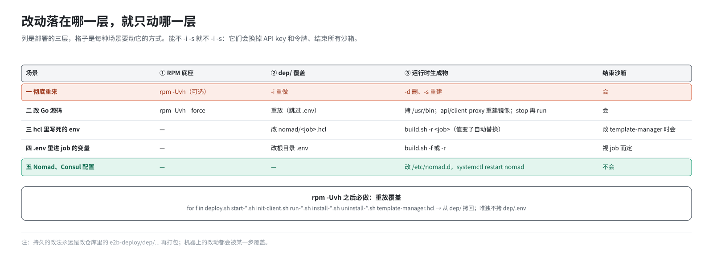
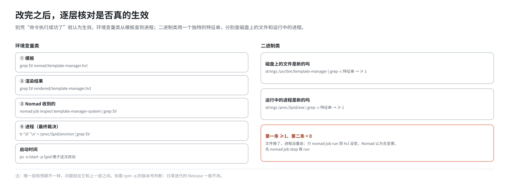
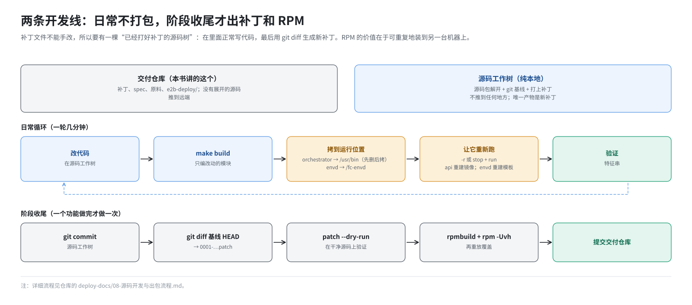

# 第 19 篇｜改了东西之后，怎么让它生效

> **本篇目标**：部署好之后，日常的工作是“改”：改源码、改一个环境变量、改 `.env`、改 Nomad 的配置。不同的改动落在部署的不同层，要做的事完全不同。用错了方法，轻则改动不生效，重则把集群的令牌冲掉、所有 job 提交失败。本篇先用“三层模型”给改动定位，再按五种场景给出最小操作，每种都说清楚为什么这样做，最后给出“确认真的生效了”的逐层核对方法，以及改源码的日常循环。

---

## 一、先定位：改动落在哪一层

第 8 篇讲过，一套完整的部署是三层叠出来的：



| 层 | 内容 | 谁写的 | 谁会覆盖它 |
|---|---|---|---|
| ① RPM 底座 | `bin/*`、`nomad/*.hcl`、根目录脚本、`dep/*` | `rpm -ivh` / `-Uvh` | 每次 `rpm -Uvh` 整层重铺 |
| ② `dep/` 覆盖 | 根目录的单机版脚本、`nomad/template-manager.hcl`、根目录 `.env` | `build.sh -i` | `rpm -Uvh` 会把它打回上游版 |
| ③ 运行时生成物 | `.env` 里的真令牌、`rendered/*`、`/usr/bin/template-manager`、`/etc` 下的配置、SDK 补丁、Nomad 里的 job 定义 | `-s`、`deploy.sh`、各脚本 | `-d` 删集群；`-i` 覆盖 `.env` |

几条由此推出的规律：

- **`rpm -Uvh` 只动第 ① 层**，但会连带让第 ② 层失效（根目录被打回上游版），第 ③ 层完全不碰。
- **`build.sh -i` 重做第 ② 层**，但会顺手覆盖 `.env`，冲掉第 ③ 层的真令牌。
- **`build.sh -d` + `-s` 重建第 ③ 层**，代价是集群从零开始、所有沙箱结束、Nomad 重新做慢速的网卡指纹。

所以核心原则是：

> **改哪层，就只动哪层。能不 `-i -s` 就不 `-i -s`。**

`-i -s` 是“全新搭一套”的重路径，不是日常迭代的循环。

---

## 二、准备动作：`rpm -Uvh` 之后重放覆盖

很多场景都会升级 RPM，升级后第 ② 层被打回了上游版：

- `deploy.sh` 丢了 `--only` 参数，之后 `build.sh -r` 报 `Unknown parameter: --only`；
- `nomad/template-manager.hcl` 变回上游版：`ORCHESTRATOR_SERVICES` 里没有 `orchestrator`，`E2B_FC_NETNS_EXEC_HELPER` 那一行消失，`MAX_STARTING_INSTANCES_PER_NODE` 变回 500；
- `init-client.sh` 等也变回上游版。

所以**每次 `rpm -Uvh` 之后，要把第 ② 层重新铺一遍，但跳过 `.env`**：

```bash
cd /opt/e2b-infra
for f in deploy.sh start-client.sh start-server.sh init-client.sh run-nomad.sh run-consul.sh \
         install-nomad.sh install-consul.sh uninstall-nomad.sh uninstall-consul.sh template-manager.hcl; do
  [ -f "dep/$f" ] || continue
  case "$f" in
    *.hcl) cp -f "dep/$f" "nomad/$f" ;;
    *)     cp -f "dep/$f" "$f" ;;
  esac
done
# 唯独不要 cp dep/.env：会把真实的 NOMAD_ACL_TOKEN 冲成占位值
```

这就是 `build.sh -i` 里 `install_e2b` 那段覆盖，去掉了 `.env` 那一行。

快速检查覆盖是否到位：

```bash
grep -c -- '--only' deploy.sh                                   # ≥ 1
grep ORCHESTRATOR_SERVICES nomad/template-manager.hcl           # 含 orchestrator,template-manager
```

---

## 三、五种场景

### 场景一：彻底重来

**适用于**：搭建阶段、换了 ACL、状态乱了想清干净、改了 `.env` 里影响 `-i`/`-s` 阶段的东西（如 `SERVER_IP`、`NOMAD_VERSION`）。

```bash
bash build.sh -d
rpm -Uvh --force ~/rpmbuild/RPMS/aarch64/e2b-infra-2026.09-3.aarch64.rpm   # 如果改了源码
bash build.sh -i
bash build.sh -s
```

代价：

- 所有沙箱结束；
- 数据库重建，**API key 全部换新**，模板记录清空；
- 集群重建，令牌换新；
- 最慢，十几分钟。

这里不需要单独重放覆盖，因为后面紧跟的 `-i` 就是在做这件事。

### 场景二：改了 Go 源码

**适用于**：改了 orchestrator、api、client-proxy、envd 等的代码，已经重新打好 RPM。

```bash
# 1. 安装新包（同一个 Release 反复迭代，要 --force）
rpm -Uvh --force ~/rpmbuild/RPMS/aarch64/e2b-infra-2026.09-3.aarch64.rpm

# 2. 重放覆盖（第二节）

# 3. 刷新 /usr/bin 里的 orchestrator：/usr/bin 不归 RPM 管
rm -f /usr/bin/orchestrator /usr/bin/template-manager
cp /opt/e2b-infra/bin/orchestrator /usr/bin/orchestrator
cp /opt/e2b-infra/bin/orchestrator /usr/bin/template-manager

# 4. 强制重启 template-manager：先 stop 再 run
cd /opt/e2b-infra && source .env
nomad job stop --token "$NOMAD_ACL_TOKEN" template-manager-system
nomad job run  --token "$NOMAD_ACL_TOKEN" rendered/template-manager.hcl
```

**第 3 步为什么先 `rm` 再 `cp`？** 正在运行的 template-manager 占着这个文件，直接 `cp` 覆盖会报 `Text file busy`（第 13 篇）。

**第 4 步为什么必须先 stop？** 这是最容易踩的坑。第 4 篇说过，`nomad job run` 只在 job 定义**有差异**时才替换 alloc。这次换的是二进制文件，`rendered/template-manager.hcl` 一个字都没变，Nomad 会判定“无变更”，什么都不做，旧进程继续运行旧的二进制。现象就是“改了代码、重新部署了，但行为一点没变”，而且 alloc ID 也没变。

先 `stop` 再 `run`，就强制建了一个新的 alloc，新进程从 `/usr/bin/template-manager` 读到新的二进制。

提交的是 `rendered/` 下现有的文件，也就是“当前正在运行的配置”，这样只换二进制、配置保持不变。

**`stop` 会结束所有运行中的沙箱**，挑没人用的时候做。

**改动涉及 api 或 client-proxy 时**，还要多一步：它们跑在容器里，容器里的二进制来自镜像，而镜像是部署时构建的（第 14 篇）。RPM 只换了 `bin/` 下的文件，镜像不会自己变：

```bash
cd /opt/e2b-infra/bin && source ../.env
export DOCKER_BUILDKIT=0
for name in api client-proxy; do
  docker build -t "${REGISTRY_URL}/${name}" -f "${name}.Dockerfile" .
  docker push   "${REGISTRY_URL}/${name}"
done
cd /opt/e2b-infra
nomad job stop --token "$NOMAD_ACL_TOKEN" api
nomad job run  --token "$NOMAD_ACL_TOKEN" rendered/api.hcl
nomad job stop --token "$NOMAD_ACL_TOKEN" client-proxy
nomad job run  --token "$NOMAD_ACL_TOKEN" rendered/edge.hcl
```

镜像标签固定是 `latest`，hcl 没变，同样必须 stop + run。

**改动涉及 envd 时**：把新的 `bin/envd` 拷到 `/fc-envd/envd`，然后**重新构建模板**。已有模板里装的是旧的 envd，不会变。

**这个场景不要跑 `-i`**：它会把 `.env` 里的真令牌冲掉。

### 场景三：改一个 job 的环境变量

**适用于**：hcl 里**写死**的环境变量，比如 `MAX_STARTING_INSTANCES_PER_NODE`、`E2B_FC_NETNS_EXEC_HELPER`、`FC_TRACK_DIRTY_PAGES`、资源配额。

先判断这个变量属于哪种情况：

| hcl 里的写法 | 走哪个场景 |
|---|---|
| 写死的字面值 `= "30"` | 本场景 |
| 占位 `= "${XXX}"`，值来自 `.env` | 场景四 |
| hcl 里根本没有这一行（程序在用内置默认值） | 本场景：在 `env {}` 里加上这一行 |

操作：

```bash
cd /opt/e2b-infra

# 1. 改模板（不要改 rendered/）
sed -i -E 's#^(\s*MAX_STARTING_INSTANCES_PER_NODE\s*=\s*).*#\1"50"#' nomad/template-manager.hcl

# 2. 渲染并只重跑这一个 job
bash build.sh -r template-manager
```

`build.sh -r <文件名>` 调用的是 `deploy.sh --only <文件名>`：

- 跳过镜像构建和推送；
- 重新渲染模板；
- 只提交这一个 job；
- 跳过数据初始化。

**这次不需要先 stop**：环境变量变了，job 定义有差异，Nomad 会自动替换 alloc。反过来，如果你 `-r` 之后发现 alloc 没换，说明值其实没变，可能是改错了文件。

这个改法只改了机器上的 `nomad/template-manager.hcl`，下次 `rpm -Uvh` 加重放覆盖后，它会回到 `dep/` 里的值。想长期保留，要改仓库里的 `e2b-deploy/dep/template-manager.hcl`，重新打包。

### 场景四：改了 `.env`

**适用于**：改了 `.env` 里经 `envsubst` 进入 job 的变量，比如端口、地址池、Redis 地址。

```bash
cd /opt/e2b-infra
grep NOMAD_ACL_TOKEN .env          # 确认是真令牌，不是占位值
vi .env                            # 改根目录这份
bash build.sh -f                   # = deploy.sh：重新构建镜像、渲染、提交全部 job
```

要改的是**根目录** `.env`，因为 `deploy.sh` 读的是它。同时把改动同步到 `dep/.env` 和仓库，否则下次 `-i` 又被覆盖回去。

`-f` 会重新构建全部镜像、提交全部 job，比 `-r` 慢。如果只影响一个 job，也可以用 `-r <job>`，它同样会重新渲染。

有几个 `.env` 变量不经过 `deploy.sh`，改了要走场景一：

- `SERVER_IP`（`build.sh` 读，影响 Harbor、证书等）；
- `NOMAD_VERSION`、`CONSUL_VERSION`；
- `HUGEPAGES_BASE_MAX_MIB`（`init-client.sh` 读，下次 `-s` 生效）；
- 沙箱地址池的两个 CIDR（`-d` 清理时也要用，先 `-d` 再改）。

### 场景五：改 Nomad 或 Consul 本身的配置

**适用于**：比如给 Nomad client 加 `network_speed`。

```bash
grep -q 'network_speed' /etc/nomad.d/default.hcl || \
  sed -i '/network_interface = /a network_speed = 1000' /etc/nomad.d/default.hcl
sed -n '/^client {/,/^}/p' /etc/nomad.d/default.hcl    # 确认加对了
systemctl restart nomad
```

只重启 Nomad，不动别的。重启 Nomad 时它管的任务不会被停掉，Nomad 起来后会重新接管它们。

为什么不改 `build.sh` 然后跑 `-s`？因为 `append_nomad_client_config` 发现配置已经追加过就会跳过，改了脚本也不会作用到现有配置上；为一行配置重建整个集群也不值得。

但同样要把改动落回仓库里的 `build.sh` 或 `dep/run-nomad.sh`，否则下次 `-d` + `-s` 重建集群时会丢。

### 其他：只重启某个周边服务

PostgreSQL、Harbor、MinIO、Nginx、dnsmasq 这些不归 Nomad 管的服务，单独重启即可：

```bash
docker restart postgres
systemctl restart dnsmasq
docker compose -f /opt/e2b-infra/harbor/docker-compose.yml restart
```

### 速查表

| 你改了 | 场景 | 最小操作 | 会结束沙箱吗 |
|---|---|---|---|
| 想全部重来 | 一 | `-d` → `-i` → `-s` | 会 |
| Go 源码（orchestrator） | 二 | RPM → 重放覆盖 → 拷 `/usr/bin` → stop + run | 会 |
| Go 源码（api、client-proxy） | 二 | 同上 + 重建镜像 → stop + run 对应 job | 不会（但 api 短暂不可用） |
| envd | 二 | 拷到 `/fc-envd` → 重建模板 | 不会 |
| hcl 里写死的环境变量 | 三 | 改 `nomad/<job>.hcl` → `-r <job>` | 改 template-manager 时会 |
| `.env` 里进 job 的变量 | 四 | 改根目录 `.env` → `-f` 或 `-r` | 视 job 而定 |
| `SERVER_IP`、版本号、地址池 | 一 | `-d` → `-i` → `-s` | 会 |
| Nomad、Consul 配置 | 五 | 改 `/etc/...` → 重启该服务 | 不会 |

---

## 四、确认真的生效了

改完之后，**不要凭“命令执行成功了”就认为生效了**。按第 16 篇的方法，从源头到进程逐层核对。



**环境变量类的改动**：

```bash
cd /opt/e2b-infra && source .env
V=MAX_STARTING_INSTANCES_PER_NODE

grep $V nomad/template-manager.hcl                                              # ① 模板
grep $V rendered/template-manager.hcl                                           # ② 渲染结果
nomad job inspect -token "$NOMAD_ACL_TOKEN" template-manager-system | grep $V   # ③ Nomad 收到的
pid=$(pidof -s template-manager)
tr '\0' '\n' < /proc/$pid/environ | grep $V                                     # ④ 进程实际的（最终裁决）
ps -o pid,lstart,cmd -p $pid                                                    # 启动时间应晚于这次改动
```

哪一层和预期不一样，问题就在它和上一层之间。

**二进制类的改动**：在代码里加一句独特的日志或字符串作为“特征串”，然后：

```bash
strings /usr/bin/template-manager | grep -c "你的特征串"     # ≥1：磁盘上的文件是新的
pid=$(pidof -s template-manager)
strings /proc/$pid/exe | grep -c "你的特征串"                # ≥1：运行中的进程也是新的
```

第一条通过、第二条是 0，说明文件换了但进程没重启，回到场景二第 4 步。

不要靠 `rpm -q` 的版本号判断：日常迭代时 Release 一般不改，同一个版本号下可能装过很多次不同的包。

---

## 五、改源码的日常循环

场景二的“改代码 → 打 RPM → 安装 → 重放 → 拷贝 → 重启”一轮下来要十几分钟，适合“把一个阶段的成果正式装上去”，不适合边改边试。仓库的 `deploy-docs/08-源码开发与出包流程.md` 描述了日常开发的做法，这里只讲轮廓。



### 5.1 两个仓库

| | 是什么 | 推到远端吗 |
|---|---|---|
| 交付仓库（就是本书讲的这个） | 补丁、spec、原料、部署包，**没有展开的源码** | 是 |
| 源码工作树 | 把上游源码包解开、建一个 git 基线、打上补丁 | 否，纯本地 |

补丁文件不能手改（行号、上下文一错就打不上），所以要在一棵“已经打好补丁的源码树”里正常写代码，最后用 `git diff` 自动生成新补丁。

### 5.2 日常循环：不打包

```
改代码 → make build → 把新二进制拷到运行位置 → 让它重新跑起来 → 验证
```

一轮几分钟，不碰补丁、不跑 rpmbuild。拷到哪、怎么重新跑起来，取决于改的是哪个模块：

| 改了 | 拷到 | 怎么生效 |
|---|---|---|
| orchestrator | `/usr/bin/orchestrator`、`/usr/bin/template-manager`（先删后拷） | `build.sh -r template-manager`；二进制变了但 hcl 没变时，要先 `nomad job stop` |
| fc-netns-exec | `/opt/e2b-infra/bin/` | 不用重启，下一个沙箱就用新的 |
| api、client-proxy | `/opt/e2b-infra/bin/` | 重建镜像、推送、stop + run 对应 job |
| envd | `/fc-envd/envd` | 重建模板 |
| seed-db、migrator | `/opt/e2b-infra/bin/` | 下次用到时自然是新的 |

能这样做的道理很简单：RPM 的作用只是把编译产物摆到这几个位置。你手工把同一个文件拷到同一个位置，效果完全一样。RPM 的价值在于**可重复地装到另一台机器上**，而不是在你自己的机器上迭代。

### 5.3 阶段收尾：固化成补丁和 RPM

一个功能做完、要让别人也能装上时，才做一次：

1. 在源码工作树里提交改动；
2. `git diff <基线> HEAD > 0001-adapted-for-arm-architecture.patch`，覆盖交付仓库里的补丁；
3. 在一份干净的源码上 `patch -p1 --dry-run` 验证补丁能打上；
4. `rpmbuild`，`rpm -Uvh --force`，重放覆盖；
5. 提交交付仓库。

---

## 本篇小结

| 概念 | 一句话解释 |
|---|---|
| 三层模型 | RPM 底座 / `dep/` 覆盖 / 运行时生成物；改哪层动哪层 |
| 能不 `-i -s` 就不 | 它们是“全新搭一套”的重路径，会换掉 key 和令牌 |
| 重放覆盖 | 每次 `rpm -Uvh` 后把 `dep/` 拷回去，跳过 `.env` |
| 场景一 | 彻底重来：`-d`、`-i`、`-s` |
| 场景二 | 改源码：RPM、重放、拷 `/usr/bin`、**stop 再 run** |
| hcl 没变就不重启 | 只换二进制时 `nomad job run` 是空操作 |
| api、client-proxy | 还要重建镜像 |
| envd | 要重建模板 |
| 场景三 | hcl 里写死的变量：改模板、`-r <job>` |
| 场景四 | `.env` 里进 job 的变量：改根目录 `.env`、`-f` |
| 场景五 | Nomad、Consul 配置：改 `/etc`、重启该服务 |
| 逐层核对 | 模板 → 渲染 → Nomad → 进程；二进制用特征串 |
| 日常循环 | 改码、编译、直接换二进制；阶段收尾才出补丁和 RPM |

**下一篇预告**：[《全景、排障与风险》](20-big-picture-troubleshooting.md)。全书最后一篇。回到第 1 篇的全景图，给每个方框标上“谁装的、配置在哪、日志在哪”；给出按层排障的思路和一张常见问题速查表；最后讨论这套部署在安全、可靠性、可维护性上的风险与改进方向。
