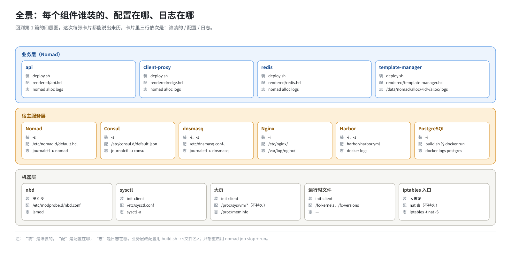
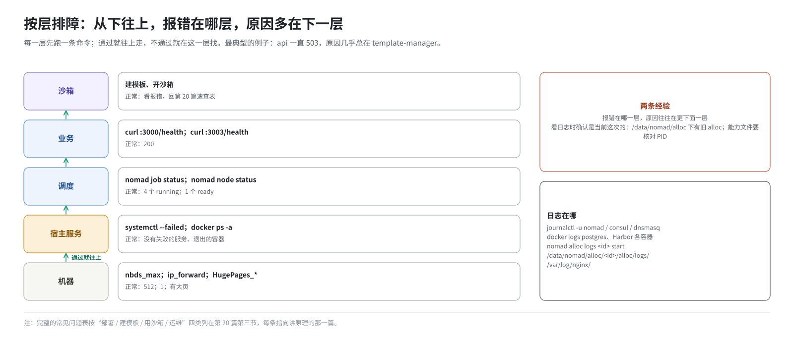

# 第 20 篇｜全景、排障与风险

> **本篇目标**：全书最后一篇。回到第 1 篇的全景图，这次给每个方框都标上“谁装的、配置在哪、日志在哪、怎么重启”。然后给出按层排障的思路，以及一张常见问题速查表，每条都指向前面讲原理的那一篇。接着讨论这套部署在安全、可靠性、可维护性上的风险和改进方向。最后是术语表和几张附录速查表。

---

## 一、再看一遍全景



第 1 篇把部署完成后的机器分成四层。现在每个组件都能说出它的来历了：

### 1.1 机器层

| 东西 | 谁做的 | 在哪 | 重启后 |
|---|---|---|---|
| nbd 模块（512 个设备） | 第 0 步手工 | `/etc/modules-load.d/nbd.conf`、`/etc/modprobe.d/nbd.conf` | 在 |
| IP 转发、连接数 | `init-client.sh` | `/etc/sysctl.conf` | 在 |
| NBD udev 规则 | `start-client.sh`、`init-client.sh` | `/etc/udev/rules.d/97-nbd-device.rules` | 在 |
| 大页池 | `start-client.sh`、`init-client.sh` | `/proc/sys/vm/nr_hugepages` 等 | **丢** |
| 两个挂载点 | 同上 | `/mnt/hugepages`、`/mnt/snapshot-cache` | **丢** |
| 运行时文件 | `init-client.sh` | `/fc-kernels`、`/fc-versions`、`/fc-envd` | 在 |
| orchestrator 二进制 | `start-client.sh` | `/usr/bin/template-manager` | 在 |
| DNS | `-i`、`start-client.sh`、`-s` | `/etc/resolv.conf`、`/etc/dnsmasq.conf`、`/etc/dnsmasq.d/consul.conf`、`/etc/hosts` | 在 |
| 80 → 3002 | `-s` 末尾 | iptables nat 表 | **丢** |
| SELinux permissive | `-i`（临时）/ 第 0 步（持久） | `/etc/selinux/config` | 视是否持久化 |

### 1.2 宿主服务层

| 服务 | 谁装的 | 配置 | 日志 | 重启 |
|---|---|---|---|---|
| Nomad | `-s`（start-server） | `/etc/nomad.d/default.hcl` | `journalctl -u nomad` | `systemctl restart nomad` |
| Consul | `-s`（start-server） | `/etc/consul.d/default.json` | `journalctl -u consul` | `systemctl restart consul` |
| dnsmasq | `-i`（yum） | `/etc/dnsmasq.conf`、`/etc/dnsmasq.d/` | `journalctl -u dnsmasq` | `systemctl restart dnsmasq` |
| Nginx | `-i` | `/etc/nginx/nginx.conf`、`/etc/nginx/ssl/` | `/var/log/nginx/` | `systemctl restart nginx` |
| MinIO | `-i` | `/etc/default/minio.yml` | `journalctl -u minio` | `systemctl restart minio` |
| PostgreSQL | `-i` | `build.sh` 里的 `docker run` 参数 | `docker logs postgres` | `docker restart postgres` |
| Harbor | `-i` 解压，`-s` 安装 | `/opt/e2b-infra/harbor/harbor.yml` | `docker logs <容器名>`；`/var/log/harbor/` | `docker compose -f .../docker-compose.yml restart` |
| Docker | 自备 | `/etc/docker/daemon.json` | `journalctl -u docker` | `systemctl restart docker`（会重启所有容器） |

### 1.3 业务层

| job | 来源 | 配置 | 日志 |
|---|---|---|---|
| `redis` | `nomad/redis.hcl` | `rendered/redis.hcl` | `nomad alloc logs <id> start` |
| `template-manager-system` | `dep/template-manager.hcl` | `rendered/template-manager.hcl` | 同上；文件在 `/data/nomad/alloc/<id>/alloc/logs/` |
| `client-proxy` | `nomad/edge.hcl` | `rendered/edge.hcl` | 同上 |
| `api`（含 db-migrator） | `nomad/api.hcl` | `rendered/api.hcl` | `nomad alloc logs <id> start`；`... db-migrator` |

重启：配置变了用 `build.sh -r <文件名>`；只想重启用 `nomad job stop` + `nomad job run rendered/<文件>.hcl`（第 19 篇）。

### 1.4 沙箱层

沙箱运行时的日志在 orchestrator 的日志里（按沙箱 ID 搜）。模板在 `/tmp/templates`，本地缓存在 `/orchestrator/*`。

---

## 二、排障思路：按层往上查



和第 17 篇的验证顺序一样，从下往上：

| 层 | 第一条命令 | 看什么 |
|---|---|---|
| 机器 | `cat /sys/module/nbd/parameters/nbds_max; sysctl -n net.ipv4.ip_forward; grep HugePages_ /proc/meminfo` | 512、1、大页数 |
| 宿主服务 | `systemctl --failed; docker ps -a` | 有没有失败的服务、退出的容器 |
| 调度 | `nomad job status; nomad node status` | 4 个 running、1 个 ready |
| 业务 | `curl :3000/health; curl :3003/health` | 200 |
| 沙箱 | 建模板、开沙箱 | 报错信息 |

两条经验：

1. **报错在哪一层，原因往往在更下面一层。** 最典型的是“api 一直 503”，原因几乎总在 template-manager（第 15 篇）。
2. **看日志时确认是当前这次的。** `/data/nomad/alloc/` 下留着以前各次部署的旧 alloc 目录；`/orchestrator/build/checkpoint-capabilities.json` 可能是上次启动写的。用 `nomad job status` 找到当前 alloc ID，或核对文件里的 PID。

---

## 三、常见问题速查表

### 3.1 部署阶段（`-i`、`-s`）

| 现象 | 原因 | 处理 | 详见 |
|---|---|---|---|
| `SERVER_IP=... 不是本机地址` | `.env` 的 `SERVER_IP` 配错 | 改成默认路由的源地址 | 第 8 篇 |
| 健康检查返回 504 | shell 设了 `http_proxy`，本机请求被代理劫持 | 脚本已加 `--noproxy`；手工 curl 时也加 | 第 10 篇 |
| `docker 镜像 postgres:latest 不存在` | 离线镜像没 `docker load` | 第 0 步补 | 第 8 篇 |
| 装 Harbor 报 `Unsupported config option for services` | Docker Compose 是 openEuler 源里的 1.x 老版本 | 装 Compose v2 插件 | 第 8 篇 |
| `-s` 卡在“等待 4646” | Nomad 崩溃（版本 < 1.11.2 遇 NUMA 编号不连续）；网卡太多指纹慢；SELinux | 看 `journalctl -u nomad`；换版本；`--recycle-netns`；持久化 permissive | 第 12、18 篇 |
| `-s` 中途 `udevadm ... Connection timed out` | 旧脚本全机 `udevadm trigger` 引起事件风暴 | `udevadm settle` 后重跑；用新脚本 | 第 13 篇 |
| `deploy.sh` 报 `403 (Permission denied)` | `.env` 里的令牌和集群不一致（被 `-i` 冲掉了） | `-d` + `-s` 重建；或从 `/data/nomad/acl.token` 恢复 | 第 11、12 篇 |
| `build.sh -r` 报 `Unknown parameter: --only` | `rpm -Uvh` 后没重放覆盖，`deploy.sh` 是上游版 | 重放覆盖 | 第 19 篇 |
| 部署卡在 api 上 10 分钟后 `Failed due to progress deadline` | api 健康检查一直 503，根因在 template-manager | 先看 `nomad job status template-manager-system` | 第 15 篇 |
| template-manager 的 alloc `failed`，日志有 `bind: address already in use` | 上一轮的进程没停干净 | `-d` 看端口自检的输出，杀掉残留 | 第 18 篇 |
| template-manager 退出码 137 | 内存配额太小，被 OOM | 调大 `resources.memory` | 第 15 篇 |
| `Dimension "memory" exhausted` | 内存配额太大，调度不上 | 调小 | 第 15 篇 |
| `reserved port collision` | stop 后马上 run，旧 alloc 还没退 | 等旧 alloc 完全退出再 run | 第 19 篇 |
| `orchestrator` 起不来：`NBD module not loaded` | nbd 模块没加载 | 第 0 步固化 | 第 8 篇 |
| `-d` 时 `Error querying jobs: 403` | Nomad 正在被卸载，令牌失效 | 正常，忽略 | 第 18 篇 |
| `-s` 时 `Failed to connect to ... port 8500` | 探测已有 Consul，全新部署时连不上 | 正常，忽略 | 第 12 篇 |

### 3.2 建模板

| 现象 | 原因 | 处理 | 详见 |
|---|---|---|---|
| `lookup harbor ... server misbehaving` | `/etc/hosts` 没有 harbor，或 dnsmasq 没重启 | 补 hosts，重启 dnsmasq | 第 14 篇 |
| `x509: certificate signed by unknown authority` | 自签证书没被信任 | 检查三处信任；`SSL_CERT_FILE` | 第 10 篇 |
| `x509: certificate has expired` | 自签证书一年有效期到了 | 重新生成（重跑 `install_nginx` 的逻辑） | 第 10 篇 |
| `manifest unknown` | Harbor 里没有基础镜像 | 推送 `ubuntu:22.04-custom` | 第 14 篇 |
| `Provisioning sandbox template` 处立即失败 | `/fc-kernels/<版本>/` 不存在 | 检查 `init-client.sh` 是否执行 | 第 13 篇 |
| 等 envd 60 秒后 `build was cancelled` | IP 转发是 0（槽位创建时继承了 0） | 改 sysctl，重启 template-manager | 第 13 篇 |
| `403: Alias 'base' already used` | 上一次构建失败，失败的模板还占着别名 | 用 API 删掉那个模板再重建 | 本篇 3.4 |
| `401` | `.env` 里缺 `E2B_ACCESS_TOKEN` | 两个 key 都要 | 第 11、17 篇 |
| 建模板时 template-manager 被 OOM | 页缓存撑满 32 GiB | 调大配额，或错开并发构建 | 第 15 篇 |

### 3.3 用沙箱

| 现象 | 原因 | 处理 | 详见 |
|---|---|---|---|
| 第一条命令慢 15 秒，后面很快 | dnsmasq 缺 `local=/e2b.app/`，AAAA 查询超时 | 补上，重启 dnsmasq | 第 11 篇 |
| `commands.run` 连接被拒绝 | 80 → 3002 规则丢了（机器重启过） | 重新加规则，或重跑 `-s` | 第 14 篇 |
| SSL 相关错误 | SDK 没打补丁 | 重跑 `patch_e2b.py` | 第 11 篇 |
| 别的机器能建、不能连 | 别的机器上 `*.e2b.app` 没解析到服务器 | 那台机器自己配 DNS | 第 17 篇 |
| 别的机器连不上 api | 防火墙没放行 3000 | `firewall-cmd` 放行 | 第 17 篇 |
| 并发到几百个后建不出沙箱 | NBD 设备（512）或大页用完 | 看 `/proc/meminfo`、`lsblk` | 第 13 篇 |
| 并发启动时排队 | `MAX_STARTING_INSTANCES_PER_NODE`（30）在限流 | 按需调整 | 第 15 篇 |
| 快照每次都是全量 | 机器没有硬件脏页跟踪 | 设 `FC_TRACK_DIRTY_PAGES=true` | 第 17 篇 |

### 3.4 运维

| 现象 | 原因 | 处理 | 详见 |
|---|---|---|---|
| 机器重启后什么都不通 | 大页、挂载、iptables、SELinux 设置都丢了，模板也丢了 | `-d`、`-s`，重建模板 | 第 9 篇 |
| 机器重启后模板全没了 | 模板在 `/tmp/templates`，`/tmp` 是 tmpfs | 重建；长远看要换持久存储 | 第 16 篇 |
| 改了代码，部署后行为没变 | 只 `nomad job run`，hcl 没变，没重启 | stop 再 run | 第 19 篇 |
| 改了 `.env`，进程里还是旧值 | 写死、不在白名单、改错层 | 逐层核对 | 第 16 篇 |
| `cp: ... Text file busy` | 覆盖正在运行的二进制 | 先 `rm` 再 `cp` | 第 13 篇 |
| 停服后内存没回来 | 大页静态池不随服务释放 | `--purge-hugepages` | 第 18 篇 |
| 宿主机网卡越来越多、iptables 越来越慢 | 槽位泄漏 | `--recycle-netns` | 第 18 篇 |
| `-i -s` 之后旧的 API key 失效了 | 数据库重建，seed-db 生成了新 key | 从 `/root/.e2b/config.json` 取新的 | 第 14 篇 |
| `/root/.e2b/config.json` 丢了 | 只写一次，数据库存的是哈希 | 只能清库重来；平时要备份 | 第 17 篇 |
| `resolv.conf` 里的 127.0.0.1 不见了 | NetworkManager 重写了它 | 让 NetworkManager 不管 DNS | 第 8 篇 |

**删除失败模板、释放别名**（3.2 表里提到的）：

```bash
AT=$(jq -r .accessToken /root/.e2b/config.json)
TID=$(curl -s -H "Authorization: Bearer $AT" http://127.0.0.1:3000/templates \
      | jq -r '.[] | select(any(.aliases[]?; . == "base")) | .templateID')
curl -s -X DELETE -H "Authorization: Bearer $AT" "http://127.0.0.1:3000/templates/$TID"
```

---

## 四、风险与改进方向

这套部署的目标是“在一台离线 ARM 服务器上一键跑起来”，它很好地完成了这个目标。但作为一个长期运行的平台，有几类风险值得清楚地认识到。

### 4.1 安全

| 风险 | 现状 | 改进方向 |
|---|---|---|
| 全程明文 HTTP | SDK 到 api、到沙箱都是 HTTP；API key 在网络上明文传输 | 在入口加 TLS（Nginx 终结 HTTPS），SDK 不再降级 |
| 默认密码 | Harbor `Harbor12345`、PostgreSQL `local`、MinIO `minioadmin`、`API_ADMIN_TOKEN=dev_admin` | 部署时随机生成，写进只有 root 可读的文件 |
| 秘密写在文件里 | `.env`、`build.sh`、`/root/.e2b/config.json` 里有令牌和密码 | 收紧文件权限；用专门的密钥管理 |
| SELinux 关闭 | 整机 permissive | 为 E2B 写专门的策略 |
| 自签证书 | 一年过期，过期后建模板失败 | 加上到期提醒，或延长、自动续期 |
| 服务端口对外 | Nomad、Consul、MinIO、Harbor 的界面监听所有网卡 | 防火墙只放行 80 和 3000 |
| 沙箱的网络隔离 | 出站防火墙限制了内网地址段 | 详见《E2B 沙箱网络从零讲透》 |

### 4.2 可靠性

| 风险 | 现状 | 改进方向 |
|---|---|---|
| 单点 | 一台机器，任何硬件故障都是全部不可用 | 这是单机部署的本质；需要高可用时用多节点形态（第 5 篇） |
| 模板在内存里 | `/tmp/templates` 是 tmpfs，重启即丢 | 改到真盘目录，或启用 MinIO |
| MinIO 空转 | 装了、跑着，但不存任何东西 | 要么启用，要么不装 |
| 重启不自恢复 | 大页、挂载、iptables 都要重新做 | 做成 systemd 服务或开机脚本 |
| 数据库没挂卷 | PostgreSQL 数据在容器层，`-i` 就清空 | 挂载宿主机目录，`-i` 时不删容器 |
| 没有监控告警 | otel、Loki、ClickHouse 都没部署 | 至少部署指标采集，对 api 健康、大页余量、NBD 余量告警 |
| `kill_timeout` 不够 | 30 秒拆不完暖池，槽位泄漏 | 定期 `--recycle-netns`；或在 Nomad 配置里放宽上限 |

### 4.3 可维护性

| 风险 | 现状 | 改进方向 |
|---|---|---|
| 同一个脚本两份 | 上游版和 `dep/` 版并存，`rpm -Uvh` 后要手工重放 | 在 spec 的 `%install` 里直接用 `dep/` 版覆盖，让 RPM 装出来就是单机版 |
| 两套宿主机准备脚本 | `start-client.sh` 和 `init-client.sh` 大量重复 | 合并成一个 |
| 化石配置 | `.env` 里一大半配置不生效 | 分成“生效的”和“保留的”两部分，加注释 |
| 写死的值分散 | 端口、密码散在 `build.sh`、hcl、`.env` 三处 | 集中到 `.env`，hcl 里全部用占位 |
| 部署一次十几分钟 | `-d -i -s` 全套 | 用好第 19 篇的五种场景，避免不必要的全套 |

这些都不是缺陷，而是“为了少改上游、快速跑起来”做出的取舍（第 5 篇）。知道它们在哪里，你就能判断什么时候该补上。

---

## 五、术语表

| 术语 | 英文 | 解释 | 首次出现 |
|---|---|---|---|
| 沙箱 | sandbox | 一台 Firecracker 微型虚拟机，运行不受信任的代码 | 第 1 篇 |
| 模板 | template | 沙箱的“出生证”：磁盘镜像 + 内存快照 | 第 2 篇 |
| 控制面 / 数据面 | control plane / data plane | 管理沙箱生命周期的路径 / 使用沙箱的路径 | 第 2 篇 |
| 软件包 | package | 一组文件 + 安装位置 + 版本信息 | 第 7 篇 |
| spec 文件 | spec file | RPM 的打包配方 | 第 7 篇 |
| 补丁 | patch | 对源码的修改，集中在一个文件里 | 第 6 篇 |
| vendor 目录 | vendor | Go 项目自带的依赖，让编译不需要联网 | 第 6 篇 |
| 单元文件 | unit file | systemd 描述一个服务的文件 | 第 3 篇 |
| 镜像 / 容器 / 仓库 | image / container / registry | 安装包 / 运行中的软件 / 应用商店 | 第 3 篇 |
| 自签证书 | self-signed certificate | 自己签发的证书，要手工加入信任库 | 第 3 篇 |
| 调度器 | scheduler | 决定服务跑在哪、负责重启的系统，本书是 Nomad | 第 4 篇 |
| 服务发现 | service discovery | 按名字找到服务地址，本书是 Consul | 第 4 篇 |
| job / group / task | | Nomad 的三层任务描述 | 第 4 篇 |
| 分配 | allocation（alloc） | 一个 group 的一次实际运行 | 第 4 篇 |
| 驱动 | driver | task 的运行方式：docker、raw_exec | 第 4 篇 |
| 节点池 | node pool | Nomad 对机器的分组 | 第 4 篇 |
| 访问控制令牌 | ACL token | 访问 Nomad、Consul 的凭据 | 第 4 篇 |
| 初始化 | bootstrap | 集群第一次生成管理令牌 | 第 4 篇 |
| 基础设施即代码 | Infrastructure as Code | 用配置文件描述云资源，如 Terraform | 第 5 篇 |
| 覆盖 | overlay | `dep/` 里的单机版文件盖在 RPM 装的上游版上 | 第 8 篇 |
| 幂等 | idempotent | 反复执行，结果一样 | 第 9 篇 |
| 大页 | hugepage | 2 MiB 的内存页，给客户机当内存 | 第 13 篇 |
| 静态池 / 超分配池 | persistent / overcommit pool | 立即划走的大页 / 用时才分配的大页上限 | 第 13 篇 |
| 网络命名空间 | network namespace | 一套独立的网络栈，每个沙箱槽位一个 | 第 13 篇 |
| 网络槽位 | network slot | 一个沙箱的网络资源：命名空间、网卡、规则 | 第 15 篇 |
| 暖池 | warm pool | 预先建好的空闲槽位 | 第 15 篇 |
| 模板替换 | envsubst | 把文本里的 `${变量}` 换成环境变量的值 | 第 14 篇 |
| 前置任务 | prestart task | 主任务启动前先跑完的任务，如 db-migrator | 第 15 篇 |
| 数据库迁移 | migration | 按版本逐步修改表结构 | 第 15 篇 |
| 槽位泄漏 | slot leak | 没被拆掉的网络槽位，越攒越多 | 第 18 篇 |

---

## 六、附录

### 附录 A：路径总表

| 路径 | 内容 | 谁建的 |
|---|---|---|
| `/opt/e2b-infra/` | RPM 安装目录：二进制、脚本、job 模板、`dep/` | RPM |
| `/opt/e2b-infra/.env` | 实际生效的配置，含真令牌 | `-i` 拷贝，`-s` 写入令牌 |
| `/opt/e2b-infra/rendered/` | 渲染好、提交给 Nomad 的 job | `deploy.sh` |
| `/opt/e2b-infra/harbor/` | Harbor 安装目录 | `-i`、`-s` |
| `/etc/nomad.d/`、`/data/nomad/` | Nomad 配置、数据（含 `acl.token`、alloc） | `-s` |
| `/etc/consul.d/`、`/data/consul/`、`/opt/consul/` | Consul 配置、数据、二进制和 `acl.token` | `-s` |
| `/opt/nomad/` | Nomad 二进制、插件 | `-s` |
| `/usr/bin/template-manager`、`/usr/bin/orchestrator` | orchestrator 二进制 | `start-client.sh` |
| `/orchestrator/{template,sandbox,build}` | orchestrator 本地缓存 | `start-client.sh`、`init-client.sh` |
| `/tmp/templates` | 模板持久化存储（tmpfs） | orchestrator |
| `/fc-kernels/`、`/fc-versions/`、`/fc-envd/`、`/fc-vm/` | 客户机内核、Firecracker、envd、运行目录 | `init-client.sh` |
| `/mnt/hugepages` | hugetlbfs | `-s` |
| `/mnt/snapshot-cache` | 65G tmpfs | `-s` |
| `/swapfile` | 1G swap | `-s` |
| `/root/.e2b/config.json` | 初始团队的明文 key | `deploy.sh` |
| `/root/data/minio` | MinIO 数据 | `-i` |
| `/etc/nginx/ssl/` | Harbor 的自签证书 | `-i` |
| `/etc/docker/certs.d/harbor:443/` | docker 信任的证书 | `-i` |

### 附录 B：`build.sh` 参数速查

| 命令 | 做什么 | 什么时候用 |
|---|---|---|
| `build.sh -d` | 停止，清理网络残留，删除 Nomad、Consul 集群 | 重新部署前 |
| `build.sh -i` | 装依赖、SDK，铺覆盖，配 dnsmasq | 第一次部署、彻底重来 |
| `build.sh -s` | 启动一切、准备宿主机、构建镜像、提交 job、初始化数据 | `-i` 之后 |
| `build.sh -f` | 重新执行 `deploy.sh` | 改了 `.env` |
| `build.sh -r <文件名>` | 只重渲染、重提交一个 job | 改了某个 job 的配置 |
| `build.sh --recycle-netns` | 停 template-manager、清网络残留、拉起 | 网卡太多、4646 慢 |
| `build.sh --purge-hugepages` | 释放大页 | 停服后回收内存 |
| `build.sh -u` | 卸载 | 不再使用 |

### 附录 C：端口总表

见第 15 篇第七节。

---

## 全书结语

回到第 1 篇的那个问题：三条命令之间，机器上到底多了什么？

现在你可以完整地回答了：

- **第一步**拿到的是原料、补丁、配方和部署包；
- **第二步** RPM 把它们加工成二进制、内核、Firecracker、脚本和 job 模板，摆进 `/opt/e2b-infra`；
- **第三步**的 `-i` 装好数据库、对象存储、镜像仓库、证书和 SDK；`-s` 拉起 Consul 和 Nomad，把机器调成能跑虚拟机的样子，现场构建镜像，把四个服务交给 Nomad，造出第一个团队，最后打开 80 端口的入口。

每一样东西都有它的理由。很多理由来自一次具体的失败：一个写死为 0 的转发开关，一个只给了 IPv4 的 DNS 配置，一个永远匹配不到的进程名，一个只出现一次的令牌。这些失败被一行行写进了脚本的注释里，本书只是把它们串成了一条能顺着读下来的线。

希望下一次你面对一个陌生的部署脚本时，也能用同样的三个问题去拆解它：**跑什么？在哪跑、谁管它？机器要准备成什么样？**

---

## 本篇小结

| 内容 | 一句话 |
|---|---|
| 全景标注 | 每个组件：谁装的、配置在哪、日志在哪、重启后还在不在 |
| 排障思路 | 自下而上；报错在哪层，原因多在下一层 |
| 速查表 | 部署、建模板、用沙箱、运维四类，每条指向原理篇 |
| 安全风险 | 明文、默认密码、SELinux、端口对外 |
| 可靠性风险 | 单点、模板在 tmpfs、重启不自恢复、无监控 |
| 可维护性风险 | 两份脚本、重复的准备脚本、化石配置 |
| 三个问题 | 跑什么；在哪跑、谁管它；机器要准备成什么样 |
