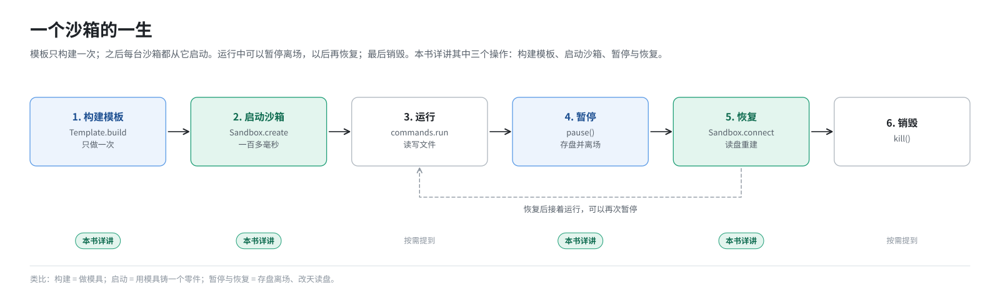
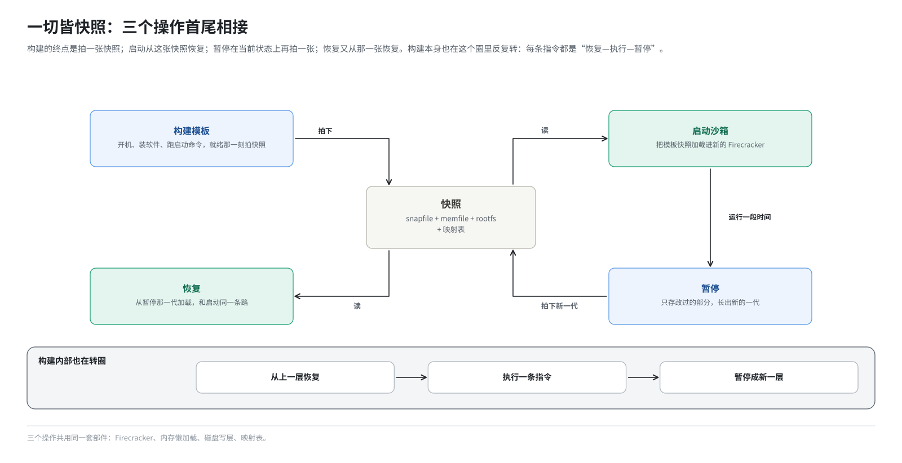
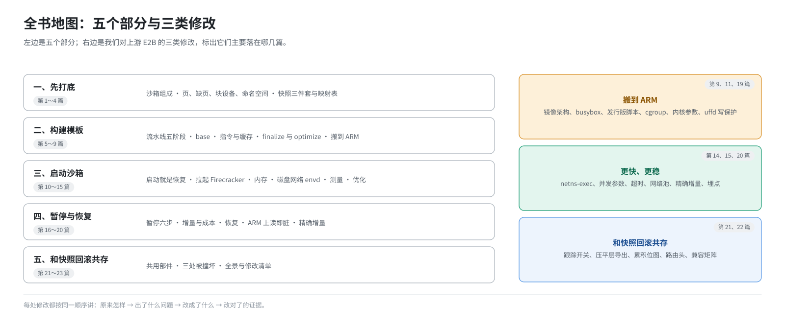

# 第 1 篇｜一个沙箱的一生：构建、启动、暂停、恢复

> **本篇目标**：先不碰任何术语，用几行 SDK 代码把一个沙箱从出生到消失走一遍，看清本书要讲的三个操作（构建模板、启动沙箱、暂停与恢复）分别处在哪个位置。然后给出全书最重要的一句话“一切皆快照”，说明这三个操作为什么其实是同一个循环。最后交代我们对它们做了哪三类修改，以及全书的地图和名词对照。

---

## 一、E2B 要解决什么问题

设想一个 AI 助手要帮你分析一份表格。它会写一段 Python，然后需要一个地方去**运行**这段代码。直接在你的电脑上跑？太危险，谁也不知道模型写出来的代码会不会删文件。在服务器上开一台完整的虚拟机？又太慢，开机一次要几十秒，用户等不起。

E2B 提供的就是这样一种东西：**一台随时可用、用完即扔的小电脑**，叫“沙箱”（sandbox）。它有三个要求：

| 要求 | 含义 | 为什么 |
|---|---|---|
| **隔离** | 沙箱里的程序碰不到宿主机和别人的沙箱 | 模型生成的代码不可信 |
| **快** | 从“我要一台”到“可以跑命令”，一百多毫秒 | Agent 一次对话可能要开好几台 |
| **便宜** | 一台物理服务器上同时跑几百上千台 | 大部分沙箱只活几分钟，很多时候在空闲 |

隔离这一条决定了 E2B 用**虚拟机**而不是容器。容器和宿主共用一个操作系统内核，内核一旦有漏洞，容器里的程序就可能逃出来；虚拟机有自己独立的内核，中间隔着一层硬件虚拟化，边界硬得多。

可虚拟机传统上又慢又重。E2B 用两样东西把它变得又快又轻：

- **Firecracker**：一种专为这种场景设计的“微虚拟机”，只模拟最少的几样设备，进程本身很小；
- **快照**：不是每次都从开机开始，而是提前把一台“已经开好机”的虚拟机存下来，要用时直接恢复。

第二样是本书的主角。

## 二、用几行代码走一遍一生

下面是用 E2B 的 Python SDK 写的一段示意代码，覆盖了一个沙箱从生到死的全部环节：

```python
from e2b import Template, Sandbox

# 1. 构建模板：把一个运行环境做成“模具”（只需做一次）
Template.build(template, alias="my-python")

# 2. 启动沙箱：用模具“铸”出一台新沙箱
sbx = Sandbox.create("my-python")

# 3. 运行：在沙箱里跑命令、读写文件
sbx.commands.run("python3 analyze.py")

# 4. 暂停：把沙箱存盘，然后让它离场
sbx.pause()

# 5. 恢复：过一会儿（可能是几天后），把它读盘拉回来
sbx = Sandbox.connect(sbx.sandbox_id)

# 6. 销毁：用完扔掉
sbx.kill()
```

六步里，本书详细讲第 1、2、4、5 步，也就是三个操作：

| 操作 | 对应 SDK | 一句话 | 类比 |
|---|---|---|---|
| **构建模板** | `Template.build` | 把一个运行环境（操作系统、软件、配置）做成一张可以反复使用的快照 | 做一个模具 |
| **启动沙箱** | `Sandbox.create` | 从模板快照恢复出一台新的沙箱 | 用模具铸一个零件 |
| **暂停与恢复** | `pause()` / `connect()` | 把正在运行的沙箱存成快照并停掉；以后再从这份快照重建出来 | 存盘离场，改天读盘 |

第 3 步“运行”和第 6 步“销毁”只在需要时提到。



## 三、核心洞见：一切皆快照

把上面的三个操作再往下看一层，会发现一件有意思的事：**它们处理的是同一种东西，就是虚拟机快照。**

- **构建模板的终点是打一张快照。** 构建时，E2B 真的会开一台虚拟机，在里面装软件、跑你的启动命令，等一切就绪，然后**在那一刻把整台机器冻住、存下来**。这张快照就是模板。
- **启动沙箱是从这张快照恢复。** `Sandbox.create` 不会重新开机。它把模板快照加载进一个新的 Firecracker 进程，虚拟机从“就绪那一刻”接着往下跑。这就是 E2B 能在一百多毫秒内给你一台可用沙箱的根本原因：开机、启动系统服务、初始化那几秒，在构建时就已经做完了。
- **暂停又是打一张快照。** 它记下沙箱此刻的内存和磁盘，但只存相对于上一张快照改过的部分。
- **恢复又是从快照恢复。** 走的是和启动完全相同的那条路，只是用的是暂停时留下的那张快照。

这四件事首尾相接，形成一个循环：



更进一步，**构建本身就是在这个循环里反复转圈**。Dockerfile 里的每一条指令，都是“从上一张快照恢复一台虚拟机 → 在里面执行这条指令 → 再暂停成一张新快照”。所以构建模板、启动沙箱、暂停恢复，用的其实是同一套部件：同一个 Firecracker、同一套内存懒加载、同一套磁盘分层、同一种快照格式。

这就是为什么本书把三个操作放在一起讲。理解了其中一个，另外两个只是在同一张图上换了个位置。

## 四、和快照回滚划清界限

我们的仓库里还有一个新增的功能叫**快照回滚**（checkpoint / restore），另一本书《E2B 沙箱快照回滚从零讲透》专门讲它。它和本书的“暂停与恢复”名字相近，做的事却完全不同：

| | 暂停与恢复（本书） | 快照回滚（另一本书） |
|---|---|---|
| 来历 | E2B 原有的功能 | 我们新增的功能 |
| 存盘之后 | 沙箱**停掉**，离场 | 沙箱**接着跑**，什么都没发生 |
| 读盘 | 新起一个 Firecracker 进程**重建**沙箱 | 在**同一个活着的**进程里原地写回 |
| 擅长 | 长期保存、换机器恢复、进程崩了也能恢复 | 一秒内反复存档读档 |
| 典型耗时 | 暂停约 250 ms 起，恢复约 100 ms | 存档、读档各约 20 ms 起 |

两者是独立的两套机制，本书不展开讲快照回滚。但它们共用了不少部件（Firecracker、磁盘写层、脏页记录），回滚加进来以后，暂停恢复真的被撞坏过几处，后来又修好了。这段经过在第五部分讲。

## 五、我们做了哪三类修改

E2B 的开源版本只在 x86 服务器上跑。我们的仓库在它的基础上做了不少修改，全部打在一个补丁文件里。按目的可以分成三类：

| 类别 | 为什么要改 | 例子 | 主要在哪几篇 |
|---|---|---|---|
| **搬到 ARM** | 要在鲲鹏服务器、openEuler 系统上跑起来 | 镜像架构从 amd64 换成 arm64；发行版脚本识别 dnf；内核没有某个功能时退而求其次 | 第 9、13、19 篇 |
| **更快、更稳** | 高并发下启动太慢、参数太保守、出错时报得不对 | 换掉启动管线里最贵的一环；放宽并发上限；修掉一个让失败等 300 秒的 bug | 第 14、15、20 篇 |
| **和快照回滚共存** | 回滚加进来后，暂停恢复的几个前提不再成立 | 暂停时把多层磁盘压平再导出；补回被清零的脏页记录 | 第 21、22 篇 |

讲每一处修改时，本书都按同一个顺序：**原来怎样 → 出了什么问题 → 改成了什么 → 有什么证据说明改对了**。

## 六、全书地图

全书 23 篇，分五个部分：

| 部分 | 篇目 | 内容 |
|---|---|---|
| 一、先打底 | 1～4 | 沙箱由什么组成；内存页、缺页、块设备、命名空间这些底子；快照里到底存了什么 |
| 二、构建模板 | 5～9 | 从 Dockerfile 到快照的流水线；搬到 ARM 改了什么 |
| 三、启动沙箱 | 10～15 | 一次启动的全过程；时间花在哪；怎样把它压下来 |
| 四、暂停与恢复 | 16～20 | 暂停和恢复各做了什么；增量怎么算；ARM 上的问题和精确增量 |
| 五、和快照回滚共存 | 21～23 | 回滚动了哪些共用部件；三处被撞坏的地方；全景与修改清单 |



**阅读建议**：

- 完全的新手：按顺序读，第 3 篇的底子不要跳；
- 只关心某一个操作：读完第 1～4 篇，直接跳到对应部分；
- 只关心我们改了什么：读第 9、15、19～22 篇，再看第 23 篇的修改清单。

## 七、名词对照

正文统一用下面这些说法：

| 本书说法 | 英文 / 接口名 | 一句话 |
|---|---|---|
| 模板 | template / build | 一张“开机到一半就冻住”的虚拟机快照，所有沙箱都从它拉起 |
| 构建 | template build | 从 Dockerfile 做出模板的整个过程 |
| 启动沙箱 | `Sandbox.create` → `Create` RPC → `ResumeSandbox` | 从模板快照恢复出一台新沙箱 |
| 暂停 | `sandbox.pause()` → `Pause` RPC | 存盘并**停掉**沙箱，产物进存储 |
| 恢复 | `Sandbox.connect()` → `ResumeSandbox` | 从暂停留下的快照**重建**一台沙箱 |
| 快照三件套 | snapfile / memfile / rootfs | CPU 与设备状态、内存、磁盘 |
| 映射表 | header | 记录“这一块数据在哪一代的哪个文件里” |
| 一代 | build ID | 每构建一层、每暂停一次，都产生新的一代 |
| 懒加载 | userfaultfd（uffd） | 内存不一次读回，用到哪页再取哪页 |
| 快照回滚 | checkpoint / restore | 我们新增的“活沙箱原地存档读档”，本书不展开 |

还有两台反复出现的机器：**鲲鹏 920B** 和**鲲鹏 950**，都是 ARM 服务器。950 有一项硬件功能（HDBSS，能由硬件记录哪些内存页被写过），920B 没有。凡是实测数字，本书都会注明是在哪台机器上量的。

---

## 本篇小结

| 概念 | 一句话解释 |
|---|---|
| 沙箱 | 一台隔离、快速、便宜的小虚拟机，给 AI 跑代码用 |
| 三个操作 | 构建模板 = 做模具；启动沙箱 = 铸零件；暂停与恢复 = 存盘离场、改天读盘 |
| 一切皆快照 | 构建的终点是快照，启动是从快照恢复，暂停是再打快照，恢复又是从快照恢复 |
| 构建也在转圈 | 每条指令都是“恢复 → 执行 → 暂停” |
| 和快照回滚的区别 | 暂停恢复停掉并重建沙箱；回滚在活沙箱里原地读档 |
| 三类修改 | 搬到 ARM、更快更稳、和回滚共存 |

**下一篇预告**：[《一台沙箱由什么组成：从 SDK 到 Firecracker》](02-what-a-sandbox-is-made-of.md)。用户手里一个 `Sandbox` 对象，背后在宿主机上对应哪些进程、哪些文件？一条命令从 SDK 出发，经过哪些服务，才到达虚拟机里的程序？
