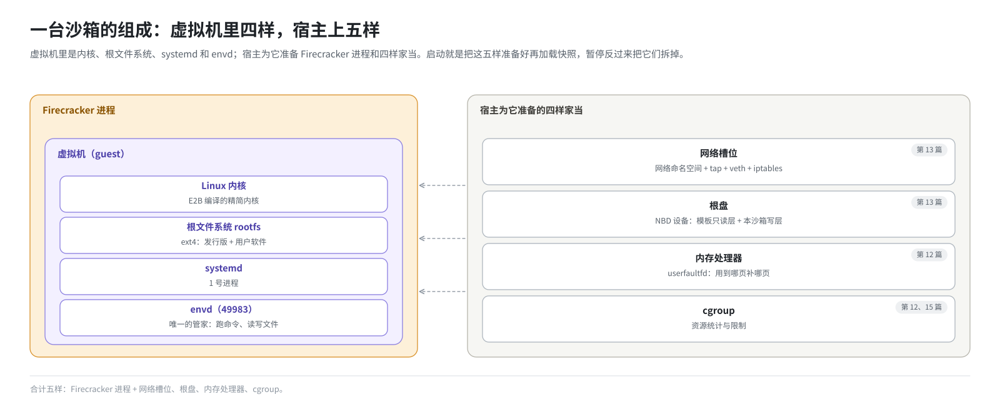
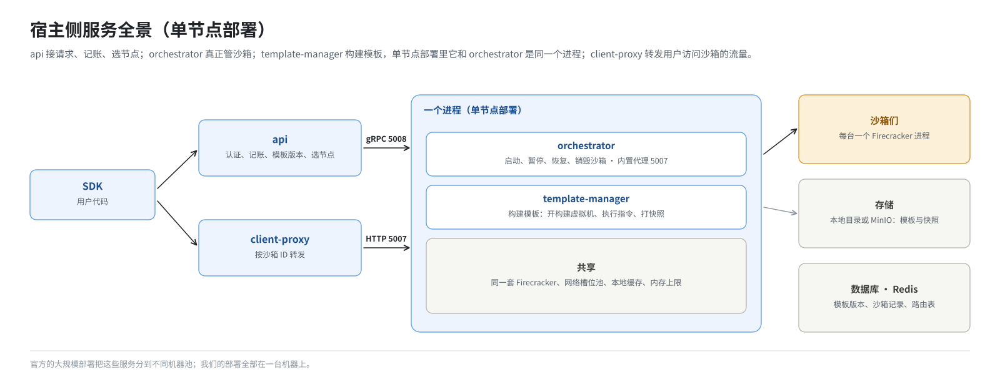
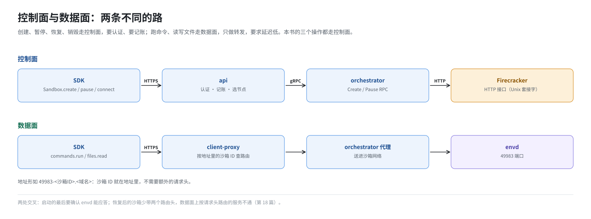

# 第 2 篇｜一台沙箱由什么组成：从 SDK 到 Firecracker

> **本篇目标**：用户手里只有一个 `Sandbox` 对象，可它背后站着一整套服务。本篇先讲一点虚拟机的最小知识，然后把一台沙箱拆开看：虚拟机里面有什么，宿主机上为它准备了哪些东西，宿主侧有哪几个服务、各管什么。最后讲请求走的两条路：控制面和数据面。后面所有篇章都在这张图上展开。

---

## 一、虚拟机的最小知识

一台电脑能运行程序，靠的是 CPU、内存、磁盘、网卡这几样硬件。**虚拟机**就是用软件“假装”出一套这样的硬件，让一个完整的操作系统在上面跑，而这个操作系统以为自己独占了一台真机器。

“假装”最难的部分是 CPU。现代 CPU（不管 x86 还是 ARM）都内置了**硬件虚拟化**支持：虚拟机里的指令大部分直接在真 CPU 上执行，只有少数敏感操作（比如访问设备）会“陷出来”交给宿主处理。Linux 内核里负责这件事的模块叫 **KVM**。有了 KVM，虚拟机里的程序跑起来几乎和在真机上一样快。

KVM 只管 CPU 和内存，设备要另外有人模拟：磁盘读写、网卡收发、串口输出。负责模拟设备、管理一台虚拟机生命周期的那个宿主进程，叫**虚拟机监控器**（VMM）。传统的 VMM（比如 QEMU）能模拟几百种设备，功能全但体积大、启动慢。

**Firecracker** 是一种极简的 VMM，原本为“函数计算”这类场景设计。它只模拟最少的几样设备：

| 设备 | 用途 |
|---|---|
| virtio 块设备 | 虚拟机的磁盘 |
| virtio 网卡 | 虚拟机的网络 |
| 串口 | 内核日志输出 |
| vsock、balloon 等少数几个 | 宿主与虚拟机通信、内存回收 |

没有显卡、没有 USB、没有 BIOS 那一大套。代价是只能跑特定配置的 Linux，好处是每个 Firecracker 进程很小，启动只要一百多毫秒，一台物理机上能同时跑几千个。

Firecracker 对外暴露一个 **HTTP 接口**，走的是一个本地的 Unix 套接字（一种只在本机可见的“文件形式的网络端口”）。宿主上的程序通过它告诉 Firecracker：用哪个内核、哪块磁盘、多少内存，开机、暂停、恢复、打快照。后面会反复看到这个接口。

## 二、虚拟机里面有什么

一台 E2B 沙箱的虚拟机里，和一台普通 Linux 服务器差不多：

- **Linux 内核**：E2B 自己编译的一个精简内核，宿主上按版本号存放；
- **根文件系统**（rootfs）：一个 ext4 格式的磁盘镜像，里面是 Ubuntu、Debian 或 openEuler 这样的发行版，加上用户装的软件；
- **systemd**：1 号进程，负责拉起各种系统服务；
- **envd**：E2B 自己写的一个小服务，监听虚拟机里的 49983 端口。SDK 里的“跑命令”“读写文件”“看进程”最后都是 envd 在执行。

envd 是沙箱里**唯一**的“管家”。它不是在你每次 `Sandbox.create` 时才启动的。在构建模板时它就已经启动好，和整个系统一起被冻进了快照。每台沙箱从快照恢复时，envd 进程本来就在内存里跑着，只需要“醒过来”接收新的身份信息。第 8、13 篇会细讲这件事。

## 三、宿主机上为它准备了什么

一台沙箱在宿主机上不只是一个 Firecracker 进程。为了让它能跑起来，宿主还要为它准备好四样“家当”：

| 家当 | 是什么 | 为什么需要 | 详见 |
|---|---|---|---|
| **网络槽位** | 一个独立的网络命名空间，里面有一块 tap 网卡，外面通过一对 veth 接到宿主 | 每台沙箱要有自己的网络，彼此看不见 | 第 13 篇 |
| **根盘** | 一个 NBD 块设备，背后是“模板只读层 + 本沙箱写层” | 几百台沙箱共用同一份模板磁盘，各自的改动互不干扰 | 第 13 篇 |
| **内存处理器** | 一个 userfaultfd（uffd）处理程序 | 虚拟机内存不一次读回，用到哪页再补哪页 | 第 12 篇 |
| **cgroup** | 一个资源控制组 | 统计和限制这台沙箱用了多少 CPU、内存 | 第 15 篇 |

加上 Firecracker 进程本身，一台沙箱在宿主上一共是五样东西。记住这个数字：**启动一台沙箱，本质上就是把这五样东西准备好，再加载快照。** 暂停则是反过来，把它们拆掉。



## 四、宿主侧的服务

沙箱之外，还有几个常驻服务在管理它们。

| 服务 | 管什么 | 一句话 |
|---|---|---|
| **api** | 对外的入口 | 认证、记账、决定把沙箱放到哪个节点、记下每个模板有哪些版本 |
| **orchestrator** | 一个节点上的所有沙箱 | 真正动手的人：拉起 Firecracker、准备四样家当、暂停、恢复 |
| **template-manager** | 模板构建 | 接构建任务，在本节点上开构建用的虚拟机、执行 Dockerfile 指令、打快照 |
| **client-proxy** | 用户访问沙箱的流量 | 按沙箱 ID 找到它在哪个节点，把流量转过去 |
| 数据库、Redis、存储 | 记录与产物 | 模板和沙箱的记录、路由表、快照文件 |

在官方的大规模部署里，这些服务分散在不同的机器池里。我们仓库的部署是**单节点**的：所有服务都在一台机器上，而且 orchestrator 和 template-manager 是**同一个进程**（同一个二进制，通过环境变量同时打开两种角色）。所以在我们的环境里，“构建模板”和“启动沙箱”其实是同一个进程在干，共用同一套 Firecracker、同一个网络槽位池、同一个内存上限。这一点在第 9 篇讲构建时的内存故障、第 12 篇讲空闲沙箱的内存账时都会用到。



还有一个容易被忽略的角色：**存储**。模板快照、暂停产生的快照，都要放在一个地方，下次启动或恢复时再取出来。官方用云厂商的对象存储；我们的部署支持本地目录和 MinIO（一种可以自己部署的对象存储）。第 4 篇会讲快照在存储里长什么样。

## 五、两条路：控制面和数据面

请求从 SDK 出发，有两条完全不同的路。

**控制面**：创建、暂停、恢复、销毁这类“管理”操作。

```
SDK ──HTTPS──▶ api ──gRPC──▶ orchestrator ──HTTP（Unix 套接字）──▶ Firecracker
```

api 收到 `Sandbox.create` 后，查数据库确定模板的最新版本，挑一个节点，用 gRPC 调用该节点 orchestrator 的 `Create` 接口。orchestrator 准备好家当，再通过 Firecracker 的 HTTP 接口加载快照。

**数据面**：沙箱活着时，跑命令、读写文件、访问沙箱里开的网页服务。

```
SDK ──HTTPS──▶ client-proxy ──▶ orchestrator 的代理 ──▶ 沙箱网络 ──▶ envd（49983）
```

请求的地址里带着沙箱 ID（形如 `49983-<沙箱ID>.<域名>`），client-proxy 按它查路由表，找到沙箱所在节点，交给那个节点上 orchestrator 内置的代理，代理再把它送进沙箱的网络，最后到达 envd。

两条路分开，是因为它们的性质不同：控制面请求少、每个都很重要，要认证、要记账；数据面请求多、要求延迟低，只做转发。



本书讲的三个操作都走控制面。但有两处会碰到数据面：一是启动的最后要确认 envd 能应答，二是第 18 篇讲的一个修复，恢复后的沙箱因为少带了两个请求头，数据面上有一类请求路由不过去。

## 六、两类硬件

本书的实测数字来自两类机器：

| 机器 | 架构 | 和本书有关的特点 |
|---|---|---|
| 鲲鹏 920B | ARM | 宿主内核没有 uffd 写保护；没有硬件脏页记录 |
| 鲲鹏 950 | ARM | 有硬件脏页记录 HDBSS（第 21 篇会用到） |

上游 E2B 是为 x86 写的。从 x86 搬到这两台 ARM 机器上，构建、启动、暂停三条路都各有要改的地方，分别在第 9、13～15、19～20 篇讲。

---

## 本篇小结

| 概念 | 一句话解释 |
|---|---|
| KVM | Linux 内核里的硬件虚拟化模块，让虚拟机的指令直接在真 CPU 上跑 |
| Firecracker | 极简的虚拟机监控器，只模拟几样设备，通过 HTTP 接口控制 |
| envd | 沙箱里唯一的管家，跑命令、读写文件；在构建时就已启动并冻进快照 |
| 五样东西 | Firecracker 进程 + 网络槽位、根盘、内存处理器、cgroup |
| api / orchestrator / template-manager / client-proxy | 入口与记账 / 节点上真正动手的人 / 构建模板 / 转发沙箱流量 |
| 单节点部署 | orchestrator 和 template-manager 是同一个进程 |
| 控制面与数据面 | 管理操作走 api → orchestrator；用户流量走 client-proxy → envd |

**下一篇预告**：[《必备底子：内存页、缺页、块设备与命名空间》](03-pages-faults-blocks-namespaces.md)。后面会反复出现“大页”“缺页”“写时复制”“命名空间”这些词。下一篇用最少的篇幅把它们讲清楚。
