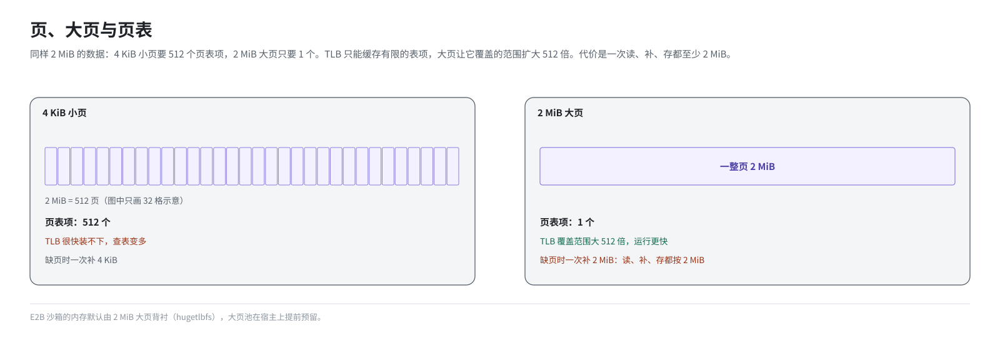
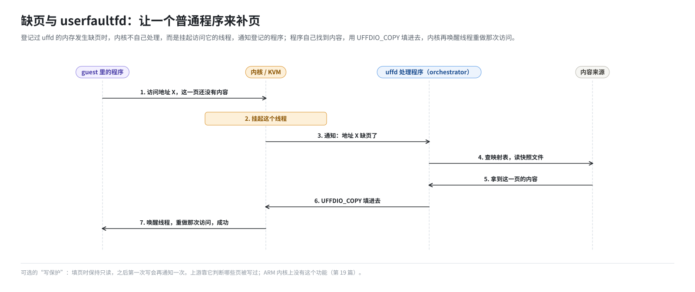

# 第 3 篇｜必备底子：内存页、缺页、块设备与命名空间

> **本篇目标**：后面的章节会反复出现“页”“大页”“缺页”“userfaultfd”“块设备”“写时复制”“命名空间”这些词。本篇用最少的篇幅把它们讲清楚，每个概念只讲到本书用得到的程度。已经熟悉的读者可以只看每节末尾那句“和本书的关系”。

---

## 一、内存按页管理

### 1. 页

操作系统不会一个字节一个字节地管理内存，那样账本会比内存本身还大。它把内存切成固定大小的块，叫**页**（page），以页为单位分配、回收、记录状态。

在 x86 和本书用到的 ARM 机器上，最常见的页大小是 **4 KiB**。一台 2 GiB 内存的虚拟机，就是 524288 个 4 KiB 的页。

### 2. 页表

程序看到的内存地址（虚拟地址）和内存条上的真实位置（物理地址）不是一回事。两者之间靠一张**页表**来翻译：每一项记着“这一页虚拟地址对应哪一页物理内存”。这像一栋楼的门牌对照表，程序只知道门牌号，CPU 查表才知道是哪个房间。

查表要时间，所以 CPU 里有一个小缓存，叫 **TLB**，记着最近查过的几百到几千项。命中就快，不命中就要去内存里一级一级地查。

### 3. 大页

如果一个程序要用很大一块内存，4 KiB 一页就太碎了：2 MiB 的数据需要 512 个页表项，TLB 很快就装不下。**大页**（huge page）把一页做成 2 MiB，同样 2 MiB 的数据只要 1 个表项，TLB 覆盖范围扩大 512 倍。

大页的代价是：一旦要处理“一页”，就是整整 2 MiB。读一页、补一页、存一页，都是 2 MiB 起步。

Linux 上用大页最直接的方式是 **hugetlbfs**：系统启动后预留一个“大页池”，程序从里面按 2 MiB 领取。池子是提前划走的，没人用也占着。

**和本书的关系**：E2B 沙箱的内存默认由 2 MiB 大页背衬，好处是虚拟机里的程序跑得快。但“一次至少 2 MiB”这个特点，在第 12 篇的内存懒加载和第 20 篇的精确增量里都是关键约束。部署时要在宿主上预留大页池，第 15 篇会讲它的申请和释放。

## 二、缺页

程序访问一个虚拟地址，CPU 查页表发现“这一页现在没有对应的物理内存”（比如还没分配，或者被换到了磁盘上），就会暂停这个程序，向操作系统报告一次**缺页**（page fault）。操作系统把这一页准备好（分配物理内存、从磁盘读回内容），填进页表，再让程序从刚才那条指令继续执行。程序完全感觉不到中间发生过什么，只是这一次访问慢了一点。

缺页是正常机制，不是错误。Linux 正是靠它实现“按需分配”：你申请 1 GiB 内存，系统只是答应了，真正用到哪一页才分配哪一页。

**和本书的关系**：沙箱从快照恢复时，内存一开始是“空”的，guest 每访问一页都会触发一次缺页。怎么处理这次缺页，就是下一节的 userfaultfd。

## 三、userfaultfd：让一个普通程序来补页

正常的缺页由内核处理，内核知道去哪里取内容（物理内存、交换分区、文件）。可如果内容在一个内核不知道的地方呢？比如在一份快照文件的某个偏移，甚至在远端的对象存储里？

Linux 提供了一个机制叫 **userfaultfd**（简称 uffd）：一个程序可以登记“这一段内存的缺页由我来处理”。之后这段内存每发生一次缺页：

1. 访问它的线程被挂起；
2. 内核通过一个文件描述符通知登记的程序：“地址 X 缺页了”；
3. 程序自己去找内容（读文件、查表、从网络下载），然后用一个系统调用 `UFFDIO_COPY` 把内容填进那一页；
4. 内核唤醒刚才挂起的线程，它从头重做那次访问，这次就成功了。

uffd 还有一个可选功能叫**写保护**（write-protect）：填页时可以要求“这一页先保持只读”，之后有人第一次写它，会再通知一次处理程序。利用这一点，处理程序就能分辨“这一页只是被读过”还是“被写过”。

**和本书的关系**：E2B 的内存懒加载全靠 uffd，处理程序在 orchestrator 里（第 12 篇）。写保护功能则是暂停时判断“哪些页改过”的依据。第 19 篇要讲的 ARM 问题，根源正是 ARM 内核上没有这个写保护功能。

## 四、块设备、NBD 与写时复制

### 1. 块设备

磁盘在操作系统眼里是一个**块设备**：一长串固定大小的块，可以按编号读写任意一块。文件系统（比如 ext4）建在块设备之上，把“文件”“目录”翻译成“哪些块”。

### 2. NBD

**NBD**（Network Block Device，网络块设备）是 Linux 内核的一个模块，它创建形如 `/dev/nbd0` 的块设备，但这块“磁盘”的读写请求不交给硬件，而是通过一个套接字转发给某个用户态程序处理。程序想从哪里读、往哪里写都行，本地文件、内存、网络都可以。

这和 uffd 的思路如出一辙：**把本来由内核处理的事，交给一个普通程序来决定。**

### 3. 写时复制

几百台沙箱都从同一个模板启动，磁盘内容一开始完全一样。如果每台都复制一份几 GiB 的磁盘，又慢又占地方。

**写时复制**（copy-on-write，COW）的做法是：

- 底下放一份**只读**的公共磁盘（模板）；
- 每台沙箱上面叠一个自己的**写层**，一开始是空的；
- 写：只写进自己的写层；
- 读：先看写层里有没有这一块，有就用写层的，没有就从底下的模板读。

于是启动一台沙箱不用复制任何磁盘数据，写层只随改动增长。

**和本书的关系**：E2B 的根盘就是“NBD + 写时复制”：orchestrator 当 NBD 背后的那个程序，按上面的规则在模板和写层之间分派读写（第 13 篇）。暂停时导出的磁盘增量就是写层里那些块（第 17 篇）。我们的快照回滚又把一个写层变成了一叠写层，这给暂停带来了问题（第 22 篇）。

## 五、命名空间

Linux 的**命名空间**（namespace）让一组进程拥有一份独立的“视图”。常用的有几种：

| 命名空间 | 隔离什么 | 本书用到的地方 |
|---|---|---|
| 网络命名空间 | 网卡、IP、路由表、防火墙规则 | 每台沙箱一个，里面放它的 tap 网卡 |
| 挂载命名空间 | 能看到哪些挂载点、文件路径指向哪里 | 启动 Firecracker 时，让同一个路径在不同沙箱里指向不同文件 |

一个进程进了某个网络命名空间，就只能看见那里面的网卡。这样宿主上同时跑一千台沙箱，每台都可以有一块叫 `eth0` 的网卡、一个相同的内部 IP，互不冲突。

创建和切换命名空间都要动内核里的全局数据结构。平时很快，但几百个进程同时做，就会在内核的锁上排队。第 15 篇的启动优化正是从这里下手的。

## 六、两个小工具：稀疏文件与 mmap

**稀疏文件**：一个文件可以声明自己有 2 GiB 大，但只有写过的地方真正占磁盘，没写过的地方是“空洞”，读出来是全零。适合存“大部分是空的”数据。

**mmap**：把一个文件直接映射进进程的内存地址空间，读写这段内存就等于读写文件，由内核负责在两者之间搬数据。E2B 读快照文件、维护磁盘写层都大量使用 mmap。

---

## 本篇小结

| 概念 | 一句话解释 | 在本书里 |
|---|---|---|
| 页 / 大页 | 内存管理的单位，4 KiB / 2 MiB | 沙箱内存由 2 MiB 大页背衬 |
| 页表与 TLB | 虚拟地址到物理地址的对照表，及其缓存 | 大页让 TLB 更省 |
| 缺页 | 访问未就绪的页时，暂停程序、补好再继续 | 恢复后内存靠缺页一页页回来 |
| userfaultfd | 让普通程序来处理缺页 | E2B 的内存懒加载 |
| uffd 写保护 | 填页后保持只读，第一次写时再通知 | 判断“哪些页改过”的依据，ARM 内核上没有 |
| NBD | 读写请求交给用户程序处理的块设备 | 沙箱的根盘 |
| 写时复制 | 只读底层 + 各自写层 | 几百台沙箱共用一份模板磁盘 |
| 命名空间 | 进程的独立视图 | 每台沙箱一个网络命名空间 |

**下一篇预告**：[《快照是什么：三件套与映射表》](04-what-a-snapshot-is.md)。有了这些底子，就可以回答：一张虚拟机快照里到底存了什么？为什么 E2B 不把内存和磁盘交给 Firecracker 存？“一代一代”的增量快照是怎么拼起来的？
