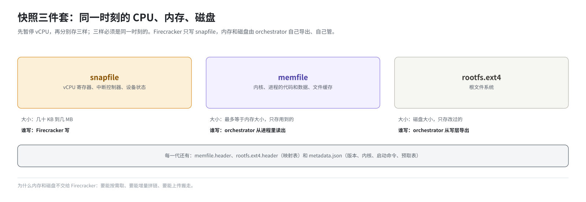
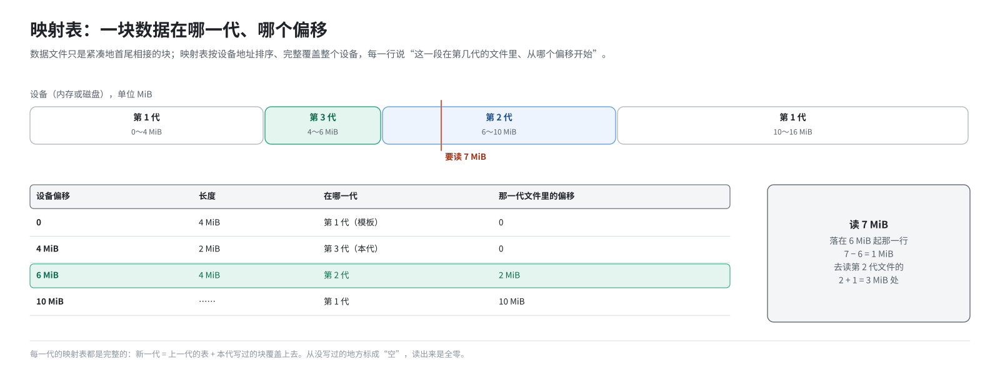
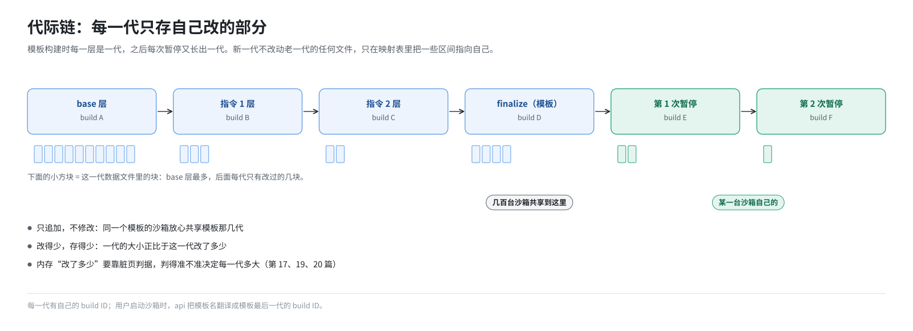
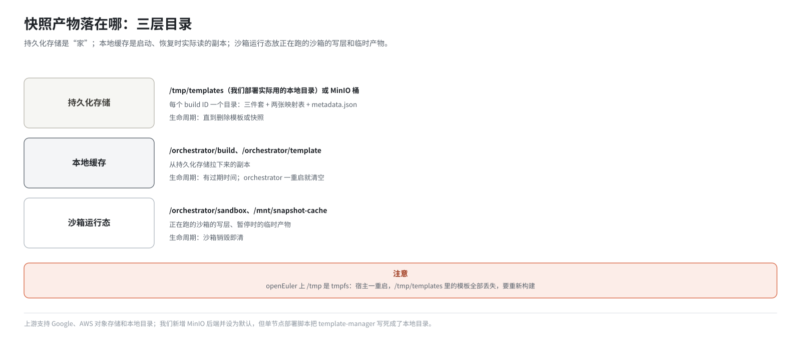

# 第 4 篇｜快照是什么：三件套与映射表

> **本篇目标**：上一篇的底子到这里派上用场。本篇回答三个问题：一张虚拟机快照里到底存了什么；为什么 E2B 不让 Firecracker 自己存内存和磁盘，而是自己管；一代一代的增量快照怎样靠一张“映射表”拼成一个完整的样子。最后看快照在宿主上和存储里放在哪。读完这一篇，后面构建、启动、暂停三部分都只是在“读快照”和“长出新一代”。

---

## 一、存一台机器，要存哪三样

把一台正在运行的电脑“冻住”再“解冻”，要保证解冻后它能从冻住那一刻接着往下跑，好像什么都没发生。需要记下的东西分三类：

| 类别 | 内容 | 大小 | E2B 的文件名 |
|---|---|---|---|
| **CPU 与设备状态** | 每个 vCPU 的寄存器（正执行到哪条指令、各寄存器的值）、中断控制器、虚拟设备的内部状态（网卡队列到哪了、磁盘请求处理到哪了） | 几十 KB 到几 MB | `snapfile` |
| **内存** | 虚拟机的全部内存内容：内核、所有进程的代码和数据、文件缓存 | 等于虚拟机内存大小（如 2 GiB），但只存用到的部分 | `memfile` |
| **磁盘** | 根文件系统 | 磁盘大小（几 GiB），只存改过的部分 | `rootfs.ext4` |

这就是**快照三件套**。三样必须是**同一个时刻**的：如果内存里的文件系统缓存说“某个文件写了 100 行”，磁盘上却只有 50 行，恢复后系统就会错乱。所以打快照前一定要先**暂停 vCPU**，让虚拟机停止产生新状态，再分别把三样存下来。

除了三件套，每一代快照还有一个 `metadata.json`，记着模板的版本、用哪个内核和 Firecracker、启动命令是什么、预取表（第 8 篇）等等。

## 二、为什么内存和磁盘不交给 Firecracker 存

Firecracker 自己会打快照：调它的 `PUT /snapshot/create` 接口，它就把 vCPU 状态写进 snapfile，再把整份内存写进一个内存文件。它也支持“差分快照”：只写上一次快照以来改过的页。

可 E2B 只让 Firecracker 写 snapfile，**内存和磁盘都自己管**。原因有三：

1. **要能按需取**。从快照恢复时，E2B 不想先把 2 GiB 内存全读回来再开跑，而是用 uffd 懒加载，用到哪页取哪页（第 12 篇）。这要求内存文件能按偏移随机读，而且读的人是 orchestrator，不是 Firecracker。
2. **要能增量、能拼链**。一个沙箱可能被暂停很多次，每次只该存改过的部分。几十代快照叠在一起，恢复时要知道每一页最新的内容在哪一代。Firecracker 的差分快照只描述“相对上一次”，不负责记这条链。
3. **要能上传、能搬走**。快照要存进对象存储，以后可能在另一个节点上恢复。产物必须是自足的、紧凑的文件，而不是依赖某个进程的状态。

磁盘更是如此：Firecracker 的快照根本不含磁盘，它假定磁盘由外部保证一致。E2B 的磁盘本来就是 orchestrator 用 NBD 提供的（第 3 篇），自然由 orchestrator 来存。

所以分工是：**Firecracker 只存 CPU 和设备状态；内存由 orchestrator 从 Firecracker 进程里直接读出来存；磁盘由 orchestrator 从写层导出。** 第 17 篇会细讲这两种“导出”。

## 三、增量：只存改过的块

模板构建完是第一代。之后每暂停一次，沙箱的内存和磁盘都只有一小部分变了。如果每次都存一整份，一个暂停过十次的 2 GiB 沙箱就要 20 GiB，显然不行。

E2B 的做法是**每一代只存自己改过的块**，并且把这些块**紧凑地**首尾相接写进文件。比如这一代只改了内存里第 3、7、8 块（每块 2 MiB），这一代的 `memfile` 就只有 6 MiB，里面依次放着第 3、7、8 块的内容。

“块”的大小是这样定的：

| 文件 | 块大小 | 原因 |
|---|---|---|
| `memfile` | 2 MiB | 和 guest 的大页一样大，一次缺页正好填一块（第 20 篇会改这一点） |
| `rootfs.ext4` | 4 KiB | 和 ext4 文件系统的块一样大 |

问题来了：文件里只是紧挨着的几块数据，**怎么知道哪一块原来在哪个位置？没存的块又去哪里找？**

## 四、映射表

每一代除了数据文件，还有一个**映射表**（header）文件：`memfile.header` 和 `rootfs.ext4.header`。它是一张按地址排序的表，每一行说：

> “设备上从偏移 A 开始、长度为 L 的这一段，在**第几代**的数据文件里，从**偏移 B** 开始。”

举个例子。设备（内存或磁盘）被切成一段段，第三代的映射表可能长这样：

| 设备偏移 | 长度 | 在哪一代 | 那一代文件里的偏移 |
|---|---|---|---|
| 0 | 4 MiB | 第 1 代（模板） | 0 |
| 4 MiB | 2 MiB | 第 3 代（本代） | 0 |
| 6 MiB | 4 MiB | 第 2 代 | 2 MiB |
| 10 MiB | …… | 第 1 代 | 10 MiB |

要读设备偏移 7 MiB 的数据：找到覆盖它的那一行（6 MiB 起、长 4 MiB），算出在那一行里的位置（7 − 6 = 1 MiB），于是去读第 2 代文件的 2 + 1 = 3 MiB 处。

几个要点：

- 映射表**完整覆盖**整个设备，按地址升序，首尾相接，所以任何偏移都能一步找到对应的那一行。
- 每一代的映射表都是**完整的**，不是只描述本代的块。新一代的映射表 = 上一代的映射表 + 本代改过的块覆盖上去。所以读的时候不用沿着代一层层往上翻，查本代这一张表就够了。
- 从没被写过的地方，映射表里会标成“空”，读出来是全零，不占任何文件空间。

## 五、代际链

每一代都有一个唯一的 **build ID**。模板构建时，每一层（第 7 篇）是一代；之后每次暂停，又长出一代。

这条链有几个性质，后面会反复用到：

- **只追加，不修改**。新一代不会改动老一代的任何文件，只是在映射表里把一些区间指向自己。所以同一个模板拉起的几百台沙箱可以放心地共享模板那几代的文件。
- **改得少，存得少**。一代的数据文件大小正比于这一代改了多少。这是“只为用到的付费”在存储上的体现。
- **判断“改了多少”是关键**。磁盘的改动很好判断：写层里有的块就是改过的。内存的改动要靠一个“脏页判据”，判得准不准直接决定每一代存多大。第 17 篇讲上游的判据，第 19 篇讲它在 ARM 上怎么失灵，第 20 篇讲怎么修好。

## 六、快照放在哪

快照文件在宿主上分三层存放，别混在一起：

| 层 | 位置（我们的部署） | 是什么 | 生命周期 |
|---|---|---|---|
| **持久化存储** | 本地目录 `/tmp/templates`，或 MinIO 的桶 | 每个 build ID 一个目录，放三件套、两张映射表、`metadata.json` | 直到删除模板或快照 |
| **本地缓存** | `/orchestrator/build`、`/orchestrator/template` | 从持久化存储拉下来的副本，启动、恢复时实际读的是它 | 有过期时间；orchestrator 一重启就清空 |
| **沙箱运行态** | `/orchestrator/sandbox`、`/mnt/snapshot-cache` | 正在运行的沙箱的写层、暂停时的临时产物 | 沙箱销毁即清 |

持久化存储由一个叫 `STORAGE_PROVIDER` 的配置决定用哪种。上游支持 Google 和 AWS 的对象存储，以及本地目录；我们为了能在不连外网的环境里部署，加了一种 **MinIO** 后端，并把默认值改成了它。

不过这里有一个部署上的细节值得知道：我们的单节点部署脚本在 template-manager 的配置里把它**写死成了本地目录**，所以实际生效的是 `/tmp/templates`。在 openEuler 上 `/tmp` 是内存文件系统（tmpfs），**宿主机一重启，所有模板就都没了**，要重新构建。这不是 bug，而是当前部署的选择，第 23 篇把它列在“还没解决的问题”里。

## 七、三个操作，三种读写方式

有了快照的样子，三个操作就可以用一句话描述：

| 操作 | 对快照做什么 |
|---|---|
| 构建模板 | 从空白开始，一层一层地**长出**第 1 代、第 2 代……最后一代就是模板 |
| 启动沙箱 | 沿着模板的映射表**读**：snapfile 一次读完，内存和磁盘按需读 |
| 暂停 | 在当前这一代上再**长出**一代：只存改过的块，写一张新映射表 |
| 恢复 | 和启动一样**读**，只是读的是暂停留下的那一代 |

---

## 本篇小结

| 概念 | 一句话解释 |
|---|---|
| 快照三件套 | snapfile（CPU 与设备）、memfile（内存）、rootfs（磁盘），必须是同一时刻的 |
| 分工 | Firecracker 只写 snapfile；内存和磁盘由 orchestrator 自己导出、自己管 |
| 增量 | 每一代只存改过的块，紧凑地首尾相接 |
| 块大小 | 内存 2 MiB（跟大页一样），磁盘 4 KiB |
| 映射表（header） | 设备上每一段在哪一代的哪个偏移；每代一张完整的表 |
| 代际链 | 模板各层与每次暂停都是一代，只追加不修改 |
| 三层存放 | 持久化存储、本地缓存、沙箱运行态 |
| 部署细节 | 我们的部署实际用本地目录 `/tmp/templates`，宿主重启即丢 |

**下一篇预告**：[《构建总览：为什么镜像不够，要的是一张快照》](05-build-overview.md)。进入第二部分。有了 Docker 镜像，为什么还要“构建模板”？一次构建的输入、输出是什么，流水线分哪几段？为什么说构建本身就是在反复启动和暂停？
