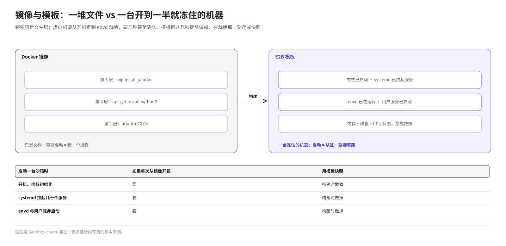
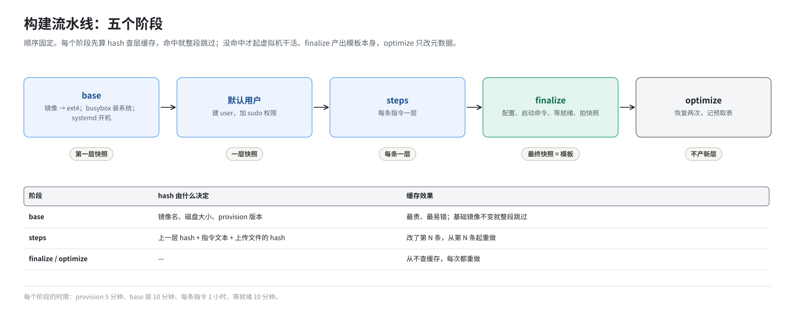
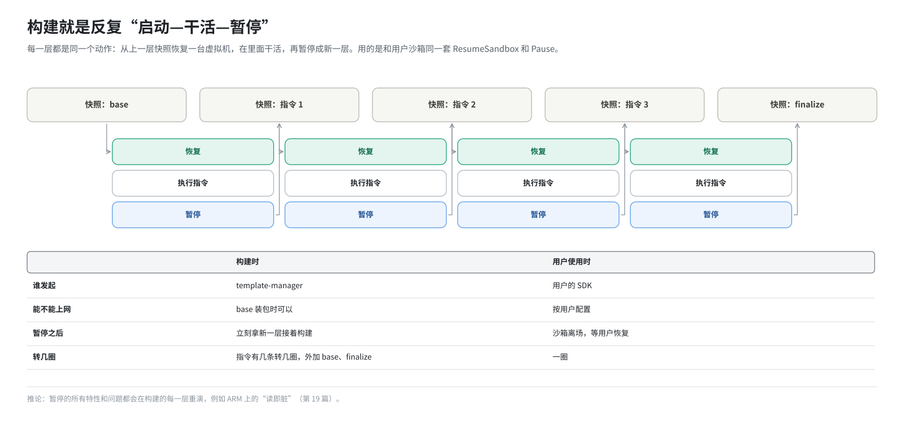

# 第 5 篇｜构建总览：为什么镜像不够，要的是一张快照

> **本篇目标**：进入第二部分“构建模板”。本篇先回答一个看起来多余的问题：都有 Docker 镜像了，为什么还要“构建模板”？然后给出一次构建的输入和输出，把流水线的五个阶段过一遍，最后点出整个构建最核心的一个事实：**构建本身就是在反复“启动—干活—暂停”**。后面三篇再分别展开 base 阶段、指令与缓存、收尾阶段。

---

## 一、镜像只是一堆文件

用户写模板，最常见的起点是一个 Docker 镜像，比如 `ubuntu:22.04`，再加几行指令：

```dockerfile
FROM ubuntu:22.04
RUN apt-get install -y python3 python3-pip
RUN pip install pandas
WORKDIR /home/user
```

在 Docker 里，镜像就是一叠文件层，容器启动时把它们叠起来当作根目录，然后直接运行一个进程。容器和宿主共用内核，所以“启动”只是创建一个进程，很快。

可 E2B 的沙箱是虚拟机。虚拟机要的不是“一叠文件”，而是：

- 一块**磁盘**（块设备），上面有文件系统；
- 一个**内核**，要从开机开始引导；
- 一个 **1 号进程**（init），把系统服务一个个拉起来；
- 沙箱里的管家 **envd** 已经在运行。

从一堆文件走到“envd 已经在运行”，要经过开机、内核初始化、systemd 启动几十个服务，通常要好几秒甚至更久。如果每次 `Sandbox.create` 都这样走一遍，“一百多毫秒可用”就无从谈起。

所以 E2B 的思路是：**把这几秒提前做掉。** 构建时真的开一台虚拟机，让它开机、装软件、跑启动命令，一直走到“一切就绪”，然后在那一刻把整台机器冻住、存成快照。以后每次启动，都从这一刻接着往下跑。



这就是“模板”：**不是一堆文件，而是一台开到一半就冻住的机器。**

## 二、输入和输出

一次构建：

| | 内容 |
|---|---|
| **输入** | 基础镜像（或另一个已有的模板）；一串指令（`RUN`、`COPY`、`ENV`、`WORKDIR`、`USER` 等）；CPU 核数和内存大小；可选的启动命令（start）与就绪检查命令（ready） |
| **输出** | 一个 build ID，以及它的快照三件套、映射表、`metadata.json`（第 4 篇） |
| **副产品** | 中间每一层的快照（也是 build ID），可以被以后的构建复用 |

用户在 SDK 里调用 `Template.build`，请求先到 api。api 在数据库里登记“这个模板有一个新版本正在构建”，挑一个能构建的节点，把任务交给那里的 template-manager。template-manager 收下任务就立刻返回，构建在后台进行；SDK 这边则不断轮询构建的状态和日志，直到成功或失败。

前面说过，在我们的单节点部署里，template-manager 和 orchestrator 是同一个进程。所以构建用的虚拟机和用户的沙箱由同一个进程管理，共享同一套 Firecracker、网络槽位池、本地缓存，也共享同一个内存上限。

## 三、流水线的五个阶段

构建按固定顺序走五个阶段：

| 阶段 | 做什么 | 产出 | 详见 |
|---|---|---|---|
| **base** | 拉镜像、解包成 ext4 磁盘；开一台临时虚拟机装上 systemd 等必需组件；再用 systemd 正式开机，等 envd 就绪 | 第一层快照 | 第 6 篇 |
| **默认用户** | 创建名为 `user` 的默认用户并给它 sudo 权限 | 一层快照 | 第 7 篇 |
| **steps** | 每条指令一层：执行指令，然后暂停成新的一层 | 每条指令一层快照 | 第 7 篇 |
| **finalize** | 重启沙箱，跑配置脚本、执行用户的启动命令、轮询就绪检查，就绪那一刻拍下最终快照 | 最终快照（模板本身） | 第 8 篇 |
| **optimize** | 从最终快照恢复两次，记下“一恢复就会访问哪些内存块”，写成预取表 | 不产生新层，只改元数据 | 第 8 篇 |



每个阶段在开始前都会算一个 **hash**：本阶段的 hash 由上一阶段的 hash 和本阶段的内容（比如这条指令的文本）共同决定。拿这个 hash 去“层缓存索引”里查，查到了说明以前构建过一模一样的东西，直接复用那一层，跳过整个阶段。第 7 篇细讲。

## 四、构建就是反复“启动—干活—暂停”

仔细看每个阶段在做什么，会发现它们几乎是同一个动作的重复：

```
拿到上一层的快照
 → 从它启动（恢复）一台虚拟机
 → 在里面干活（执行一条指令、跑一个脚本）
 → 暂停，存成新的一层快照
```



这里的“启动”和“暂停”，用的正是第三、四部分要讲的同一套代码：同一个 `ResumeSandbox` 把快照加载进 Firecracker，同一个 `Pause` 把内存和磁盘的改动导出成新的一代。区别只在于：

| | 构建时 | 用户使用时 |
|---|---|---|
| 谁发起 | template-manager | 用户的 SDK 调用 |
| 沙箱能不能上网 | base 阶段装包时可以 | 按用户配置 |
| 暂停后 | 立刻拿新一层接着构建下一条指令 | 沙箱离场，等用户来恢复 |
| 一次构建要转几圈 | 指令有几条就转几圈，外加 base、finalize 各一两圈 | 一圈 |

这也意味着：**构建会受到启动和暂停的所有特性和问题的影响。** 比如第 19 篇要讲的 ARM 上“读过就算脏”的问题，在构建的每一层暂停时同样存在；第 9 篇讲的构建内存故障，原因也和这些虚拟机共享同一个进程的内存上限有关。

还有一个细节：不是每一层都“从上一层恢复”。如果上一层是从缓存里直接拿来的（没有真的跑），下一层会用**冷启动**（从开机开始）而不是恢复，因为要让新的 CPU、内存规格生效。连续几条没命中缓存的指令则会共用一条“恢复—暂停”链，只有链的第一环付一次冷启动的代价。

## 五、层是怎么落地的

每一层暂停得到快照之后，要做三件事，顺序有讲究：

1. **先放进本地缓存**。下一条指令马上就要从这一层恢复，不能等上传完。
2. **再异步上传**到持久化存储，不阻塞下一层的构建。
3. **最后写层缓存索引**，而且要等这一层**以及所有更早的层**都上传完之后才写。

第 3 步的顺序很重要。索引一旦写下，别的构建就可能命中这一层、从它接着往下造；如果它依赖的前面某一层还没传完，那个构建就会去读一个不存在的文件。所以宁可晚一点登记，也不能先登记后上传。这和第 16 篇里暂停“等上传完成才返回”是同一个道理：**元数据不能早于数据宣布就绪。**

## 六、时限

构建的每一段都有超时：

| 环节 | 超时 |
|---|---|
| base 阶段的装包脚本 | 5 分钟 |
| base 阶段的第一层 | 10 分钟 |
| 每一条指令 | 1 小时 |
| finalize 的配置脚本 | 5 分钟 |
| 等待就绪检查通过 | 10 分钟 |
| optimize 的每次采集 | 5 分钟 |

optimize 是“尽力而为”的：采集失败只记一条警告，不让构建失败，模板照样可用，只是启动时少了预取。

---

## 本篇小结

| 概念 | 一句话解释 |
|---|---|
| 为什么要构建模板 | 镜像只是一堆文件；要做到一百多毫秒可用，必须把开机到就绪这几秒提前做掉，存成快照 |
| 输入 / 输出 | 镜像 + 指令 + 规格 + 启动与就绪命令 → 一个 build ID 及其快照 |
| 五个阶段 | base → 默认用户 → steps → finalize → optimize |
| 层缓存 | 每个阶段算一个 hash，命中就整段跳过 |
| 构建即启动暂停 | 每一层都是“恢复—干活—暂停”，用的是和用户沙箱同一套代码 |
| 落地顺序 | 先放本地缓存，再异步上传，全部传完才写索引 |

**下一篇预告**：[《base 阶段：把镜像变成一块能开机的磁盘》](06-base-phase.md)。一个容器镜像怎样变成虚拟机能用的 ext4 磁盘？镜像里没有 systemd，第一次开机靠什么？为什么 base 阶段要开两台虚拟机？
