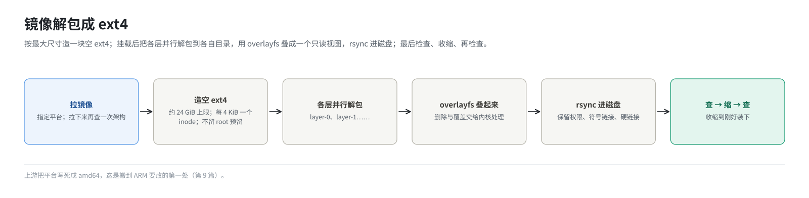
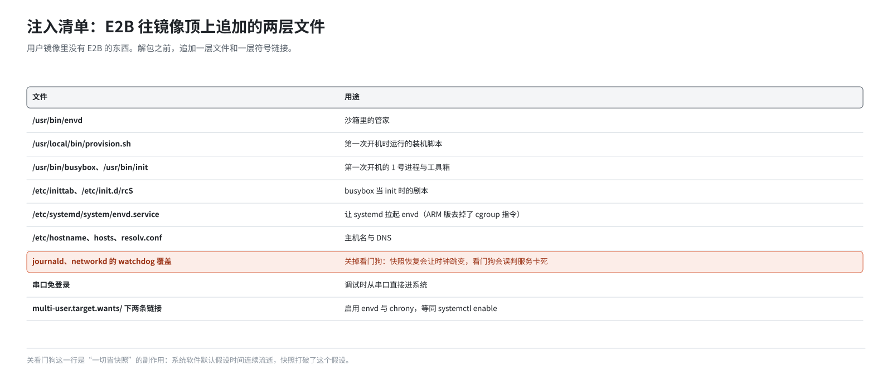

# 第 6 篇｜base 阶段：把镜像变成一块能开机的磁盘

> **本篇目标**：base 是整个构建里最贵、也最容易出错的一段。本篇按顺序走一遍：怎样把一个容器镜像变成一块 ext4 磁盘；往磁盘里塞进了哪些 E2B 自己的文件；为什么第一次开机不用 systemd，而用一个叫 busybox 的小工具当临时的 1 号进程；装完系统组件之后，怎样用 systemd 正式开机、等 envd 就绪、暂停成第一层。

---

## 一、从镜像到磁盘

### 1. 拉镜像

template-manager 先按用户给的镜像名（比如 `ubuntu:22.04`）去镜像仓库拉取。一个镜像往往同时有 x86 和 ARM 两种版本，拉的时候要指定**平台**，拉下来后还要再检查一遍它的架构字段对不对。两道检查都有必要：多架构镜像靠第一道挑出正确的版本；只有一种架构的镜像，第一道不起作用，只能靠第二道拦住。上游把平台写死成 `amd64`，这是第 9 篇要改的第一处。

### 2. 造一块空磁盘

接下来造一个 ext4 格式的磁盘文件。几个参数体现了沙箱的特点：

| 参数 | 含义 | 为什么 |
|---|---|---|
| 一开始按允许的最大尺寸造 | 默认上限约 24 GiB | 先保证装得下，后面再收缩 |
| 每 4 KiB 一个 inode | inode 是文件的“身份证”，数量在造盘时就定死了 | 解包 `node_modules` 这类海量小文件时不会先把 inode 用光 |
| 不给 root 预留空间 | ext4 默认留 5% 给 root 应急 | 沙箱是一次性的，预留纯属浪费 |

### 3. 解包

镜像由好几层组成，后面的层可以覆盖、删除前面层里的文件。要得到最终的样子，得把各层按顺序叠起来。

E2B 的做法是：把磁盘文件挂载到一个临时目录；把每一层并行解包到各自的目录；用 Linux 的 overlayfs 把这些目录叠成一个只读视图（删除、覆盖的语义交给内核处理，比自己逐层重放可靠）；最后用 `rsync` 把叠好的视图整个拷进磁盘，保留权限、符号链接和硬链接。

### 4. 检查与收缩

拷完之后：检查文件系统 → 收缩到“刚好装下现有数据”的大小 → 再检查一次。先查后缩，是因为带着错误去缩会把问题放大；缩完再查，是因为收缩本身也可能留下小问题。



## 二、往磁盘里塞进了什么

用户的镜像里当然没有 E2B 的东西。在解包之前，E2B 会往镜像顶上追加两层自己的文件：

| 文件 | 用途 |
|---|---|
| `/usr/bin/envd` | 沙箱里的管家 |
| `/usr/local/bin/provision.sh` | 第一次开机时运行的装机脚本 |
| `/usr/bin/busybox`、`/usr/bin/init` | 一个“万能小工具箱”，第一次开机时当 1 号进程 |
| `/etc/inittab`、`/etc/init.d/rcS` | busybox 当 1 号进程时的“剧本” |
| `/etc/systemd/system/envd.service` | 让 systemd 开机时拉起 envd |
| `/etc/hostname`、`/etc/hosts`、`/etc/resolv.conf` | 主机名、DNS |
| 两个 watchdog 覆盖配置 | 关掉 journald 和网络服务的“看门狗” |
| 串口免登录配置 | 方便调试时从串口直接进系统 |



关掉看门狗这一条值得多说一句。systemd 的看门狗会定期检查服务是否还活着，太久没响应就重启它。可快照恢复会让虚拟机里的时钟出现跳变：从系统的角度看，好像某个服务“突然很久没响应了”，看门狗就会误判它卡死。所以要关掉。这是“一切皆快照”带来的一个副作用：系统软件默认假设时间是连续流逝的，快照打破了这个假设。

还有一处细节：envd 和 chrony（校时服务）被“启用”的方式，是直接在 systemd 的目录里放符号链接，效果等同于 `systemctl enable`。不用在镜像里真的运行 systemctl，因为此时还没有一个在运行的系统。

## 三、第一次开机：用 busybox 当临时的 1 号进程

现在磁盘有了，但里面多半**没有 systemd**。很多基础镜像是为容器设计的，容器不需要 init 系统。要装 systemd，就得运行 `apt-get`（或 `dnf`）；要运行包管理器，就得有一个在运行的系统。这是一个循环依赖。

E2B 的解法是**开两次机**。第一次开机，用磁盘里塞进去的 busybox 当 1 号进程。busybox 很小，一个二进制里包含了 `sh`、`mount`、`sync` 等上百个常用命令，自己就能当一个最简单的 init。它照着 `/etc/inittab` 这份剧本依次执行：

```
1. 挂载 /proc、/sys、/dev、/tmp、/run（容器里这些是运行时给的，裸机得自己挂）
2. 运行 provision.sh，输出加上 [external] 前缀
3. sync，把缓存刷到磁盘
4. 冻结根文件系统（fsfreeze），保证没有在途的写
5. 打印一行 "E2B_PROVISIONING_EXIT:<退出码>"
6. sleep infinity，等宿主来关机
```

这里面有两个巧妙的地方：

- **日志靠前缀过滤**。这台虚拟机里没有 envd，没有任何 RPC 通道。它的输出只能走串口，变成 Firecracker 进程的标准输出。宿主按 `[external]` 前缀把装机日志挑出来，转成用户在 SDK 里能看到的构建日志。
- **结果靠一行文本**。退出码也没有别的路可走，只能打印一行带固定前缀的文本，宿主扫描输出流认出它。如果读不到结果文件，就按失败处理，宁可误判失败也不误判成功。

宿主拿到退出码后主动关掉这台虚拟机。

这台临时虚拟机是整个构建里**唯一允许上网**的，因为装包要访问软件源。整个过程限时 5 分钟。

### provision.sh 装了什么

| 软件包 | 谁需要它 |
|---|---|
| systemd | 第二次开机的 init 与服务管理 |
| chrony、linuxptp | 快照恢复后校时（从宿主提供的时钟设备同步） |
| openssh-server、sudo | 用户在沙箱里的交互与提权 |
| socat、curl、ca-certificates | 用户命令和就绪检查常用 |

脚本开头还会把 `/etc/resolv.conf` 锁成不可修改，装完再解锁。因为装 systemd 的过程中，有的软件包会试图接管 DNS 配置，接管后沙箱的 DNS 就依赖一个在快照恢复后未必正常的服务。

## 四、第二次开机：systemd 正式登场

第一台虚拟机关掉之后，宿主检查一遍磁盘的完整性，再把磁盘的**空闲空间**扩到用户要求的大小（用户指定的磁盘大小指的是空闲空间，不是总大小）。

然后第二次开机，这次用 systemd 当 1 号进程，和以后所有的沙箱一样。systemd 拉起各种服务，其中包括 envd。宿主等 envd 能应答，把磁盘缓存刷下去，然后**暂停**，得到构建的第一层快照。


两台虚拟机用的是宿主上**同一个**磁盘文件，所以第一台装好的软件，第二台开机时自然就在。

## 五、为什么 base 最贵，也最值得缓存

base 阶段包含两次完整的冷启动和一次装包，通常是整个构建里最慢的一段，也是最容易失败的一段：镜像拉不下来、软件源连不上、包名在这个发行版里不存在……所以这一段会把内核日志也直接流给用户，方便排查。

反过来，它也是缓存收益最大的一段：只要基础镜像没变，第二次构建可以整段跳过。如果模板不是从镜像而是从另一个模板派生的，base 阶段根本不跑，直接拿那个模板的最后一层当起点。

## 六、在 ARM 上要改的地方

这一段在 x86 上写得很顺，搬到鲲鹏和 openEuler 上却处处碰壁：镜像平台写死 amd64；内嵌的 busybox 是 x86 二进制；provision.sh 只认 apt；有几个包在 openEuler 的软件源里装不上。这些都在第 9 篇统一讲。

---

## 本篇小结

| 概念 | 一句话解释 |
|---|---|
| 拉镜像 | 按平台挑版本，拉下来后再查一次架构 |
| 造磁盘 | 按最大尺寸造、每 4 KiB 一个 inode、不留 root 预留 |
| 解包 | 各层并行解包，用 overlayfs 叠好，`rsync` 进磁盘，查—缩—查 |
| 注入文件 | envd、provision.sh、busybox、systemd 单元、关看门狗等 |
| 第一次开机 | busybox 当 init，跑 provision.sh 装 systemd 等，结果靠一行文本回报，唯一能上网 |
| 第二次开机 | systemd 开机、等 envd 就绪、暂停成第一层 |
| 缓存 | base 最贵，基础镜像不变就整段跳过 |

**下一篇预告**：[《指令、层与缓存：一条 RUN 是怎么执行的》](07-steps-layers-cache.md)。Dockerfile 里的每一条指令在 E2B 里怎么落地？为什么改了最后一行，前面的不用重做？E2B 的“层”和 Docker 的“层”有什么不同？
