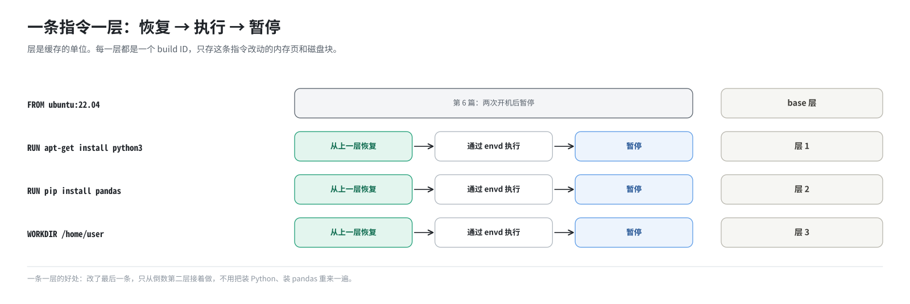
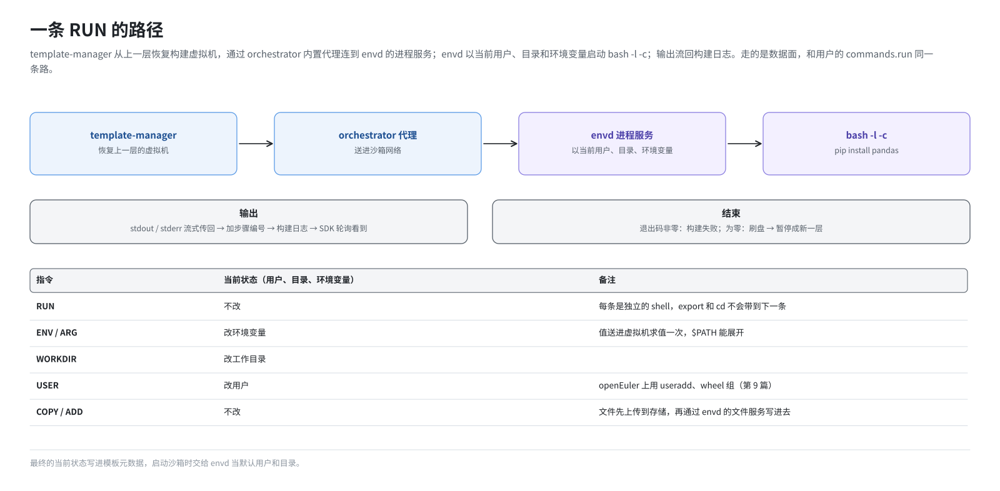
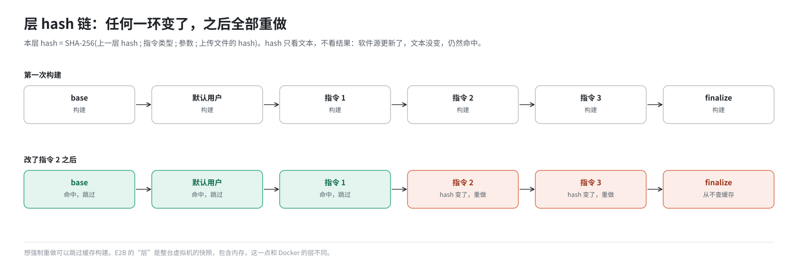

# 第 7 篇｜指令、层与缓存：一条 RUN 是怎么执行的

> **本篇目标**：base 阶段给了我们一台能开机、envd 已就绪的机器。接下来是用户自己的指令：`RUN`、`COPY`、`ENV`、`WORKDIR`、`USER`。本篇讲每条指令怎样变成“一层快照”；一条 `RUN` 从 template-manager 出发，经过哪些环节才在虚拟机里执行；指令之间传递了什么状态；以及为什么改了最后一行，前面的不用重做。

---

## 一、一条指令一层

steps 阶段把用户的指令逐条展开，每条指令就是一个小阶段，做的事情都一样：

```
从上一层的快照恢复一台虚拟机
 → 通过 envd 在里面执行这条指令
 → 暂停，存成新的一层
```



为什么要一条一层，而不是全部执行完再存一次？因为层是**缓存的单位**。如果十条指令只存一层，改了第十条就得把前九条全部重做；一条一层，就只需要从第九层接着做第十条。装 Python、装 pandas 这种动辄几分钟的指令，能省下大量时间。

每一层都是一个 build ID，都有自己的快照三件套。由于快照是增量的（第 4 篇），每一层只存这条指令改动的内存页和磁盘块。一条 `RUN pip install pandas` 那一层的磁盘增量，大致就是 pandas 装进去的那些文件。

## 二、六类指令

E2B 只支持 Dockerfile 的一个子集：

| 指令 | 做什么 | 会不会改变“当前状态” |
|---|---|---|
| `RUN` | 在虚拟机里执行一条 shell 命令 | 不会 |
| `COPY` / `ADD` | 把用户上传的文件放进虚拟机 | 不会 |
| `ENV` / `ARG` | 设环境变量 | 改环境变量 |
| `WORKDIR` | 设工作目录 | 改工作目录 |
| `USER` | 切换后续指令的执行用户 | 改用户 |

没有 `CMD`、`ENTRYPOINT`、`EXPOSE` 这些。它们在 Docker 里描述“容器启动时干什么”，在 E2B 里由模板的启动命令和就绪检查承担（第 8 篇）。

### 指令之间传递什么

每条指令执行时都带着一份“当前状态”：**以哪个用户、在哪个目录、带哪些环境变量**。`ENV`、`WORKDIR`、`USER` 修改它，`RUN`、`COPY` 读取它但不修改。这份状态会写进每一层的元数据，随快照一起保存，所以下一层从快照恢复后仍然知道当前用户和目录；模板最终的这份状态，还会在启动沙箱时交给 envd，作为默认用户和默认目录。

这里有一个和 Docker 一致的语义：**每条 `RUN` 是一个独立的 shell**。你在一条 `RUN` 里 `export FOO=1` 或者 `cd /tmp`，下一条 `RUN` 看不到。副作用只留在文件系统里。要改环境变量和目录，必须用 `ENV` 和 `WORKDIR`。

`ENV` 还有一个小细节：变量的值会**送进虚拟机里求值一次**，所以 `ENV PATH=$PATH:/opt/bin` 这种引用已有变量的写法能正确展开。代价是每设一个变量就要在虚拟机里跑一次命令。

## 三、一条 RUN 的完整路径

以 `RUN pip install pandas` 为例：

1. template-manager 从上一层快照恢复出一台构建用的虚拟机（就是第三部分要讲的 `ResumeSandbox`）；
2. 它通过 orchestrator 内置的代理，连到这台虚拟机里 envd 的进程服务；
3. envd 以当前用户、在当前目录、带着当前的环境变量，启动 `bash -l -c "pip install pandas"`；
4. 命令的标准输出和标准错误以流的形式传回 template-manager，加上步骤编号，写进构建日志，SDK 那边轮询就能看到；
5. 命令结束，envd 回报退出码。非零就判这一步失败，整个构建失败；
6. 成功则把虚拟机里的磁盘缓存刷下去，然后暂停，得到新的一层。



注意第 2 步：template-manager 和这台虚拟机之间走的是**数据面**（第 2 篇），和用户在 SDK 里 `sbx.commands.run(...)` 走的是同一条路。构建没有什么“后门”，它就是一个特殊的 envd 客户端。

`COPY` 也类似：用户的文件先由 SDK 打包上传到存储，template-manager 取下来，通过 envd 的文件服务写进虚拟机。

## 四、层缓存：改了最后一行，前面不用重做

### 1. 层 hash

每个阶段在执行前都先算一个 hash：

```
本层 hash = SHA-256( 上一层 hash ; 指令类型 ; 指令参数 ; 上传文件的 hash )
```

base 阶段没有“上一层”，它的输入是镜像名、磁盘大小、provision 脚本的版本和一个缓存格式版本号。

由于每一层都把上一层的 hash 当作输入，整条链就是一条 **hash 链**：任何一环变了，它之后所有层的 hash 都会变。

### 2. 查缓存

算出 hash 后，去“层缓存索引”里查：以前有没有构建过 hash 一模一样的层？有，就直接拿那一层的 build ID 当本层的结果，跳过执行；没有，才真的恢复虚拟机去跑。



于是：

- 改了第 3 条指令：第 1、2 条命中缓存，从第 3 条开始重做；
- 改了 `COPY` 的文件内容：文件 hash 变了，这一条和之后的都重做；
- 换了基础镜像：从 base 开始全部重做。

### 3. 缓存的“陷阱”

hash 只看指令的**文本**，不看指令执行的**结果**。`RUN apt-get update && apt-get install -y python3` 第一次构建时装的是当时最新的 python3，三个月后再构建，文本没变，缓存命中，用的还是三个月前那一层，不会去装新版本。这和 Docker 的层缓存行为一样。想强制重做，可以在构建时要求跳过缓存。

finalize 和 optimize 两个阶段**从不查缓存**，每次都重做，因为它们要在最终的状态上跑启动命令、采集预取表，结果和运行时机有关。

## 五、和 Docker 层的异同

| | Docker 的层 | E2B 的层 |
|---|---|---|
| 存的是什么 | 文件系统的差分（一个 tar 包） | 整台虚拟机的快照：内存 + 磁盘 + CPU 状态 |
| 能不能直接运行 | 不能，要叠起来再启动进程 | 能，最后一层就是一台随时可恢复的机器 |
| 缓存键 | 上一层 + 指令文本 + 文件内容 | 同左 |
| 每条 RUN 的环境 | 新 shell，副作用只留在文件里 | 同左 |
| 中间层占的空间 | 只有文件差分 | 文件差分 + 内存差分 |

最大的不同在第一行：E2B 的每一层都包含**内存**。这意味着每一层暂停时，都要判断“这条指令执行期间改了哪些内存页”。判得准，一层只多存几 MiB；判得不准，每一层都要多存上百 MiB。第 19 篇会看到，在 ARM 适配的早期版本上，后一种情况真的发生了。

## 六、默认用户

在用户的指令之前，还有一个小阶段：创建一个叫 `user` 的普通用户，把它加进有 sudo 权限的组，并把它设为后续指令的默认用户。用户在 SDK 里跑命令，默认就是以 `user` 身份执行的。

这一步在 Debian 系的镜像里用 `adduser` 和 `sudo` 组；可 openEuler 这类发行版没有 `adduser` 这个命令，sudo 权限组也叫 `wheel` 而不叫 `sudo`。第 9 篇会讲我们怎么改。

---

## 本篇小结

| 概念 | 一句话解释 |
|---|---|
| 一条指令一层 | 恢复 → 通过 envd 执行 → 暂停；层是缓存的单位 |
| 六类指令 | RUN、COPY/ADD、ENV/ARG、WORKDIR、USER；没有 CMD、ENTRYPOINT |
| 当前状态 | 用户、目录、环境变量；随快照保存，最后交给 envd 当默认值 |
| 独立 shell | 每条 RUN 的 export、cd 不会带到下一条 |
| 一条 RUN 的路径 | template-manager → orchestrator 代理 → envd → bash，输出流回构建日志 |
| 层 hash 链 | 本层 hash 包含上一层 hash，任何一环变化，之后全部重做 |
| 缓存只看文本 | 指令文本不变就命中，不管软件源有没有更新 |
| 和 Docker 的区别 | E2B 的层包含内存，判脏的准确度直接影响每层大小 |

**下一篇预告**：[《finalize 与 optimize：拍下最终那张快照》](08-finalize-optimize.md)。模板的最后一张快照拍在什么时刻？为什么要重启一次、跑启动命令、等就绪再暂停？预取表又是什么，它怎样让启动更快？
