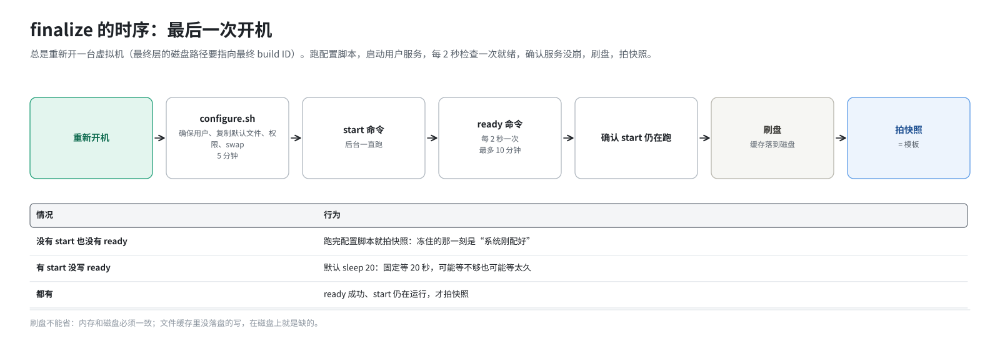
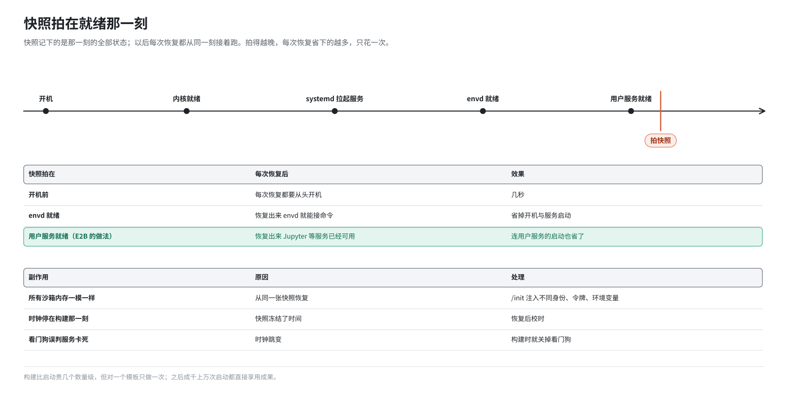
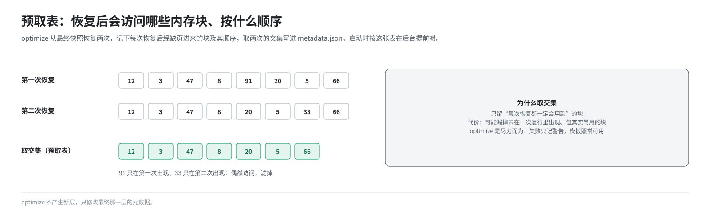

# 第 8 篇｜finalize 与 optimize：拍下最终那张快照

> **本篇目标**：所有指令执行完之后，还差最关键的一步：拍下模板的最终快照。本篇讲 finalize 阶段为什么要“重启一次、跑配置、启动用户服务、等就绪、再暂停”；为什么快照要拍在“就绪那一刻”；optimize 阶段怎样记录预取表；以及一个模板最终由哪些东西组成、什么时候才算真正可用。

---

## 一、finalize：最后一次开机

finalize 阶段**总是重新开一台虚拟机**，而不是从最后一条指令那一层恢复。原因是最终那一层的磁盘路径要指向最终 build ID 的产物，必须用新的配置重新拉起。

开机之后依次做四件事：

| 步骤 | 做什么 | 时限 |
|---|---|---|
| 1. 跑配置脚本 | `configure.sh`：确保默认用户存在、复制家目录的默认文件、调整权限、开 swap 等 | 5 分钟 |
| 2. 启动用户服务 | 运行用户给的 start 命令（比如启动一个 Jupyter 服务），它会一直在后台跑 | — |
| 3. 等就绪 | 每 2 秒执行一次用户给的 ready 命令（比如 `curl localhost:8888`），直到成功 | 10 分钟 |
| 4. 拍快照 | 把虚拟机里的磁盘缓存刷到磁盘，然后暂停 | — |

几个细节：

- **没有 start 命令也没有 ready 命令**：跑完配置脚本就直接拍快照，模板冻住的那一刻就是“系统刚配好”。
- **有 start 命令但没写 ready 命令**：默认的“就绪检查”是 `sleep 20`，即固定等 20 秒。这不是探测，只是一个保守的等待：可能等不够（服务还没开始监听就被冻住了），也可能等太久（白白多花 20 秒构建时间）。好处是用户不用为每个模板写健康检查。
- **就绪之后还要确认 start 命令真的在跑**，没有提前崩掉，才去拍快照。
- **刷盘这一步不能省**。虚拟机里的程序写文件，数据可能还停留在内存的文件缓存里，没落到磁盘上。快照恢复后，系统会继续使用这块磁盘；没刷下去的那部分，在磁盘上就是缺的。虽然内存快照里也有这份缓存，但内存和磁盘必须一致，所以先刷再拍。

## 二、为什么快照要拍在“就绪那一刻”

这是整个 E2B 设计里最核心的一个决定。

快照记下的是虚拟机**在那一刻的全部状态**：内存里有哪些进程、每个进程执行到哪一行、打开了哪些文件、网络连接处于什么状态。以后每次从这张快照恢复，虚拟机都从**同一刻**接着往下跑。

如果快照拍在“开机前”，每次恢复都要从头开机，几秒钟；拍在“开机完成、envd 就绪”，每次恢复出来 envd 就已经在跑，可以立刻接受命令；拍在“用户的 Jupyter 已经启动、可以访问”，每次恢复出来 Jupyter 就是现成的，连它的启动时间也省了。

这就是为什么 E2B 能做到一百多毫秒可用：**所有“准备”的时间都在构建时花掉了，而且只花一次。** 之后成百上千次启动，都直接从“已准备好”开始。

这个设计也带来一些需要专门处理的副作用：

| 副作用 | 原因 | 怎么处理 |
|---|---|---|
| 所有沙箱的内存一开始一模一样 | 从同一张快照恢复 | 恢复后通过 envd 的 `/init` 给每台注入不同的身份、令牌、环境变量（第 13 篇） |
| 虚拟机里的时钟停在构建那一刻 | 快照冻结了时间 | 恢复后校时（第 13 篇） |
| 看门狗误判服务卡死 | 时钟跳变 | 构建时就关掉看门狗（第 6 篇） |

## 三、optimize：记下“一恢复就会用到哪些内存”

模板拍好了。可从它恢复时，内存是懒加载的（第 12 篇）：虚拟机访问哪一页，才去取哪一页。刚恢复的那一小段时间里，envd、用户服务、内核都会密集地访问内存，引发一阵“缺页风暴”，每次缺页都要等 orchestrator 去取数据。

如果能**提前知道**这些页是哪些，就可以在虚拟机刚开始跑的同时，后台把它们先搬进来，等虚拟机真用到时已经在那了。

optimize 阶段就是去获取这份名单：

1. 从刚拍好的最终快照恢复一台虚拟机；
2. 等 envd 能应答；
3. 读出这段时间里所有通过缺页进来的内存块，以及它们的**先后顺序**；
4. 再恢复一次，重复一遍；
5. 两次结果取**交集**：只保留两次都出现的块；
6. 写进 `metadata.json`，成为这个模板的**预取表**。

取交集是为了滤掉偶然的访问（比如某个后台任务恰好在那一刻醒来），只留下“每次恢复都一定会用到”的部分。代价是可能漏掉一些只在一次运行里出现、但其实也很常用的块。

optimize 不产生新的一层，它只修改最终那一层的元数据。它也是“尽力而为”的：采集失败只记警告，模板照常可用，只是启动时没有预取可用。

## 四、模板最终长什么样

一个构建成功的模板，在存储里是这样一组东西：

| 内容 | 说明 |
|---|---|
| 一条代际链 | base 层 → 默认用户层 → 每条指令一层 → finalize 层，每层一个 build ID，各有三件套和映射表 |
| 最终 build ID | finalize 层，也就是这个模板版本对外的 ID |
| `metadata.json` | 内核与 Firecracker 版本、默认用户与目录、环境变量、start 与 ready 命令、预取表 |
| 数据库记录 | api 那边记着“模板 X 的当前版本是这个 build ID” |

用户 `Sandbox.create("my-python")` 时，api 把模板名翻译成最终 build ID，交给 orchestrator 去恢复。

## 五、什么时候才算可用

构建的最后一步是**等所有层都上传完成**，然后才把构建标记为成功。

上一篇讲过，每一层暂停后是先放进本地缓存、再异步上传的，为的是不让上传拖慢下一层。可如果这时就告诉用户“构建好了”，用户马上 `Sandbox.create`，而沙箱被调度到另一个节点上，那个节点要从存储里取这个模板，可它还没传完。所以必须等全部上传完成才宣布可用。

这个“元数据不能早于数据宣布就绪”的原则，在第 16 篇的暂停里还会再见到一次。

## 六、构建在一个模板的一生里有多重要

把五个阶段串起来看，一次构建大概经历了：

- 两次冷启动（base 阶段）+ 一次冷启动（finalize）；
- 指令条数那么多次的“恢复—执行—暂停”；
- 两次恢复（optimize）；
- 若干次上传。

它比启动一台沙箱贵几个数量级，但对一个模板只做一次。之后这个模板可能被启动成千上万次，每次都直接享用构建时的成果。这是一笔典型的“预先投入，反复收益”的交易。

---

## 本篇小结

| 概念 | 一句话解释 |
|---|---|
| finalize | 重开一台虚拟机：配置 → 启动用户服务 → 等就绪 → 刷盘 → 拍快照 |
| 默认就绪检查 | 有 start 无 ready 时固定等 20 秒 |
| 拍在就绪那一刻 | 所有准备时间在构建时花掉，之后每次恢复都从“已就绪”开始 |
| 副作用 | 内存相同、时钟停住、看门狗误判，各有处理 |
| optimize | 恢复两次、记录缺页顺序、取交集，存成预取表 |
| 可用的条件 | 所有层上传完成之后才宣布构建成功 |

**下一篇预告**：[《把构建搬到 ARM 上：我们改了什么》](09-build-on-arm.md)。上游 E2B 只在 x86 上跑。要在鲲鹏服务器和 openEuler 上把模板构建跑通，要改哪些地方？其中有一次故障，症状和病因隔了三个服务。
