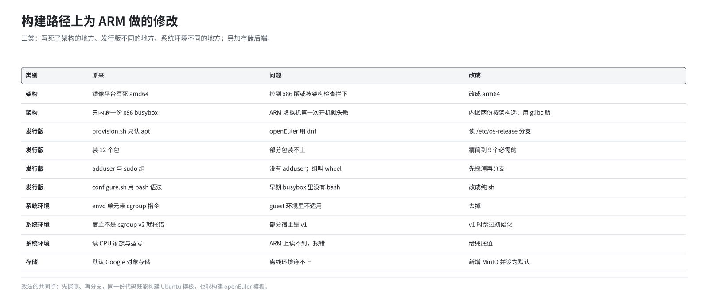
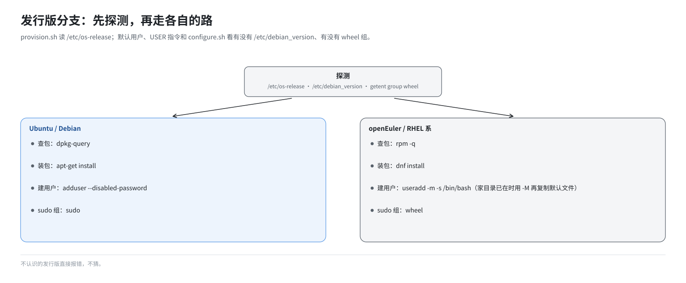
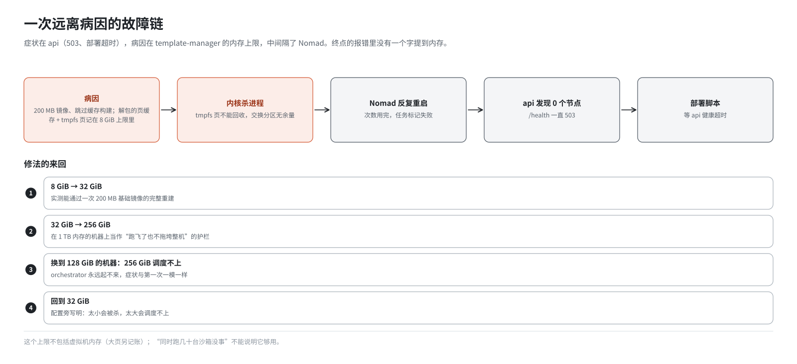

# 第 9 篇｜把构建搬到 ARM 上：我们改了什么

> **本篇目标**：前面四篇讲的是上游 E2B 的构建流程，它在 x86 和 Ubuntu 上写得很顺。可我们要在鲲鹏（ARM）服务器、openEuler 系统上跑。本篇把构建路径上的修改分成三类讲：写死了架构的地方、发行版不同的地方、系统环境不同的地方。然后讲两个和构建有关的故障：一个是 Firecracker 版本目录引起的，一个是内存上限引起的，后者的症状和病因隔了三个服务。最后说明为什么模板构建的虚拟机不走第 15 篇的启动优化。

---

## 一、先看全貌

把构建路径上所有为 ARM 做的修改放在一张表里：

| 类别 | 原来 | 问题 | 改成 |
|---|---|---|---|
| 架构 | 镜像平台写死 `amd64` | 拉不到 ARM 镜像；拉到了也会被架构检查拦下 | 改成 `arm64` |
| 架构 | 只内嵌一份 x86 的 busybox | ARM 虚拟机里根本跑不起来，第一次开机就失败 | 内嵌两份，按编译时的架构选择 |
| 发行版 | provision.sh 只认 apt | openEuler 用 dnf | 读 `/etc/os-release`，按发行版选包管理器 |
| 发行版 | 装 12 个包 | 有几个包在 openEuler 软件源里名字不同或装不上 | 精简到 9 个必需的包 |
| 发行版 | 建用户用 `adduser`，sudo 组叫 `sudo` | openEuler 没有 `adduser`，sudo 组叫 `wheel` | 先探测，再分别用 `adduser`/`useradd`、`sudo`/`wheel` |
| 发行版 | configure.sh 用 bash 语法 | 早期用的 busybox 版本里没有 bash | 改成纯 `sh` 语法 |
| 系统环境 | envd 的 systemd 单元带一组 cgroup 资源指令 | 在 guest 环境里不适用 | 去掉这组指令 |
| 系统环境 | 宿主不是 cgroup v2 就报错退出 | 部分宿主是 cgroup v1 | 检测到 v1 就跳过 cgroup 初始化 |
| 系统环境 | 读 CPU 的“家族”和“型号” | ARM 上读不到这两个字段，直接报错 | ARM 上给出兜底值 |
| 存储 | 默认用 Google 对象存储 | 离线环境连不上 | 新增 MinIO 后端并设为默认 |

下面挑几处展开。

## 二、架构写死的地方

### 1. 镜像平台

第 6 篇讲过，拉镜像时要指定平台，拉下来再检查一遍架构字段。上游把这个平台写成了一个**编译期常量** `amd64`，不是配置项。在 ARM 机器上，结果有两种：多架构镜像会拉到 x86 版本，单架构的 ARM 镜像则被第二道检查拦下来，报“镜像不是 amd64”。

改法是把常量改成 `arm64`。这意味着一个 orchestrator 二进制只能构建一种架构的模板。这本来就是合理的：ARM 机器上的 Firecracker 只能跑 ARM 的虚拟机。

### 2. busybox

base 阶段的第一次开机靠 busybox 当 1 号进程（第 6 篇）。上游把一个 x86 的 busybox 二进制直接**编进** orchestrator 里，构建时写进磁盘。ARM 虚拟机的 CPU 根本不认识 x86 指令，内核一启动就找不到能执行的 init，构建在第一步就失败。

改法是同时内嵌 x86 和 arm64 两份 busybox，程序启动时按自己的架构挑一份。这里还有一个踩过的坑：最初用的是一个基于 musl 的 busybox，它体积小，但里面没有 bash，而 configure.sh 是 bash 脚本，跑不起来。最后换成了基于 glibc 的版本，同时把 configure.sh 改成只用最基本的 `sh` 语法，两头都不再依赖 bash。

## 三、发行版不同的地方

Ubuntu 和 openEuler 都是 Linux，但在构建会碰到的地方差得不少：

| 事情 | Ubuntu / Debian | openEuler / RHEL 系 |
|---|---|---|
| 查一个包装没装 | `dpkg-query` | `rpm -q` |
| 装包 | `apt-get install` | `dnf install` |
| 建用户 | `adduser --disabled-password`（一个交互友好的脚本） | `useradd -m -s /bin/bash` |
| 有 sudo 权限的组 | `sudo` | `wheel` |
| 识别标志 | 有 `/etc/debian_version` | 没有 |

我们的改法都是**先探测、再分支**，而不是把 Ubuntu 的写法替换掉：

- **provision.sh**：读 `/etc/os-release` 拿到发行版 ID，查包用 `dpkg-query` 还是 `rpm -q`、装包用 `apt-get` 还是 `dnf`，各走各的。遇到不认识的发行版直接报错。
- **默认用户和 `USER` 指令**：先在虚拟机里试一下 `test -f /etc/debian_version`，有就用 `adduser`，没有就用 `useradd`；再试一下 `getent group wheel`，有 `wheel` 组就加进 `wheel`，否则加进 `sudo`。
- **configure.sh**：同样按 `/etc/debian_version` 分支。openEuler 那一支还要多处理一种情况：家目录已经存在时 `useradd -m` 会报错，所以先检查，存在就不让它建家目录，再手动把默认文件复制进去。

这样同一份代码既能构建 Ubuntu 模板，也能构建 openEuler 模板。

装包列表也精简了：上游装 12 个包，其中 `fuse3`、`iptables`、`git`、`nfs-common` 这几个，或者在 openEuler 上包名不同，或者对沙箱的基本功能不是必需的。我们保留了 systemd、ssh、sudo、chrony、linuxptp、socat、curl、证书这些必需品。用户真需要 git，可以在自己的 Dockerfile 里装。

## 四、系统环境不同的地方

### 1. envd 的 systemd 单元

上游给 envd 的 systemd 单元里写了一组资源控制指令：委托 cgroup、保证至少 50 MB 内存、开 CPU 记账、把 CPU 权重调到最高。目的是让 envd 在沙箱资源紧张时也能得到照顾。这组指令依赖 guest 内核和 systemd 的 cgroup 配置，在我们的 guest 环境里不适用。我们把这一组指令去掉了，envd 作为普通服务运行。

### 2. 宿主的 cgroup

orchestrator 启动时要初始化一棵 cgroup 树，用来给每台沙箱记账。上游要求宿主必须是 **cgroup v2**，否则直接报错退出。部分鲲鹏宿主跑的是 cgroup v1。我们的改法是检测到 v1 就跳过这棵树的初始化，orchestrator 照常启动。

这一处改动的影响不止于构建。ARM 移植时还把“把 Firecracker 进程放进它自己那个 cgroup”的那段代码注释掉了，于是所有 Firecracker 进程都继承了 orchestrator 所在的 cgroup。这件事在第 12 篇讲内存账、第 15 篇讲绑核时会再出现。

### 3. CPU 信息

orchestrator 会上报本机的 CPU 信息（家族、型号），供调度时参考。上游用的库在 ARM 上读不到这两个字段，返回空值，上游代码见到空值就报错。改法是在 ARM 上给出兜底值（家族 `arm64`、型号 `0`）。

## 五、故障一：Firecracker 的版本目录

宿主上的 Firecracker 按版本号放在 `/fc-versions/<版本>/firecracker`。模板构建时记下用的是哪个版本，以后启动这个模板的沙箱也用同一个版本。

我们在 ARM 上用的是**自己编译的** Firecracker。它不是直接从上游改的，而是在 E2B 自己的 Firecracker 分支 `firecracker-v1.12-direct-mem` 上加了快照回滚和 HDBSS 的改动，Cargo 里的版本号是 1.12.1，`firecracker --version` 报的也是它。部署时它放在 `v1.13.1` 这个目录下，因为代码里查找版本时用的键是 v1.13.1。曾经有一次试图把一切改成名副其实的 v1.12.1，结果版本号的来源不止一处：环境变量里残留的旧值优先于代码里的常量，构建登记的版本指向了一个根本不存在的目录，报 `stat /fc-versions/v1.13.1/firecracker: no such file or directory`。实地测试又发现改名后运行时仍然按 v1.13.1 去找。最后的决定是**不再和查找键较劲**：目录就叫 v1.13.1，文档里说清楚“里面是基于 1.12.1 自己编译的版本”。也正因为目录名和版本号都只是标签，要确认跑的是哪个二进制，得看进程实际运行的文件和它的 sha256。

这个故障的教训是：版本号这类“标签”往往有多个来源（常量、环境变量、配置文件、数据库），改一处之前要先把所有来源找全。

## 六、故障二：一次远离病因的内存故障

这是构建路径上最有代表性的一次故障。

**症状**：部署脚本卡在“等 api 健康”，最后报“部署超时”。api 一直返回 503。

**表面上看**，问题在 api。但 api 只有在发现至少一个可用的 orchestrator 节点时才报健康，而它一个节点都没发现。

**再往下看**，orchestrator（也就是 template-manager，单节点部署里它们是一个进程）一直在被 Nomad 反复重启，重启次数用完后任务被标记为失败。

**再往下看**，每次重启前，它都被内核的内存控制组**强制杀掉**了，原因是超过了 8 GiB 的内存上限。

**真正的病因**：用一个 200 MB 的基础镜像、跳过缓存做一次完整构建。进程自身的内存只有 125 MB 左右，可是：

- 解包镜像各层时产生了大量**文件缓存**，这部分算在这个进程的内存账上；
- 构建过程中往一个 tmpfs（内存文件系统）目录里写了文件，tmpfs 的页**不能**像普通文件缓存那样被回收，只能换出到交换分区，而交换分区已经没有余量了。

于是内核只能杀进程。

这条链上，从“构建内存超限”到“部署超时”隔了三个服务（template-manager → Nomad → api），终点的报错里没有任何一个字提到内存。

**修法**经历了一个来回：

1. 先把上限从 8 GiB 提到 32 GiB，实测能通过一次 200 MB 基础镜像的完整重建；
2. 后来在一台 1 TB 内存的机器上，觉得 32 GiB 太紧，提到 256 GiB，当作“跑飞了也不至于拖垮整机”的护栏；
3. 再后来换到一台 128 GiB 内存的机器上，256 GiB 的申请让 Nomad **根本调度不了**这个任务（资源不够），orchestrator 永远起不来，症状和第一次一模一样：api 503，部署卡住；
4. 最终回到 32 GiB，并在配置旁写明两种失败模式：太小会被杀，太大会调度不上。

还有一个容易误解的地方：这个上限管的是 orchestrator 进程和构建，**不包括虚拟机的内存**。虚拟机内存由大页背衬，大页只记在单独的大页账上，不进这个上限（第 12 篇）。所以“同时跑几十台沙箱都没事”并不能说明这个上限够用，构建时解包镜像产生的文件缓存才是压垮它的那根稻草。

## 七、模板构建不走启动优化

第 15 篇会讲一个重要的启动优化：用一个小程序 `fc-netns-exec` 替换启动 Firecracker 时的 `ip netns exec`。这个优化**只用于从快照恢复的沙箱**，模板构建时开的虚拟机仍然走原来的 `ip netns exec`。

原因是两者用的磁盘路径机制不同：模板构建的虚拟机用的是一组固定路径，不带模板 ID 和 build ID；从快照恢复的沙箱则需要把快照里录死的路径重新指向自己的文件（第 11 篇）。优化代码判断：如果没有模板 ID 或 build ID，就退回原来的方式。构建一次只开几台虚拟机，不存在高并发争用，优化的收益本来就很小，没有必要冒风险。

---

## 本篇小结

| 修改 | 原因 | 改法 |
|---|---|---|
| 镜像平台 | 写死 amd64 | 改成 arm64 |
| busybox | 只有 x86 版；musl 版缺 bash | 内嵌两份按架构选，用 glibc 版；configure.sh 改用纯 sh |
| 包管理器与装包列表 | openEuler 用 dnf，部分包装不上 | 按 `/etc/os-release` 分支，精简到必需的包 |
| 用户与 sudo 组 | 没有 adduser，组叫 wheel | 先探测再分支 |
| envd 单元 | cgroup 指令不适用 | 去掉 |
| cgroup v1 宿主 | 上游只认 v2 | 检测到 v1 跳过初始化 |
| CPU 信息 | ARM 上读不到 | 给兜底值 |
| Firecracker 版本目录 | 自编译版本与查找键不一致 | 目录沿用 v1.13.1，文档写明实际版本 |
| 构建内存上限 | 8 GiB 被解包缓存和 tmpfs 撑爆 | 32 GiB，并写明太小被杀、太大调度不上 |
| 启动优化 | 构建虚拟机用固定路径 | 构建不走 netns-exec |

**下一篇预告**：[《启动就是恢复：一次 Sandbox.create 的全景》](10-create-is-resume.md)。进入第三部分。`Sandbox.create` 之后，请求经过了哪些环节？orchestrator 里的 `ResumeSandbox` 分几段，哪几样东西是并行准备的？
