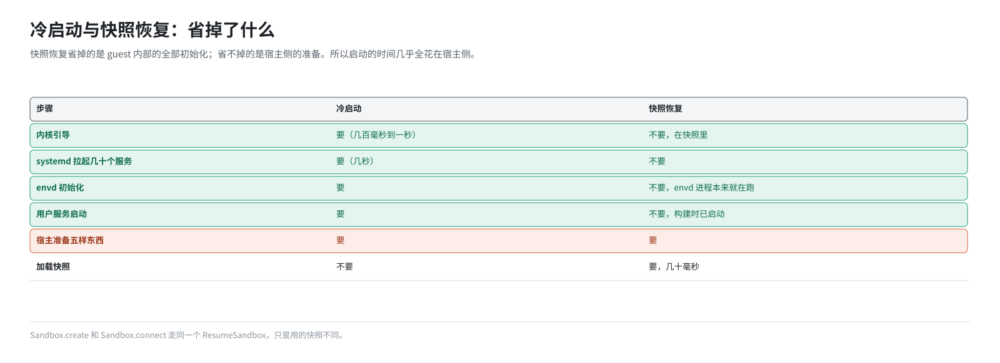
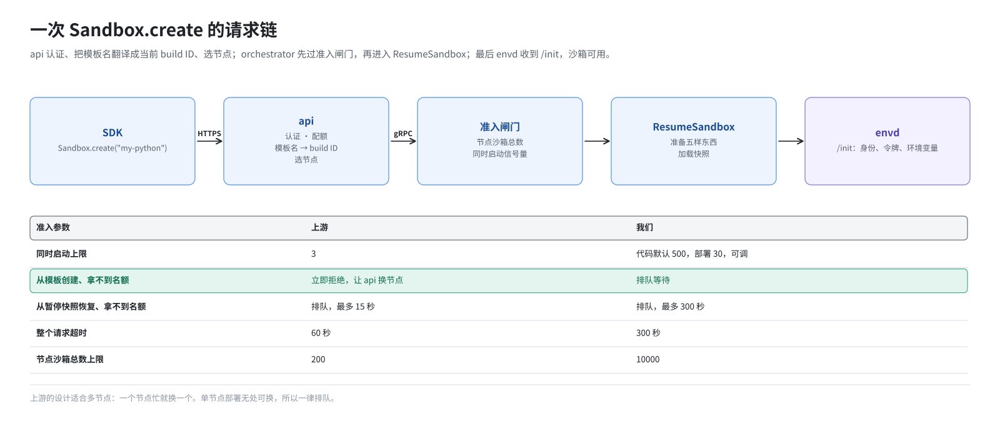
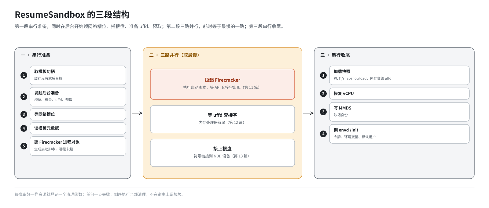

# 第 10 篇｜启动就是恢复：一次 `Sandbox.create` 的全景

> **本篇目标**：进入第三部分“启动沙箱”。本篇先把一次 `Sandbox.create` 从头到尾走一遍，建立全景：请求经过 api 到达 orchestrator；orchestrator 先过一道“准入闸门”；然后进入核心函数 `ResumeSandbox`，它分成“串行准备 → 三路并行 → 串行收尾”三段；最后 guest 里的 envd 醒过来。后面四篇分别把其中的 Firecracker、内存、磁盘与网络放大来看，第 14、15 篇讲时间和优化。

---

## 一、名字里的提示

orchestrator 里负责“启动一台沙箱”的那个函数，名字叫 `ResumeSandbox`：**恢复**沙箱，不是创建沙箱。

这个名字说出了 E2B 最核心的事实：**它从不冷启动用户的沙箱。** 模板构建时，系统已经开机、envd 已经就绪、用户的服务已经启动，那一刻被拍成了快照（第 8 篇）。`Sandbox.create` 做的是把这张快照加载进一个新的 Firecracker 进程，让虚拟机从那一刻接着跑。

而从用户暂停的快照恢复一台沙箱（`Sandbox.connect`，第 18 篇），走的也是**同一个** `ResumeSandbox`。两者唯一的区别是用哪一张快照：模板的最终快照，还是暂停时留下的那一张。



| | 冷启动 | 快照恢复 |
|---|---|---|
| 内核引导 | 要，几百毫秒到一秒 | 不要，内核状态在快照里 |
| systemd 拉起几十个服务 | 要，几秒 | 不要 |
| envd 初始化 | 要 | 不要，envd 进程在快照里本来就在跑 |
| 用户服务（如 Jupyter）启动 | 要 | 不要，构建时已经启动 |
| 宿主准备五样东西 | 要 | 要 |
| 加载快照 | 不要 | 要，几十毫秒 |

省掉的是 guest 内部的所有初始化；省不掉的是**宿主侧的准备**。后面会看到，启动的时间几乎全花在宿主侧。

## 二、请求链

```
SDK ── Sandbox.create("my-python") ──▶ api
api ── 认证、查模板最新 build ID、挑节点 ──▶ orchestrator 的 Create（gRPC）
orchestrator ── 准入 → ResumeSandbox ──▶ Firecracker + envd
```



api 做三件事：

1. 验证 API 密钥，确认这个团队有权使用这个模板、没超过配额；
2. 把模板名翻译成**当前版本的 build ID**；
3. 选一个节点，调用那个节点上 orchestrator 的 `Create` 接口。

我们是单节点部署，第 3 步没有选择余地。

## 三、准入闸门

orchestrator 的 `Create` 接口在真正动手之前，先过两道检查：

**第一道：节点上的沙箱总数有没有超上限。** 超了直接拒绝。上游默认 200 台，我们放宽到 10000，因为我们的机器内存很大，真正的上限由内存和 CPU 决定，而不是这个数字。

**第二道：同时“正在启动”的沙箱有没有超上限。** 这是一个**信号量**：手里有 N 张票，每个启动拿一张，启动完还回去，票发完了后来的就得等。

为什么要限制“同时启动”的数量？因为启动是一个资源密集的瞬间：要创建进程、准备网络、加载快照、密集缺页。一百个沙箱同时启动，CPU、磁盘、内核锁都会被挤爆，每个都慢，甚至一起超时。限制同时启动的数量，让它们排队分批进行，总体反而更快、更稳。

上游这道闸门很紧：

| 参数 | 上游 | 我们 |
|---|---|---|
| 同时启动上限 | 3 | 代码默认 500，部署配置为 30，可用环境变量调整 |
| 从模板创建、拿不到票时 | 立即拒绝，让 api 换个节点重试 | 排队等待 |
| 从暂停快照恢复、拿不到票时 | 排队等，最多 15 秒 | 排队等，最多 300 秒 |
| 整个请求的超时 | 60 秒 | 300 秒 |

上游的设计适合多节点的大集群：一个节点忙，api 换一个就是了。我们是单节点，“换一个节点”无处可换，立即拒绝只会让用户看到失败。所以改成一律排队，并把超时放宽。这些参数怎样影响高并发下的表现，第 14、15 篇细讲。

## 四、`ResumeSandbox` 的三段结构

过了闸门，进入核心函数。它的骨架是三段：



### 第一段：串行准备

| 步骤 | 做什么 |
|---|---|
| 取模板句柄 | 不阻塞：缓存里没有就在后台开始拉取模板文件，先拿回一个“句柄” |
| 发起几项后台准备 | 同时开始：领一个网络槽位、搭好根盘（NBD + 写层）、准备内存处理器（uffd）、开始预取 |
| 等网络槽位 | 槽位池预先建好，通常立刻就能领到 |
| 读模板元数据 | 版本、内核、Firecracker 版本等 |
| 创建 Firecracker 进程对象 | 生成启动脚本、检查二进制和内核文件存在。进程此时还没真正启动 |

### 第二段：三路并行

| 路 | 做什么 | 详见 |
|---|---|---|
| **拉起 Firecracker** | 执行启动脚本：进入私有的挂载和网络命名空间，启动 Firecracker 进程，等它的 API 套接字出现 | 第 11 篇 |
| **等 uffd 套接字** | 等内存处理器的通信套接字准备好 | 第 12 篇 |
| **接上根盘** | 把根盘的路径链接到 Firecracker 能找到的位置 | 第 13 篇 |

三路同时开始，**全部完成**才进入下一段。所以这一段的耗时等于**最慢的那一路**。

### 第三段：串行收尾

| 步骤 | 做什么 |
|---|---|
| 加载快照 | 通过 Firecracker 的 HTTP 接口加载 snapfile，告诉它内存由 uffd 提供 |
| 恢复运行 | 让 vCPU 开始执行 |
| 写 MMDS | 把这台沙箱的身份信息写进 Firecracker 的元数据服务，guest 里可以读到 |
| 初始化 envd | 调用 envd 的 `/init`：交给它访问令牌、环境变量、默认用户等 |

`/init` 成功返回，`ResumeSandbox` 就结束了。orchestrator 把沙箱登记进自己的表，告诉 api“创建成功”，api 再告诉 SDK。

## 五、guest 里发生了什么

从 guest 的角度看，这次“启动”是这样的：

1. 时间停在构建那一刻，所有进程都停在原地；
2. vCPU 恢复执行，进程们接着往下跑，好像什么都没发生；
3. 一跑起来就开始访问内存，每次访问到还没取回的页都触发一次缺页，由宿主上的 uffd 处理器补上；
4. envd 收到 `/init`，换上新的身份和环境变量；
5. 时钟是错的（还停在构建时），需要校时；
6. envd 对外应答，沙箱可用。

envd **没有重新启动**，它只是“醒了过来”，接收了一份新的身份。这就是第 2 篇说的“envd 在构建时就已启动并冻进快照”的含义。第 13 篇会把这几件事细讲。

## 六、失败了怎么办

`ResumeSandbox` 里每准备好一样资源，就立刻登记一个对应的“清理函数”。任何一步失败，就按相反的顺序把已经登记的清理函数全部执行一遍：归还网络槽位、拆掉根盘、停掉 uffd、杀掉 Firecracker 进程。这样即使启动到一半失败，也不会在宿主上留下垃圾。

不过有一种情况例外：orchestrator 进程本身被强行杀掉时，清理函数来不及执行。网络槽位这类资源就会泄漏在宿主上。第 13 篇会讲这个问题，以及为什么只能通过“停服务、再清理”来回收。

---

## 本篇小结

| 概念 | 一句话解释 |
|---|---|
| 启动就是恢复 | `Sandbox.create` 和 `Sandbox.connect` 走同一个 `ResumeSandbox`，只是快照不同 |
| 省掉了什么 | guest 内部的全部初始化；省不掉宿主侧的准备 |
| 准入闸门 | 节点沙箱总数上限 + 同时启动数信号量 |
| 我们的修改 | 同时启动上限 3 → 可配置；拿不到票改为排队；超时放宽到 300 秒 |
| 三段结构 | 串行准备 → 三路并行（拉起 Firecracker、等 uffd、接根盘）→ 串行收尾（加载快照、恢复、MMDS、`/init`） |
| envd | 不重新启动，只是醒来接收新身份 |
| 失败清理 | 每样资源配一个清理函数，失败时倒序执行 |

**下一篇预告**：[《拉起 Firecracker：启动脚本与加载快照》](11-launch-firecracker.md)。快照里录死了磁盘和内核的路径，可每台沙箱的文件在宿主上都不一样，怎么办？启动 Firecracker 的那条 shell 管线长什么样？
