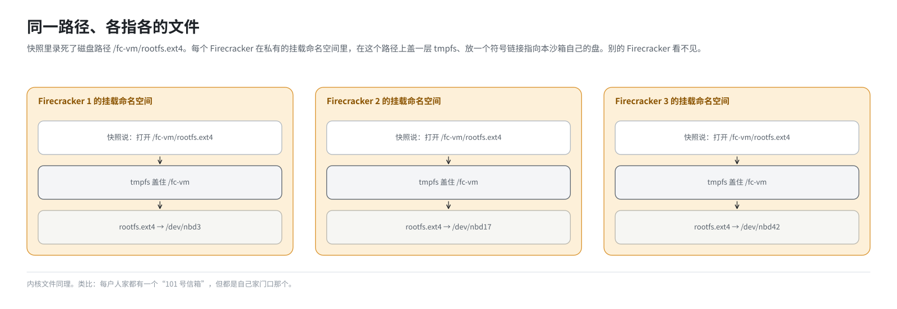
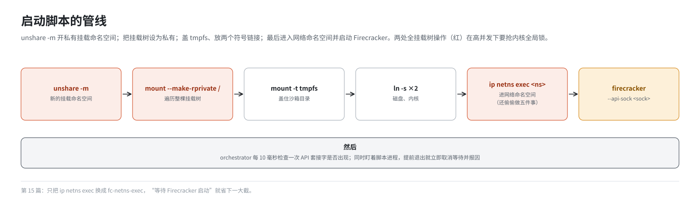
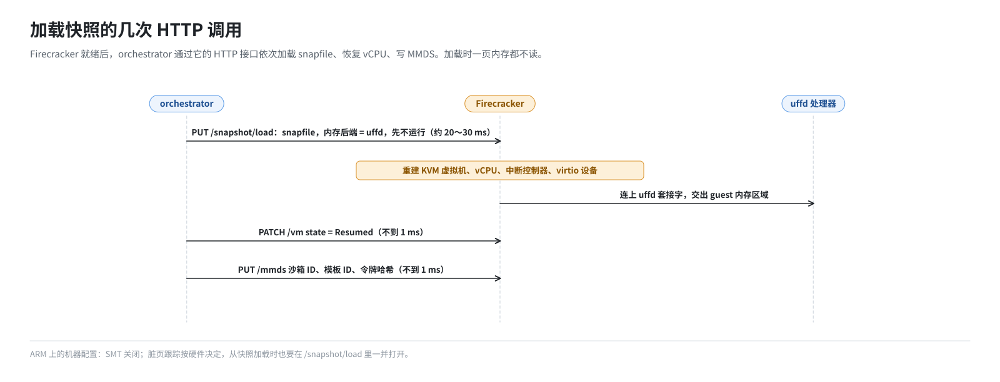

# 第 11 篇｜拉起 Firecracker：启动脚本与加载快照

> **本篇目标**：上一篇说启动分三段，中间那段最慢的一路是“拉起 Firecracker”。本篇放大看它：快照里录死了磁盘和内核的路径，每台沙箱却要用自己的文件，这个矛盾怎么解决；启动 Firecracker 的那条 shell 管线每一步在做什么；Firecracker 起来之后，orchestrator 通过哪几次 HTTP 调用把快照加载进去、让虚拟机跑起来。最后讲 ARM 上对内核启动参数和机器配置的两处修改。

---

## 一、一个矛盾：快照里录死了路径

Firecracker 打快照时，会把虚拟机配置的一部分也记进 snapfile，其中包括**磁盘文件和内核文件的路径**。加载快照时，它会按这些路径去打开文件。

问题是：模板构建时，磁盘在某个路径（比如 `/fc-vm/rootfs.ext4`）；以后从这个模板启动的几百台沙箱，每一台的磁盘在宿主上都是**不同的**设备或文件（各自的 NBD 设备，第 13 篇）。可它们加载的是同一张快照，快照里写的是同一个路径。

怎样让**同一个路径，在每台沙箱眼里指向各自不同的文件**？

## 二、解法：私有挂载命名空间加符号链接

答案是第 3 篇讲的**挂载命名空间**。每个 Firecracker 进程都运行在自己私有的挂载命名空间里，在这个命名空间里：

1. 在快照记录的那个固定目录上盖一层空的内存文件系统（tmpfs），把宿主上原来的内容遮住；
2. 在这层 tmpfs 里放一个符号链接，名字是快照记录的那个文件名，指向**本沙箱自己**的磁盘设备；
3. 内核文件同理。

由于挂载命名空间是私有的，这层 tmpfs 和符号链接只有这个 Firecracker 进程看得见。几百个 Firecracker 各自在“同一个路径”上看到各自的文件，互不干扰。



这就像一栋楼里每户人家都有一个“101 号信箱”，但每户的“101 号信箱”是自己家门口那个。

## 三、启动脚本

orchestrator 为每个 Firecracker 生成一段启动脚本，执行方式大致是：

```bash
unshare -m -- bash -c "
  mount --make-rprivate / &&
  mount -t tmpfs tmpfs <沙箱目录> -o X-mount.mkdir &&
  ln -s <本沙箱的磁盘设备> <快照记录的磁盘路径> &&
  mkdir -p <内核目录> &&
  ln -s <宿主上的内核文件> <快照记录的内核路径> &&
  ip netns exec <网络命名空间> <firecracker> --api-sock <套接字路径>
"
```

逐段看：

| 片段 | 作用 |
|---|---|
| `unshare -m` | 创建一个新的私有挂载命名空间，后面的命令都在里面执行 |
| `mount --make-rprivate /` | 把整棵挂载树设为“私有”，保证里面的挂载不会传播回宿主 |
| `mount -t tmpfs ...` | 在沙箱目录上盖一层 tmpfs |
| `ln -s ...`（两次） | 在固定路径放符号链接，指向本沙箱的磁盘和内核 |
| `ip netns exec <ns>` | 进入这台沙箱的网络命名空间 |
| `firecracker --api-sock <sock>` | 启动 Firecracker，它会在指定位置创建自己的 HTTP 接口套接字 |



最后一步 `ip netns exec` 让 Firecracker 运行在这台沙箱的网络命名空间里，于是它创建的 tap 网卡也在里面，虚拟机的网络就和宿主、和其他沙箱隔开了。

这条管线看起来很平常，但里面藏着启动最大的性能问题：`mount --make-rprivate /` 和 `ip netns exec` 都要遍历整棵挂载树、修改内核的全局数据结构，几百个沙箱同时做时要在内核的一把全局锁上排队。第 15 篇专门讲这个问题，以及我们怎样只换掉最后一环就省下一大截时间。

## 四、等 Firecracker 就绪

脚本启动后，orchestrator 要等 Firecracker 准备好接收命令。判断标准是：它的 API 套接字文件出现了。

上游的做法很朴素：每 10 毫秒检查一次文件在不在。平均要白等 5 毫秒，还有长尾。

等的同时，orchestrator 还在另一边盯着启动脚本这个进程：如果它提前退出（比如 Firecracker 二进制不存在、内核文件找不到），就立刻取消等待、报告真正的原因。这本来是上游的设计，可我们发现上游在等套接字的函数里用了一个**和调用方无关**的超时上下文，取消信号传不进去，结果 Firecracker 早已死掉，orchestrator 还在傻等，一直等到 300 秒超时，报的还是“超时”而不是真正的死因。第 15 篇讲这个修复。

## 五、加载快照的几次 HTTP 调用

Firecracker 就绪后，orchestrator 通过它的 HTTP 接口依次发出几个请求：

| 请求 | 内容 | 典型耗时 |
|---|---|---|
| `PUT /snapshot/load` | 加载 snapfile；内存后端设为 uffd，并给出 uffd 套接字的路径；先不要恢复运行 | 约 20～30 ms |
| `PATCH /vm`（state = Resumed） | 让 vCPU 开始执行 | 不到 1 ms |
| `PUT /mmds` | 写入这台沙箱的元数据：沙箱 ID、模板 ID、访问令牌的哈希等 | 不到 1 ms |



**加载快照**是其中最重的一步。Firecracker 要读 snapfile，重建 KVM 虚拟机、vCPU、中断控制器、各个 virtio 设备，并恢复它们的状态。它还要连上 uffd 套接字，把虚拟机的内存区域交给 uffd 处理器，告诉它“这些内存的缺页由你负责”。注意，这时**一页内存都没有读**，内存是之后靠缺页一页页回来的（第 12 篇）。

加载时有一个参数“先不要恢复运行”：加载完，虚拟机处于暂停状态，由 orchestrator 再单独发一个“恢复”请求。分两步是为了在中间插入别的准备工作。

**MMDS**（MicroVM Metadata Service）是 Firecracker 内置的一个小型元数据服务，guest 里的程序可以通过一个固定的内部地址读到宿主写进去的内容，类似云主机的元数据接口。E2B 用它把“你是哪台沙箱”告诉 guest 里的 envd。

## 六、ARM 上的两处修改

### 1. 内核启动参数

每台虚拟机的内核在开机时会收到一串启动参数。虽然从快照恢复时内核不会重新开机，但构建时开机要用，而且这串参数会被记录下来。上游给的参数里有几项是 **x86 专用**的：

| 参数 | 含义 |
|---|---|
| `pci=off` | 不探测 PCI 总线 |
| `i8042.nokbd`、`i8042.noaux` | 不探测 i8042 键盘和鼠标控制器（x86 PC 上的老设备） |
| `random.trust_cpu=on` | 信任 CPU 提供的硬件随机数指令来初始化随机数池 |

在 ARM 上这些参数要么无意义、要么不适用。我们改成只在 x86 上加这几项。

### 2. 机器配置

启动 Firecracker 时还要告诉它虚拟机的“机器配置”：几个 vCPU、多少内存、是否用大页，以及两个开关：

| 开关 | 上游 | 我们 | 原因 |
|---|---|---|---|
| SMT（超线程） | 开 | **关** | ARM 上的 Firecracker 不支持把 vCPU 呈现为超线程 |
| 脏页跟踪 | 关 | **按硬件决定** | 快照回滚需要它，暂停的精确增量也用它（第 20、21 篇） |

第二个开关在加载快照时也要同样设置：从快照恢复的虚拟机不会经过开机流程，所以要在 `PUT /snapshot/load` 的请求里一并打开。Firecracker 收到后，在建好虚拟机、注册完内存之后决定用什么方式记脏页：鲲鹏 950 上打开 HDBSS 让硬件记，打不开就退回 KVM 写保护（源码 `src/vmm/src/vstate/vm.rs` 的 `setup_dirty_tracking`，冷启动和加载快照两条路径各调一次）。这是快照回滚加进来以后启动路径上多出来的一件事，第 21 篇会讲它对普通沙箱有什么影响。

还有一处更深的修改不在这条管线上：上游会把 Firecracker 进程在创建的那一刻直接放进它自己的 cgroup，ARM 移植时这段被注释掉了，Firecracker 进程于是留在 orchestrator 所在的 cgroup 里。这会影响内存记账和绑核，第 12、15 篇讲。

---

## 本篇小结

| 概念 | 一句话解释 |
|---|---|
| 路径矛盾 | 快照录死了磁盘和内核路径，每台沙箱的文件却不同 |
| 解法 | 私有挂载命名空间 + tmpfs + 符号链接：同一路径各指各的文件 |
| 启动脚本 | unshare → make-rprivate → tmpfs → 两个符号链接 → `ip netns exec` → firecracker |
| 等就绪 | 每 10 ms 检查一次 API 套接字；脚本提前退出时应立即报因 |
| 加载快照 | `PUT /snapshot/load`（内存交给 uffd）→ 恢复 vCPU → 写 MMDS |
| ARM 修改 | x86 专用的内核参数只在 x86 上加；关闭 SMT；脏页跟踪按硬件决定 |

**下一篇预告**：[《内存怎么回来：懒加载、预取与大页》](12-memory-comes-back.md)。加载快照时一页内存都没读，那虚拟机的内存是怎么回来的？一页内存从快照文件到 guest 手里经过了什么？一台空闲沙箱在宿主上到底占多少内存？
