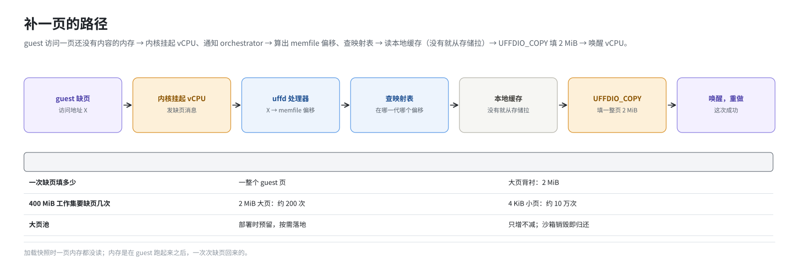
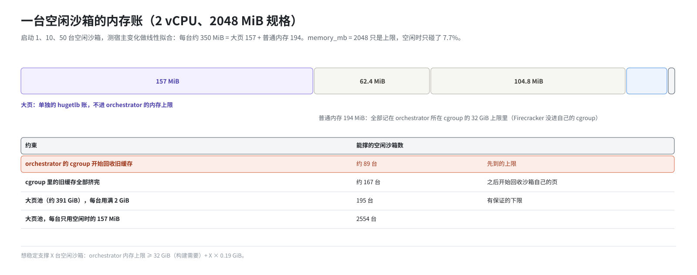

# 第 12 篇｜内存怎么回来：懒加载、预取与大页

> **本篇目标**：上一篇说加载快照时一页内存都没读。那虚拟机的 2 GiB 内存是怎么回到它手里的？本篇讲三件事：用 userfaultfd 懒加载，guest 用到哪页补哪页；用预取表在后台提前搬，缓解刚恢复时的缺页风暴；用大页背衬 guest 内存。最后用一组实测数字回答一个很实际的问题：一台空闲沙箱在宿主上到底占多少内存，并发能开多少台先被什么卡住。

---

## 一、为什么不一次读回来

一台 2 GiB 内存的沙箱，如果启动时先把 2 GiB 全部从快照文件读进内存，哪怕磁盘有每秒 2 GB 的速度，也要 1 秒。几百台同时启动，磁盘带宽直接被打满。

而实际上，一台刚恢复的沙箱**用不到这么多**。实测一台空闲的沙箱（2 GiB 规格），恢复后 5 分钟内只碰过约 157 MiB 的内存，不到 8%。剩下 92% 的内存，可能永远不会被访问。

所以 E2B 的做法是**懒加载**：先不读，guest 访问到哪一页，再去取哪一页。这就是第 3 篇讲的 userfaultfd 的用武之地。

## 二、补一页的路径

加载快照时，Firecracker 为 guest 内存映射了一段 2 GiB 的地址空间，但没有放进任何内容，然后把这段内存登记给 uffd，再通过一个 Unix 套接字把 uffd 的文件描述符和内存布局交给 orchestrator。从此，这段内存上发生的每一次缺页，都会通知 orchestrator 里的 uffd 处理器。

一次缺页的完整路径：

1. guest 里某个程序访问了一个地址，这一页还没有内容；
2. CPU 陷出，KVM 把这次访问报告给宿主内核，内核发现这段内存登记了 uffd，于是挂起这个 vCPU，向 orchestrator 发出一条缺页消息；
3. orchestrator 的 uffd 处理器收到消息，算出这个地址对应 memfile 的哪个偏移；
4. 查映射表（第 4 篇），找到这一块数据在哪一代的哪个文件里；
5. 从本地缓存读出这一块。如果本地缓存还没有，就从持久化存储拉下来，放进缓存；
6. 用 `UFFDIO_COPY` 把内容填进那一页；
7. 内核唤醒 vCPU，它重做刚才那次访问，这次成功了。

一次缺页填多少？**一整个 guest 页**。E2B 的 guest 内存由 2 MiB 大页背衬，所以一次缺页就填 2 MiB。映射表里 memfile 的块大小也是 2 MiB，正好一次缺页对应一块（第 20 篇会看到，我们为了精确增量改动了这个对应关系）。

## 三、大页

guest 内存为什么用大页？

- **运行时更快**：虚拟机的地址翻译本来就比真机多一层（guest 页表 + 宿主的第二层页表），TLB 不命中的代价更高。大页让 TLB 覆盖范围扩大 512 倍。
- **缺页次数更少**：一个 400 MiB 的工作集，用 2 MiB 大页约 200 次缺页，用 4 KiB 小页要约 10 万次。每次缺页都是一次“内核 → orchestrator → 内核”的往返，次数少很多。

大页要提前在宿主上预留成一个**大页池**。我们的部署脚本在启动时向内核申请一大批 2 MiB 大页，挂在 `/mnt/hugepages`。有几点值得知道：

| 事实 | 含义 |
|---|---|
| **按需落地，不预留** | Firecracker 映射了 2 GiB 的大页地址空间，但只有真正被缺页填进去的大页才从池里拿走 |
| **只增不减** | guest 没有内存回收机制（balloon），碰过的页不会还回来，长期运行的沙箱会慢慢往规格上限靠 |
| **关闭即归还** | 沙箱销毁后，它占的大页全部回到池里 |
| **池子不会自己消失** | 停掉所有服务后，大页池仍然被内核预留着，要显式释放（第 15 篇） |

## 四、预取：在缺页风暴之前先搬

懒加载有一个代价：刚恢复的那一小段时间里，envd、内核、用户服务都会密集地访问内存，几十上百次缺页接踵而来，每次都要等 orchestrator 去取。

第 8 篇讲过，构建模板的 optimize 阶段记下了一张**预取表**：“一恢复就会被访问的内存块，以及它们的先后顺序”。启动时，orchestrator 按这张表在**后台**提前把这些块搬进 guest 内存。

预取分两组工作者：

| 工作者 | 做什么 | 什么时候开始 |
|---|---|---|
| **取数据** | 按预取表的顺序，把块从存储读进本地缓存 | 立刻开始，甚至在 Firecracker 启动之前 |
| **填内存** | 把取好的块用 `UFFDIO_COPY` 填进 guest 内存 | 等 uffd 准备好之后 |

取数据和启动 Firecracker 是**同时**进行的。等 Firecracker 起来、uffd 就绪，很多块已经在本地缓存里等着了，直接填进去就行。

预取和真正的缺页走的是同一个填页函数。如果 guest 先访问了一页，缺页处理就把它填上；预取工作者后来再想填这一页，发现已经有了，就跳过。反过来也一样。两者不会冲突。

我们把两组工作者的并发数都翻了一倍：取数据从 16 个到 32 个，填内存从 8 个到 16 个。我们的机器核数多、本地磁盘快，更高的并发能更快地把预取表搬完。

## 五、成本被推迟了

懒加载让“启动”本身很快：加载快照只要几十毫秒，因为一页内存都没读。但搬内存的成本没有消失，只是**推迟**到了每一次缺页上。

鲲鹏 950 上的一个实测：一台沙箱在快照前把一份 192 MiB 的内存数据读一遍，用了 590.9 ms；暂停再恢复之后，第一次读同一份数据用了 702.6 ms，多出约 112 ms。这 112 ms 不算在“启动时间”里，而是由 guest 里第一个访问这些页的程序承担。

这是一个合理的交易：大部分内存永远不会被访问，没必要为它们付费；真正要用的那部分，用到时再付，而且预取已经帮忙付掉了最常用的那一部分。

## 六、一台空闲沙箱占多少内存

一个很实际的问题：一台什么都不做的沙箱，在宿主上到底占多少内存？我们用 2 vCPU、2048 MiB 规格的模板，分别启动 1、10、50 台空闲沙箱，测宿主上的变化，再做线性拟合：

| 部分 | 每台沙箱 | 是什么 |
|---|---:|---|
| **大页** | 约 157 MiB | guest 实际碰过的内存 |
| **普通内存** | 约 194 MiB | 下面四项之和 |
| 　沙箱目录的文件页 | 62.4 MiB | orchestrator 用 mmap 打开的这台沙箱的运行态文件 |
| 　其他文件缓存 | 104.8 MiB | 大概率是根盘经 NBD 读写、读模板文件产生的缓存 |
| 　匿名内存 | 22.3 MiB | orchestrator 为这台沙箱用的堆约 20 MiB，Firecracker 自身约 2.3 MiB |
| 　其他 | 4.2 MiB | 主要是内核对象 |
| **合计** | **约 350 MiB** | |

两点值得记住：

**`memory_mb = 2048` 是上限，不是占用。** 空闲时只碰了 7.7%。规格调大，空闲占用几乎不变；真正决定空闲占用的是**镜像内容**，也就是快照那一刻 guest 里常驻了多少东西。

**普通内存全部记在 orchestrator 的账上。** 第 11 篇说过，ARM 移植时 Firecracker 进程没有被放进自己的 cgroup，而是留在 orchestrator 所在的 cgroup 里。guest 的大页走单独的大页账，不进这个 cgroup 的内存上限；但 Firecracker 和 orchestrator 为这台沙箱产生的文件缓存、匿名内存，全部算在 orchestrator 那个 32 GiB 的上限里（第 9 篇讲的那个上限）。

## 七、并发容量先被什么卡住

把上面的数字和两个上限放在一起算：

| 约束 | 能撑的空闲沙箱数 |
|---|---:|
| orchestrator 的 cgroup 开始回收旧缓存 | 约 89 |
| cgroup 里的旧缓存全部挤完 | 约 167 |
| 大页池（约 391 GiB），每台都用满 2 GiB | 195 |
| 大页池，每台只用空闲时的 157 MiB | 2554 |

结论有点反直觉：**先到上限的是 orchestrator 的 cgroup，不是大页池。** 约 89 台空闲沙箱时，cgroup 用量就碰到了 32 GiB，内核开始回收构建等操作留下的旧文件缓存；超过约 167 台，就只能回收沙箱自己正在用的页，沙箱会变慢，严重时可能触发内存超限把 orchestrator 杀掉。

所以想稳定支撑 X 台空闲沙箱，orchestrator 的内存上限至少要 32 GiB（构建需要）再加上 X × 0.19 GiB。这个结论只对空闲沙箱成立；沙箱跑起重任务后，大页池按规格上限算的 195 台才是有保证的下限。

---

## 本篇小结

| 概念 | 一句话解释 |
|---|---|
| 懒加载 | 加载快照不读内存，guest 访问哪页 uffd 补哪页 |
| 补一页 | 缺页 → 查映射表 → 读本地缓存（必要时从存储拉）→ `UFFDIO_COPY` |
| 大页 | 2 MiB 一页，运行快、缺页少；池子提前预留，按需落地、只增不减 |
| 预取 | 按模板记录的顺序后台搬，取数据立刻开始，填内存等 uffd 就绪；并发我们翻倍 |
| 成本推迟 | 启动快，第一次访问工作集才付费（950 上 192 MiB 多约 112 ms） |
| 空闲沙箱 | 约 350 MiB = 大页 157 + 普通内存 194；`memory_mb` 只是上限 |
| 并发容量 | 先卡在 orchestrator 的 cgroup（约 89 台开始回收），不是大页池 |

**下一篇预告**：[《磁盘、网络与 envd：其余几样怎么就位》](13-disk-network-envd.md)。根盘怎样由“模板只读层 + 写层”拼出来？NBD 设备不够用怎么办？网络槽位为什么要提前建好，又为什么会泄漏？envd 醒过来之后要做哪几件事？
