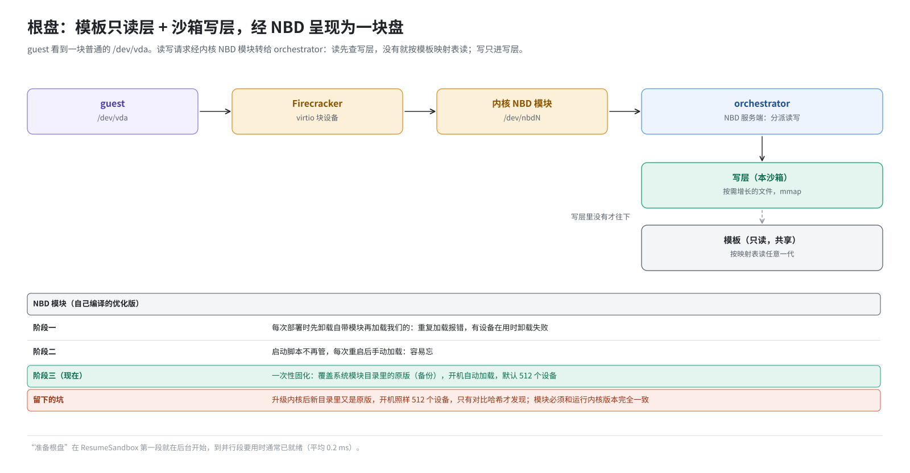
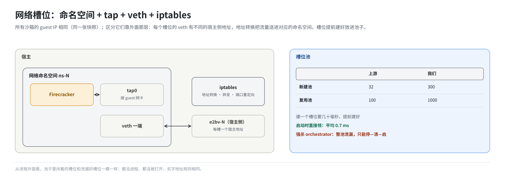
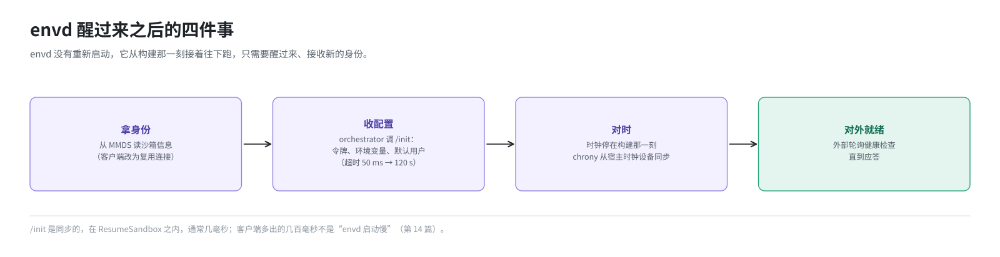

# 第 13 篇｜磁盘、网络与 envd：其余几样怎么就位

> **本篇目标**：宿主为一台沙箱准备的五样东西里，Firecracker 和内存已经讲过。本篇讲剩下三样：根盘怎样由“模板只读层 + 写层”拼成一块盘，为什么我们要换一个自己编译的 NBD 模块；网络槽位是什么、为什么要提前建好放进池子、为什么 orchestrator 被强杀后会泄漏、怎么回收；最后是 envd 醒过来之后要做的四件事。

---

## 一、根盘：一块“拼”出来的盘

### 1. 两层

第 3 篇讲过写时复制。沙箱的根盘就是这样拼出来的：

| 层 | 内容 | 谁能写 |
|---|---|---|
| **模板层**（只读） | 模板最终那一代的 rootfs，通过映射表可以读到任意一块（可能在模板的任意一代文件里） | 没人能写，几百台沙箱共享 |
| **写层** | 这台沙箱自己写过的块，一开始是空的；是一个按需增长的文件，用 mmap 访问 | 只有这台沙箱 |

读一块：先看写层里有没有，有就返回写层的；没有就按模板的映射表去读。写一块：只写进写层。

### 2. 用 NBD 呈现成一块盘

Firecracker 要的是一个“磁盘文件”或“块设备”的路径，它不懂什么映射表和写层。orchestrator 用 NBD 把这套逻辑包装成一块真正的块设备：

1. 从宿主上空闲的 NBD 设备（`/dev/nbd0`、`/dev/nbd1`……）里领一个；
2. orchestrator 自己当这个设备背后的服务端：内核把对这块盘的每一次读写请求转给 orchestrator，orchestrator 按上面的规则在写层和模板之间分派；
3. 把这个设备的路径交给 Firecracker（通过第 11 篇讲的符号链接）。

于是 guest 里看到的就是一块普普通通的 `/dev/vda`，完全不知道背后是拼出来的。

这一步在 `ResumeSandbox` 的第一段就在后台开始了，和领网络槽位、准备 uffd 同时进行。等到三路并行段要用时，通常早已准备好，实测“准备根盘”平均只有 0.2 ms。

### 3. NBD 设备不够用

每台运行中的沙箱要占一个 NBD 设备。Linux 自带的 NBD 模块默认只创建很少几个设备，要同时跑几百台沙箱，设备数必须调大。

我们用的是一个**自己编译的优化版 NBD 模块**，加载时把设备数设为 512。部署上经历了三个阶段：

| 阶段 | 做法 | 问题 |
|---|---|---|
| 一 | 每次部署时，启动脚本里先卸载系统自带的 NBD 模块，再加载我们的版本 | 模块已加载时重复加载会报错；有设备在用时卸载会失败 |
| 二 | 启动脚本不再管模块，每次宿主重启后手动加载 | 容易忘 |
| 三 | **一次性固化**：用我们的版本覆盖系统模块目录里的原版（原版备份），加开机自动加载和默认参数的配置 | 见下 |

固化之后还留了一个坑写在部署文档里：**升级或重装内核时，新内核目录里放的又是发行版原版的 NBD 模块**，开机照样自动加载、照样是 512 个设备，看起来一切正常，只有对比文件哈希才能发现被换回去了。还有一个硬性前提：自己编译的模块必须和正在运行的内核版本完全一致，否则根本加载不上。

## 二、网络槽位

### 1. 一个槽位里有什么

每台沙箱需要一套独立的网络。E2B 把这一套东西叫一个**网络槽位**（slot），编号从 1 开始。一个槽位包括：

| 东西 | 在哪 | 作用 |
|---|---|---|
| 网络命名空间 `ns-<编号>` | 宿主 | 一个独立的网络视图，Firecracker 运行在里面 |
| tap 网卡 | 命名空间里 | Firecracker 用它和 guest 的网卡收发数据 |
| 一对 veth | 一端在命名空间里，一端在宿主上 | 把命名空间接到宿主网络 |
| 若干 iptables 规则 | 宿主和命名空间里 | 地址转换、转发、端口重定向 |

一个有意思的设计：**所有沙箱的 guest IP 都相同**。因为它们从同一张快照恢复，guest 里的网络配置一模一样。区分它们靠的是外面那层：每个槽位的 veth 有不同的宿主侧地址，地址转换规则把流量正确地送进对应的命名空间。

### 2. 为什么要提前建好放进池子

建一个槽位要创建命名空间、创建网卡、配地址、加十几条 iptables 规则，几十毫秒是常事，而且要动内核的全局网络结构，并发时会互相等。如果每次启动都现建，这几十毫秒就直接加在启动时间上。

所以 orchestrator 启动后就在后台**预先建好一批槽位**放进池子；沙箱启动时直接领一个，用完了清理一下放回“复用池”，下次接着用。实测“等网络槽位”平均只有 0.7 ms。

池子的大小决定了高并发时会不会“领不到”：

| 池 | 上游 | 我们 |
|---|---|---|
| 新建槽位池 | 32 | 300 |
| 复用槽位池 | 100 | 1000 |

上游的大小适合一个节点同时只启动几台的情况。我们要求 100 路甚至更高的并发启动，池子太小就会出现“池空了，只能现建”的长尾。放大池子的代价是宿主上常驻更多的命名空间、网卡和 iptables 规则。我们还加了一行定期打印池子状态的日志，方便确认池子是否充足。

### 3. 被强杀时整池泄漏

槽位池平时由 orchestrator 管理。正常停止时，orchestrator 会把池子里所有槽位拆掉。可如果它被**强行杀掉**（比如被内存超限杀掉，或部署脚本直接 kill），来不及拆，宿主上就会留下成百上千个命名空间、网卡和 iptables 规则。下次启动时，新的 orchestrator 会避开这些已存在的编号，但留下的垃圾一直在。

最初我们想写一个“不停服务、只清垃圾”的清理命令。但很快发现这做不到：**从进程外面看，池子里闲着的槽位和泄漏的槽位一模一样**。两者都没有进程在命名空间里运行，都没有被打开的文件描述符引用（建好槽位后就关掉了），名字、地址、规则也完全相同。只有 orchestrator 进程内部知道哪些是它池子里的。而且即使精确地删掉了泄漏的那些，编号也还不回去，因为“哪些编号被外部占用”只在 orchestrator 启动时扫描一次。

所以最终的做法是承认这件事的本质是“**停—清—启**”：先优雅地停掉 orchestrator（让它自己把池子拆干净），再清理宿主上剩下的一切（此时剩下的必然是泄漏），然后重新启动。部署脚本的“停止服务”也改成先优雅停止 orchestrator，再做后面的事，避免强杀导致整池泄漏。

## 三、envd 醒过来

### 1. 四件事

Firecracker 恢复运行之后，guest 里的 envd 从构建那一刻接着往下跑。它要做四件事才能真正对外服务：

| 事情 | 为什么 | 怎么做 |
|---|---|---|
| **拿身份** | 快照里的 envd 还是构建时的那一个，不知道自己现在是哪台沙箱 | 从 MMDS 读取沙箱 ID 等信息（第 11 篇） |
| **收配置** | 每台沙箱的访问令牌、环境变量、默认用户都不同 | orchestrator 调用 envd 的 `/init` 接口，把这些交给它 |
| **对时** | guest 的时钟停在构建那一刻，可能已经过去几天 | chrony 从宿主提供的时钟设备（PTP）同步 |
| **对外就绪** | 之后 SDK 才能通过数据面访问它 | 外部轮询 envd 的健康检查，直到应答 |

### 2. `/init` 的超时

orchestrator 调 `/init` 是同步的，`ResumeSandbox` 要等它成功才返回。因为 envd 本来就在运行，这一步通常只要几毫秒。

上游给这一次请求设的超时是 **50 毫秒**，失败就重试，直到成功或整个请求超时。在高并发下，刚恢复的 guest 正在经历缺页风暴，envd 可能一时响应不过来，50 毫秒的超时会导致大量无意义的重试，反而更挤。我们把它放宽到 120 秒，等它慢慢应答。

### 3. MMDS 连接复用

envd 从 MMDS 读身份信息，用的是一个 HTTP 客户端。上游把这个客户端配置成“每次请求都新建连接、用完就关”。我们改成复用连接（保留最多 10 个空闲连接，空闲 90 秒才关闭）。这是 guest 侧唯一的一处修改，省的是每次请求建立 TCP 连接的那一点开销。

### 4. 为什么“envd 启动”不慢

常有人以为，`Sandbox.create` 在客户端看来比服务端日志慢了几百毫秒，是因为“envd 启动慢”。其实不是。envd 没有启动，它只是醒来。orchestrator 同步调的那次 `/init` 只有几毫秒。客户端多出来的时间是排队、路由、外部轮询健康检查、恢复后的缺页这几样的总和，第 14 篇会把它们拆开。

---

## 本篇小结

| 概念 | 一句话解释 |
|---|---|
| 根盘 | 模板只读层 + 沙箱写层，读先查写层，写只进写层 |
| NBD | orchestrator 当块设备的服务端，guest 看到一块普通的盘 |
| NBD 模块 | 自己编译的优化版，512 个设备，一次性固化；内核升级会悄悄换回原版 |
| 网络槽位 | 命名空间 + tap + veth + iptables，所有沙箱 guest IP 相同 |
| 槽位池 | 提前建好；我们把池子从 32/100 放大到 300/1000 |
| 整池泄漏 | 从外面分不清闲置与泄漏，只能停—清—启 |
| envd 的四件事 | 拿身份、收配置、对时、对外就绪 |
| `/init` 超时 | 50 ms → 120 s，避免高并发下无意义的重试 |
| MMDS | guest 里取身份的 HTTP 客户端改为复用连接 |

**下一篇预告**：[《启动有多慢、慢在哪：埋点与测量》](14-measuring-startup.md)。一次启动的时间到底花在哪？我们怎样在代码里打点、怎样把并行段还原出来？客户端看到的 600 ms 和服务端的 294 ms 差在哪？
