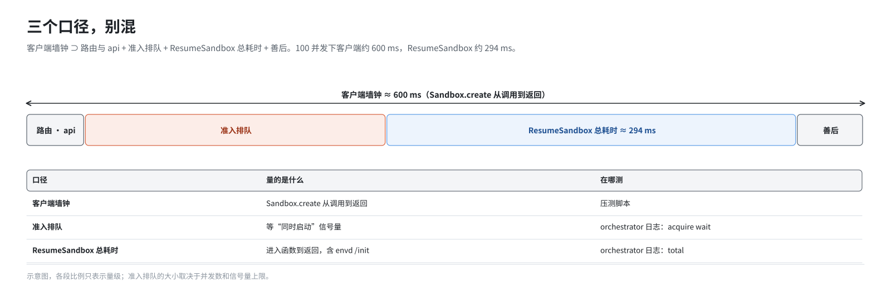
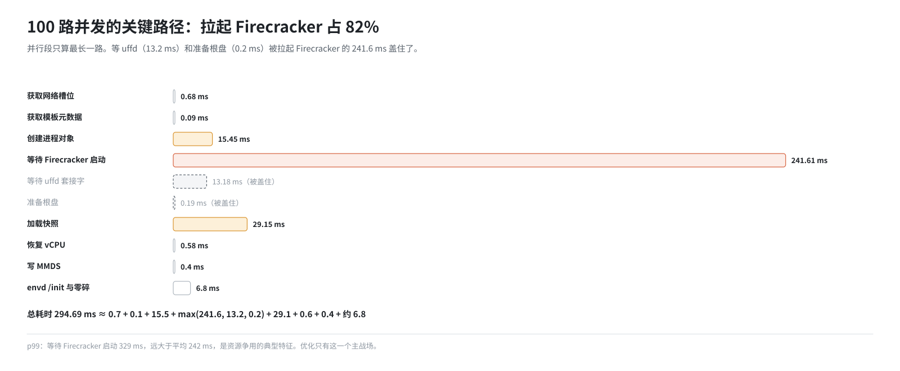
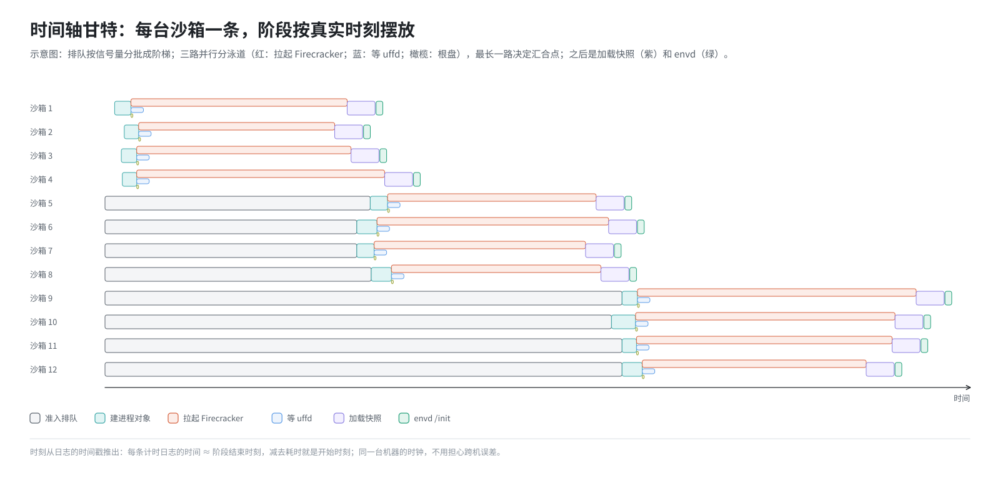
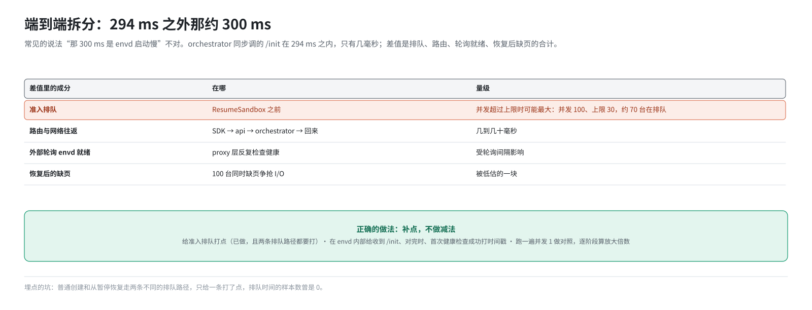

# 第 14 篇｜启动有多慢、慢在哪：埋点与测量

> **本篇目标**：前四篇讲了启动的每一步“做什么”，本篇回答“花多久”。先分清三个经常被混在一起的测量口径；然后讲我们怎样在代码里打点、怎样把日志里串行和并行混排的阶段还原成真实的执行结构；再看 100 路并发下的实测：总耗时 294.7 ms，其中 82% 卡在一个地方。最后拆开客户端多出来的那约 300 ms，并讲一个埋点时踩过的坑。

---

## 一、三个口径，别混

问“启动一台沙箱要多久”，至少有三种答案：

| 口径 | 量的是什么 | 在哪测 |
|---|---|---|
| **客户端墙钟** | SDK 里 `Sandbox.create()` 从调用到返回的时间 | 压测脚本 |
| **准入排队** | 在 orchestrator 里等“同时启动”信号量的时间（第 10 篇） | orchestrator 日志 |
| **`ResumeSandbox` 总耗时** | 进入这个函数到它返回，包括恢复虚拟机和调 envd `/init` | orchestrator 日志 |



三者的关系是：

```
客户端墙钟 = 路由与网络往返 + api 处理 + 准入排队 + ResumeSandbox 总耗时 + 善后
```

在 100 路并发下，客户端墙钟约 600 ms，`ResumeSandbox` 总耗时约 294 ms。如果只看一个数字，就会得出完全不同的结论。

## 二、怎么打点

上游代码有分布式追踪（trace），但在单节点部署里不方便汇总成统计。我们在关键阶段的前后加了计时，统一打成这种格式的日志：

```
[ResumeSandbox] configured fc cost: 241.614 ms, traceID=...
[ResumeSandbox] load snapshot cost: 29.148 ms, traceID=...
[ResumeSandbox] total cost: 294.690 ms, traceID=...
```

同一次启动的所有日志带同一个 traceID，压测结束后用一个解析脚本按 traceID 归并，就能得到每台沙箱每个阶段的耗时，再算平均值和各个百分位。

一共打了十几个点：

| 报告里的阶段 | 日志里的名字 | 属于哪一段 |
|---|---|---|
| 准入排队 | `acquire wait` | `ResumeSandbox` 之前 |
| 获取网络槽位 | `wait network slot` | 串行准备 |
| 获取模板元数据 | `get template metadata` | 串行准备 |
| 创建 Firecracker 进程对象 | `fc.NewProcess` | 串行准备 |
| 等待 Firecracker 启动 | `configured fc` | 三路并行 |
| 等待 uffd 套接字 | `get uffd sock path` | 三路并行 |
| 准备根盘 | `get rootfs path` | 三路并行 |
| 加载快照 | `load snapshot` | 串行收尾 |
| 恢复 vCPU | `post resume` | 串行收尾 |
| 写 MMDS | `set mmds` | 串行收尾 |
| 初始化 envd | `start envd` | 串行收尾 |
| 总耗时 | `total` | 整个函数 |

## 三、报告分组不等于代码结构

第一版报告是按“概念”分组的：“沙箱恢复准备”“创建 Firecracker 进程”“Firecracker 恢复虚拟机”。看起来很整齐，可读起来总觉得数字对不上。原因是**概念分组和代码的执行结构不是一回事**：

- “准备根盘”被分在“恢复准备”组，实际上它和“等 Firecracker 启动”“等 uffd”是在**同一组并行任务**里跑的；
- “等 Firecracker 启动”被分在“创建 Firecracker 进程”组，可它和“创建进程对象”根本不在一段里，一个在串行准备、一个在并行段。

并行的阶段不能简单相加。要读懂数字，必须先按代码把真实的结构还原出来：

```
总耗时
├─ 获取网络槽位 ........................... 串行
├─ 获取模板元数据 ......................... 串行
├─ 创建 Firecracker 进程对象 .............. 串行
├─ 恢复虚拟机
│   ├─ 并行段，取最长的一路
│   │   ├─ 等待 Firecracker 启动
│   │   ├─ 等待 uffd 套接字
│   │   └─ 准备根盘
│   ├─ 加载快照 ........................... 串行
│   ├─ 恢复 vCPU .......................... 串行
│   └─ 写 MMDS ............................ 串行
└─ 初始化 envd ............................ 串行
```

## 四、100 路并发的结果

压测时我们**刻意**用 100 路并发，目的就是把高并发下的瓶颈暴露出来，而不是追求一个好看的单沙箱数字。100 台沙箱的平均值：

| 阶段 | 平均 | p99 | 在关键路径上？ |
|---|---:|---:|:---:|
| 获取网络槽位 | 0.68 ms | 0.37 ms | 是 |
| 获取模板元数据 | 0.09 ms | 0.14 ms | 是 |
| 创建 Firecracker 进程对象 | 15.45 ms | 80.49 ms | 是 |
| **等待 Firecracker 启动** | **241.61 ms** | **329.14 ms** | **是** |
| 等待 uffd 套接字 | 13.18 ms | 71.64 ms | 否，被上一行盖住 |
| 准备根盘 | 0.19 ms | 2.86 ms | 否，被盖住 |
| 加载快照 | 29.15 ms | 54.44 ms | 是 |
| 恢复 vCPU | 0.58 ms | 3.25 ms | 是 |
| 写 MMDS | 0.40 ms | 1.53 ms | 是 |
| **总耗时** | **294.69 ms** | 376 ms | |

（网络槽位的 p99 比平均值还小，是因为平均值被极个别池子没命中的长尾拉高了。）

可以对一下账：

```
恢复虚拟机 ≈ max(241.6, 13.2, 0.2) + 29.1 + 0.6 + 0.4 = 271.8 ms
总耗时   ≈ 0.7 + 0.1 + 15.5 + 271.7 + 约 6.8（envd /init 与零碎开销）= 294.7 ms
```



结论一目了然：**82%（241.6 ms）卡在“等待 Firecracker 启动”**，其次是加载快照（29.1 ms，10%）和创建进程对象（15.5 ms，5%）。其余所有阶段加起来不到 9 ms。

“等待 Firecracker 启动”量的是：执行第 11 篇那条启动脚本，到 Firecracker 的 API 套接字出现。单沙箱时它远没有这么慢；100 路并发时，100 条启动脚本同时在创建命名空间、遍历挂载树、启动进程，互相争抢 CPU 和内核锁。p99（329 ms）远大于平均值（242 ms），也是资源争用的典型特征。

所以优化**只有一个主战场**：把高并发下的这 240 ms 降下来。动其他任何阶段，对总耗时几乎没有可感知的收益。第 15 篇讲怎么降。

## 五、画出来看

数字表格只能看平均。为了看清 100 台沙箱各自的时间线，我们写了一个可视化脚本：每台沙箱画一条横条，每个阶段按它**真实的开始和结束时刻**摆放，不同阶段不同颜色；同一台沙箱里并行的阶段分到不同的“泳道”上下叠放。



时刻信息从哪来？每条计时日志本身带着时间戳（约等于这个阶段结束的时刻），减去耗时就是开始时刻。同一台沙箱的所有阶段都来自同一个 orchestrator 进程、同一台机器的时钟，天然对得上，不用担心跨机器的时钟误差。

这张图能一眼看出几件事：排队的部分会排成一级一级的“阶梯”（每一级是一批拿到票的沙箱）；红色的“等待 Firecracker 启动”有多长、是否越往后越长（资源越来越饱和）；蓝色的“等 uffd”在红色下方的泳道里与之并行。

## 六、客户端多出来的约 300 ms

客户端墙钟约 600 ms，`ResumeSandbox` 约 294 ms，差出来约 300 ms。一种常见的说法是“这 300 ms 是 envd 启动慢”。这个归因**不对**：

| 差值里的成分 | 在哪 | 量级 |
|---|---|---|
| **准入排队** | orchestrator，`ResumeSandbox` 之前 | 并发数超过信号量上限时**可能最大**：并发 100、上限 30，约 70 台在排队 |
| 路由与网络往返 | SDK → api → orchestrator → 回来 | 几到几十毫秒 |
| 外部轮询 envd 就绪 | proxy 层反复检查 envd 健康 | 受轮询间隔影响 |
| 恢复后的缺页 | guest 一跑起来就密集缺页，100 台同时缺页争抢 I/O | 被低估的一块 |



orchestrator 同步调用 envd `/init` 那一步，**在** `ResumeSandbox` 的总耗时之内，而且只有几毫秒（envd 本来就在运行）。所以“envd 启动慢”的说法把好几样东西错算到了 envd 头上。

要把差值真正拆开，正确的做法是**补点而不是做减法**：给准入排队打点（已经做了）；在 envd 内部给收到 `/init`、对完时、第一次健康检查成功各打一个时间戳；再跑一遍并发为 1 的对照，和 100 并发逐阶段对比，就知道每个阶段被并发放大了多少倍。

## 七、一个埋点的坑：排队时间恒为 0

第一次加“准入排队”的计时后，报告里这一行的样本数是 **0**。

查下去发现，orchestrator 获取信号量有**两条代码路径**：从用户暂停的快照恢复时走一个专门的等待函数，普通的 `Sandbox.create`（从模板创建）则走另一个分支里内联的获取逻辑。我们只在前一个函数里打了点。而 100 并发压测用的正是 `Sandbox.create`，走的是没打点的那条，于是排队时间“恒为 0”。

两条路径都补上点之后，从模板创建时的排队时间才读得出来。

这个坑的教训很朴素：**一个数字是 0 时，先确认它是“真的为 0”还是“根本没测到”。** 样本数为 0 和数值为 0 是两回事，报告里要把样本数也打出来。

---

## 本篇小结

| 概念 | 一句话解释 |
|---|---|
| 三个口径 | 客户端墙钟 ⊃ 准入排队 + `ResumeSandbox` 总耗时 + 路由等 |
| 打点 | `[ResumeSandbox] <阶段> cost` 日志，按 traceID 归并 |
| 还原结构 | 报告分组不等于代码结构，并行段只算最长一路 |
| 100 并发结果 | 总 294.7 ms，等待 Firecracker 启动 241.6 ms（82%），加载快照 29.1 ms |
| 唯一主战场 | 高并发下拉起 Firecracker 的资源争用 |
| 可视化 | 每台沙箱一条，阶段按真实时刻摆放，并行分泳道 |
| 客户端多出的 300 ms | 排队 + 路由 + 轮询就绪 + 缺页，不是 envd 启动慢 |
| 埋点的坑 | 两条排队路径只打了一条，样本数为 0 |

**下一篇预告**：[《启动优化：把“拉起 Firecracker”压下来》](15-faster-startup.md)。拉起一个 Firecracker 为什么在高并发下要 240 ms？`ip netns exec` 到底偷偷做了哪些事？我们只换掉启动管线的最后一环，省下了什么？还有哪些试过又放弃了？
