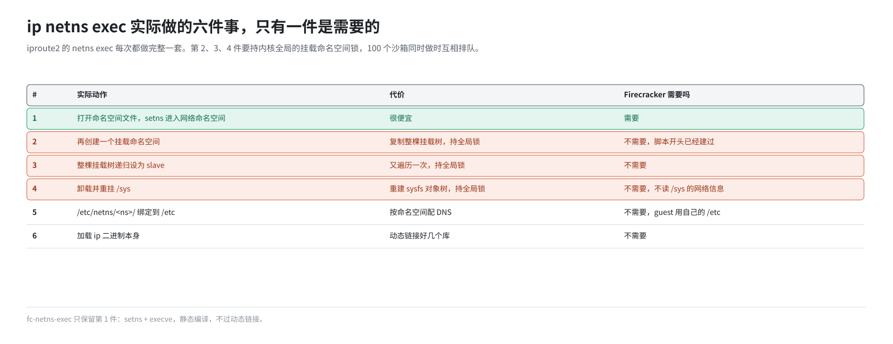
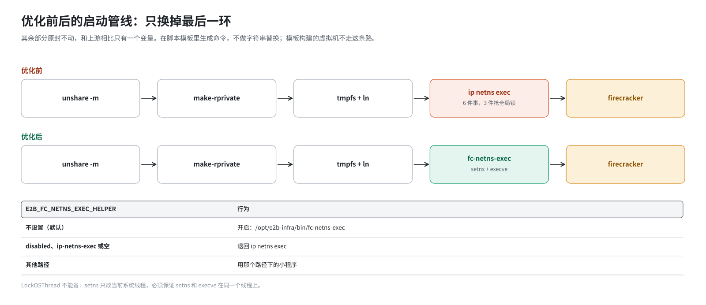
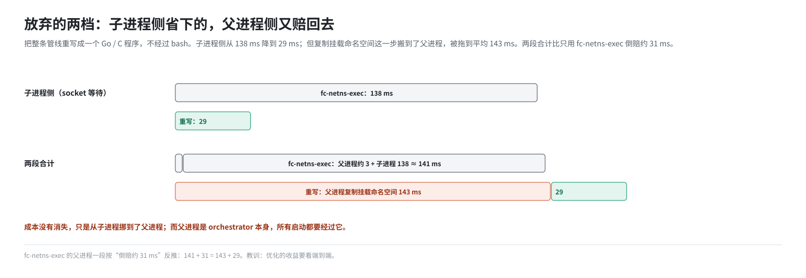

# 第 15 篇｜启动优化：把“拉起 Firecracker”压下来

> **本篇目标**：上一篇的结论是，高并发下 82% 的启动时间卡在“拉起 Firecracker 并等它就绪”。本篇先找病因：启动脚本的最后一环 `ip netns exec` 远不止“进入网络命名空间”，它还偷偷做了五件 Firecracker 完全不需要、而且要抢内核全局锁的事。然后讲解法：一个约 70 行的小程序，只做真正需要的那一件事。接着讲顺带修掉的一个让失败空等 300 秒的 bug、两种试过又放弃的更激进的做法，以及并发参数和宿主侧的几项调整。

---

## 一、病因：`ip netns exec` 做了什么

第 11 篇的启动脚本最后一步是：

```bash
ip netns exec <网络命名空间> firecracker --api-sock <套接字>
```

直觉上这只是“进入那个网络命名空间，然后运行 firecracker”。可 `ip` 这个工具（属于 iproute2）的 `netns exec` 子命令，每次实际上做了六件事：

| # | 实际动作 | 代价 | Firecracker 需要吗 |
|---|---|---|---|
| 1 | 打开命名空间文件，`setns` 进入网络命名空间 | 很便宜 | **需要**，唯一需要的 |
| 2 | 再创建一个新的挂载命名空间 | 内核要复制整棵挂载树，持全局锁 | 不需要，脚本开头已经建过一个 |
| 3 | 把整棵挂载树递归设为 slave | 又一次遍历整棵挂载树，持全局锁 | 不需要 |
| 4 | 卸载并重新挂载 `/sys` | 重建 sysfs 的对象树，本身不便宜 | 不需要，Firecracker 不读 `/sys` 里的网络信息 |
| 5 | 把 `/etc/netns/<ns>/` 下的文件绑定挂载到 `/etc` | 为每个命名空间单独配 DNS 等 | 不需要，guest 用自己的 `/etc` |
| 6 | 加载 `ip` 这个二进制本身 | 动态链接好几个库，每次都要解析 | 不需要 |



六件事里五件是白做的。更要命的是，第 2、3、4 件都要拿内核里一把**全局的挂载命名空间锁**。一台沙箱做一次，几毫秒，无所谓；100 台沙箱同时做，它们就得在这把锁上排成一队，一个一个来。


这正是“等待 Firecracker 启动”从单沙箱几十毫秒放大到 100 并发下 240 ms 的串行化来源之一；p99 远大于平均值的长尾形态，也是锁争用的典型特征。

## 二、解法：只保留第 1 件

我们用一个约 70 行的小程序 `fc-netns-exec` 替换 `ip netns exec`。它只做三步：

```go
runtime.LockOSThread()                        // 把当前 goroutine 钉在一个系统线程上
fd := open("/run/netns/<ns>")                 // 打开网络命名空间
setns(fd, CLONE_NEWNET)                       // 进入它
execve(firecracker, args, env)                // 原地变成 firecracker 进程
```

没有第二个挂载命名空间，没有挂载树遍历，没有重挂 `/sys`，没有绑定 `/etc`。而且它是**静态编译**的，启动时不需要动态链接任何库。

第一行有讲究：`setns` 只改变**调用它的那个系统线程**所在的命名空间，可 Go 的运行时会把 goroutine 在不同线程之间搬来搬去。如果 `setns` 在线程 A 上执行，`execve` 却被调度到了线程 B 上，Firecracker 就会运行在错误的网络命名空间里。所以先把 goroutine 钉在一个线程上，保证这两步在同一个线程上发生。`execve` 会把整个进程收拢到这一个线程，Firecracker 从而完整继承目标命名空间。

启动管线的其余部分（`unshare`、`mount`、`ln`……）**原封不动**。和原来相比只有一个变量，效果好坏一目了然。



### 接入方式

两个设计细节：

- **在脚本模板里生成，而不是对生成好的脚本做字符串替换。** 如果做字符串替换（把 `ip netns exec ` 替换成 `fc-netns-exec `），哪天上游改了模板的措辞，替换就会悄悄失效：不报错、不打日志，优化就这么静默消失了。在模板层面生成命令，不存在这个问题。
- **只用于从快照恢复的沙箱。** 模板构建的虚拟机仍然走 `ip netns exec`（第 9 篇讲过原因）。

### 开关

只有一个环境变量 `E2B_FC_NETNS_EXEC_HELPER`，同时充当开关和小程序的路径：

| 取值 | 行为 |
|---|---|
| 不设置 | 默认开启，用 `/opt/e2b-infra/bin/fc-netns-exec` |
| `disabled` 或 `ip-netns-exec` 或空 | 退回原来的 `ip netns exec` |
| 其他路径 | 用那个路径下的小程序 |

改 Nomad 任务的环境变量、重新部署即可切换，不用重新编译。这方便做 A/B 对比：同样 100 并发，开和关各跑一次，比较“等待 Firecracker 启动”这一项。

**默认开启有一个代价**：代码不检查小程序文件在不在，直接拼进启动脚本。如果安装时漏了它，bash 报“命令找不到”，Firecracker 根本没起来，启动脚本以退出码 127 结束。这种失败必须**快速、准确**地报出来，否则排查起来很痛苦。这就引出了下一节的修复。

## 三、顺带修掉的 bug：死了还要等 300 秒

orchestrator 拉起启动脚本后，会同时做两件事：

- 一边等 Firecracker 的 API 套接字出现；
- 一边盯着启动脚本进程，如果它提前退出，就**取消**上面那个等待，并记下死因。

设计没问题，可上游在“等套接字”的函数里创建超时时，用的是一个**全新的、和调用方无关**的上下文，而不是调用方传进来的那个。于是调用方发出的取消信号根本传不进去。

后果：小程序缺失 → 启动脚本 127 退出 → orchestrator 发出取消 → 等套接字的函数**收不到** → 一直等到超时（默认 300 秒）才返回，而且返回的错误是“超时”，而不是真正的“exit status 127”。

修法只有一行：创建超时时以调用方的上下文为基础。超时上限不变，但取消信号能传进来了；错误信息里也能带出真正的死因。

这一行修改在合并上游新版本时很危险：一旦这个文件有冲突，很容易顺手选了上游那一侧，bug 就悄悄回来了。而它的症状（沙箱起不来时卡 300 秒、报错指向超时）在正常压测里根本不显眼。所以我们在文档里专门写了一条：合版时务必确认这一行。

## 四、试过又放弃的两档

`fc-netns-exec` 只换掉了最后一环，启动脚本里还留着不少开销：

| 剩下的开销 | 说明 |
|---|---|
| 约 7 次 fork/exec | bash、两次 mount、两次 ln、mkdir，每个都要加载程序、初始化 C 库 |
| 1 次挂载树遍历 | 脚本开头的 `mount --make-rprivate /`，同样持全局锁 |
| bash 解析 | 启动 bash、解析脚本、为每个 `&&` 分别 fork |
| 10 ms 轮询套接字 | 平均白等 5 ms，还有长尾 |

我们试过两种更激进的做法：把整条启动管线重写成一个 Go 程序，以及重写成一个 C 程序，在一个进程里用系统调用直接完成所有挂载、链接和进入命名空间的动作，完全不经过 bash。

结果很有意思：**子进程那一侧确实快了**，从启动到 API 套接字出现，从 138 ms 降到了 29 ms。可**父进程那一侧变慢了**：为了让子进程拥有私有的挂载命名空间，创建子进程时要复制挂载命名空间，这一步在父进程里执行，被拖到了平均 143 ms。两段加起来，比只用 `fc-netns-exec` 还**倒赔了约 31 ms**。



原因在于：昂贵的“复制挂载命名空间”并没有消失，只是从子进程搬到了父进程，而且父进程是 orchestrator 本身，所有沙箱的启动都要经过它，搬过去反而更堵。于是这两档没有采纳，从主线代码里删除，实验记录归档保存。

这个经历说明了一件事：**优化的收益要看端到端，不能只看被优化的那一段。** 把成本从 A 处挪到 B 处，A 处的数字会很好看，但用户感受到的是 A + B。

## 五、并发参数

除了启动管线本身，还有一组参数决定了高并发下的表现。上游的默认值是为“多节点大集群、每个节点同时只启动几台”设计的，我们是单节点、要求上百路并发，几乎每一个都要调：

| 参数 | 上游 | 我们 | 原因 |
|---|---|---|---|
| 同时启动上限 | 3 | 代码默认 500，部署 30，可用环境变量调 | 3 太保守；单节点没法让 api 换节点重试 |
| 拿不到启动名额时 | 从模板创建：立即拒绝 | 一律排队 | 单节点无处可换 |
| 排队超时 | 15 秒 | 300 秒 | 高并发下排队时间长 |
| 整个请求超时 | 60 秒 | 300 秒 | 同上 |
| 节点沙箱总数上限 | 200 | 10000 | 真正的上限由内存决定（第 12 篇） |
| 新建 / 复用网络槽位池 | 32 / 100 | 300 / 1000 | 避免池空了现建（第 13 篇） |
| 预取：取数据 / 填内存的并发 | 16 / 8 | 32 / 16 | 机器核多、磁盘快 |
| envd `/init` 单次超时 | 50 毫秒 | 120 秒 | 避免高并发下无意义的重试（第 13 篇） |
| 等 uffd 消息的超时 | 10 秒 | 120 秒 | ARM 上 Firecracker 起得慢，等待窗口要放宽 |
| 等套接字的超时 | 写死 | 可用环境变量调，默认 300 秒 | 方便排查 |


“同时启动上限”怎么定才合适？我们的方法是**上限扫描**：固定 100 路并发，把上限分别设成 15、30、100、500 各跑一遍，观察“准入排队”和“等待 Firecracker 启动”两项此消彼长。如果放开上限只是把时间从排队挪到了等 Firecracker，说明信号量本来就在保护一个已经饱和的 CPU，真正的天花板在 Firecracker 启动，放开没有意义；如果放开后总时间明显下降，说明之前确实是排队卡住了。

## 六、宿主侧的几项调整

最后是几项和代码无关、但会直接影响启动成败的宿主配置。

**大页池的申请与释放。** 大页池要在宿主内存还没碎片化时尽早申请，所以部署脚本启动时就申请。可停止服务时，大页池不会自己消失：一台 1.1 TB 的机器上，停了服务后仍有约 218 GiB 被预留着，重启之前无法归还。我们加了一个单独的释放命令，按正确的顺序把池子清零（先清可超额部分，再清固定部分，避免清理过程中又冒出新的页），并且能识别 64K 页内核上 512 MiB 的大页。它**不**接进停止服务的流程，因为下次启动又要尽早申请，每次停服都释放反而得不偿失。后来为了和同机的其他沙箱系统共存，还把大页池的上限设为 64 GB。

**NUMA 节点编号不连续导致调度器崩溃。** 有些鲲鹏机器开启了一种内存热插拔模式，会出现只有内存、没有 CPU 的 NUMA 节点，节点编号也不连续（比如 0～3 之后直接是 10 和 19）。我们用的 Nomad 1.10 版本在采集 CPU 拓扑时会因此数组越界崩溃，systemd 反复重启它直到放弃，部署脚本则永远在等它的端口。上游在 1.11.2 修了这个问题，我们升级了 Nomad。

**绑核与 NUMA 亲和。** 想把沙箱限制在指定的 CPU 上（压测时要稳定数字，或者要和同机其他业务隔离），要先知道沙箱在哪个 cgroup 里。第 11 篇说过，ARM 移植时 Firecracker 进程没有被放进各自的 cgroup，所以从宿主侧能绑的对象只能是“orchestrator 加全部沙箱”这一整组。推荐的做法是给 Nomad 的任务 cgroup 设置允许使用的 CPU 和内存节点，一条命令立即生效。绑之前必须先算大页：大页是按 NUMA 节点分配的，绑到一个大页不够的节点上，沙箱会直接起不来。默认不绑，让沙箱用满整机。

---

## 本篇小结

| 修改 | 原来 | 问题 | 改成 |
|---|---|---|---|
| 进入网络命名空间 | `ip netns exec` | 多做五件事，三件要抢全局锁 | `fc-netns-exec`：只 `setns` + `execve`，默认开启 |
| 接入方式 | — | 字符串替换会静默失效 | 在脚本模板里生成；构建虚拟机不用 |
| 等套接字 | 用无关的上下文 | Firecracker 死了还要等 300 秒，报错不对 | 以调用方上下文为基础 |
| 重写整条管线 | — | 子进程侧省 109 ms，父进程侧赔 140 ms | 不采纳 |
| 并发参数 | 为大集群设计 | 单节点高并发下太保守 | 一组参数放宽，用上限扫描定值 |
| 大页池 | 停服后仍占着 | 无法归还 | 单独的释放命令 |
| Nomad | 1.10 | 不连续的 NUMA 编号导致崩溃 | 升级到 1.11.2 |
| 绑核 | 上游没有 | Firecracker 不在各自的 cgroup | 绑整个任务 cgroup，先算大页 |

**下一篇预告**：[《暂停走一遍：存盘，然后离场》](16-pause-walkthrough.md)。进入第四部分。`sandbox.pause()` 之后宿主上依次发生了什么？`Pause` 和 `Checkpoint` 两个接口有什么区别？为什么暂停一定会停掉沙箱？
