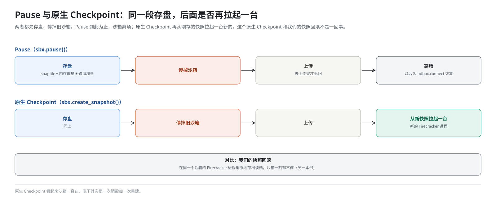
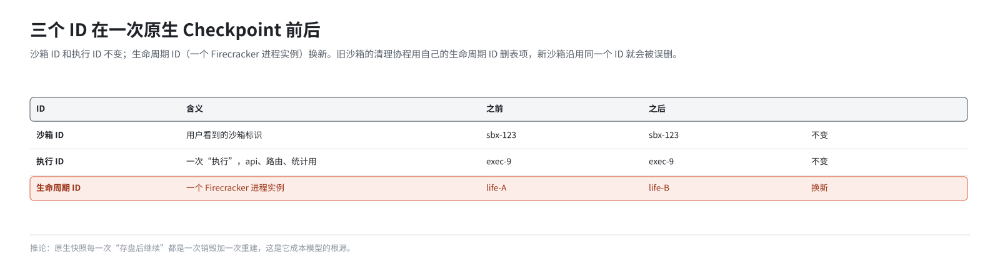

# 第 16 篇｜暂停走一遍：存盘，然后离场

> **本篇目标**：进入第四部分“暂停与恢复”。本篇先讲 E2B 原生的两个快照接口 `Pause` 和 `Checkpoint` 有什么区别；再讲一次快照前后沙箱的三个 ID 怎么变；然后按顺序走一遍暂停的六步，重点讲清一个事实：**暂停一定会停掉沙箱**，这不是偷懒，而是代码结构决定的。最后说明暂停为什么要等上传完成才返回，以及暂停在模板构建里扮演的角色。

---

## 一、两个接口

E2B 原生有两个和快照有关的接口，它们共用同一段“存盘”逻辑，区别在存完之后：

| 接口 | 做什么 | SDK 里 |
|---|---|---|
| `Pause` | 存盘，**停掉沙箱**，产物上传进存储 | `sbx.pause()` |
| `Checkpoint` | 存盘，停掉沙箱，然后**从刚存的快照再拉起一台** | `sbx.create_snapshot()` |

`Pause` 的语义是“沙箱到此为止，离场”。以后想用，再通过 `Sandbox.connect()` 恢复。

`Checkpoint` 的语义是“留一个存档，然后接着用”。看起来沙箱一直在，但底下其实是**停掉旧的、从新快照启动一个新的**。

> **注意名字的冲突**：这个原生的 `Checkpoint` 接口，和我们新增的“快照回滚”里的 checkpoint 不是一回事。后者在同一个活着的 Firecracker 进程里原地存档，沙箱一刻都不停（见《E2B 沙箱快照回滚从零讲透》）。本书凡是说“原生 Checkpoint”，指的都是这个“存盘—停掉—重启”的接口。

## 二、三个 ID

一台沙箱有三个 ID，在原生 `Checkpoint` 前后的变化是：

| ID | 含义 | Checkpoint 之后 |
|---|---|---|
| 沙箱 ID | 用户看到的沙箱标识 | **不变** |
| 执行 ID | 一次“执行”的标识，api、路由表、统计用 | **不变** |
| 生命周期 ID | 一个 Firecracker 进程实例的标识 | **换新** |

用户看到的沙箱 ID 不变，可底下的 Firecracker 进程已经换了一个。为什么生命周期 ID 必须换新？因为旧沙箱被停掉时，它的清理协程会用**自己的**生命周期 ID 去删除 orchestrator 表里的条目。如果新沙箱沿用同一个 ID，旧的清理协程就会把新沙箱的条目也一起删掉。

这个细节说明了一件事：**原生快照的每一次“存盘后继续”，都是一次销毁加一次重建。** 新进程要重建 KVM 虚拟机、vCPU、设备、网络、uffd，然后靠缺页把工作集一页页换回来。这正是原生快照成本模型的根源（第 17 篇）。

## 三、暂停的六步

`Pause` 的主干按执行顺序是：

| 步 | 做什么 | 说明 |
|---|---|---|
| ① | 停掉健康检查 | 接下来沙箱会停止响应，别让健康检查误报 |
| ② | 暂停 vCPU | 从此 guest 不再产生新的状态 |
| ③ | 让 Firecracker 写出 snapfile | 只写 CPU、中断控制器、设备状态，**不含内存** |
| ④ | 取“脏页集合” | 问内存处理器：这一代哪些内存页改过 |
| ⑤ | 导出内存增量 | 按脏页集合，从 Firecracker 进程里把这些页拷出来，写成紧凑文件 |
| ⑥ | 导出磁盘增量 | 把写层里的块导出成紧凑文件。**这一步会关掉沙箱** |

最后写元数据、上传。

注意第 ② 步之后**一直没有恢复运行**。对 `Pause` 来说，沙箱从此离场；对原生 `Checkpoint` 来说，“继续跑”是另起一台新沙箱实现的。

第 ④、⑤ 步怎么判断脏页、怎么拷贝，第 6 步怎么导出磁盘，下一篇细讲。这一篇先回答一个更根本的问题。

## 四、为什么暂停一定要停掉沙箱

第 ⑥ 步导出磁盘增量时，要把写层从根盘上“摘”下来，然后遍历其中写过的块。在代码里，导出磁盘增量的那个函数，**参数之一就是“关掉沙箱”的回调**。也就是说，导出磁盘这个动作本身就包含了停沙箱。

为什么必须这样？三个原因：

1. **摘下写层之后，之后的写没有去处。** 写层一旦被摘下，根盘就不再完整，guest 如果继续运行、继续写磁盘，这些写无处可去。
2. **遍历写层时不能有并发写。** 一边遍历一边有人写，导出的就是一个“一半新一半旧”的磁盘镜像，恢复后文件系统可能是坏的。
3. **NBD 设备要先释放，写层文件才能关闭。** 写层文件被 NBD 服务端用 mmap 打开着，设备不断开，文件就关不掉。

对“沙箱离场”这个场景，停掉沙箱完全合理，反正它也要走了。但这也决定了原生快照**不适合高频地存档读档**：每存一次就要停一次、重建一次。这正是我们后来另做一套快照回滚的直接原因，那套方案的做法是把写层原地封存、换上一个新的空写层，不搬数据、不停沙箱。

## 五、等上传完成才返回

`Pause` 不是存到本地就返回，而是要**等产物上传进存储之后**才返回给调用方。所以用户在 SDK 里看到的 `pause()` 耗时，包含了停沙箱、导出、上传三部分，不只是冻结虚拟机那一下。

为什么要等？因为快照的元数据一旦被标记为“就绪”，就可能马上有人来恢复它，而恢复可能发生在别的节点上，要从存储里取。如果数据还没传完，那次恢复就会读到不存在的文件。这和第 5 篇构建时“全部层上传完才写缓存索引”是同一个原则：**元数据不能早于数据宣布就绪。**

## 六、暂停在构建里的角色

回头看第 7 篇：模板构建时，每一条指令执行完，都要“暂停成新的一层”。那里的“暂停”就是本篇的 `Pause` 流程（只是不经过 SDK）。所以：

- 构建一个有 10 条指令的模板，要暂停十几次；
- 暂停的每一个特性和问题，都会在构建的每一层重演一遍。第 19 篇讲的 ARM 上“读过就算脏”的问题，会让每一层都多存上百 MiB；第 20 篇的精确增量修好它之后，构建的每一层也跟着变小。

不过构建里有一个例外：**冷启动**的那几台构建虚拟机（base 阶段的第二次开机、finalize 的重新开机）不是从快照恢复的，它们的内存不经过 uffd 懒加载，而是由 Firecracker 直接管理。暂停它们时，判断脏页走的是另一条更简单的路，产出的映射表块大小仍是 2 MiB。第 20 篇讲精确增量时会再提到这一点。

## 七、两个接口在我们的使用场景里

| 场景 | 用哪个 | 原因 |
|---|---|---|
| 用户暂时不用沙箱，想省资源 | `Pause` | 沙箱停掉，不占内存和 CPU，只占存储 |
| 想保存一个状态，以后从它开新沙箱 | 原生 `Checkpoint` | 留下一份持久的快照，当前沙箱继续用 |
| 一次对话里反复尝试、失败就退回 | 都不合适 | 每次都要停—重建，几百毫秒；用我们的快照回滚 |

---

## 本篇小结

| 概念 | 一句话解释 |
|---|---|
| `Pause` | 存盘 + 停沙箱 + 上传，沙箱离场 |
| 原生 `Checkpoint` | 存盘 + 停沙箱 + 从新快照再拉起一台；和我们的快照回滚不是一回事 |
| 三个 ID | 沙箱 ID、执行 ID 不变；生命周期 ID 换新，防止旧清理误删新条目 |
| 六步 | 停健康检查 → 暂停 vCPU → 写 snapfile → 取脏页 → 导出内存 → 导出磁盘（关沙箱） |
| 必须停沙箱 | 摘下写层后写无去处、遍历不能并发写、NBD 释放才能关文件 |
| 等上传 | 元数据不能早于数据宣布就绪 |
| 构建里的暂停 | 每一层都是一次暂停，暂停的问题会在每一层重演 |

**下一篇预告**：[《增量怎么算出来：脏页、导出与映射表》](17-increments-and-cost.md)。暂停时怎么知道哪些内存页改过？数据怎么从 Firecracker 进程里搬出来？为什么一次什么都没改的暂停也要约 250 ms，这些时间都花在哪？
