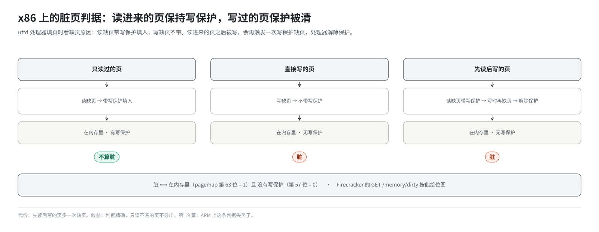
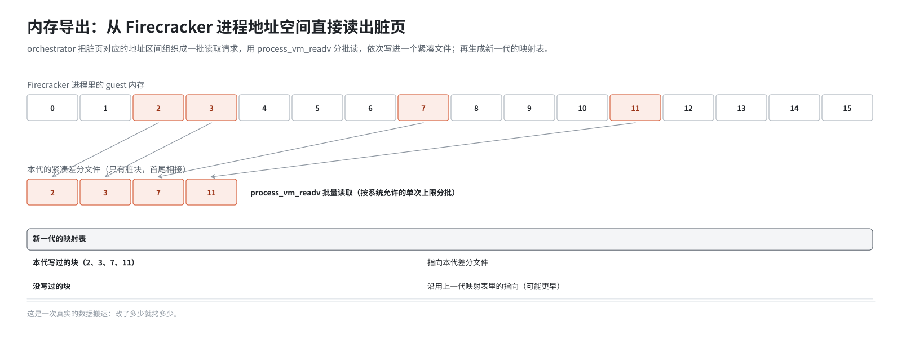
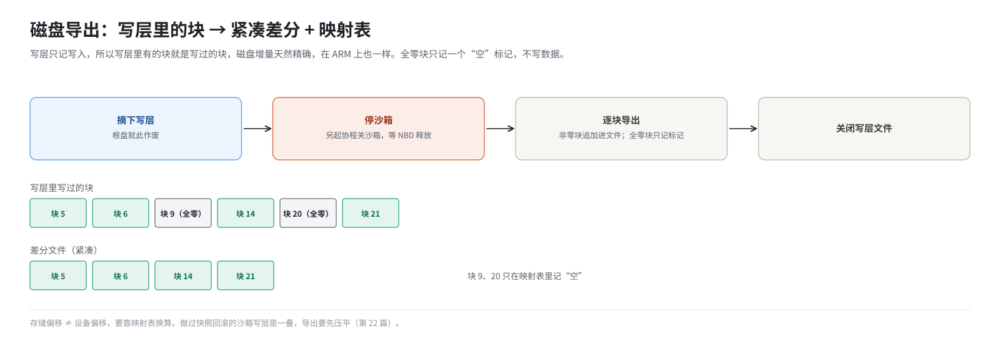
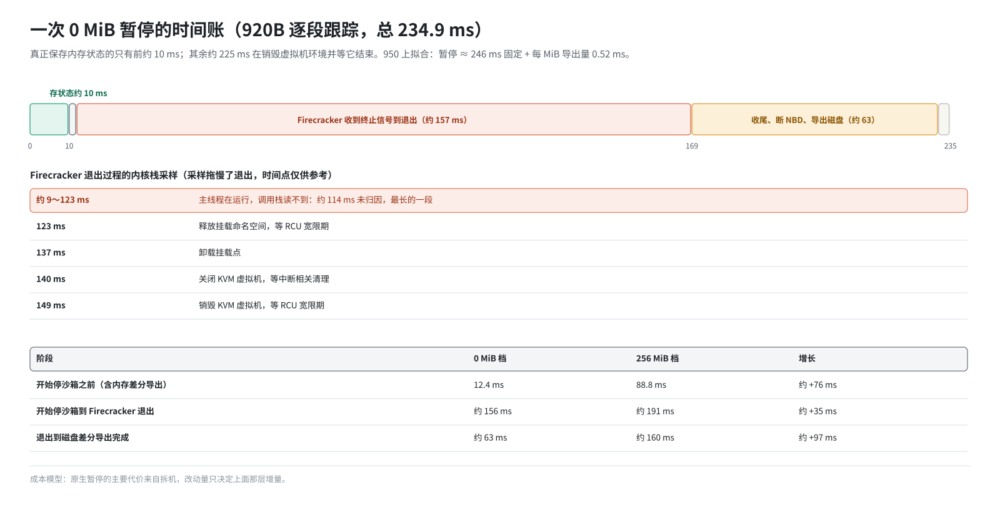

# 第 17 篇｜增量怎么算出来：脏页、导出与映射表

> **本篇目标**：上一篇列了暂停的六步，本篇放大其中最实质的三步：怎样判断哪些内存页改过（脏页判据），怎样把它们从 Firecracker 进程里搬出来，怎样导出磁盘增量。然后看成本：鲲鹏 950 上一次什么都没改的暂停也要约 250 ms，把这 250 ms 拆开看，会发现真正存内存状态的只有前 10 ms 左右，其余时间都在“拆机”。

---

## 一、内存：怎么知道哪些页改过

暂停时要导出的是“这一代改过的内存页”。没改过的页，在上一代（或模板）里本来就有，不用再存。问题是：orchestrator 怎么知道哪些页被 guest 写过？

上游在 x86 上的做法，巧妙地利用了第 3 篇讲的 **uffd 写保护**。回想一下，从快照恢复的沙箱，内存是靠缺页一页页填进来的，每次填页都经过 orchestrator 的 uffd 处理器。处理器在填页时会看这次缺页是**读**引起的还是**写**引起的：

| 缺页原因 | 填页时 | 之后 |
|---|---|---|
| 读 | 带上“写保护”标记填进去，这一页仍是只读的 | 如果 guest 后来写了它，会再触发一次写保护缺页，处理器解除保护 |
| 写 | 不带写保护，这一页直接可写 | — |

于是，一页内存只要被写过，它的写保护标记就一定被清掉了；只被读过的页，标记还在。Linux 在每个进程的 `/proc/<pid>/pagemap` 里为每一页记了若干状态位，其中第 63 位表示“这一页在内存里”，第 57 位表示“这一页被 uffd 写保护着”。所以：

```
脏页 ⟺ 在内存里（第 63 位 = 1）且 没有写保护（第 57 位 = 0）
```



Firecracker 提供了一个接口 `GET /memory/dirty`，就是按这条判据给出位图的：先找出在内存里的页，再对这些页查写保护位。

代价是：一页如果先被读、后被写，要多经历一次写保护缺页。收益是判据**精确**：只读不写的页不算脏，不会被导出。

记住这条判据。第 19 篇会看到，它在 ARM 上失灵了。

## 二、内存：怎么搬出来

拿到脏页集合后，要把这些页的内容存成文件。内容在哪？在 Firecracker 进程的地址空间里，guest 的内存就是 Firecracker 映射的一段内存。

E2B 不让 Firecracker 自己写文件，而是由 orchestrator **直接从 Firecracker 进程里读**。Linux 有一个系统调用 `process_vm_readv`，可以从另一个进程的地址空间里读一段数据（需要权限）。orchestrator 把脏页对应的地址区间组织成一批“读取请求”，按系统允许的单次上限分批调用，读出来的数据依次写进一个本地文件。

这是一次真实的数据搬运：改了多少就拷多少，从一个进程的内存到另一个进程的文件。产物是**紧凑**的：只有脏页，首尾相接。



## 三、新一代的映射表

数据文件只是一串紧挨着的块，要靠映射表才知道每一块原来在哪（第 4 篇）。新一代的映射表这样生成：

```
新一代的映射表
  ├── 本代写过的块  →  指向本代的差分文件
  └── 没写过的块    →  沿用上一代映射表里的指向（可能指向更早的某一代）
```

相邻的、指向同一代且连续的区间会合并成一行，所以映射表通常不大。

## 四、磁盘：导出写层

磁盘的判断简单得多：**写层里有的块，就是这一代写过的块。** 写层只记录写进来的东西，读不会在写层里留下任何痕迹。所以磁盘增量天然是精确的，在 ARM 上也一样。

导出的步骤（上一篇说过，这一步会关掉沙箱）：

1. **摘下写层**：从根盘上拿下来，根盘就此作废；
2. **停沙箱**：另起一个协程去关掉沙箱，然后等 NBD 设备释放；
3. **逐块导出**：遍历写层里每个写过的块。全零的块只在映射表里记一个“空”标记，不写数据；非零的块依次追加进输出文件；
4. **关闭写层文件**。



和内存一样，产物是紧凑的，“文件里的偏移”和“磁盘上的偏移”不同，要靠映射表换算。

## 五、成本：什么都没改也要约 250 ms

有了这些机制，来看一次暂停到底花多少时间。鲲鹏 950 上，每一档用一台新沙箱，先改指定数量的内存和磁盘，再暂停，客户端测得的中位数：

| 改动量 | 暂停 | 恢复 |
|---|---|---|
| 0 MiB | 251.9 ms | 109.3 ms |
| 256 MiB | 429.9 ms | 120.7 ms |

按六个档位拟合，暂停大约是：

```
暂停耗时 ≈ 246 ms（固定开销） + 每 MiB 导出量 × 0.52 ms
```

**改动量为 0 时也要约 250 ms。** 这 250 ms 花在哪了？

## 六、拆开那 250 ms

在 920B 上，我们对一次改动量为 0 的暂停（总耗时 234.9 ms）做了逐段跟踪，从开始暂停算起：

| 时间点 | 发生的事 |
|---|---|
| 0～约 10 ms | 暂停 vCPU 约 0.08 ms；写 snapfile 约 3.2 ms；取脏页位图 0.67 ms；约 9.6 ms 时内存差分文件写好 |
| 约 12 ms | 开始导出磁盘，开始停沙箱 |
| 约 12～169 ms | Firecracker 收到终止信号后退出，168.8 ms 时进程结束 |
| 169～232 ms | 收尾：删 cgroup、停 uffd；刷盘、断开 NBD 设备；导出磁盘差分 |
| 232～235 ms | 上传到本地存储并返回 |



**真正保存内存状态的只有前约 10 ms，其余约 225 ms 都在销毁虚拟机环境、等它结束。** 磁盘差分要等 NBD 设备释放后才能导出，暂停又要等上传完成才返回，所以这段等待全部计入暂停时间。

那 Firecracker 退出为什么要 150 多毫秒？我们对它的内核调用栈做了采样（采样本身会拖慢退出，时间点只能参考）：

| 时间点 | 内核在做什么 |
|---|---|
| 约 9～123 ms | 主线程在运行，调用栈读不到 |
| 123 ms | 释放挂载命名空间，等待 RCU 宽限期 |
| 137 ms | 卸载挂载点 |
| 140 ms | 关闭 KVM 虚拟机，等中断相关的清理工作完成 |
| 149 ms | 销毁 KVM 虚拟机，等待 RCU 宽限期 |

（RCU 是 Linux 内核里一种同步机制，修改共享数据后要等一个“宽限期”，确认所有读者都已经离开，才能真正释放旧数据。销毁命名空间、销毁虚拟机都要等它。）

这里有约 114 ms 的一段**未归因**：进程在运行，但看不到在做什么。它是退出过程中最长的一段，要继续优化暂停，应该从这里查起。第 23 篇把它列在待解决的问题里。

改动量增大时呢？同样的跟踪在 256 MiB 档（总耗时 443 ms）上：

| 阶段 | 0 MiB 档 | 256 MiB 档 | 增长 |
|---|---|---|---|
| 开始停沙箱之前（含内存差分导出） | 12.4 ms | 88.8 ms | 约 76 ms |
| 开始停沙箱到 Firecracker 退出 | 约 156 ms | 约 191 ms | 约 35 ms |
| Firecracker 退出到磁盘差分导出完成 | 约 63 ms | 约 160 ms | 约 97 ms，其中写 64.5 MiB 磁盘差分约 71 ms |

增长并不全是拷数据，进程退出本身也慢了约 35 ms。这是单次样本，只说明方向。

## 七、成本模型

把上面的观察合起来：

| 阶段 | 成本正比于 |
|---|---|
| 写 snapfile | 常数，几毫秒 |
| 导出内存 | 脏页量（x86 上）；ARM 上见第 19 篇 |
| 导出磁盘 | 写过的块数，**而且必须先停沙箱** |
| 销毁虚拟机 | 常数，但很大：一两百毫秒 |
| 上传 | 增量大小 |

一句话：**原生暂停的主要代价来自销毁虚拟机，改动量只决定它上面那一层增量。** 即使把脏页判据做到完美精确，“每次暂停都要拆掉整台虚拟机”这一项也不会变，因为它来自“沙箱离场”这个语义本身。

---

## 本篇小结

| 概念 | 一句话解释 |
|---|---|
| 脏页判据（x86） | 读缺页带写保护填入，写过的页保护被清；脏 = 在内存里且无写保护 |
| 内存导出 | `process_vm_readv` 直接从 Firecracker 进程读脏页，写成紧凑文件 |
| 新映射表 | 本代写过的块指向本代，其余沿用上一代的指向 |
| 磁盘导出 | 写层里有的块就是写过的；全零块只记标记；先停沙箱 |
| 950 实测 | 0 MiB 档 252 ms，256 MiB 档 430 ms；约 246 ms 固定 + 每 MiB 0.52 ms |
| 250 ms 去哪了 | 前 10 ms 存状态，其余在销毁虚拟机；有约 114 ms 未归因 |
| 成本模型 | 主要代价来自拆机，与改动量无关 |

**下一篇预告**：[《恢复：在新进程里读盘重建》](18-resume.md)。`Sandbox.connect()` 恢复一台暂停的沙箱，和第三部分的“启动”有什么不同？为什么恢复的耗时和改动量无关？成本又被推迟到了哪里？
