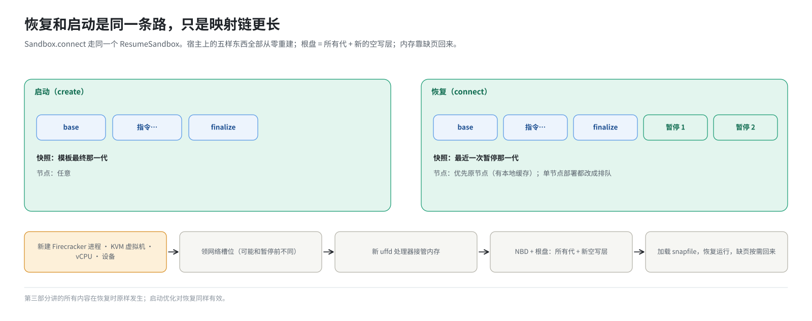
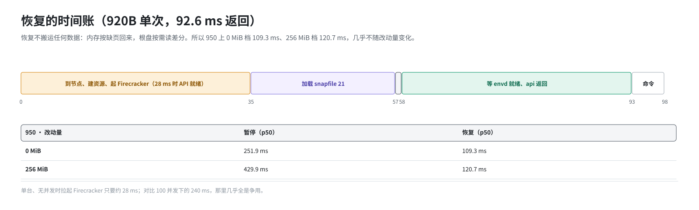
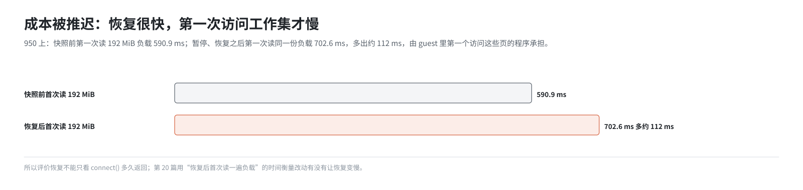
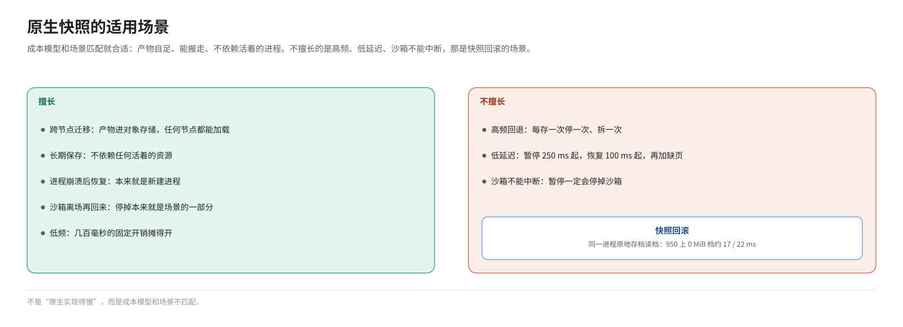

# 第 18 篇｜恢复：在新进程里读盘重建

> **本篇目标**：暂停之后，用户调用 `Sandbox.connect()` 把沙箱拉回来。本篇讲：恢复和第三部分的“启动”是同一条路，只是用的快照不同；恢复时宿主上的一切都要重建；鲲鹏 950 上恢复在各种改动量下都是 100 ms 出头，时间花在哪；搬内存的成本被推迟到了恢复之后。接着总结原生快照擅长什么、不擅长什么。最后讲一个和恢复有关的 SDK 修复：恢复出来的沙箱少带了两个请求头。

---

## 一、恢复就是启动

用户对一台已暂停的沙箱调用 `Sandbox.connect(sandbox_id)`，请求经过 api 到达 orchestrator，走的是和 `Sandbox.create` **同一个** `ResumeSandbox`（第 10 篇）。区别只有两处：

| | 启动（create） | 恢复（connect） |
|---|---|---|
| 用哪张快照 | 模板的最终快照 | 暂停时留下的那一代 |
| 映射表的链 | 模板的几层 | 模板的几层 + 每次暂停各一代，更长 |
| 节点选择 | 任意节点 | 优先原节点，那里有本地缓存 |
| 拿不到启动名额时（上游） | 立即拒绝，换节点 | 排队等待 |



最后一行在上游有意义：恢复的快照文件已经缓存在原来那个节点上，换节点要重新从存储下载，代价高，所以宁可排队。我们是单节点部署，两者都改成了排队（第 10 篇）。

因为是同一条路，第三部分讲的所有内容（启动脚本、懒加载、预取、根盘、网络、envd 醒来）在恢复时全部原样发生。第 15 篇的启动优化，对恢复同样有效。

## 二、一切都要重建

恢复时，宿主上为这台沙箱准备的五样东西**全部从零开始**：

```
新建 Firecracker 进程
  ├── 建 KVM 虚拟机、vCPU、中断控制器、virtio 设备
  ├── 领一个网络槽位（可能和暂停前不是同一个）
  ├── 起一个新的 uffd 处理器，接管 guest 内存
  ├── 建 NBD 设备 + 根盘（模板只读层 + 暂停时导出的那一代 + 新的空写层）
  └── 加载 snapfile，恢复 vCPU 和设备状态
跑起来
  └── guest 访问一页还没有内容的内存 → 缺页 → uffd 处理器
       → 查映射表 → 读本地缓存（没有就从存储拉）→ 填进去
```

这就是第 16 篇说的“每一次都是销毁加重建”。暂停时拆掉的，恢复时一样一样再建起来。

## 三、实测：100 ms 出头，和改动量无关

鲲鹏 950 上，每一档一台新沙箱，客户端测得的恢复中位数：

| 改动量 | 恢复 |
|---|---|
| 0 MiB | 109.3 ms |
| 256 MiB | 120.7 ms |

几乎不随改动量变化。为什么？因为恢复**不搬运任何数据**：内存靠缺页按需回来，根盘按需从差分里读。改了 256 MiB 还是 0 MiB，恢复那一刻要做的事一样多。

在 920B 上对一次恢复（总耗时 92.6 ms）的时间拆分，从客户端发起调用开始计：

| 时间点 | 发生的事 |
|---|---|
| 0～35 ms | 请求经 api 到节点；建 cgroup、网络槽位、NBD、uffd，启动 Firecracker 进程（约 27 ms 进程起来，28 ms API 就绪） |
| 35～57 ms | 加载 snapfile（约 21 ms） |
| 57～58 ms | 恢复 vCPU（约 1 ms） |
| 58～93 ms | 等 envd 就绪、api 返回 |
| 93～98 ms | 第一条命令执行完 |



单台沙箱、没有并发时，启动 Firecracker 只要 28 ms 左右。对比第 14 篇 100 并发下的 240 ms，可见那里的时间几乎全是争用。

## 四、成本被推迟了

恢复很快，但内存的成本并没有消失，只是**推迟到了恢复之后**。

950 上的实测：一台沙箱在暂停前，第一次把一份 192 MiB 的内存数据读一遍，用了 590.9 ms；暂停、恢复之后，第一次读同一份数据用了 702.6 ms，多出约 112 ms。这 112 ms 不计入恢复耗时，而由 guest 里第一个访问这些页的程序承担。



所以评价恢复的快慢，不能只看 `connect()` 多久返回，还要看“恢复后第一次碰到工作集”要多久。第 20 篇讲精确增量时，我们就是用这个“恢复后第一次读一遍负载”的时间来衡量改动有没有让恢复变慢的。

## 五、原生快照擅长什么

把暂停和恢复合起来看，原生快照的设计对它的目标场景是**合适**的：

| 场景 | 为什么合适 |
|---|---|
| **跨节点迁移** | 产物自足、存进对象存储，任何节点都能加载 |
| **长期保存** | 同上，不依赖任何活着的资源 |
| **进程崩溃后恢复** | 恢复本来就是新建进程，原来那个死没死都无所谓 |
| **沙箱离场再回来** | 停掉沙箱本来就是这个场景的一部分 |
| **低频使用** | 一个沙箱暂停一两次，几百毫秒的固定开销摊得开 |

它**不擅长**的，是“高频、低延迟、沙箱不能中断”：每存一次档都要停一次、拆一次，每读一次档都要建一次、等缺页。这不是实现上的缺陷，而是**成本模型和场景不匹配**。这正是我们另做一套快照回滚的原因：回滚在同一个活着的进程里原地存档读档，存档、读档各约 20 ms 起。



两者的分工和互相影响，第五部分讲。

## 六、一个 SDK 修复：恢复后少了两个请求头

这是一个由快照回滚“暴露”出来的、原本就存在于恢复路径上的问题。

SDK 创建沙箱时，会为这台沙箱准备一组请求头，用于数据面上的路由。其中有两个是 `E2b-Sandbox-Id` 和 `E2b-Sandbox-Port`，proxy 靠它们把一类“按请求头寻址”的请求送到正确的沙箱和端口。

可 SDK 里 `Sandbox.connect()` 的代码路径只设置了访问令牌这一个请求头，**漏掉了这两个路由头**。于是通过 `connect()` 拿到的沙箱对象（包括所有暂停后恢复的沙箱），发出这类请求时，proxy 回答“缺少请求头”。

为什么一直没人发现？因为最常用的 envd 不受影响：访问 envd 的地址里本身就带着沙箱 ID（形如 `49983-<沙箱ID>.<域名>`），不需要靠请求头路由。直到快照回滚加进来，它的接口恰好是按请求头路由的，在恢复出来的沙箱上就完全用不了了。

修法是在 `connect()` 路径上补上这两个请求头，和 `create()` 保持一致。我们部署时把修好的 SDK 文件覆盖到 pip 安装的 e2b 包上。

这个例子说明：**一条路径上长期存在的缺陷，可能因为“没人走那条路”而一直潜伏。** 新功能走了一条不常走的路，它就浮出来了。第 22 篇还会看到几个类似的例子。

---

## 本篇小结

| 概念 | 一句话解释 |
|---|---|
| 恢复就是启动 | 同一个 `ResumeSandbox`，只是快照换成暂停那一代，映射链更长 |
| 一切重建 | 进程、KVM、网络、uffd、NBD、根盘全部从零开始 |
| 950 实测 | 0 MiB 档 109 ms，256 MiB 档 121 ms，和改动量无关 |
| 成本推迟 | 恢复后第一次读 192 MiB 多约 112 ms |
| 擅长 | 迁移、长期保存、崩溃恢复、离场再回来、低频 |
| 不擅长 | 高频回退，那是快照回滚的场景 |
| SDK 修复 | `connect()` 补上沙箱 ID 和端口两个路由头 |

**下一篇预告**：[《ARM 上的退化：读过就算脏》](19-arm-read-is-dirty.md)。第 17 篇讲的脏页判据，在 ARM 上为什么失灵了？为什么一台什么都没改的沙箱，一次暂停也要导出一百多 MiB 内存？
