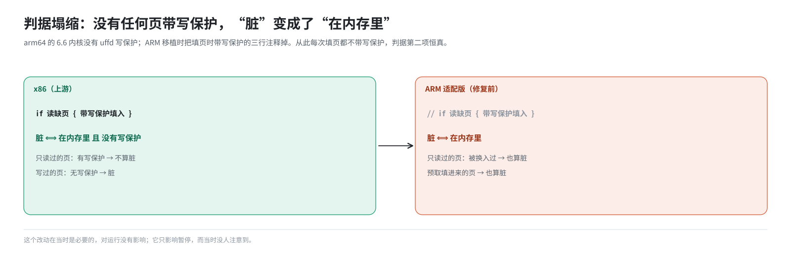
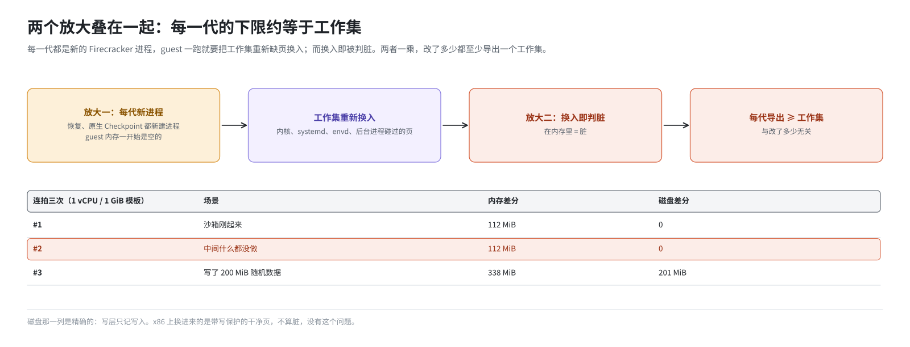
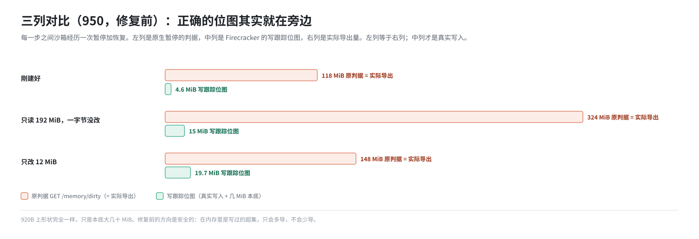

# 第 19 篇｜ARM 上的退化：读过就算脏

> **本篇目标**：第 17 篇讲的脏页判据依赖 uffd 写保护。可我们的 ARM 服务器上，内核不支持这个功能。本篇讲 ARM 移植时为了绕过它做了什么改动，这个改动怎样让判据塌缩成“读过就算脏”，再叠加“每一代都是新进程”这个放大器，导致一台什么都没改的沙箱，每次暂停也要导出一百多 MiB。最后用三列对比数据说明：正确的答案其实一直就在旁边。

---

## 一、一处注释掉的代码

第 17 篇讲过，x86 上 uffd 处理器填页时，读缺页会带上“写保护”标记：

```go
// 读缺页：带写保护填入，之后被写会再通知一次
if accessType != block.Write {
    copyMode |= UFFDIO_COPY_MODE_WP
}
```

我们 ARM 服务器上用的 6.6 内核，在 arm64 上**不支持 uffd 写保护**。带着这个标记去填页，内核直接报错，沙箱起不来。

ARM 移植时的做法是把这三行**注释掉**：

```go
//if accessType != block.Write {
//    copyMode |= UFFDIO_COPY_MODE_WP
//}
```

沙箱能正常启动、正常运行了。可这三行注释掉之后，每一次填页都不带写保护，不管这次缺页是读引起的还是写引起的。

这个改动在当时是必要的，ARM 上没有更好的办法。它对运行没有任何影响，但对暂停有影响，而当时没有人注意到。

## 二、判据塌缩

回想判据：

```
脏页 ⟺ 在内存里 且 没有写保护
```

现在**没有任何一页带写保护**，判据的第二项永远为真，整个判据塌缩成了第一项：

```
脏页 ⟺ 在内存里
```

也就是说：**凡是被换进过内存的页，都算脏。** 被读过的页，因为读的时候要缺页把它换进来，所以也算脏。



## 三、两个放大叠在一起

“读过就算脏”单独看，好像也还好：多存一些只读的页而已。可它和原生快照的另一个特性叠在一起，就变成了一个很大的数。

**放大一：每一代都是一个新进程。** 第 16、18 篇讲过，暂停之后的恢复是新建一个 Firecracker 进程，新进程的 guest 内存一开始是空的。guest 一跑起来，它用到的所有页（工作集）都要重新经过缺页换进来。原生 `Checkpoint` 也一样：存完盘就停掉旧进程、从新快照拉起新进程。

**放大二：换入即被判脏。** 只要换进来，就在内存里；只要在内存里，就算脏。

两者一乘：**每一代暂停导出的内存，下限约等于这一代 guest 碰过的全部页**，和改了多少完全无关。



而 x86 上没有这个问题：同样是每代新进程、工作集重新换入，可换进来的是“读进来的干净页”，带着写保护，不算脏。所以 x86 的增量仍然只包含写过的页。

**这是 ARM 移植带来的退化，不是 E2B 的设计问题。**

## 四、实测

### 1. 连拍三次

在一台 ARM 服务器上（当时模板是 1 vCPU、1 GiB 内存），对同一台沙箱连续做三次原生 `Checkpoint`：

| 快照 | 场景 | 内存差分 | 磁盘差分 |
|---|---|---|---|
| #1 | 沙箱刚起来 | **112 MiB** | 0 |
| #2 | 中间什么都没做 | **112 MiB** | **0** |
| #3 | 写了 200 MiB 随机数据 | 338 MiB | 201 MiB |

最能说明问题的是 #2：两次快照之间一条命令都没跑，如果是精确增量，这里应该接近 0。112 MiB 正是“从 #1 恢复之后到 #2 之间被换进来的页”，也就是这台沙箱（内核 + systemd + envd + 后台进程）的常驻工作集，约占 1 GiB 的 11%。

**磁盘那一列是精确的**：#1、#2 都是 0 字节。如果磁盘也有“读即脏”，沙箱启动必然读了一堆盘，不可能是 0。磁盘增量来自写层，写层只记写入，和 uffd 无关。

#3 的内存差分 338 MiB ≈ 112（工作集）+ 200（写的数据，guest 的文件缓存本身就在内存里）+ 约 26（缓冲区、元数据、新换入的页）。

### 2. 三列对比

在鲲鹏 950 上，我们用一个探针脚本把三样东西并排量出来。每一步之间沙箱都经历一次暂停加恢复，也就是每一步都是一个新进程：

- **左列**：原生暂停用的判据，Firecracker 的 `GET /memory/dirty`；
- **中列**：Firecracker 的“写跟踪位图”（我们为快照回滚给 Firecracker 加的一个接口，它记录的是真正被写过的页）；
- **右列**：实际导出的内存差分大小。

| 步骤 | 原判据 | 写跟踪位图 | 实际导出 |
|---|---|---|---|
| 刚建好 | 118.0 MiB | 4.6 MiB | 118.0 MiB |
| 只读 192 MiB，一字节没改 | 324.0 MiB | 15.0 MiB | 324.0 MiB |
| 只改 12 MiB | 148.0 MiB | 19.7 MiB | 148.0 MiB |



从这三行能读出三件事：

1. **左列等于右列**，逐行相等。原生暂停就是按这个判据导出的，中间没有别的放大环节。要找原因，只需要看判据。
2. **只读那一行，左列涨到 324 MiB。** 读了 192 MiB、一个字节都没改，导出量却比上一步多了约 200 MiB。判据把“读”算成了“脏”。
3. **中列是对的。** 4.6、15.0、19.7，都是“真正写入量加上几 MiB 系统本底”（guest 内核自己的记账、日志、页表更新）。

920B 上三行的形状完全一样，只是本底大几十 MiB。所以这不是某一台机器的问题，是 ARM 适配版原生路径的问题。

## 五、预取也被算进去了

第 12 篇讲的预取，填页走的是和真实缺页**同一个**填页函数。x86 上预取填进去的页带写保护，不算脏；ARM 上不带，预取多少页就脏多少页。

也就是说，在 ARM 上调大预取，会直接放大每次暂停的体积。一个为了让启动更快的优化，在这里变成了暂停的负担。

## 六、还有一个测量上的陷阱

这个问题还影响了测量本身。我们原生快照的基准脚本，在每一档恢复之后，都会把负载完整读一遍，用来**验证内容**是否正确。可这一读，就让负载的全部页被换进内存、被判脏。结果修复前六个档位导出的内存差分恒在 440 MiB 左右，几乎不随档位变化。

“验证内容”这个动作本身，就在放大被测量的东西。这是测量里一个很隐蔽的陷阱：**观察者改变了被观察的对象。**

## 七、为什么不影响正确性

这个退化浪费空间和时间，但**方向是安全的**：

- 一页被写过，写之前一定先被缺页换进来，所以它一定“在内存里”；
- 所以“在内存里”是“被写过”的**超集**；
- 按超集导出，只会多存一些没改过的页（内容和上一代一样，恢复时覆盖成相同的值），不会漏掉任何改过的页。

所以修复前的 ARM 版本，暂停恢复的结果始终是对的，只是每次多存了很多。这个“只会多、不会少”的性质很重要，下一篇会看到，它让“在内存里就算脏”这条退化的判据成了所有退路的落脚点。

## 八、正确的答案就在旁边

三列对比里最值得注意的是中列：**Firecracker 一直在算一份正确的位图**，只是原生暂停没有用它。

那么问题变成两个：

1. 为什么原生路径不用那份位图？
2. 用了它，就够了吗？

第一个问题的答案很简单：那份位图是我们为快照回滚加进 Firecracker 的，原生路径写在它之前。第二个问题的答案是“不够”，原因藏在 2 MiB 大页里。下一篇讲。

---

## 本篇小结

| 概念 | 一句话解释 |
|---|---|
| 一处注释 | arm64 的 6.6 内核没有 uffd 写保护，填页时带写保护的三行被注释掉 |
| 判据塌缩 | 没有任何页带写保护，“脏”塌缩成“在内存里”，读过也算脏 |
| 两个放大 | 每代新进程重新换入工作集 × 换入即判脏 → 每代下限约等于工作集 |
| 实测 | 中间什么都没做也是 112 MiB；950 上改 12 MiB 导出 148 MiB，只读 192 MiB 导出 324 MiB |
| 磁盘不受影响 | 写层只记写入，磁盘增量仍然精确 |
| 预取被算进去 | ARM 上预取多少就脏多少 |
| 测量陷阱 | 验证内容的那一读本身让页变脏 |
| 不影响正确性 | 在内存里是写过的超集，只会多导，不会少导 |
| 正确答案在旁边 | Firecracker 的写跟踪位图只有 4.6 / 15.0 / 19.7 MiB |

**下一篇预告**：[《精确增量：判、存、填三层一起改》](20-precise-increment.md)。把判据换成写跟踪位图就够了吗？为什么还被 2 MiB 大页卡在约 130 MiB？怎样做到导出精确，同时恢复不变慢？
