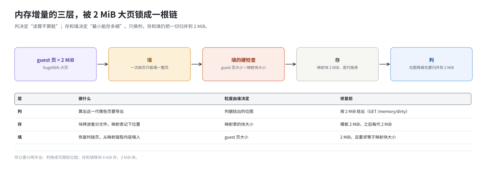
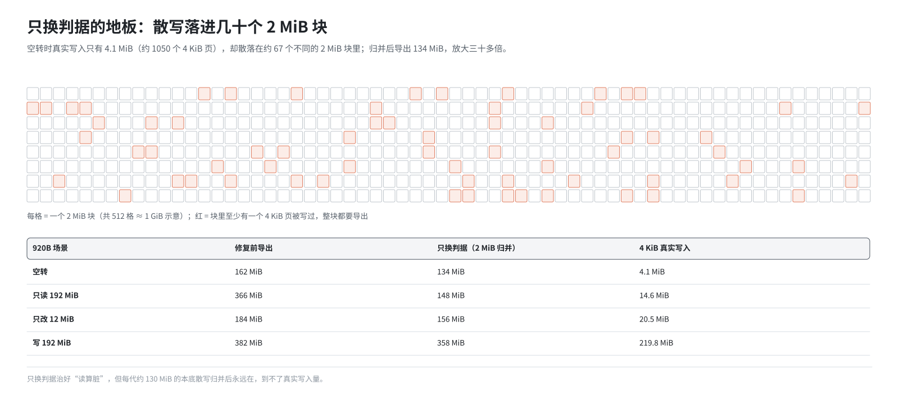
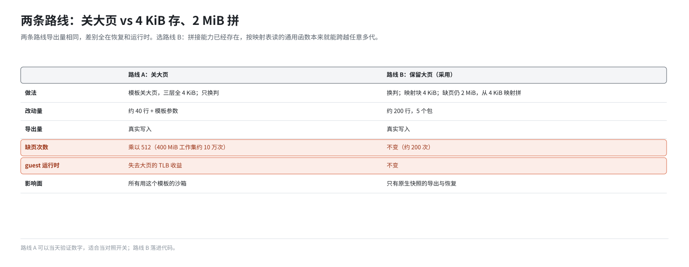
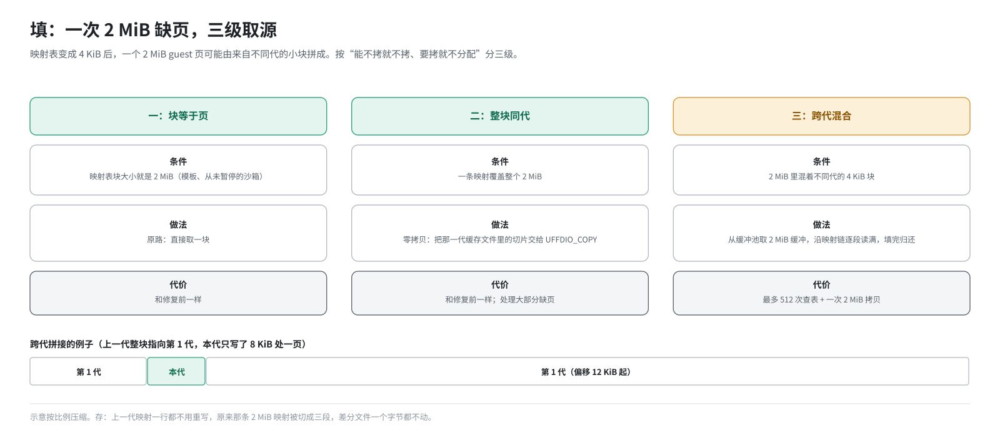
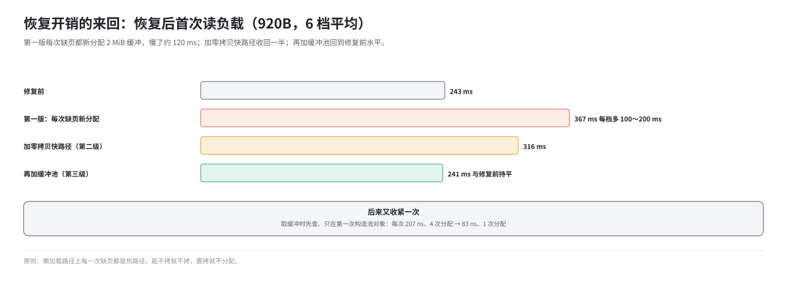

# 第 20 篇｜精确增量：判、存、填三层一起改

> **本篇目标**：上一篇的结论是，正确的写跟踪位图就在 Firecracker 里。本篇先说明为什么“只换判据”不够：内存增量其实分三层，粒度被 2 MiB 大页锁成了一根链，只换最上面一层，导出量会被卡在约 130 MiB 的地板上。然后讲改之前先立的一条规矩“宁可多导，不可少导”；两条可选路线以及为什么选第二条；三层各自怎么改；改完之后恢复变慢了，又怎么收回来；什么时候退回旧判据。最后看修复前后的数字。

---

## 一、内存增量的三层

把原生暂停的内存路径按“谁决定粒度”切开，是三层：

| 层 | 做什么 | 粒度由谁决定 | 修复前 |
|---|---|---|---|
| **判** | 算出这一代哪些页要导出 | 判据给出的位图 | 按映射表的块大小（2 MiB）给出 |
| **存** | 把要导出的块拷进差分文件，映射表记下每块在哪 | 映射表的块大小，逐代继承 | 模板是 2 MiB，之后每代都是 2 MiB |
| **填** | 恢复时 uffd 缺页，从映射表取内容填进去 | guest 页的大小 | 大页 2 MiB；而且硬性要求“guest 页大小 = 映射表块大小”，否则拒绝启动 |

三层的粒度被一根链锁在一起：

```
guest 页 = 2 MiB（大页）
 → 填：一次缺页只能填一整页 2 MiB
 → 填的硬检查：guest 页大小必须等于映射表块大小
 → 存：映射表块大小 = 2 MiB，写在映射表里逐代继承
 → 判：位图再精细，最后也要归并到 2 MiB 块导出
```



所以这件事要分两半治：**“判”决定读算不算脏；“存”和“填”决定最小能存多细。**

## 二、只换判据的地板

最直接的想法：把“判”换成写跟踪位图，“存”和“填”不动。这能省多少？

我们写了一个探针，把 4 KiB 粒度的写跟踪位图按 2 MiB 归并（一个 2 MiB 块里只要有一个 4 KiB 页被写过，整块就要导出），算出“只换判据”时的导出量。920B 上：

| 场景 | 修复前导出 | 只换判据 | 4 KiB 真实写入 |
|---|---|---|---|
| 空转 | 162 MiB | 134 MiB | 4.1 MiB |
| 只读 192 MiB | 366 MiB | 148 MiB | 14.6 MiB |
| 只改 12 MiB | 184 MiB | 156 MiB | 20.5 MiB |
| 写 192 MiB | 382 MiB | 358 MiB | 219.8 MiB |

看“空转”那行：真正写了 4.1 MiB，归并后却是 134 MiB，放大了三十多倍。为什么？因为这 4 MiB 不是连成一片的，而是**散落**在 2 GiB 的 guest 内存里：内核的页表更新、内存分配器、定时器、日志缓冲，各自落在不同的物理页上。4.1 MiB 约 1050 个 4 KiB 页，落进了约 67 个不同的 2 MiB 块，平均每块只有十几个页真被写过，剩下四百多个页是“陪绑”导出的。



这就是**只换判据的地板**：只要 guest 活着，每一代就有一百多 MiB 的“本底散写”，归并到 2 MiB 后约 130 MiB，和改动量无关。只换判据治好了“读算脏”，对读多写少的负载收益很大（只读那行从 366 降到 148），但对写多的负载只省个位数百分比，而且**永远到不了真实写入量**。

## 三、先立规矩：宁可多导，不可少导

在动手改之前，先想清楚改错了会怎样。

暂停导出的内存差分是相对上一代的。恢复时，没有被导出的页一律从上一代读。所以：

- **多导一页**：这一页的内容本来就能从上一代读到，重复存一份，只浪费空间和时间；
- **少导一页**：如果这一页其实被写过，恢复后它会变回上一代的旧内容。guest 内存由两个不同时刻拼成，页表、链表、引用计数前后对不上，轻则数据错乱，重则 guest 内核在恢复后几十毫秒内崩溃。更糟的是，**暂停本身报成功**，错误要到恢复时才暴露。

两个方向的代价完全不对称。所以任何判据的改动都必须满足：**新判据给出的页集合，必须是真正被写过的页的超集。** 旧的“在内存里就算脏”满足这一点（上一篇第七节），只是超得太多。换成写跟踪位图之后，必须逐项论证它覆盖了所有的写。

## 四、两条路线

要让导出量等于 4 KiB 粒度的真实写入，有两条路：

| | 路线 A：关掉大页 | 路线 B：保留大页，4 KiB 存、2 MiB 拼 |
|---|---|---|
| 做法 | 模板关掉大页构建，guest 页、映射表块、缺页单位全是 4 KiB；只换“判” | 换“判”；映射表块降到 4 KiB；缺页仍按 2 MiB，内容从多个 4 KiB 映射拼起来 |
| 改动量 | 约 40 行 + 模板参数 | 约 200 行，5 个包 |
| 导出量 | 真实写入 | 真实写入 |
| 缺页次数 | **乘以 512** | 不变 |
| guest 运行时 | 失去大页的 TLB 收益 | 不变 |
| 影响面 | 所有用这个模板的沙箱，不只做快照的 | 只有原生快照的导出和恢复 |



**选 B。** 两条路线导出量相同，差别全在恢复和运行时。路线 A 让一个 400 MiB 工作集的缺页次数从约 200 次变成约 10 万次，每一次都是一次“内核 → orchestrator → 内核”的往返，恢复后首次触碰工作集的延迟会从几百毫秒升到秒级；还让所有沙箱在运行时失去大页。为了快照的体积让所有沙箱付运行时代价，不划算。

路线 B 的关键判断是：**拼接能力其实已经存在。** 按映射表读数据的那个通用函数本来就是一个循环：查一次映射，从对应那一代读“映射剩余长度和待读长度中较小的那个”，前进，再查，直到读满。它天然能跨越任意多代。修复前只有 uffd 用了一个“只取一个块”的捷径。所以要做的不是写一个拼接器，而是把 uffd 的路径换成“能拼的读法”，再把拼接的开销压下去。

## 五、三层各改了什么

### 1. 判：换成写跟踪位图

暂停取脏页时，不再调 `GET /memory/dirty`，而是：

1. 让 Firecracker 把当前的写跟踪位图写进一个临时文件（这是我们给 Firecracker 加的接口）；
2. 读取并解析这个文件，得到一个按 4 KiB 页的位集合；
3. 以 4 KiB 为块大小返回。

这一步要成立有三个前提，都满足：

- 这个接口要求虚拟机已暂停：暂停流程里取脏页时虚拟机确实已暂停；
- 暂停流程先写了 snapfile，这次写**不会清空**位图（Firecracker 只在连内存一起导出时才清，原生暂停不让它导内存）；
- 位图的起点就是这一代的起点：每一代都是新进程，从快照加载时位图为空，之前的写已经在上一代的差分里。（这一条在沙箱做过快照回滚之后**不再成立**，第 22 篇专门讲。）

位图覆盖了哪些写？它是两份位图的并集：KVM 记录的 guest 的每一次写（920B 上靠写保护陷出，950 上靠硬件 HDBSS），以及 Firecracker 自己写 guest 内存的地方（网卡收包缓冲、virtio 队列）。**orchestrator 经 uffd 填进去的页不在位图里**，也不该在：它们是“换入”，内容等于映射链里已有的内容。这恰恰是“换入即脏”的反面。

### 2. 存：映射表块大小降到 4 KiB，父代映射原样保留

生成新一代映射表时加一条规则：差分的块比上一代细、并且能整除上一代的块，就把新映射表的块大小改成差分的块大小。

**上一代的映射一行都不用重写。** 映射表里记的是字节区间，2 MiB 对齐的区间必然也是 4 KiB 对齐的；查找时只要求每段的起点落在块边界上，不要求每段长度等于块大小。所以一张 4 KiB 的映射表里，可以同时有 2 MiB 长的老映射和 4 KiB 长的新映射。

例如上一代把 `[0, 2 MiB)` 整块映射到第 1 代，本代只写了其中偏移 8 KiB 那一页，合并后：

```
[0,      8 KiB)  → 第 1 代，偏移 0
[8 KiB, 12 KiB)  → 本代，偏移 0        ← 本代唯一的一页
[12 KiB,  2 MiB) → 第 1 代，偏移 12 KiB
```

原来那条 2 MiB 的映射被切成三段，前后两段仍指向第 1 代，差分文件一个字节都不用动。

模板的映射表仍是 2 MiB；沙箱**第一次**原生暂停时切到 4 KiB，之后每一代继承 4 KiB。

### 3. 填：一次 2 MiB 缺页，三级取源

缺页单位仍然是 2 MiB 的 guest 页，可映射表现在是 4 KiB 的，一个 2 MiB 页可能由来自不同代的 512 个小块拼成。填页时按三级取源：

| 级 | 条件 | 做法 | 代价 |
|---|---|---|---|
| 一 | 映射表块大小就等于 guest 页 | 原来的路，直接取一块 | 和修复前一样 |
| 二 | 一条映射覆盖了整个 2 MiB | **零拷贝**：直接把那一代缓存文件里的那段切片交给 `UFFDIO_COPY` | 和修复前一样 |
| 三 | 2 MiB 里混着不同代的块 | 从缓冲池取一块 2 MiB 缓冲，沿映射链逐段读满，填完把缓冲还回池里 | 最多 512 次查表 + 一次 2 MiB 拷贝 |



guest 物理页在 2 MiB 块里虽然混着，但整块都来自同一代的仍占多数，第二级能处理大部分缺页。缺页处理和预取共用这个入口。

原来那条“guest 页大小必须等于映射表块大小”的硬检查，也放宽成“guest 页大小必须是块大小的整数倍”。

## 六、恢复开销的来回

体积是“存”这一侧的收益；代价落在“填”这一侧，也就是恢复后懒加载的热路径上。我们用“恢复后第一次把负载整个读一遍的耗时”来衡量，它比恢复本身的耗时更接近用户真正等的时间。

第一版的“填”很直接：每次 2 MiB 缺页都新分配一块 2 MiB 缓冲，沿映射链读满再填。一个 400 MiB 的工作集约 200 次缺页，就是 400 MiB 的分配、清零、拷贝和之后的垃圾回收。920B 上六个档位的平均值：

| 版本 | 恢复后首次读负载（6 档平均） |
|---|---|
| 修复前 | 243 ms |
| 第一版 | 367 ms，每档多 100～200 ms |
| 加上零拷贝快路径（第二级） | 316 ms |
| 再加上缓冲池（第三级） | **241 ms**，与修复前持平 |



后来缓冲池的取法又收紧了一次：最初每次取缓冲都会顺手构造一个新的池对象再丢掉，现在先查、只在第一次才构造。每次取缓冲从 207 ns、4 次内存分配降到 83 ns、1 次分配。在一次 2 MiB 拷贝面前这只是零头，但它体现同一条原则：**懒加载路径上每一次缺页都是热路径，能不拷就不拷，要拷就不分配。**

## 七、退路：什么时候退回旧判据

写跟踪位图只有在“这一代从启动起就开着跟踪，而且没有被清掉而未补回的部分”时才完整。任何一个条件不满足，就退回旧的“在内存里就算脏”，因为它**不会漏掉写过的页**。按顺序检查四道门：

| # | 条件 | 为什么不能用写跟踪位图 |
|---|---|---|
| 1 | 这台 orchestrator 没给虚拟机开脏页跟踪 | 位图里只剩 Firecracker 自己的写 |
| 2 | 为配合快照回滚而维护的“自启动以来脏页集”不可信 | 并回去也可能少导（第 22 篇） |
| 3 | Firecracker 没有导出位图的接口 | 拿不到位图 |
| 4 | 合并时页大小对不上 | 同 2 |

第 1 道门对应一个开关：**脏页跟踪是否开启，默认跟着硬件走**。950 有硬件记脏（HDBSS），默认开，原生暂停就是精确增量；920B 没有，默认关，原生暂停仍按旧判据。为什么 920B 默认不开？因为软件方式的跟踪要让每个干净页第一次被写时陷出一次，**所有沙箱**都要付这个运行期代价，不管它做不做快照。这一点第 21 篇再展开。

每次暂停都会在日志里说清：这次导出了多少页、依据是哪一种（写跟踪、写跟踪加累积、驻留）、为什么。修复前那种“导多导少完全看不见”的状态不会再有。

## 八、修复后的数字

920B 上开启跟踪、修复后，三列对比的右列（实际导出）等于中列（写跟踪位图），逐行相等：

| 场景 | 修复前导出 | 修复后导出 |
|---|---|---|
| 刚建好 | 154 MiB | 5.5 MiB |
| 只读 192 MiB | 358 MiB | **12.7 MiB** |
| 只改 12 MiB | 176 MiB | **20.3 MiB** |
| 写 192 MiB | 370 MiB | 209.5 MiB |

修复后，导出量等于“这一档写入量 + 二三十 MiB 本底”，随写入量线性增长。导出量变小还带来一个直接收益：上传时间从约 200 ms 降到 50～150 ms。暂停和恢复的耗时本身变化不大，因为它们的主要成本本来就在拆机和建机上（第 17、18 篇）。

这次修复只是把 ARM 补回到 x86 本来就有的精确程度，并没有超越 x86 原生。

---

## 本篇小结

| 概念 | 一句话解释 |
|---|---|
| 三层 | 判（哪些页）、存（映射块大小）、填（缺页单位），被 2 MiB 大页锁成一链 |
| 只换判据的地板 | 本底散写落进几十个大块，归并后约 130 MiB |
| 规矩 | 宁可多导，不可少导；新判据必须是真实写入的超集 |
| 两条路线 | 关大页（缺页 ×512，所有沙箱受累）vs 4 KiB 存、2 MiB 拼，选后者 |
| 判 | 写跟踪位图，4 KiB；换入的页不在其中 |
| 存 | 映射块降到 4 KiB，上一代映射原样保留 |
| 填 | 三级取源：块等于页、整块同代零拷贝、跨代用池里的缓冲拼 |
| 恢复开销 | 第一版慢 120 ms，零拷贝和缓冲池收回到修复前水平 |
| 退路 | 四道门任一不过，退回“在内存里就算脏”；跟踪默认跟着硬件走 |
| 修复后 | 只读 192 MiB：358 → 12.7 MiB；只改 12 MiB：176 → 20.3 MiB |

**下一篇预告**：[《快照回滚动了哪些共用部件》](21-what-rollback-touched.md)。进入第五部分。快照回滚和暂停恢复是两套独立的机制，为什么还会互相影响？加了回滚之后，普通的启动和暂停多付了什么？
