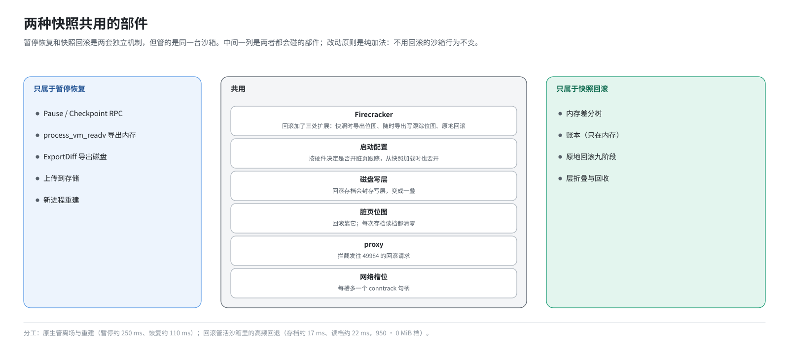
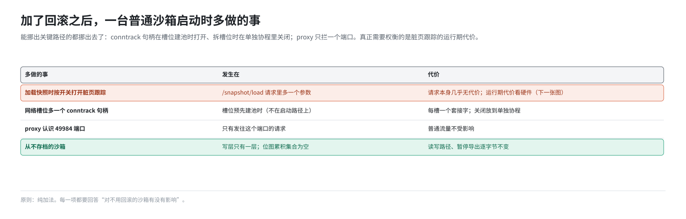
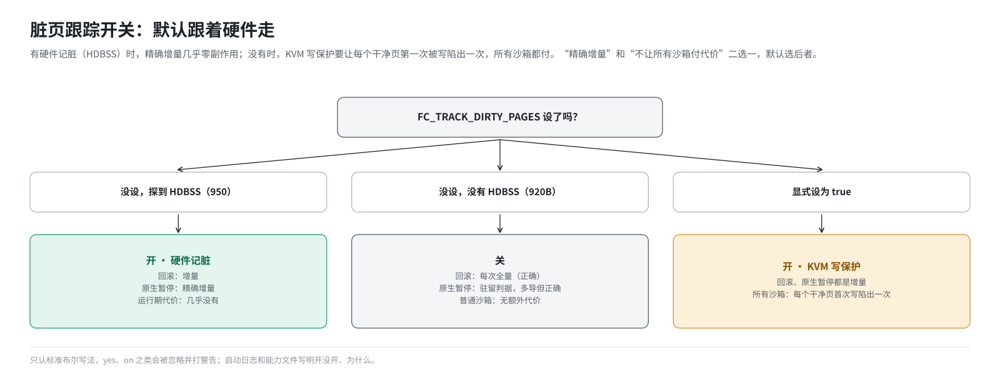

# 第 21 篇｜快照回滚动了哪些共用部件

> **本篇目标**：进入第五部分。我们新增的快照回滚和 E2B 原有的暂停恢复是两套独立的机制，可它们管的是同一台沙箱、同一个 Firecracker、同一叠磁盘、同一份内存。本篇先用几句话交代两者的分工，然后列出回滚动过的共用部件，再逐项看：加了回滚之后，一台**从不使用回滚**的普通沙箱，在启动和暂停时多付了什么，我们又怎样让这些代价尽量为零。最后顺带讲为了和同机其他沙箱系统共存做的几处改名。

---

## 一、两种快照的分工

只讲结论，机制见《E2B 沙箱快照回滚从零讲透》：

| | 暂停恢复（原生） | 快照回滚（新增） |
|---|---|---|
| 解决什么 | 沙箱离场后保存，以后在任意节点重建 | 活沙箱里高频、快速地回到之前的某个状态 |
| 存档后沙箱 | 停掉 | 继续跑 |
| 读档 | 新进程重建，靠缺页换回工作集 | 同一个进程原地写回改过的页 |
| 产物 | 自足、紧凑、可上传 | 只在本机、绑定这台沙箱的生命周期 |
| 典型耗时（950，0 MiB 档） | 暂停约 250 ms，恢复约 110 ms | 存档约 17 ms，读档约 22 ms |

谁也替代不了谁：回滚的存档离不开这台活着的沙箱，沙箱一停就没了，所以长期保存、迁移只能靠原生；原生每次都拆机建机，几百毫秒，所以高频回退只能靠回滚。

## 二、共用了哪些部件

回滚要在一个活着的沙箱里原地存档读档，就不得不动几样原本只为原生路径服务的部件：

| 部件 | 原来 | 回滚加了什么 |
|---|---|---|
| **Firecracker** | E2B 的 Firecracker 分支 | 三处扩展：快照时可导出脏页位图、随时导出当前写跟踪位图、原地回滚；另外加了 HDBSS 硬件记脏（改动清单见《E2B 沙箱快照回滚从零讲透》附录 A） |
| **虚拟机启动配置** | 不开脏页跟踪 | 按硬件决定是否开启脏页跟踪，从快照加载时也要开 |
| **磁盘写层** | 一台沙箱一个写层 | 存档时把当前写层封存成只读层、再开一个新写层，于是变成一叠 |
| **脏页位图** | 原生不用 | 回滚靠它判断“这次存档要存哪些页”，每次存档读档都会清零 |
| **proxy** | 只转发 | 拦截发往沙箱 49984 端口的回滚请求，由宿主处理 |
| **网络槽位** | 只管网络 | 每个槽位额外保留一个 conntrack 句柄，回滚时快速清理连接跟踪表 |

改动的原则是**纯加法**：不使用回滚的沙箱，行为应当和原来一模一样。下面逐项检查这条原则有没有做到。

## 三、一台普通沙箱启动时多做了什么

| 多做的事 | 发生在 | 代价 |
|---|---|---|
| 加载快照时按开关打开脏页跟踪 | 加载快照的那次 HTTP 请求里多一个参数 | 请求本身几乎无代价；**运行期**的代价见下一节 |
| 网络槽位多开一个 conntrack 句柄 | 槽位**预先建池**时，不在启动路径上 | 每个槽位一个套接字；关闭放在单独的协程里，因为关闭本身有点慢 |
| proxy 认识 49984 端口 | 只有发往这个端口的请求才会被拦截 | 普通流量不受影响 |

前两项都尽量放在了启动的关键路径之外。conntrack 句柄在槽位建池时就打开，启动时直接拿来用；拆槽位时关闭句柄放进单独的协程，不让它拖慢拆除。

## 四、脏页跟踪的运行期代价

真正需要权衡的是第一项：**脏页跟踪一旦打开，虚拟机的每一次写内存都可能被记录。** 记录的方式取决于硬件：

| 机器 | 怎么记 | 运行期代价 |
|---|---|---|
| 鲲鹏 950 | CPU 硬件 HDBSS 自动记录写过的页，guest 写内存不需要陷出 | 几乎没有 |
| 鲲鹏 920B 等无 HDBSS 的机器 | KVM 把所有页设为写保护，每个干净页第一次被写时**陷出一次**，KVM 记下来再放行 | **所有开了跟踪的沙箱**都要付，不管它用不用回滚 |

在 920B 上，如果默认打开跟踪，一台从不做存档的普通沙箱也会因为每个页第一次被写都要陷出一次而变慢。这对不用回滚的用户是纯损失。

所以开关的**默认值跟着硬件走**：

| 机器 | 不设开关时 | 结果 |
|---|---|---|
| 950（有 HDBSS） | 探测到硬件能力，自动开 | 回滚是增量的；原生暂停是精确增量的（第 20 篇）；几乎无运行期代价 |
| 920B（无 HDBSS） | 关 | 回滚每次全量，功能正确；原生暂停退回旧判据（多导但正确）；普通沙箱无额外代价 |
| 920B，显式打开 | 开，走 KVM 写保护 | 回滚和原生暂停都是增量的；所有沙箱付写保护代价 |

这是一个典型的取舍：**有硬件支持时，精确增量几乎零副作用；没有硬件支持时，“精确增量”和“不让所有沙箱付写保护代价”只能二选一，默认选后者。** 需要的人可以显式打开。开关只认标准的布尔写法，写成 `yes`、`on` 之类会被忽略并打一条警告，避免“以为开了其实没开”。

orchestrator 启动时会在日志和一个能力文件里写明：跟踪开没开、为什么开或不开（“探测到硬件能力”“没有硬件，软件跟踪代价太高”“显式设置为 true”），每次暂停的日志也会说明用了哪种判据。所以无论哪种组合，都能从日志里看出来，不会出现“悄悄退化”。

## 五、磁盘写层从一层变成一叠

回滚存档时，不搬任何磁盘数据，只是把当前写层“封存”成只读的，再开一个新的空写层。存档几次，就叠几层。读磁盘时要从最上面一层往下找，直到找到这一块，或者落到模板。

对**从不存档**的沙箱，写层始终只有一层，读写路径和原来完全相同。

对存过档的沙箱，层数会随存档次数增长，读路径会越来越长。回滚那边为此做了限制层数、折叠相邻层、回收不再被引用的层这几件事，保证读路径不会无限变长。这些是回滚自己的事，不展开。

但“一层变成一叠”对原生暂停有一个直接后果：第 17 篇讲的磁盘导出，原来只导出“当前写层”。当写层变成一叠之后，当前写层里只有最近一次存档之后的写，更早的写在下面那些封存层里。下一篇第一个故事就从这里开始。

## 六、脏页位图会被清零

另一个共用部件是 Firecracker 的写跟踪位图。第 20 篇的精确增量用它来判断“这一代 guest 写过哪些页”，前提是“位图的起点就是这一代的起点”。

可回滚在每次存档、每次读档时都会**清零**这份位图，因为回滚自己的下一次存档要“相对于这一刻”。对回滚来说这是正确的；对原生暂停来说，位图就丢了一截历史。这是下一篇的第二个故事。

## 七、和同机其他沙箱系统共存

最后是一组和回滚无关、但同样属于“共存”的修改：我们的 E2B 有时要和另一套沙箱系统部署在同一台机器上。两套系统都会在宿主上建网卡、加路由、写 iptables 规则，名字和地址一旦撞上就会互相干扰：

| 冲突点 | 原来 | 改成 |
|---|---|---|
| 宿主侧 veth 网卡名 | `veth-<编号>`，和对方的命名一样，对方的 iptables 规则按 `veth-+` 匹配会误伤 | `e2bv-<编号>` |
| 沙箱地址池 | 和对方重叠 | 挪到另外两个网段 |
| 80 端口重定向规则 | 不限网卡、排在所有规则前面，会截走对方的 80 端口流量 | 只匹配发往本地地址的流量 |
| 部署脚本的清理 | 按通配名字清理 | 只清理 E2B 自己的名字和地址池 |
| 大页池 | 按比例预留 | 封顶 64 GB，给对方留出余地 |

这些修改的思路和第 9 篇的发行版适配一样：**不假设自己是机器上唯一的住户。**

---

## 本篇小结

| 概念 | 一句话解释 |
|---|---|
| 分工 | 原生管离场与重建；回滚管活沙箱里的高频回退；谁也替代不了谁 |
| 共用部件 | Firecracker、启动配置、写层、脏页位图、proxy、网络槽位 |
| 纯加法 | 不用回滚的沙箱，行为应当和原来一样 |
| 启动多做的事 | 加载时按开关开跟踪；conntrack 句柄在建池时开；proxy 只拦 49984 |
| 跟踪的运行期代价 | 950 几乎为零；920B 每个干净页首次写陷出一次 |
| 默认跟着硬件走 | 有 HDBSS 就开，没有就关；日志写明原因 |
| 写层变一叠 | 不存档的沙箱仍是一层；存档后原生暂停的导出要改 |
| 位图被清零 | 回滚的存档读档会清零位图，原生暂停的精确增量前提被打破 |
| 同机共存 | veth 改名、地址池错开、80 端口规则收窄、大页封顶 |

**下一篇预告**：[《三处被撞坏的地方和修法》](22-what-broke-and-fixes.md)。回滚加进来以后，暂停恢复具体出过哪些问题？为什么它们都是“静默”的，连测试都没发现？最后怎么修、怎么证明修好了？
