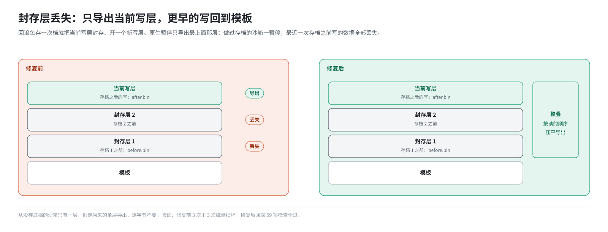
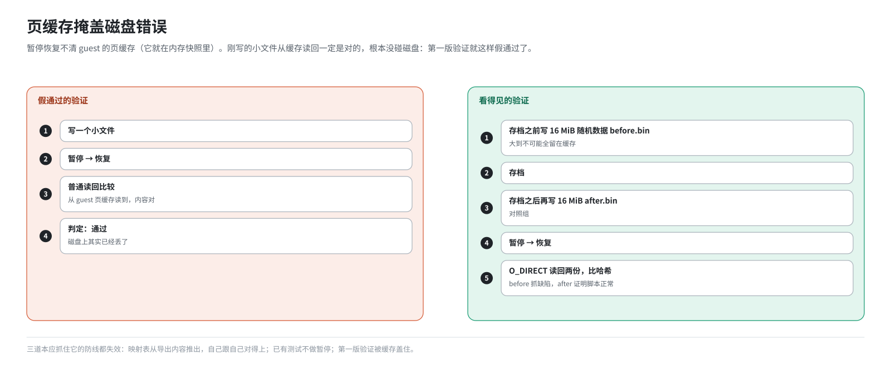
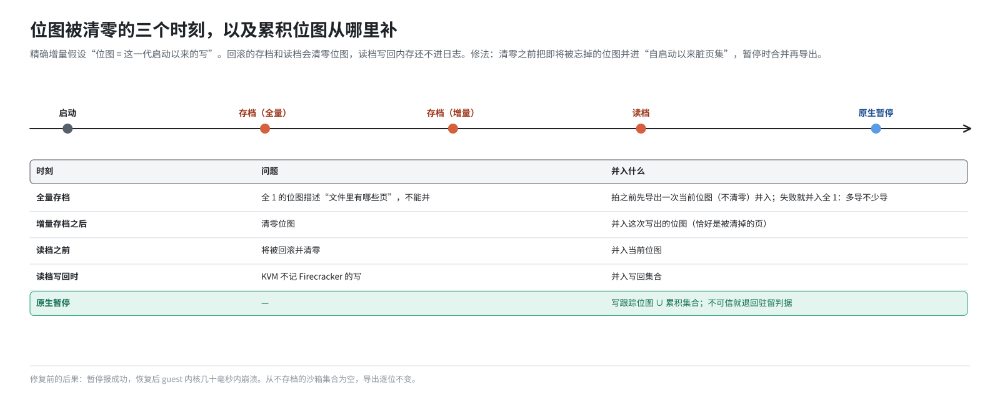
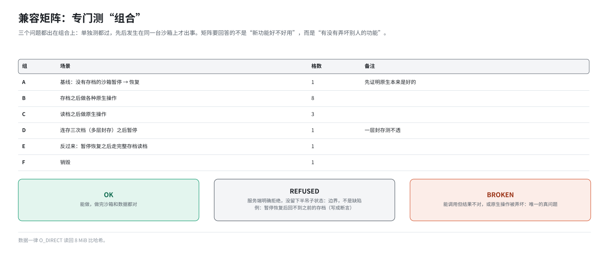

# 第 22 篇｜三处被撞坏的地方和修法

> **本篇目标**：快照回滚加进来以后，E2B 原有的暂停恢复被撞坏过三处：磁盘上，做过存档的沙箱一暂停，封存层里的数据就丢了；内存上，脏页位图被回滚清零，暂停少导了页；SDK 上，恢复出来的沙箱用不了回滚。本篇逐个讲：原因是什么，为什么没人发现，怎么修，怎么证明修好了。最后总结三条共同的教训，以及专门为“组合”设计的兼容矩阵测试。

---

## 一、磁盘：做过存档的沙箱一暂停，封存层就丢了

### 1. 原因

上一篇讲过，回滚每存一次档，就把当前写层封存成只读层、再开一个新写层。从第一次存档起，当前写层里只有**最近一次存档之后**的写，更早的写在下面那些封存层里。

E2B 原生暂停导出磁盘时，只导出**当前写层**（第 17 篇）。于是：

- 做过存档的沙箱一暂停，最近一次存档**之前**写的所有数据都没被导出，恢复后这些块回到了模板的内容；
- 做过读档的沙箱更严重：读档会换上一个新的空写层，暂停时几乎什么都导不出来。

这是三个问题里唯一一个**真的丢数据**的。

### 2. 为什么没人发现

本来有三道防线应该能抓住它，结果全部失效：

| 本应抓住它的 | 为什么没抓住 |
|---|---|
| 导出产物的自我校验 | 映射表是**从导出的内容推出来的**：导出了多少，映射表就描述多少。块数对得上，校验对得上，只是内容少了一截。没有独立的第二方来源可以对照 |
| 已有的回滚正确性测试 | 一个都不做原生暂停。它们测的是存档读档自己那条链；暂停是 E2B 原有的操作，两者的**组合**没人走过 |
| 修复后补写的第一版验证 | 写一个小文件 → 暂停恢复 → 读回比较，**假通过** |

第三行是真正的教训。暂停恢复不会清空 guest 里的文件缓存（它就在内存快照里），刚写过的小文件从缓存里读回来，内容一定是对的，根本没碰到磁盘。**guest 的页缓存能把磁盘层的错误完全盖住。**

### 3. 怎么才看得见

验证方法要同时绕开两个“好心的”缓存：

1. 在存档**之前**写一份足够大的随机数据（16 MiB），大到不可能全部留在缓存里；
2. 存档；
3. 在存档**之后**再写一份同样大小的随机数据；
4. 暂停、恢复；
5. 两份数据都用 `O_DIRECT`（绕开页缓存，直接读磁盘）读回，比对哈希。

抓缺陷的是第 1 步那一份：它落在被封存的层里，是唯一会丢的。第 3 步那一份是**对照**：它在当前写层里，修复前后都应该是对的，证明测试脚本本身在正常工作。没有对照组，“全部失败”可能只是脚本写错了。

### 4. 修法

暂停导出磁盘时，把**整叠层**交出来，按读的顺序压平（每一块取最上面那层里的版本）再导出。从没存过档的沙箱，写层只有一层，**仍走原来的单层导出路径，逐字节不变**。

用同一个构建在 920B 上验证：存档 → 暂停 → 恢复、读档 → 暂停 → 恢复，两种组合磁盘都完好，回滚自己的 59 项检查全过；同样的测试跑在修复前的版本上，恢复后的磁盘 3 次里 3 次都是坏的。

## 二、内存：脏页位图被清零，暂停少导了页

### 1. 原因

第 20 篇的精确增量用写跟踪位图判断“这一代 guest 写过哪些页”，它有一个前提：**位图 = 这一代启动以来写过的所有页**。对从不存档的沙箱，这成立。可 Firecracker 的位图在三个时刻会被清零或被绕过：

| 时刻 | 发生了什么 |
|---|---|
| 每次存档 | 写完差分之后清零位图，让下一次存档只相对于这一刻 |
| 每次读档 | 回滚完成后清零位图 |
| 读档写回内存时 | Firecracker 经它自己对 guest 内存的映射写回页，KVM **不记这种写** |

于是一台做过存档的沙箱暂停时，只看位图，就只会导出“上一次存档或读档以来”写过的页。更早写过的页没导出，恢复时从上一代读回旧内容，guest 内存由两个时刻拼成。读档写回的那批页更隐蔽：它们确实改变了内存，却不在任何一份日志里。

### 2. 后果

正是第 20 篇说的最坏情形：**暂停报成功，快照照常上传；恢复后 guest 内核在几十毫秒内崩溃**。实测的形态是内核先报内存计数异常，接着一连串链表损坏，最后内核恐慌。运气“更好”一点、内核没立刻崩的话，就是一台能跑、但数据已经错乱的沙箱。

这个缺陷由一个专门的测试用例发现，并一直守着。

### 3. 修法：把即将被忘掉的位图收起来

每次位图要被清零时，被清掉的恰好是“即将被忘掉的页”，而这些位图此刻都在 orchestrator 手里。所以做法很直接：每台虚拟机维护一个**“自启动以来脏页集”**，在每个清零时刻之前，把相应的位图并进去；原生暂停时，把这个集合和写跟踪位图合并，再导出。

| 时机 | 并入什么 |
|---|---|
| 增量存档之后 | 这次存档写出的脏页位图（恰好就是被清掉的那些页） |
| 全量存档**之前** | 先导出一次当前的位图（见下） |
| 存档超时 | 仍然尝试并入，超时的存档可能已经写完并清了位图 |
| 读档之前 | 当前的位图（上次存档以来写过、即将被回滚和清零的页） |
| 读档准备好写回集合之后 | 写回集合（这些写不进任何日志） |

**全量存档为什么是例外？** 全量存档写出的位图是“每一页都是 1”，它描述的是“文件里有哪些页”，不是“guest 写过哪些页”。如果把它并进集合，这台沙箱以后每一次暂停都会导出整份内存。而沙箱的第一次存档总是全量的，等于每个用过回滚的沙箱都会中招。所以全量存档改为在拍之前、虚拟机已暂停时，先导出一次当前位图（导出不会清零），对第一次存档来说，这张图正好就是“启动以来写过的页”。这一步万一失败，就退而求其次并入全 1 的位图：多导，但不会少导。

### 4. 合不上就标“不可信”

位图来源多样，有时几何形状对不上（页大小不同、页数不同）。合并规则只接受一种安全的情况：新位图的页更粗，就展开成细页再并（一个粗页置位，它覆盖的细页全部置位，只会多记）。其余任何对不上的情况（新位图更细、不是整数倍、页数不同、文件缺失或格式错误），位照样并进来，但**整个集合标记为“不可信”**。暂停时发现集合不可信，就退回旧的“在内存里就算脏”（第 20 篇的第 2 道门）。

合并失败从不让存档或读档本身失败，只打一条警告：这次存档功能不受影响，受影响的只是这台沙箱下一次原生暂停的导出量。

### 5. 从不存档的沙箱不受影响

集合的初始状态是“空的、可信的”。从不存档的沙箱什么都不并，暂停时不做合并、不多分配内存，导出的页集合和没有这个机制时逐位相同。

暂停日志里现在会写明：导出多少页、依据是哪种（写跟踪、写跟踪加累积、驻留）、集合里有多少页、并过几次。修复前那个缺陷在日志里**完全不可见**，没有任何一行说“这次暂停只导出了上次的百分之一”。

## 三、SDK：恢复出来的沙箱用不了回滚

第 18 篇讲过：SDK 的 `connect()` 漏了两个路由请求头。envd 的地址里带着沙箱 ID，所以从来没受影响；回滚的接口是按请求头路由的，于是所有通过 `connect()` 拿到的沙箱（包括所有暂停后恢复的）都调不了回滚，proxy 报“缺少请求头”。

修法是在 `connect()` 里补上这两个请求头。这个缺陷严格说不是回滚“撞坏”的，而是一直潜伏在恢复路径上，回滚是第一个走到那里的功能。

## 四、兼容矩阵：专门测“组合”

三个问题都出在**组合**上：单独测回滚没问题，单独测暂停恢复也没问题，两者先后发生在同一台沙箱上才出事。所以我们专门写了一个兼容矩阵测试，把“回滚的操作”和“原生的操作”按各种顺序组合起来过一遍：

| 组 | 场景 | 格数 |
|---|---|---|
| A | 基线：没有存档的沙箱上暂停 → 恢复 | 1 |
| B | 存档之后做各种原生操作 | 8 |
| C | 读档之后做原生操作 | 3 |
| D | 连存三次档（多层封存）之后暂停 | 1 |
| E | 反过来：暂停恢复之后走完整的存档读档 | 1 |
| F | 销毁 | 1 |

每一格的判定有三种：

| 判定 | 含义 |
|---|---|
| `OK` | 能做，做完沙箱和数据都对 |
| `REFUSED` | 服务端明确拒绝，并且没留下半吊子状态。**这是边界，不是缺陷** |
| `BROKEN` | 能调用但结果不对，或者本来能做的原生操作被弄坏了。**唯一的真问题** |

几个设计要点：

- **先测基线**。第一组在没有任何存档的沙箱上跑一遍暂停恢复，确认原生能力本来是好的，后面才有资格说“是我们弄坏的”。
- **D 组专门测多层**。磁盘问题的本质是“当前层之下还有 N 个封存层”，存一次档只有一层封存，测不透。
- **数据一律 `O_DIRECT` 读回比哈希**。
- **预期的拒绝写成断言**。比如“暂停恢复之后，回不到暂停之前的存档”：回滚的存档绑定在 Firecracker 进程上，暂停后进程换了，存档自然没了。这一格预期是 `REFUSED`，写成断言而不是注释：哪天行为变了（不管是变成支持，还是变成静默返回错误数据），测试会立刻报出来。

这个矩阵要回答的问题，不是“我们的新功能好不好用”，而是“**我们有没有弄坏别人的功能**”。

## 五、三条教训

| 教训 | 在哪个问题里 |
|---|---|
| **两个各自正确的机制叠加时，要重新检查每一个前提。** 精确增量假设“位图 = 这一代启动以来的写”，回滚假设“存档后可以清零位图”，各自都对，放在一起就错了 | 内存 |
| **验证要绕开缓存，要有对照组。** 页缓存会盖住磁盘错误；没有对照组的“失败”可能只是脚本错了 | 磁盘 |
| **专门走“组合”和“不常走的路”。** 单独的测试都过，组合才出事；长期潜伏的缺陷，等一个新功能走过那条路才浮出来 | 全部三个 |

还有一条贯穿全书的原则在这里再次出现：**宁可多导，不可少导。** 两个内存相关的修法里，所有“拿不准”的分支都退向多导的那一边：全量存档导出位图失败就并入全 1、合不上就标不可信退回驻留判据。多导只是浪费，少导会让沙箱崩溃。

---

## 本篇小结

| 问题 | 原因 | 为什么静默 | 修法 |
|---|---|---|---|
| 磁盘：封存层丢失 | 存档把写层变成一叠，暂停只导出最上面一层 | 映射表自洽；没人测组合；小文件被页缓存盖住 | 有封存层时整叠压平再导出；没有时走原路 |
| 内存：少导页 | 存档读档清零位图，读档写回不进日志 | 暂停报成功，日志里看不出导了多少 | 每台虚拟机维护“自启动以来脏页集”，清零前并入，暂停时合并；合不上就退回驻留判据 |
| SDK：调不了回滚 | `connect()` 漏了两个路由头 | envd 不靠请求头路由 | 补上两个请求头 |
| 兼容矩阵 | 问题都在组合里 | — | 6 组 15 格，`OK` / `REFUSED` / `BROKEN`，一律 `O_DIRECT` |

**下一篇预告**：[《全景与回顾：三个操作、一张图、一份修改清单》](23-big-picture.md)。最后一篇用一张图把三个操作串起来，把全书讲过的所有修改按四类整理成一份清单，再列出还没解决的问题。
