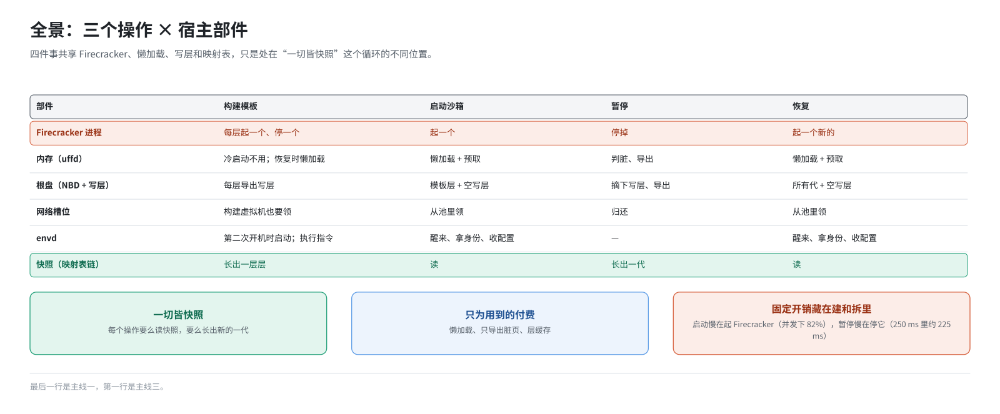
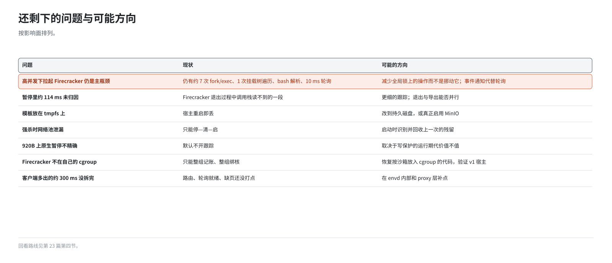

# 第 23 篇｜全景与回顾：三个操作、一张图、一份修改清单

> **本篇目标**：合上书之前，用一张图把构建、启动、暂停、恢复四件事放在宿主的部件上串起来；把全书讲过的所有修改按四类整理成一份清单，每一条指回讲它的那一篇；再列出还没解决的问题和可能的方向。最后给出不同读者的回看路线。

---

## 一、一张图

把四件事放在同一组部件上看：

| 部件 | 构建模板 | 启动沙箱 | 暂停 | 恢复 |
|---|---|---|---|---|
| Firecracker 进程 | 每层起一个、停一个 | 起一个 | 停掉 | 起一个新的 |
| 内存（uffd） | 冷启动不用；恢复时懒加载 | 懒加载 + 预取 | 判脏、导出 | 懒加载 + 预取 |
| 根盘（NBD + 写层） | 每层导出写层 | 建：模板层 + 空写层 | 摘下写层、导出 | 建：所有代 + 空写层 |
| 网络槽位 | 构建虚拟机也要领 | 从池里领 | 归还 | 从池里领 |
| envd | base 阶段第二次开机时启动；执行每条指令 | 醒来、拿身份、收配置 | — | 醒来、拿身份、收配置 |
| 快照（映射表链） | 长出一层层 | 读 | 长出一代 | 读 |

回到第 1 篇的那句话：**一切皆快照。** 构建是一连串“恢复—干活—暂停”，最后一次暂停拍在就绪那一刻；启动是从那一刻恢复；暂停又长出一代；恢复又从那一代恢复。所有操作共享同一套 Firecracker、懒加载、写层和映射表。

三条主线也在这张图上：

| 主线 | 在图上的体现 |
|---|---|
| **一切皆快照** | 最后一行：每个操作要么读快照，要么长出新的一代 |
| **只为用到的付费** | 内存懒加载、只导出脏页、层缓存，每一格都只处理“用到的”或“改过的” |
| **固定开销藏在建和拆里** | 第一行：启动慢在起 Firecracker（高并发下 82%），暂停慢在停 Firecracker（0 MiB 档 250 ms 里 225 ms） |

## 二、修改清单

全书讲过的修改，按目的分成四类：

### 1. 为 ARM

| 修改 | 原来 → 现在 | 篇 |
|---|---|---|
| 镜像平台 | amd64 → arm64 | 9 |
| busybox | 只有 x86 → 按架构选，用 glibc 版 | 9 |
| 发行版脚本 | 只认 apt / adduser / sudo → 探测后分支 dnf / useradd / wheel；configure.sh 改纯 sh | 9 |
| 装包列表 | 12 个 → 9 个必需的 | 9 |
| envd 的 systemd 单元 | 带 cgroup 指令 → 去掉 | 9 |
| 宿主 cgroup | 只认 v2 → v1 时跳过 | 9 |
| CPU 信息 | 读不到就报错 → 给兜底值 | 9 |
| 内核启动参数 | x86 专用参数无条件加 → 只在 x86 上加 | 11 |
| SMT | 开 → 关 | 11 |
| uffd 写保护 | 带 → 注释掉（内核不支持），导致“读即脏” | 19 |
| 存储后端 | 默认 Google 对象存储 → 新增 MinIO 并设为默认 | 4、9 |
| Firecracker | 上游二进制 → 自己编译，目录沿用 v1.13.1 | 9 |

### 2. 为性能

| 修改 | 原来 → 现在 | 篇 |
|---|---|---|
| 进入网络命名空间 | `ip netns exec` → `fc-netns-exec`（只 setns + execve） | 15 |
| 同时启动上限 | 3 → 可配置（30 / 500） | 10、15 |
| 拿不到启动名额 | 从模板创建时立即拒绝 → 一律排队 | 10、15 |
| 排队与请求超时 | 15 秒 / 60 秒 → 300 秒 / 300 秒 | 10、15 |
| 节点沙箱上限 | 200 → 10000 | 10 |
| 网络槽位池 | 32 / 100 → 300 / 1000 | 13 |
| 预取并发 | 16 / 8 → 32 / 16 | 12 |
| envd `/init` 超时 | 50 毫秒 → 120 秒 | 13 |
| uffd 等待超时 | 10 秒 → 120 秒 | 15 |
| MMDS 客户端 | 每次新建连接 → 复用连接 | 13 |
| NBD 模块 | 系统自带 → 自编译优化版，512 设备，固化 | 13 |
| 精确增量 | 判、存、填三层改造，零拷贝 + 缓冲池 | 20 |
| 启动埋点 | 无 → 十几个阶段计时 + 可视化 | 14 |

### 3. 为正确与稳定

| 修改 | 原来 → 现在 | 篇 |
|---|---|---|
| 等套接字 | 用无关的上下文，死了还等 300 秒 → 以调用方上下文为基础 | 15 |
| 构建内存上限 | 8 GiB 被撑爆 → 32 GiB，并写明太大会调度不上 | 9 |
| 网络池泄漏 | 强杀后整池泄漏 → 停—清—启，停服先优雅停止 | 13 |
| 大页池 | 停服后仍占着 → 单独的释放命令 | 15 |
| Nomad | 1.10 遇不连续 NUMA 编号崩溃 → 1.11.2 | 15 |
| 排队埋点 | 只覆盖一条路径 → 两条都覆盖 | 14 |
| 暂停日志 | 看不出导了多少 → 每次写明页数和依据 | 20、22 |

### 4. 为与快照回滚共存

| 修改 | 原来 → 现在 | 篇 |
|---|---|---|
| 脏页跟踪默认值 | 关 → 跟着硬件走，有 HDBSS 就开 | 21 |
| 加载快照 | 不开跟踪 → 按开关开跟踪 | 11、21 |
| 暂停导出磁盘 | 只导当前写层 → 有封存层时整叠压平 | 22 |
| 暂停导出内存 | 只看位图 → 合并“自启动以来脏页集”，合不上就退回驻留 | 22 |
| SDK `connect()` | 漏两个路由头 → 补上 | 18、22 |
| 兼容矩阵 | 无 → 6 组 15 格，专测组合 | 22 |
| 同机共存 | veth 名、地址池、80 端口规则冲突 → 改名、错开、收窄 | 21 |

## 三、还没解决的问题

| 问题 | 现状 | 可能的方向 |
|---|---|---|
| **高并发下拉起 Firecracker 仍是主瓶颈** | 换掉 `ip netns exec` 之后，脚本里仍有约 7 次 fork/exec、1 次挂载树遍历、bash 解析、10 ms 轮询 | 重写整条管线的尝试倒赔了时间（第 15 篇）；方向是减少全局锁上的操作而不是挪动它，比如预先准备好挂载命名空间、用事件通知代替轮询 |
| **暂停里约 114 ms 未归因** | Firecracker 退出过程中最长的一段，调用栈读不到 | 更细的跟踪；看能不能让进程退出和导出并行 |
| **模板放在 tmpfs 上** | 部署实际用 `/tmp/templates`，宿主重启即丢 | 改到持久磁盘，或真正启用 MinIO |
| **orchestrator 被强杀时网络池泄漏** | 只能停—清—启 | 启动时识别并回收上一次的残留 |
| **920B 上原生暂停仍不精确** | 默认不开跟踪，按驻留判据导出 | 取决于“所有沙箱付写保护代价”值不值；有 HDBSS 的机器不存在这个问题 |
| **Firecracker 不在自己的 cgroup 里** | ARM 移植时注释掉了，内存和 CPU 只能整组记账、整组绑核 | 恢复按沙箱放进各自 cgroup 的那段代码，并验证在 cgroup v1 宿主上的行为 |
| **客户端多出的约 300 ms 没完全拆开** | 排队已打点，路由、轮询就绪、恢复后缺页还没有 | 在 envd 内部和 proxy 层补点 |

## 四、怎么回看

| 你关心的 | 回看哪几篇 |
|---|---|
| 三个操作从头到尾怎么回事 | 1、4、5、10、16、18 |
| 为什么 E2B 能一百多毫秒给出一台沙箱 | 8、10、12 |
| 启动时间花在哪、怎么优化 | 14、15 |
| 暂停为什么慢、增量怎么算 | 17、19、20 |
| 搬到 ARM 改了什么 | 9、11、19 |
| 回滚和暂停恢复怎么互相影响 | 21、22 |
| 我们一共改了什么 | 本篇第二节 |

延伸阅读：

- 快照回滚本身：《E2B 沙箱快照回滚从零讲透》；
- 部署：《E2B 部署从零讲透》；
- 网络、存储的更多细节：《E2B 沙箱网络从零讲透》《E2B 沙箱存储从零讲透》；
- 逐包读上游源码：《E2B Infra 源码导读》。

---

## 本篇小结

| 概念 | 一句话解释 |
|---|---|
| 一张图 | 四个操作共享 Firecracker、懒加载、写层、映射表，只是在循环里的位置不同 |
| 三条主线 | 一切皆快照；只为用到的付费；固定开销藏在建和拆里 |
| 四类修改 | 为 ARM、为性能、为正确与稳定、为与回滚共存 |
| 还没解决的 | 拉起 Firecracker 的争用、暂停里未归因的退出时间、模板在 tmpfs 上、网络池泄漏、920B 不精确、cgroup、端到端拆分 |
