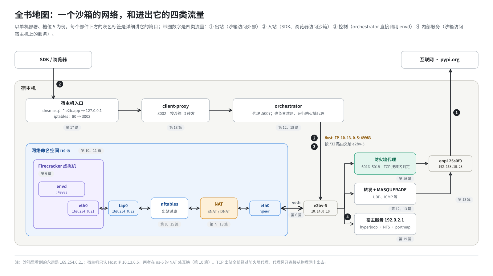

# 第 1 篇｜从一行 `curl` 说起：E2B 沙箱网络要解决什么问题

> **本篇目标**：先不碰任何技术细节，搞清楚 **E2B 的沙箱网络到底要解决什么问题**。读完本篇，你会知道：这套环境由哪些组件构成；沙箱网络要处理哪四类流量；设计时必须满足哪些目标。你还会拿到一张贯穿全书的“全景图”，后面每一篇都在把这张图的某一段放大来看。

---

## 一、两个再普通不过的场景

### 1.1 场景一：沙箱里的程序要上网

假设你让 AI 写一段数据分析代码，代码的第一行是：

```bash
pip install pandas
```

这行命令会去 `pypi.org` 下载安装包。它跑在 E2B 的**沙箱**里：一台只为这一次任务临时拉起来的小虚拟机。

问题来了：这台虚拟机连到了哪里？它发出去的数据包，经过了哪些“关卡”，最后怎么到达互联网上的 `pypi.org`？`pypi.org` 回过来的数据，又是怎么准确地找回这台虚拟机，而不是送进隔壁另一个沙箱的？

### 1.2 场景二：宿主机上的程序要“伸手”进沙箱

再看另一个方向。你在服务器上用 Python SDK 写了这样几行：

```python
from e2b import Sandbox

sbx = Sandbox.create("base")
print(sbx.commands.run("whoami"))
```

`commands.run("whoami")` 的意思是：在沙箱里执行 `whoami`，把结果拿回来。SDK 跑在宿主机上，沙箱是一台独立的虚拟机，这条命令是怎么“送进去”的？

答案是：SDK 发出一个 HTTP 请求，请求一路转交，最后到达沙箱里一个叫 **envd** 的小程序，envd 执行命令，再把结果原路送回来。这一路要经过 DNS、iptables、两层代理、一次地址转换，本书第 17、18 篇会一跳一跳地走一遍。

这两个场景看起来平平无奇，但它们背后是一整套精心设计的网络栈。本书要做的，就是把这套网络栈从头到尾拆开讲清楚。

---

## 二、E2B 是什么，这套环境长什么样

### 2.1 一句话介绍 E2B

**E2B** 是一套开源的“AI 代码执行沙箱”基础设施。AI 生成的代码不可信：可能有 bug，可能被诱导去做坏事。所以不能直接在服务器上跑，要放进一个**隔离的环境**里跑。E2B 选择的隔离手段是 **Firecracker microVM**：一种极其轻量的虚拟机，启动快、占内存少，但隔离强度和真正的虚拟机一样。

E2B 有一个和网络设计密切相关的特点：**沙箱从不“冷启动”**。

- 每种沙箱都有一个**模板**：一台事先装好系统、启动好、然后“拍了快照”的虚拟机。
- 创建沙箱时，不是从头开机，而是把快照**恢复**出来，几十到几百毫秒就能用。

记住这一点，第 10 篇会讲到：正是“从快照恢复”这件事，决定了整个网络设计的基本形状。

### 2.2 本书讲的是哪一套环境

本书不讲抽象的“E2B 官方架构”，而是讲一套**实际在用的部署**：

- **源码**：上游 [e2b-dev/infra](https://github.com/e2b-dev/infra) 的 `2026.09` 版本，加上一个 ARM 适配补丁。补丁里有几处网络相关的改动，书里会逐一指出。
- **机器**：一台鲲鹏 ARM 服务器，操作系统是 openEuler。
- **部署方式**：所有组件装在**同一台机器**上（单机部署）。
  1. 把代码打成 RPM 包，安装到 `/opt/e2b-infra`。
  2. 执行 `build.sh -d`：停止旧服务、清理残留。
  3. 执行 `build.sh -i`：安装依赖组件。
  4. 执行 `build.sh -s`：启动并部署全部服务。

单机部署意味着：控制面、沙箱、DNS、代理全部挤在一台机器上，它们之间的网络关系比多机部署更紧凑，也更容易看清全貌。

### 2.3 这套环境里有哪些组件

和网络有关的组件不多，先混个脸熟：

| 组件 | 做什么 | 和网络的关系 |
|---|---|---|
| **api** | 控制面：创建、暂停、销毁沙箱，校验密钥 | 监听 3000 端口，SDK 的控制请求打到这里 |
| **client-proxy** | 沙箱流量的入口代理 | 监听 3002 端口，按沙箱 ID 把请求转给 orchestrator |
| **orchestrator** | 真正管理沙箱的进程：建网络、拉起 Firecracker | 负责本书第二、三部分讲的几乎所有网络配置；自带一个代理（5007 端口）和一个出站防火墙代理 |
| **Firecracker** | 虚拟机监控器，每个沙箱一个进程 | 把虚拟机的网卡接到宿主机的 tap 设备上 |
| **envd** | 跑在沙箱里面的小服务 | 监听沙箱内 49983 端口，执行命令、读写文件 |
| **dnsmasq** | 宿主机上的 DNS 转发器 | 把 `*.e2b.app` 解析到本机，把 `*.consul` 转给 Consul |
| **Consul / Nomad** | 服务发现 / 任务调度 | 组件之间互相寻址靠 Consul 的 DNS |

在这套单机环境里，orchestrator 和负责构建模板的 template-manager 是**同一个进程**（Nomad 任务名叫 template-manager）。后面说“orchestrator”时，指的就是这个进程。

---

## 三、沙箱网络要处理的四类流量

把场景一、场景二推广开，沙箱网络要处理的流量可以分成四类：

### 3.1 出站：沙箱访问外部

沙箱里的程序主动向外发起连接：`pip install`、`curl`、`git clone`、调用某个 HTTP API。这是**最常见、也最危险**的一类：沙箱里的代码是不可信的，它想连哪里，必须由我们说了算。

### 3.2 入站：外部访问沙箱

SDK、浏览器从外部访问沙箱里的服务。比如：

- SDK 调用 envd 执行命令、上传文件。
- 用户在沙箱里用 `python -m http.server 8000` 起了一个网页，想在浏览器里打开它。

### 3.3 控制：宿主机直接调用沙箱

orchestrator 自己也要和沙箱里的 envd 说话。比如沙箱刚恢复时，orchestrator 要调用 envd 的 `/init` 接口，把环境变量、访问令牌等信息告诉它；平时还要做健康检查。这类流量不经过对外入口，是宿主机内部直接发起的。

### 3.4 内部服务：沙箱访问宿主机上的服务

有时候沙箱需要访问宿主机上的几个特定服务：

- 查询自己的身份信息。
- 上报日志。
- 挂载持久化存储卷（NFS）。

但宿主机的地址对沙箱是“禁区”。怎么在“禁止访问宿主”的前提下开出这几个小口子？第 19 篇会讲 E2B 的巧妙做法：约定一个假地址 `192.0.2.1`。

---

## 四、设计目标：这套网络必须做到什么

在动手设计之前，先把要求列清楚。这些要求互相拉扯，整套设计就是在它们之间找平衡。

### 4.1 隔离：沙箱之间互相看不见

一台服务器上同时跑着成百上千个沙箱，分属不同的用户。A 用户的沙箱绝不能访问 B 用户的沙箱，哪怕只是 `ping` 一下都不行。

### 4.2 保护宿主机和内网

沙箱和宿主机挤在同一台物理机器上，宿主机上跑着数据库、Consul、Nomad 这些关键服务。沙箱绝不能访问它们，也不能访问机房内网里的其他机器。

在云上部署时还有一个经典风险：**云元数据服务**，通常在 `169.254.169.254`。从那里能拿到云主机的临时凭证，泄露了就等于把整台机器的权限交出去。

### 4.3 出站可控

默认情况下沙箱可以访问互联网，否则 `pip install` 都跑不了。但用户应该能收紧规则，比如：

- 完全断网。
- 只允许访问 PyPI 和某一个 API。
- 禁止访问某几个网段。

而且最好能**按域名**来配置，因为没人记得住 PyPI 背后的 IP 地址。

### 4.4 快

沙箱的恢复只要几百毫秒，网络准备不能成为瓶颈。如果每次创建沙箱都要现场建网卡、配地址、写防火墙规则，几十毫秒就没了。所以 E2B 会**提前建好一批网络**放在池子里，用的时候直接拿（第 20 篇）。

### 4.5 简单可靠

规则要少、要能清理干净。出了问题要能查。一台机器上跑上万次沙箱后，不能留下一堆垃圾把系统拖慢。第 21 篇会看到，这一条在实际运维中有多重要。

---

## 五、全景图

下面这张图会贯穿全书。现在看不懂没关系，读完全书再回来看，每一个框你都会认识。



图上有两条主线：

- **沙箱一侧**（下半部分，从左往右）：客户机里的 `eth0`，经 Firecracker 接到 `tap0`；`tap0` 在一个**网络命名空间**里，命名空间通过一对 **veth** 网卡连到宿主机；宿主机再经过 **NAT**、**防火墙**，从物理网卡出去。
- **入口一侧**（上面一行，从左往右，再沿竖线往下）：请求先经 **DNS** 解析到本机，被 **iptables** 改到 3002 端口，经过两层代理，最后访问沙箱的 **Host IP**，再被翻译成客户机地址。

---

## 六、本书路线图

为了看懂这张图，我们分五部分来走：

1. **第一部分（第 2～8 篇）：网络基础。** IP 地址、子网、路由、TCP、DNS，然后是 Linux 上的“虚拟网络积木”：网络命名空间、veth、tap，以及内核防火墙 Netfilter（iptables、nftables、NAT、连接跟踪）。这部分不讲 E2B，只讲后面要用到的通用知识。篇幅给得足，有基础的读者可以跳读。
2. **第二部分（第 9～14 篇）：一个沙箱的网络栈。** 虚拟机的网卡、为什么每个沙箱的 IP 都一样、一个“槽位”里有哪些网卡和地址、网络是怎么一步步建起来的、一个包的完整旅程、沙箱里的 DNS。
3. **第三部分（第 15～16 篇）：管住出站流量。** 命名空间里的 nftables 防火墙，以及专门按域名过滤 TCP 的防火墙代理。
4. **第四部分（第 17～19 篇）：入站与内部通道。** 宿主机上的 DNS 与入口规则，从 SDK 到 envd 的完整路径，沙箱访问宿主服务的特殊通道。
5. **第五部分（第 20～22 篇）：规模、运维与这套环境的改动。** 网络槽位池、快照回滚时的连接跟踪清理、部署脚本里的每一项网络配置，最后是全景复盘、排障与安全回顾。

每篇末尾都有一张“本篇小结”表，复习时只看小结也能把主线串起来。

---

## 本篇小结

| 概念 | 一句话解释 |
|---|---|
| E2B | 用 Firecracker 虚拟机隔离运行 AI 代码的开源基础设施 |
| 本书的环境 | 上游 2026.09 + ARM 补丁，单机鲲鹏服务器，RPM 安装后用 `build.sh -d/-i/-s` 部署 |
| 从快照恢复 | 沙箱不开机，而是从模板快照恢复；这一点决定了网络设计的基本形状 |
| 出站流量 | 沙箱主动访问外部，最危险，必须可控 |
| 入站流量 | SDK、浏览器访问沙箱里的 envd 或用户服务 |
| 控制流量 | orchestrator 直接调用沙箱里的 envd |
| 内部服务流量 | 沙箱访问宿主机上的少数几个特定服务 |
| 设计目标 | 隔离、保护宿主与内网、出站可控、快、简单可靠 |

**下一篇预告**：[《网络基础（一）：IP 地址、子网与几类特殊地址》](02-ip-addresses-and-subnets.md)。全景图上出现了一堆地址：`169.254.0.21`、`10.13.0.5`、`192.0.2.1`、`127.0.0.1`，还有 `/30`、`/31` 这样的后缀。下一篇从最基础的 IP 地址讲起，把这些数字背后的含义一次讲清楚。
