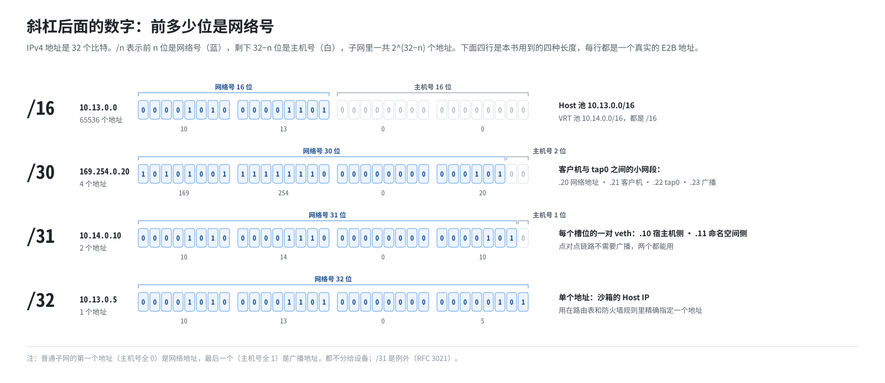
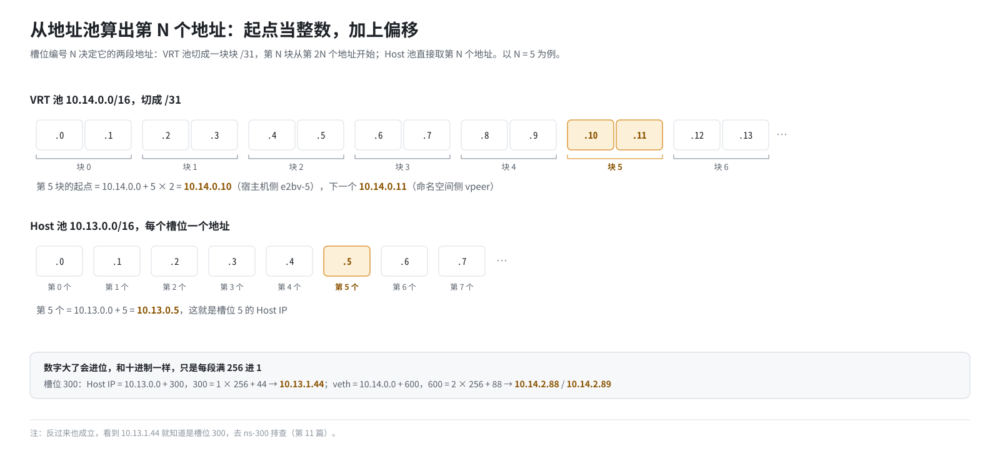

# 第 2 篇｜网络基础（一）：IP 地址、子网与几类特殊地址

> **本篇目标**：把 IP 地址这件事从头讲清楚：一个 IP 地址由什么组成；`/16`、`/30`、`/31`、`/32` 这些后缀是什么意思；怎么从一个地址段算出第 N 个地址；以及 `10.x`、`127.x`、`169.254.x`、`192.0.2.x` 这几类特殊地址各有什么含义。这些知识在后面讲槽位地址、防火墙规则时会反复用到。

---

## 一、IP 地址是“门牌号”

### 1.1 32 个比特

网络上的每台设备要通信，得先有个地址，好比寄信要写门牌号。IPv4 地址就是一个 **32 位的二进制数**。为了好读，人们把它切成 4 段、每段 8 位，再写成十进制，用点隔开：

```
二进制：00001010 00001101 00000000 00000101
十进制：   10   .   13   .    0   .    5      →  10.13.0.5
```

每一段 8 位，取值 0～255。所以 IPv4 地址一共有 2³² 个，约 43 亿个。

把 IP 地址看成一个 32 位整数，有助于理解后面的很多计算。比如 `10.13.0.5` 就是整数：

```
10×2²⁴ + 13×2¹⁶ + 0×2⁸ + 5 = 168,624,133
```

“地址加 1”就是这个整数加 1：`10.13.0.5` 的下一个是 `10.13.0.6`，`10.13.0.255` 的下一个是 `10.13.1.0`，和数字进位一模一样。

### 1.2 一台机器可以有多个地址

一个 IP 地址不是属于“一台机器”，而是属于机器上的**一个网络接口**（网卡）。一台服务器有好几块网卡，每块网卡可以配一个甚至多个地址。

E2B 的宿主机就是这样：物理网卡上有一个对外的地址；每建一个沙箱网络，宿主机上就多出一块虚拟网卡，带着它自己的地址。跑着几百个沙箱的宿主机上，有几百块网卡、几百个地址，这很正常。

---

## 二、子网：一条街上的门牌

### 2.1 网络号和主机号

如果每个地址都要单独记住它在哪，路由器就累死了。所以地址是**按段分配**的：一段连续的地址属于同一个“子网”，好比一条街上的门牌号都以同样的街道名开头。

一个 IP 地址因此被拆成两部分：

- **网络号**（前面若干位）：这是哪条街。
- **主机号**（剩下的位）：这条街上的几号。

拆分的位置用**子网掩码**表示。掩码也是 32 位，前面连续的 1 表示网络号，后面的 0 表示主机号：

```
地址：  10.13.0.5        00001010.00001101.00000000.00000101
掩码：  255.255.0.0      11111111.11111111.00000000.00000000
                         └────── 网络号 ──────┘└── 主机号 ──┘
网络：  10.13.0.0
```

### 2.2 CIDR 写法：斜杠后面那个数字

写掩码太长，于是有了更简洁的 **CIDR 写法**：在地址后面加一个斜杠和一个数字，表示“前多少位是网络号”。

```
10.13.0.0/16   ⇔   网络 10.13.0.0，掩码 255.255.0.0
```

斜杠后的数字越大，网络号越长，主机号越短，这个子网里的地址就越少：

| 写法 | 掩码 | 地址数量 | 本书里谁在用 |
|---|---|---|---|
| `/16` | 255.255.0.0 | 65536 | 沙箱的两个地址池：`10.13.0.0/16`、`10.14.0.0/16` |
| `/24` | 255.255.255.0 | 256 | 文档保留段 `192.0.2.0/24` |
| `/30` | 255.255.255.252 | 4 | 沙箱里客户机与 tap 之间的小网段 |
| `/31` | 255.255.255.254 | 2 | 每个沙箱的一对 veth 网卡 |
| `/32` | 255.255.255.255 | 1 | 单个地址，每个沙箱的 Host IP |

公式很简单：`/n` 的子网有 2^(32−n) 个地址。



### 2.3 普通子网里有两个地址不能用

在一个普通子网里，**第一个地址**和**最后一个地址**有特殊用途：

- 第一个（主机号全 0）是**网络地址**，代表“这个子网本身”。
- 最后一个（主机号全 1）是**广播地址**，发给它就等于发给子网里所有人。

所以一个 `/24` 有 256 个地址，但能分给设备的只有 254 个。

来看 E2B 里那个 `/30`。它在 `169.254.0.20` 到 `169.254.0.23` 这 4 个地址上：

```
169.254.0.20   网络地址（不能用）
169.254.0.21   客户机（沙箱虚拟机）的地址
169.254.0.22   tap0 的地址，也就是客户机的网关
169.254.0.23   广播地址（不能用）
```

4 个地址刚好够两台设备用：`/30` 是传统上“点对点连接”的标准大小，一根网线两头各一个地址。

### 2.4 `/31`：只有两个地址的特殊子网

按上面的规则，`/31` 只有 2 个地址，去掉网络地址和广播地址就什么都不剩了。但点对点链路（一根线两头，只有两个人）根本不需要广播。所以后来有了一个专门的约定（RFC 3021）：**`/31` 的两个地址都可以用**，一头一个。

E2B 给每个沙箱的那对 veth 网卡用的就是 `/31`。这样每个沙箱只占 2 个地址，一个 `/16` 能容纳三万多个沙箱。如果用 `/30`，每个沙箱要占 4 个地址，容量就减半了。

### 2.5 `/32`：单个地址

`/32` 表示网络号占满 32 位，这个“子网”里只有它自己一个地址。它通常不用来描述一条“街”，而是用来在路由表或防火墙规则里**精确指定一个地址**。

E2B 给每个沙箱分配一个宿主机可见的 **Host IP**，比如 `10.13.0.5/32`。宿主机路由表里有一条“去往 `10.13.0.5/32` 的包交给某块网卡”的路由，防火墙规则里有“源地址是 `10.13.0.5/32` 的包做某种处理”。

---

## 三、从地址段里算出第 N 个地址

后面第 11 篇会讲 E2B 怎么从“槽位编号”算出一个沙箱的所有地址。这里先练一下手。

**问题一**：`10.13.0.0/16` 里的第 5 个地址是什么？

把起始地址当成整数，加 5 就行：`10.13.0.0 + 5 = 10.13.0.5`。

**问题二**：`10.13.0.0/16` 里的第 300 个地址是什么？

300 = 1×256 + 44，所以第三段进 1、第四段是 44：`10.13.1.44`。

**问题三**：把 `10.14.0.0/16` 切成一个个 `/31`，第 5 块的两个地址是什么？

每块 2 个地址，第 5 块从第 5×2 = 10 个地址开始：`10.14.0.10` 和 `10.14.0.11`。



这三个计算，就是 E2B 分配沙箱地址的全部数学。

---

## 四、几类特殊地址

IP 地址并不都是“普通门牌号”。有几段地址被预留下来，有特殊含义。下面这几类在本书里都会出现。

### 4.1 私有地址：只在内部用

以下三段叫**私有地址**（RFC 1918）。它们可以在任何机构内部随便用，但不会出现在公网上，公网路由器见了它们直接丢弃：

| 地址段 | 范围 |
|---|---|
| `10.0.0.0/8` | 10.0.0.0 ～ 10.255.255.255 |
| `172.16.0.0/12` | 172.16.0.0 ～ 172.31.255.255 |
| `192.168.0.0/16` | 192.168.0.0 ～ 192.168.255.255 |

家里的路由器给手机分配的 `192.168.1.x`、公司内网的 `10.x.x.x`，都是私有地址。

在 E2B 里：

- 沙箱的两个地址池 `10.13.0.0/16`、`10.14.0.0/16` 都在 `10.0.0.0/8` 里。这些地址只在宿主机内部用，从来不会出现在公网上。
- 机房内网通常也用私有地址，比如数据库在 `10.x` 或 `192.168.x`。所以 E2B 的出站防火墙**默认禁止沙箱访问这三段**，这样沙箱就碰不到内网（第 15 篇）。

私有地址的包要上公网，必须先经过**地址转换（NAT）**，把私有地址换成一个公网能认的地址。这正是第 7 篇和第 13 篇的主题。

### 4.2 环回地址：127.0.0.0/8

`127.0.0.1` 大家都熟悉，它代表“**我自己**”。发往 `127.x.x.x` 的包根本不会离开这台机器，内核直接把它转回给本机的程序。

一个容易忽略的要点：**“自己”是相对的**。

- 在宿主机上访问 `127.0.0.1`，访问的是宿主机。
- 在沙箱里访问 `127.0.0.1`，访问的是沙箱自己。

所以宿主机上跑在 `127.0.0.1:53` 的 DNS 服务，沙箱是用不了的。第 14 篇会讲到这一点。

### 4.3 链路本地地址：169.254.0.0/16

`169.254.0.0/16` 叫**链路本地地址**（RFC 3927）。它原本的用途是：一台电脑插上网线却拿不到地址时，自己随便挑一个 `169.254.x.x` 用，只能和同一根线上的设备说话，路由器不会转发它。

后来它多了两个出名的用途：

1. **云元数据服务**：各大云厂商都把元数据服务放在 `169.254.169.254`，虚拟机访问它就能拿到自己的配置，甚至临时访问凭证。Firecracker 也有一个类似的内置服务（MMDS），地址同样是 `169.254.169.254`（第 9 篇）。
2. **E2B 的客户机地址**：每个沙箱虚拟机的地址都是 `169.254.0.21`，网关是 `169.254.0.22`。为什么选这一段？因为这一段本来就不该被路由出去，拿来当“只在一根虚拟网线上有效”的地址正合适。

E2B 的出站防火墙默认禁止沙箱访问 `169.254.0.0/16`，主要是为了挡住云元数据服务。那沙箱自己的地址也在这一段里，会不会把自己挡住？不会，原因第 15 篇再讲。

### 4.4 文档保留地址：192.0.2.0/24

`192.0.2.0/24`（还有另外两段）叫 **TEST-NET**（RFC 5737），专门留给“写文档、举例子”用，保证不会和任何真实设备冲突。

E2B 在这里用了一个小技巧：它让沙箱把 `192.0.2.1` 当作“orchestrator 的地址”。沙箱访问这个地址的特定端口时，宿主机会把包拦下来，转给本机上对应的服务（第 19 篇）。

为什么用一个“文档专用”的地址？正因为它**保证不对应任何真实设备**，拿它当一个纯粹的“暗号”，就不会和真实网络撞车。

### 4.5 `0.0.0.0/0`：所有地址

`0.0.0.0/0` 的网络号是 0 位，也就是说**任何地址都匹配它**。它常出现在两个地方：

- 路由表里：`0.0.0.0/0` 就是“默认路由”，其他路由都不匹配时走它（第 3 篇）。
- 防火墙规则里：“拒绝 `0.0.0.0/0`”就是“拒绝一切”。E2B 的“禁止沙箱上网”就是这么实现的（第 15 篇）。

---

## 五、IPv6 一句话

IPv4 只有 43 亿个地址，早就不够用了，于是有了 128 位的 **IPv6**，地址写成 `fe80::1` 这样的十六进制形式。

本书只讲 IPv4。在这套环境里，沙箱的网络规则全部围绕 IPv4 设计；IPv6 只在出站防火墙的拦截列表里出现，用来挡住几类 IPv6 的本地地址：

- `::1`：IPv6 的环回地址。
- `fc00::/7`：IPv6 的“私有地址”。
- `fe80::/10`：IPv6 的链路本地地址。

知道它们和 IPv4 的哪几类地址一一对应就够了。

---

## 本篇小结

| 概念 | 一句话解释 |
|---|---|
| IPv4 地址 | 32 位整数，写成四段十进制；属于某块网卡，而不是某台机器 |
| 网络号 / 主机号 | 前一部分表示“哪条街”，后一部分表示“几号” |
| CIDR `/n` | 前 n 位是网络号，子网里有 2^(32−n) 个地址 |
| `/30` | 4 个地址，两个可用；E2B 用于客户机与 tap0 之间 |
| `/31` | 2 个地址，点对点链路上两个都能用；E2B 用于 veth 对 |
| `/32` | 单个地址；E2B 的 Host IP |
| 第 N 个地址 | 起始地址当整数，加 N |
| 私有地址 | 10/8、172.16/12、192.168/16，只在内部用，出公网要 NAT |
| 环回 127/8 | “我自己”，沙箱里的 127.0.0.1 是沙箱自己 |
| 链路本地 169.254/16 | 不被路由；元数据服务和 E2B 客户机地址都在这里 |
| TEST-NET 192.0.2.0/24 | 文档专用，E2B 用 `192.0.2.1` 作“orchestrator 地址”暗号 |
| `0.0.0.0/0` | 匹配一切：默认路由、“拒绝一切” |

**下一篇预告**：[《网络基础（二）：以太网、ARP、路由表与转发》](03-ethernet-arp-routing.md)。知道了地址，下一个问题是：一个包怎么从一块网卡走到下一块网卡？我们会讲 MAC 地址、ARP 和路由表，并解释为什么两台机器用同一个 IP 会出大乱子。这正是第 10 篇要解决的核心难题。
