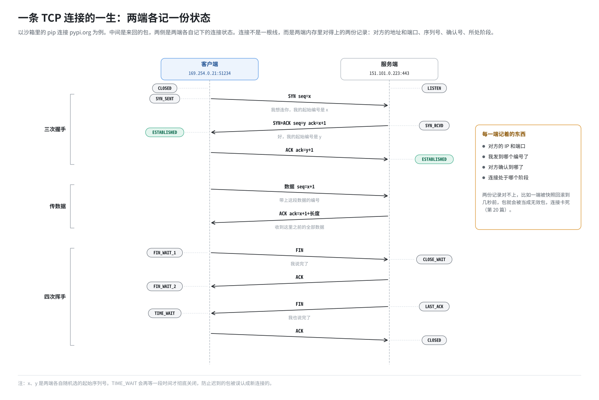
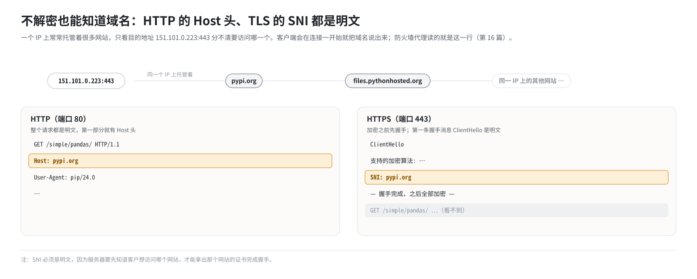

# 第 4 篇｜网络基础（三）：TCP、UDP、端口与连接

> **本篇目标**：IP 地址把包送到一台机器，但机器上跑着很多程序，包该交给谁？本篇讲端口、UDP 与 TCP 的区别、一条 TCP 连接从建立到关闭的全过程，以及“五元组”和“监听地址”这两个后面要反复用到的概念。最后介绍 HTTP 的 `Host` 头和 TLS 的 SNI：一个连接刚开始时，不用解密就能看到它想访问哪个网站。

---

## 一、端口：机器上的“房间号”

### 1.1 为什么需要端口

一台机器只有一个（或几个）IP 地址，上面却同时跑着很多网络程序：Web 服务、数据库、SSH……包到了机器上，内核怎么知道该交给谁？

答案是**端口号**：一个 0～65535 之间的数字。如果 IP 地址是门牌号，端口就是房间号。每个网络程序在启动时向内核“占”一个端口，叫作**监听**这个端口；发往这个端口的数据就交给它。

一些约定俗成的端口：

| 端口 | 服务 |
|---|---|
| 22 | SSH |
| 53 | DNS |
| 80 | HTTP |
| 443 | HTTPS（TLS） |

E2B 里自己用到的端口更多，比如：

- 49983：沙箱里的 envd。
- 3002：client-proxy。
- 5007：orchestrator 的代理。
- 5016～5018：出站防火墙代理。

第 21 篇有一张总表。

### 1.2 两个方向的端口

一次通信有两端，每端都有端口：

- **服务端**用一个固定的、众所周知的端口，比如 80，等别人来连。
- **客户端**发起连接时，内核随机给它分配一个临时端口，比如 51234。

所以一个从沙箱访问 `pypi.org` 的请求，看起来是：

```
169.254.0.21:51234   ───►   151.101.0.223:443
（沙箱，临时端口）            （pypi.org，HTTPS 端口）
```

---

## 二、UDP 和 TCP：寄明信片与打电话

端口号写在 IP 包里面的一层，这一层主要有两种协议。

### 2.1 UDP：寄明信片

UDP 非常简单：把数据装进一个包，写上源端口、目的端口，发出去就完事了。

- 不保证送到：丢了就丢了。
- 不保证顺序：后发的可能先到。
- 没有“连接”的概念：每个包都是独立的。

好处是快、开销小。**DNS 查询**默认就用 UDP：问一句、答一句，丢了重问就是。

### 2.2 TCP：打电话

TCP 复杂得多，它在不可靠的网络上提供一条**可靠的、有顺序的字节流**：

- 先“拨号”建立连接，双方确认后才开始传数据。
- 每个字节都有编号（**序列号**）。对方收到后要回“确认”，没回就重发。
- 接收方按编号重新排序，保证顺序正确。
- 用完了要“挂电话”，正式关闭连接。

HTTP、HTTPS、SSH、数据库连接，几乎所有“正经”的应用都跑在 TCP 上。

### 2.3 E2B 对两者区别对待

这个区别在 E2B 里很重要：

- **TCP** 出站流量会被统一交给一个专门的**防火墙代理**，由它判断放行与否（第 16 篇）。
- **TCP 以外**的流量（UDP、ICMP 等）由命名空间里的 **nftables** 按 IP 地址判断（第 15 篇）。

为什么要分开？因为只有 TCP 能被代理“接住”再“转出去”；而且 HTTP、HTTPS 都跑在 TCP 上，代理能从中读出域名。

---

## 三、一条 TCP 连接的一生

### 3.1 三次握手

TCP 建立连接要来回三次，叫**三次握手**：



- **SYN**：“同步”，请求建立连接，并告知自己的**起始序列号**。
- **ACK**：“确认”，表示收到了对方的某个编号。

起始序列号是随机选的，而且双方各有一个。

### 3.2 传数据：序列号与确认号

连接建立后，每发一段数据，发送方都会在包里写上这段数据的**序列号**，即“这是第几个字节开始的”。接收方回复**确认号**，即“我已经收到第几个字节之前的所有数据了，请从这里接着发”。

序列号是 TCP 可靠性的核心。双方都在心里记着“我发到哪了、对方收到哪了”。

### 3.3 四次挥手

关闭连接时，双方各自说一声“我说完了”（FIN），并确认对方的 FIN，一共四个包：

```
客户端 ── FIN ──►  服务端
客户端 ◄── ACK ──  服务端
客户端 ◄── FIN ──  服务端
客户端 ── ACK ──►  服务端
```

### 3.4 连接是“两端各记一份”的状态

请特别注意这一点：**TCP 连接不是一根真的线，而是两端各自在内存里记着的一份状态**：

- 对方的地址和端口。
- 当前序列号到哪了，确认到哪了。
- 连接处于哪个阶段：握手中、已建立、正在关闭……

只要两边的记录对得上，连接就“存在”。如果一边的记录突然变了，比如一方被“时光倒流”回了几秒前的状态，两边就对不上了：

- 对方发来的序列号对不上，这边会认为是无效包。
- 这边发出的包，对方也不认。
- 连接表面上还在，实际上已经卡死。

第 20 篇会讲到：E2B 的“快照回滚”恰好会造成这种时光倒流，而且除了两端，中间的 Linux 内核还会再记一份连接状态（连接跟踪，第 7 篇），也要一起处理。

---

## 四、五元组：唯一标识一条连接

一台机器上可能同时有成千上万条连接，怎么区分它们？用**五元组**：

```
（协议，源 IP，源端口，目的 IP，目的端口）
```

例如：

```
(TCP, 169.254.0.21, 51234, 151.101.0.223, 443)
```

只要五个值里有一个不同，就是不同的连接。比如同一个客户端连同一个服务端开两个连接，客户端的临时端口不同，就是两条连接。

五元组在后面有两个重要用途：

1. **NAT 的连接跟踪**：内核用五元组记住“这条连接的地址被改成了什么”，回包按记录改回去（第 7 篇）。
2. **按地址找沙箱**：防火墙代理接到一个连接时，看源 IP 就知道它来自哪个沙箱（第 16 篇）。

---

## 五、监听地址：0.0.0.0、127.0.0.1 与具体 IP

### 5.1 三种监听方式

一个服务程序监听端口时，还要选择监听**哪个地址**：

| 监听地址 | 含义 | 谁能连上 |
|---|---|---|
| `0.0.0.0` | 本机所有地址 | 任何能到达本机任意一个地址的人 |
| `127.0.0.1` | 只监听环回地址 | 只有本机自己 |
| 某个具体 IP，如 `169.254.0.21` | 只监听这一个地址 | 只有访问这个地址的人 |

比如在沙箱里执行：

```bash
python -m http.server 8000 --bind 127.0.0.1
```

这个网页服务只监听沙箱自己的 `127.0.0.1:8000`。从沙箱外面访问 `169.254.0.21:8000`，内核会回答“这个端口没人在听”，连接被拒绝。

### 5.2 E2B 为此做了一件贴心的事

很多开发工具默认只监听 `127.0.0.1`（出于安全考虑），这会导致用户在沙箱里起的服务从外面访问不到。E2B 的 envd 会定期扫描沙箱里“只监听在 localhost 上”的端口，自动起一个 **socat** 进程：在 `169.254.0.21` 的同一个端口上监听，把流量转给 `127.0.0.1` 的那个端口。

```
外部 ──► 169.254.0.21:8000 （socat 在这里听）──► 127.0.0.1:8000 （用户的服务）
```

这样，用户的服务即使只监听 localhost，也能从外面访问到。第 18 篇会再讲到它。

---

## 六、连接一开始就能看到的东西：Host 与 SNI

最后讲两个和“域名”有关的小知识，它们是第 16 篇“按域名过滤”的技术基础。

### 6.1 问题：一个 IP 上住着很多网站

如今一个 IP 地址上往往托管着成百上千个网站：共享主机、CDN……光知道“沙箱想连 `151.101.0.223:443`”，并不知道它想访问的是 `pypi.org` 还是同一个 IP 上的别的网站。

那服务器自己是怎么知道客户要访问哪个网站的？客户端会在连接一开始就把域名说出来。

### 6.2 HTTP 的 Host 头

普通 HTTP 请求的第一部分是明文的，长这样：

```
GET /simple/pandas/ HTTP/1.1
Host: pypi.org
User-Agent: pip/24.0
...
```

`Host:` 这一行就写着域名。任何能看到这个连接数据的中间人，读到这一行就知道目标网站。

### 6.3 TLS 的 SNI

HTTPS 是加密的，中间人看不到请求内容。但在加密开始之前，双方要先“握手”协商密钥。客户端发出的第一条握手消息（ClientHello）里，有一个字段叫 **SNI**（Server Name Indication，服务器名称指示），**以明文**写着要访问的域名：



为什么 SNI 是明文？因为服务器要先知道客户想访问哪个网站，才能拿出对应网站的证书来完成握手。

### 6.4 结论：不解密也能知道域名

所以，对 HTTP 读 `Host` 头，对 HTTPS 读 SNI，**不需要解密任何东西**，就能知道一个连接的目标域名。E2B 的出站防火墙代理就是这么做的（第 16 篇）。

当然也有例外：

- 有的连接根本没有域名，比如直接 `curl https://1.1.1.1`。
- 有的协议是**服务器先说话**：SSH 连上后是服务器先发一行版本号。如果代理傻等客户端先说话、好从中读出域名，连接就会卡住。

E2B 针对这些情况有专门的处理，第 16 篇详讲。

---

## 本篇小结

| 概念 | 一句话解释 |
|---|---|
| 端口 | 0～65535 的数字，决定包交给机器上的哪个程序 |
| 临时端口 | 客户端发起连接时由内核随机分配 |
| UDP | 寄明信片：无连接、不保证送达；DNS 默认用它 |
| TCP | 打电话：先握手、有序列号、可靠有序 |
| 三次握手 | SYN → SYN+ACK → ACK |
| 序列号 | 每个字节的编号，两端各记一份，对不上连接就卡死 |
| 五元组 | 协议 + 源 IP + 源端口 + 目的 IP + 目的端口，唯一标识一条连接 |
| 监听地址 | `0.0.0.0` 所有人、`127.0.0.1` 只有自己、具体 IP 只有访问它的人 |
| envd 端口转发 | 用 socat 把 `169.254.0.21:端口` 转到 `127.0.0.1:端口` |
| Host 头 | HTTP 请求里明文写着的域名 |
| SNI | TLS 握手第一条消息里明文写着的域名 |
| 服务器先说话 | SSH 等协议连上后服务器先发数据，等客户端先说话会卡住 |

**下一篇预告**：[《网络基础（四）：DNS 是怎么工作的》](05-how-dns-works.md)。人用域名，机器用 IP，中间靠 DNS 翻译。下一篇讲 DNS 的完整工作过程、Linux 怎么用 `/etc/resolv.conf` 查 DNS，以及 dnsmasq 和 Consul 这两类“特殊的 DNS 服务器”。这套环境里有两套完全独立的 DNS，下一篇先把它们背后的通用原理讲透。
