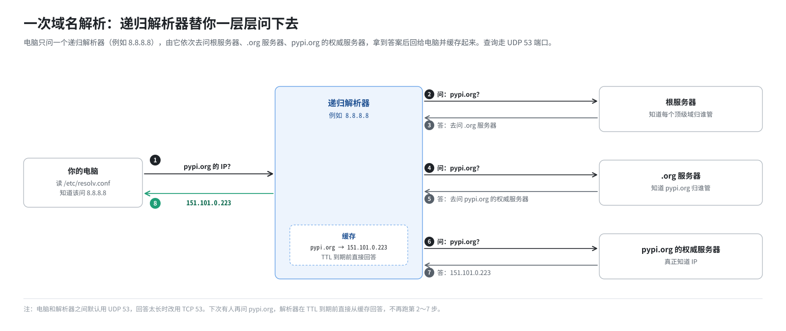
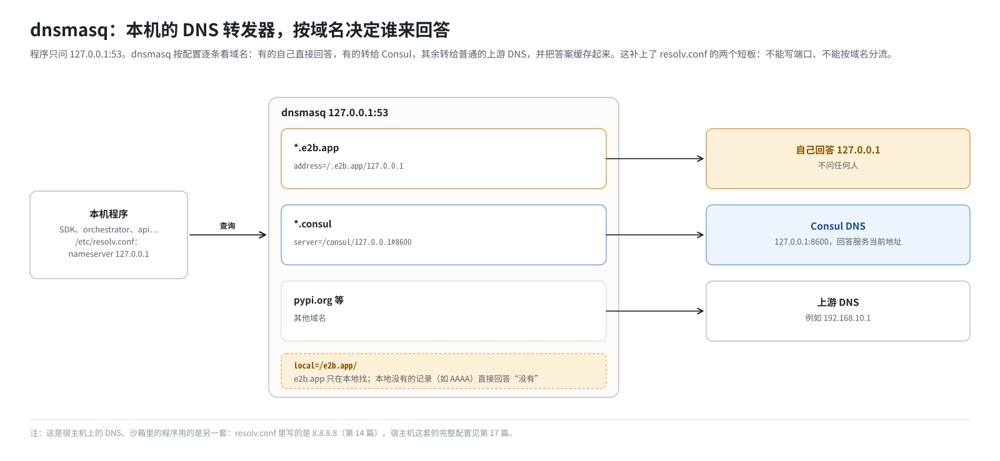

# 第 5 篇｜网络基础（四）：DNS 是怎么工作的

> **本篇目标**：人记域名，机器只认 IP，中间负责翻译的就是 DNS。本篇讲：一次域名解析的完整过程；Linux 程序怎么通过 `/etc/resolv.conf` 找到 DNS 服务器；A 和 AAAA 两种查询为什么会让客户端“白等”；以及 dnsmasq（本地 DNS 转发器）和 Consul DNS（服务发现）这两类特殊的 DNS 服务器。这套环境里有**两套完全独立的 DNS**，本篇先把共同的原理打好底。

---

## 一、DNS 是一本分布式的电话簿

### 1.1 为什么需要 DNS

你在浏览器里输入 `pypi.org`，但网络只认 IP 地址。总得有个地方告诉你“`pypi.org` 的 IP 是 `151.101.0.223`”。这个地方就是 **DNS**（域名系统）。

全世界的域名有几亿个，不可能放在一台服务器上。DNS 的设计是**分层、分布式**的，像一套分级的电话簿：

```
                    根（.）
          ┌──────────┼──────────┐
         org        com         app
          │          │           │
        pypi      google        e2b
          │
     pypi.org 的 IP
```

- **根服务器**知道每个顶级域（`.org`、`.com`、`.app`……）由谁负责。
- **顶级域服务器**知道 `pypi.org` 由谁负责。
- **权威服务器**才真正知道 `pypi.org` 的 IP。

### 1.2 递归解析器替你跑腿

你的电脑不会自己去问根服务器。它只问一个**递归解析器**（常说的“DNS 服务器”，比如公共 DNS `8.8.8.8`），由它替你一层一层地问下去：



递归解析器会把答案**缓存**一段时间（由一个叫 TTL 的值决定），下次有人问就直接回答，不用再跑一遍。

### 1.3 DNS 走 UDP 53 端口

DNS 查询默认用 **UDP**，目的端口 **53**：一个问题包、一个回答包，简单快速（第 4 篇）。回答太长时会改用 TCP 53。

记住“DNS 主要是 UDP”这件事。第 15 篇会看到，E2B 的防火墙对 TCP 和非 TCP 流量处理方式不同，DNS 查询走的是非 TCP 那条路。

---

## 二、Linux 程序怎么查 DNS

### 2.1 `/etc/resolv.conf`

一个 Linux 程序要解析域名，它怎么知道该去问哪个递归解析器？大多数程序通过 C 标准库（glibc）的解析函数来查，而 glibc 读的是 **`/etc/resolv.conf`** 这个文件：

```
nameserver 127.0.0.1
nameserver 192.168.10.1
options timeout:2
```

- `nameserver`：DNS 服务器的地址，最多写 3 个。
- `options`：可选参数，比如超时时间。

### 2.2 nameserver 的顺序很重要

多个 `nameserver` 时，glibc **按顺序**使用：

1. 先问第一个。
2. 第一个在超时时间内没回答，才问第二个。
3. 依此类推，整轮问完还没结果，再重试几轮。

默认的超时是 5 秒，默认重试 2 轮。也就是说，如果第一个 nameserver 一声不吭，每次查询都要先白等 5 秒。

这带来一个很隐蔽的问题：如果第一个 nameserver 能回答大多数问题、却对某些问题装死，客户端就会时不时卡几秒，很难查。

第 17 篇会看到，这套环境的 `/etc/resolv.conf` 第一行永远是 `nameserver 127.0.0.1`，指向本机的 dnsmasq。

### 2.3 `/etc/hosts`：本地小抄

在问 DNS 之前，glibc 通常先查 **`/etc/hosts`**，一个手写的“域名 → IP”对照表：

```
127.0.0.1      localhost
192.168.10.23  harbor
```

查到了就不问 DNS 了。这套环境的部署脚本就往宿主机的 `/etc/hosts` 里加了一行 `<本机IP> harbor`，让模板构建能拉到本机镜像仓库里的镜像（第 21 篇）。

### 2.4 不是所有程序都走 glibc

一个容易忽略的细节：Go 语言写的程序默认用 Go **自己的** DNS 解析器，不走 glibc。但它同样读 `/etc/resolv.conf` 和 `/etc/hosts`，行为大体一致。E2B 的 orchestrator 是 Go 写的，它在宿主机上解析域名时，问的是宿主机 `/etc/resolv.conf` 里写的那个 DNS（第 16 篇会用到这一点）。

---

## 三、A 记录与 AAAA 记录：为什么会“白等 15 秒”

### 3.1 两种记录

DNS 里存的不只是 IPv4 地址，常见的记录类型有：

| 类型 | 含义 |
|---|---|
| A | 域名 → IPv4 地址 |
| AAAA | 域名 → IPv6 地址 |
| CNAME | 域名 → 另一个域名（别名） |
| SRV | 服务 → 主机名和端口（Consul 会用） |

### 3.2 客户端常常两种一起查

现代的客户端程序（比如 Python 的 HTTP 库、curl）通常不知道对方支持 IPv4 还是 IPv6，于是**同时发出 A 和 AAAA 两个查询**，等两个都有了结果再决定连哪个。

问题在于：**只要其中一个查询没有回应，客户端就要等它超时**。设想一个 DNS 服务器：

- 对 A 查询立刻回答。
- 对 AAAA 查询，它自己不知道答案，于是转给上游；而上游不通，一声不吭。

客户端拿到了 A 记录，却还在等 AAAA，等满超时、重试几轮，可能白白多出十几秒。

这个场景在这套环境里真实发生过：SDK 每次连接沙箱都要多等 15 秒。第 17 篇会讲它是怎么用一行 dnsmasq 配置解决的。


---

## 四、dnsmasq：本机的“DNS 总机”

### 4.1 它是什么

**dnsmasq** 是一个轻量级的 DNS **转发器**，通常装在本机、监听 `127.0.0.1:53`。它自己不是权威服务器，也不负责完整的递归解析，而是做三件事：

1. **转发**：把收到的查询转给上游 DNS 服务器，再把答案还给客户端。
2. **缓存**：记住答案，下次直接回答。
3. **按规则分流和代答**：特定域名转给特定的服务器，或者干脆自己编一个答案。

把它想象成公司前台的**总机**：所有外线电话都先打到总机，总机根据你要找谁，转给对应的部门；有些问题总机自己就能回答。

### 4.2 三条关键配置

dnsmasq 的配置很简单，本书会用到三种：

```
# 1. 自己代答：所有 *.e2b.app 都回答 127.0.0.1
address=/.e2b.app/127.0.0.1

# 2. 只用本地数据回答 e2b.app，绝不转发给上游
local=/e2b.app/

# 3. 按域名分流：*.consul 的查询转给 127.0.0.1 的 8600 端口
server=/consul/127.0.0.1#8600
```

- `address=` 是“**我自己回答**”：查询某个域名（及其所有子域名）时，直接返回指定 IP，不问任何人。
- `local=` 是“**这个域只在本地找答案**”：本地没有的记录，直接回答“没有”，而不是转给上游。它的作用会在第 17 篇讲 AAAA 问题时体现出来。
- `server=` 是“**我替你转给别人**”：查询某个域名时，转给指定的服务器。`#8600` 表示端口。

### 4.3 为什么需要 dnsmasq，而不是直接改 resolv.conf

`/etc/resolv.conf` 有两个限制：

1. **不能指定端口**：nameserver 只能写 IP，默认就是 53 端口。Consul 的 DNS 服务在 8600 端口，resolv.conf 指不到它。
2. **不能按域名分流**：所有查询都发给同一组 nameserver。

dnsmasq 把这两件事都补上了：程序只管问 `127.0.0.1:53`，dnsmasq 按域名决定是自己回答、转给 Consul，还是转给普通的上游。



---

## 五、Consul DNS：用名字找到“现在在哪”

### 5.1 服务的地址会变

在 Nomad 这种调度系统下，一个服务（比如 Redis）跑在哪台机器、哪个端口上，是**调度器动态决定的**，重启一次就可能变。写死 IP 显然不行。

### 5.2 Consul 的做法

**Consul** 是一个服务发现系统。每个服务启动时向 Consul **注册**自己的地址和端口；别人想找它，就问 Consul。Consul 提供了一个 DNS 接口（默认在 **8600** 端口），可以像查域名一样查服务：

```
redis.service.consul   →   该服务当前所在的 IP
```

这套环境的配置里就有 `REDIS_URL="redis.service.consul"`：组件不记 Redis 的 IP，每次用名字去查。查询路径是：

```
组件 ── redis.service.consul？──► dnsmasq(127.0.0.1:53)
                                    │ 匹配 server=/consul/127.0.0.1#8600
                                    ▼
                                 Consul(127.0.0.1:8600) ── 回答当前 IP
```

---

## 六、这套环境里的两套 DNS

学完原理，提前看一下这套环境的 DNS 全貌。它其实有**两套互不相干的 DNS**：

| | 宿主机的 DNS | 沙箱里的 DNS |
|---|---|---|
| 谁在用 | 宿主机上的程序：SDK、orchestrator、api 等 | 沙箱里的程序：`pip`、`curl` 等 |
| resolv.conf 在哪 | 宿主机的 `/etc/resolv.conf` | 沙箱根文件系统里的 `/etc/resolv.conf` |
| 指向谁 | `127.0.0.1`，即本机 dnsmasq | `8.8.8.8`，模板构建时写入 |
| 特殊规则 | `*.e2b.app` → 本机；`*.consul` → Consul | 无 |
| 详见 | 第 17 篇 | 第 14 篇 |

为什么沙箱不能也用宿主机的 dnsmasq？简单说，沙箱里的 `127.0.0.1` 是沙箱自己，宿主机的地址又被防火墙挡着。第 14 篇详讲。

---

## 本篇小结

| 概念 | 一句话解释 |
|---|---|
| DNS | 分层分布式的“域名 → IP”电话簿 |
| 递归解析器 | 替客户端一层层问到底，并缓存结果，如 `8.8.8.8` |
| UDP 53 | DNS 查询默认的协议和端口 |
| `/etc/resolv.conf` | glibc 查 DNS 时读的配置，按顺序使用 nameserver |
| 超时与重试 | 第一个 nameserver 不回答时要等超时，默认 5 秒 |
| `/etc/hosts` | 本地手写的对照表，优先于 DNS |
| A / AAAA | IPv4 / IPv6 记录；客户端常同时查，一个没回答就白等 |
| dnsmasq | 本机 DNS 总机：转发、缓存、按域名分流或代答 |
| `address=` / `local=` / `server=` | 自己代答 / 只在本地找 / 转给指定服务器 |
| Consul DNS | 8600 端口，用 `xxx.service.consul` 查服务当前地址 |
| 两套 DNS | 宿主机用 dnsmasq，沙箱用 `8.8.8.8`，互不相干 |

**下一篇预告**：[《Linux 虚拟网络的积木：网络命名空间、veth 与 tap》](06-netns-veth-tap.md)。通用网络知识讲完了，下一篇进入 Linux 本身：内核怎么在一台机器里开出成百上千套互相看不见的网络，又怎么用“虚拟网线”把它们连起来。这三块积木就是 E2B 沙箱网络的骨架。
