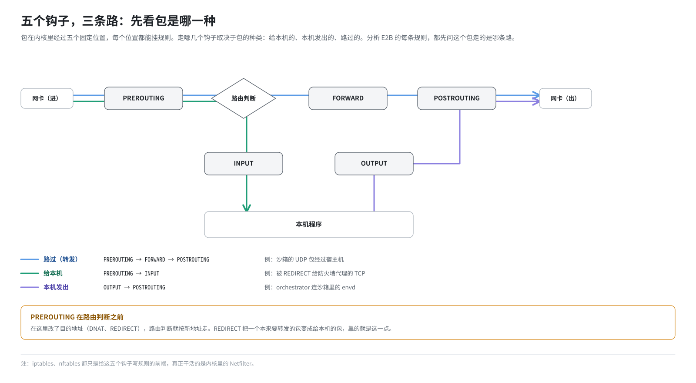
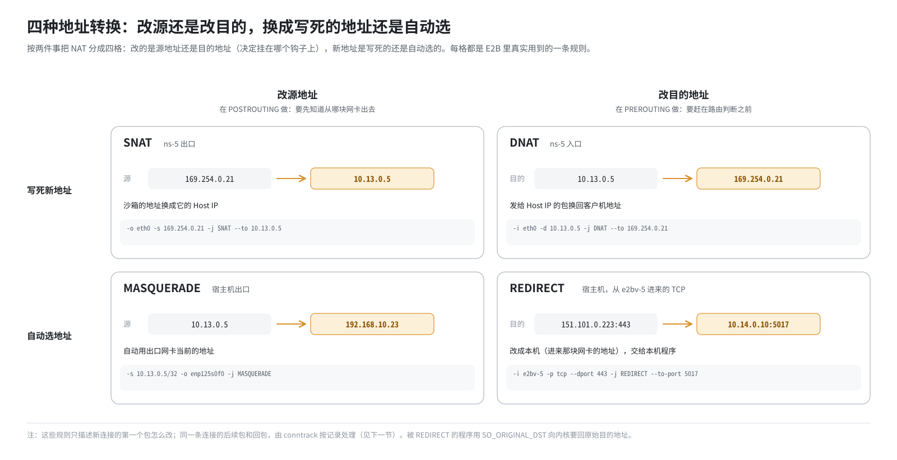
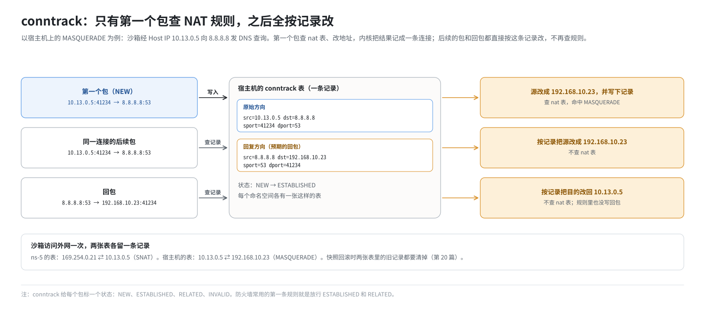

# 第 7 篇｜Netfilter（一）：iptables、NAT 与 conntrack

> **本篇目标**：认识 Linux 内核里的“安检口”Netfilter。读完本篇，你会知道：一个包在内核里会经过哪几个检查点；iptables 的表、链、规则是什么关系；SNAT、MASQUERADE、DNAT、REDIRECT 四种地址转换各做什么；以及让 NAT 能正常工作的连接跟踪（conntrack）。E2B 的地址翻译、端口改道、TCP 拦截，全都建立在本篇的知识上。

---

## 一、内核里的五个安检口

### 1.1 Netfilter 是什么

数据包在 Linux 内核里流动时，会经过一些固定的位置，内核在这些位置预留了**钩子**（hook），允许挂上自定义的处理逻辑：放行、丢弃、改地址……这套机制叫 **Netfilter**。

我们平常用的 `iptables`、`nftables` 命令，只是给 Netfilter 写规则的**前端工具**。真正干活的是内核里的 Netfilter。

### 1.2 五个钩子

一共有五个钩子，名字都很直白：

| 钩子 | 位置 |
|---|---|
| **PREROUTING** | 包刚从某块网卡进来，还没查路由 |
| **INPUT** | 查完路由，发现是给本机的，交给本机程序之前 |
| **FORWARD** | 查完路由，发现不是给本机的，要转发出去 |
| **OUTPUT** | 本机程序发出的包，刚离开程序 |
| **POSTROUTING** | 包即将从某块网卡发出去 |

### 1.3 三种包，三条路

一个包会经过哪些钩子，取决于它是哪种包：



- **给本机的包**：PREROUTING → INPUT → 本机程序。
- **本机发出的包**：本机程序 → OUTPUT → POSTROUTING。
- **路过的包**（转发）：PREROUTING → FORWARD → POSTROUTING。

这张图请记牢。后面分析 E2B 的每一条规则，都要先问：这个包走的是哪条路，会经过哪个钩子？

还有一个关键细节：**PREROUTING 在路由判断之前**。所以在 PREROUTING 里改了目的地址，路由判断就会按**新地址**来走。REDIRECT 能把一个“路过”的包变成“给本机”的包，靠的就是这一点（见第四节）。

---

## 二、表、链、规则

### 2.1 表：按用途分组

iptables 把规则按**用途**分成几张**表**：

| 表 | 用途 |
|---|---|
| **filter** | 决定放行还是丢弃，这是最常见的“防火墙” |
| **nat** | 修改地址和端口（地址转换） |
| **mangle** | 修改包头里的其他字段，比如打标记 |

### 2.2 链：表挂在钩子上

每张表在几个钩子上各有一条**链**（chain），链就是一串规则的列表。比如：

- filter 表有 INPUT、FORWARD、OUTPUT 三条链。
- nat 表有 PREROUTING、INPUT、OUTPUT、POSTROUTING 四条链。

所以说“nat 表的 PREROUTING 链”，就是“在 PREROUTING 这个钩子上、负责改地址的那一串规则”。

### 2.3 规则：从上往下，命中即停

链里的规则**从上往下**依次匹配。每条规则由两部分组成：

- **匹配条件**：从哪块网卡进来、源地址是什么、目的端口是多少……
- **目标动作**（target）：匹配上了做什么，比如 ACCEPT（放行）、DROP（丢弃）、SNAT、DNAT……

一旦命中一条带“终结性”动作的规则，就不再往下看。全都不匹配，就执行这条链的**默认策略**。

### 2.4 读懂一条 iptables 命令

来读一条 E2B 真实使用的规则：

```bash
iptables -t nat -A PREROUTING -i e2bv-5 -p tcp --dport 443 -j REDIRECT --to-port 5017
```

逐段拆解：

| 片段 | 含义 |
|---|---|
| `-t nat` | 操作 nat 表 |
| `-A PREROUTING` | 追加（Append）到 PREROUTING 链的末尾 |
| `-i e2bv-5` | 匹配条件：从网卡 `e2bv-5` 进来的（in） |
| `-p tcp` | 匹配条件：协议是 TCP |
| `--dport 443` | 匹配条件：目的端口是 443 |
| `-j REDIRECT --to-port 5017` | 动作：重定向到本机的 5017 端口 |

翻译成人话：**“从沙箱 5 那根线进来的、要去 443 端口的 TCP 包，都改送到本机的 5017 端口。”** 这正是第 16 篇讲的 TCP 防火墙代理的入口。

其他常见参数：

- `-o`：从哪块网卡出去（out）。
- `-s`：源地址。
- `-d`：目的地址。
- `-I`：插入到链的开头（Insert），和 `-A` 相对。
- `-D`：删除一条规则。
- `-C`：检查一条规则是否存在。
- `-S`：以命令的形式列出规则。

`-C ... || -A ...` 这个组合在这套环境的部署脚本里很常见：先检查有没有，没有才加，这样脚本重复执行也不会加出重复规则。

---

## 三、NAT：改地址的四种方式

### 3.1 为什么要改地址

第 2 篇讲过，私有地址（比如沙箱的 `10.13.0.5`）不能出现在公网上。沙箱要访问互联网，包在离开宿主机之前，源地址必须换成宿主机自己的公网（或内网）地址。回包到了宿主机，再换回来。这就是 **NAT**（网络地址转换）。

NAT 有四种常见形态。用快递来类比：

### 3.2 SNAT：改寄件人

**SNAT**（Source NAT）修改**源地址**。在 POSTROUTING 链上做，因为要等确定了从哪块网卡出去才好决定换成什么。

```bash
# 命名空间 ns-5 里：从 eth0 出去、源地址是 169.254.0.21 的包，源地址改成 10.13.0.5
iptables -t nat -A POSTROUTING -o eth0 -s 169.254.0.21 -j SNAT --to 10.13.0.5
```

像是把包裹上的寄件人从“某小区 21 号”改成“某某物流公司”，对方回件时寄给物流公司。

### 3.3 MASQUERADE：自动用出口网卡的地址做 SNAT

**MASQUERADE**（伪装）是 SNAT 的一种特殊形式：不写死换成哪个地址，而是**自动使用出口网卡当前的地址**。

```bash
# 宿主机上：源地址是 10.13.0.5、从物理网卡出去的包，源地址换成物理网卡的地址
iptables -t nat -A POSTROUTING -s 10.13.0.5/32 -o enp125s0f0 -j MASQUERADE
```

适合出口地址可能变化的场合，比如 DHCP 分配的地址。代价是每条新连接都要查一下网卡地址，比 SNAT 稍慢一点。

### 3.4 DNAT：改收件人

**DNAT**（Destination NAT）修改**目的地址**。在 PREROUTING（或 OUTPUT）链上做，必须赶在路由判断之前，这样路由才会按新地址走。

```bash
# 命名空间 ns-5 里：从 eth0 进来、目的地址是 10.13.0.5 的包，目的地址改成 169.254.0.21
iptables -t nat -A PREROUTING -i eth0 -d 10.13.0.5 -j DNAT --to 169.254.0.21
```

像是包裹寄到了“某某物流公司”，物流公司按记录改成真正的收件人“某小区 21 号”。

### 3.5 REDIRECT：转给本机前台

**REDIRECT** 是 DNAT 的特殊形式：把目的地址改成**本机**，即包进来的那块网卡的地址，通常同时改端口。效果是：一个本来要“路过”或发往别处的包，被拦下来交给本机的某个程序。

```bash
# 宿主机上：从 e2bv-5 进来的、去 443 端口的 TCP 包，改送本机 5017 端口
iptables -t nat -A PREROUTING -i e2bv-5 -p tcp --dport 443 -j REDIRECT --to-port 5017
```

像是所有寄往某个方向的包裹，先被**前台截下**，交给公司内部某个窗口处理。

E2B 大量使用 REDIRECT：

- 出站 TCP → 防火墙代理（第 16 篇）。
- 发往 `192.0.2.1` 的特定端口 → 宿主机内部服务（第 19 篇）。
- 宿主机 80 端口 → client-proxy 的 3002 端口（第 17 篇）。



### 3.6 被 REDIRECT 之后，程序怎么知道原本要去哪

REDIRECT 把目的地址改掉了。比如沙箱想连 `151.101.0.223:443`，被改成了本机 `5017` 端口。代理程序接到连接时，看到的目的地是它自己。那它怎么知道这个连接**原本**要去哪？

Linux 提供了一个 socket 选项 **`SO_ORIGINAL_DST`**：程序对接到的连接调用它，内核就会从连接跟踪记录里查出改写之前的目的地址和端口。E2B 的 TCP 防火墙代理正是这么拿到“沙箱原本想连谁”的（第 16 篇）。

这引出了 NAT 背后真正的功臣：连接跟踪。

---

## 四、conntrack：NAT 的记忆

### 4.1 只有第一个包查 NAT 规则

想一想：一条 TCP 连接有成百上千个包。如果每个包都要从头查一遍 nat 表，太慢了；更重要的是，**回包**怎么办？回包的源、目的地址和去程是反的，nat 表里根本没有为它写规则。

Linux 的做法是**连接跟踪**（connection tracking，简称 **conntrack**）：

1. 一条新连接的**第一个包**到来时，查 nat 表，决定怎么改地址。
2. 内核把“这条连接改成了什么”记进 **conntrack 表**，一条连接一条记录。
3. 这条连接后续的包，**不再查 nat 表**，直接按记录改。
4. **回包**到来时，内核按记录反向改回去。

所以 NAT 规则只描述“新连接怎么改”，剩下的全靠 conntrack 记住。

### 4.2 一条 conntrack 记录长什么样

用 `conntrack -L` 可以列出记录。下面是沙箱访问外网的 UDP 查询，在宿主机上留下的一条记录（简化）：

```
udp  17 25 src=10.13.0.5 dst=8.8.8.8 sport=41234 dport=53
           src=8.8.8.8 dst=192.168.10.23 sport=53 dport=41234 [ASSURED]
```

每条记录有两组五元组：

- **第一组（原始方向）**：包出发时的样子。源是沙箱的 Host IP `10.13.0.5`。
- **第二组（回复方向）**：预期的回包长什么样。回包会发给宿主机网卡地址 `192.168.10.23`。

内核收到一个从 `8.8.8.8:53` 发往 `192.168.10.23:41234` 的包，一查记录，就知道该把目的地址改回 `10.13.0.5`。

### 4.3 连接的状态

conntrack 给每个包标一个**状态**，防火墙规则可以按状态匹配：

| 状态 | 含义 |
|---|---|
| **NEW** | 一条新连接的第一个包 |
| **ESTABLISHED** | 属于一条已经有来有回的连接 |
| **RELATED** | 和某条已有连接相关，比如它引发的 ICMP 错误报告 |
| **INVALID** | 内核认不出来、或者不合规矩的包，比如 TCP 序列号对不上 |

“放行所有 ESTABLISHED 和 RELATED 的包”是防火墙最常见的第一条规则：先放行已建立连接的回包，只对新连接做严格检查。E2B 命名空间里的防火墙也是这么写的（第 15 篇）。

注意 **INVALID**。如果一条连接两端的状态被“时光倒流”了，内核会把它的包判为 INVALID 并丢掉。第 20 篇讲快照回滚时会遇到它。

### 4.4 conntrack 表也是按命名空间分开的

和路由表、防火墙规则一样，**每个网络命名空间都有自己的 conntrack 表**。E2B 的一个沙箱访问外网时，会在**两张表**里各留一条记录：

1. **沙箱命名空间里的表**：记录 `169.254.0.21` ↔ Host IP 的转换。
2. **宿主机的表**：记录 Host IP ↔ 宿主机网卡地址的转换（UDP 等），或者 Host IP ↔ TCP 代理的连接。

第 13 篇会跟着一个包把这两次转换走一遍；第 20 篇讲回滚时，要把这两张表里的旧记录都清掉。



---

## 五、两个后面要用到的小知识

### 5.1 `-m addrtype --dst-type LOCAL`

iptables 可以加载各种匹配模块（`-m`）。`addrtype` 模块按地址的**类型**匹配，`--dst-type LOCAL` 的意思是：**目的地址是本机的某个地址**（任意一块网卡上的地址都算）。

```bash
iptables -t nat -A PREROUTING -p tcp --dport 80 -m addrtype --dst-type LOCAL \
         -j REDIRECT --to-port 3002
```

“只有发给本机的 80 端口流量才改道”，而路过本机、发往别处的 80 端口流量不受影响。第 17 篇会讲这个限定为什么至关重要。

### 5.2 iptables 的锁：`-w`

同一台机器上，多个程序同时修改 iptables 会互相踩踏，所以 iptables 有一把全局锁。`-w` 参数表示“拿不到锁就等着”，而不是直接报错。

这套环境的部署脚本里，所有 iptables 命令都带 `-w`。同机还可能有 Docker、k3s 等程序在改规则，不等锁很容易偶发失败。

---

## 本篇小结

| 概念 | 一句话解释 |
|---|---|
| Netfilter | 内核里的包处理框架；iptables/nftables 只是写规则的前端 |
| 五个钩子 | PREROUTING、INPUT、FORWARD、OUTPUT、POSTROUTING |
| 三条路径 | 给本机：PRE→INPUT；本机发出：OUTPUT→POST；转发：PRE→FORWARD→POST |
| 表 | filter 管放行丢弃，nat 管改地址，mangle 管改其他字段 |
| 链与规则 | 表挂在钩子上成为链；规则从上往下，命中即停 |
| SNAT | 改源地址，在 POSTROUTING 做 |
| MASQUERADE | 自动用出口网卡地址的 SNAT |
| DNAT | 改目的地址，在 PREROUTING 做，路由按新地址走 |
| REDIRECT | 改送本机某端口，用来“截下”流量交给本机程序 |
| `SO_ORIGINAL_DST` | 被 REDIRECT 的程序向内核查询原始目的地址 |
| conntrack | 记住每条连接怎么改的；只有第一个包查 nat 规则，回包按记录反改 |
| 连接状态 | NEW / ESTABLISHED / RELATED / INVALID |
| 按命名空间分表 | 沙箱一次访问外网，在命名空间和宿主机两张 conntrack 表各留一条记录 |
| `--dst-type LOCAL` | 只匹配目的地址是本机的包 |

**下一篇预告**：[《Netfilter（二）：nftables 与集合》](08-nftables-and-sets.md)。iptables 一条规则只能匹配一个网段，要拦几十个网段就得写几十条规则。下一篇介绍 iptables 的继任者 nftables，以及它的利器“集合”：一条规则就能匹配成百上千个网段，还能原子地整批更新。E2B 每个沙箱的出站防火墙就是用 nftables 写的。
