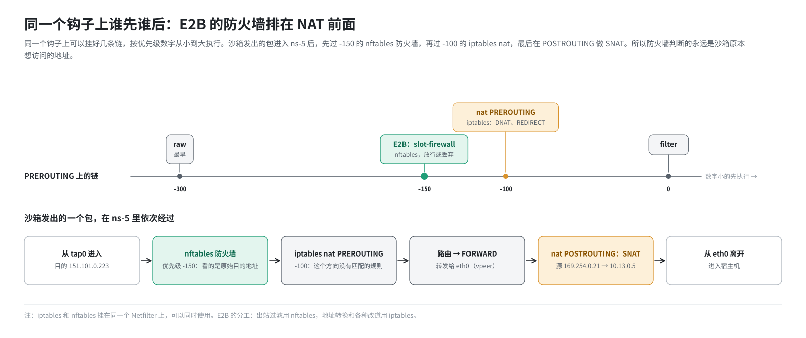

# 第 8 篇｜Netfilter（二）：nftables 与集合

> **本篇目标**：认识 iptables 的继任者 **nftables**，以及它最实用的能力：**集合**（set）。读完本篇，你会知道：nftables 的表、链、优先级怎么组织；集合为什么能让“拦截几十个网段”只需要一条规则；“一次提交、原子生效”是什么意思；以及在 E2B 里，nftables 和 iptables 是怎么分工、谁先谁后的。

---

## 一、为什么还要一个 nftables

### 1.1 iptables 的几个老问题

iptables 用了二十多年，暴露出一些问题：

- **一条规则只能匹配一个地址段。** 要拦截 10 个网段，就得写 10 条规则；包要一条一条比过去，规则越多越慢。
- **改规则要整表重写。** iptables 修改一条规则时，要把整张表从内核读出来、改完、再整张写回去。规则多了以后，每次修改都很慢。第 21 篇会看到，这套环境就曾因为残留规则攒到几万条，部署收尾变得非常慢。
- **几个工具各管一摊。** IPv4 用 `iptables`，IPv6 用 `ip6tables`，网桥用 `ebtables`，语法各不相同。

### 1.2 nftables

**nftables** 是 Linux 3.13 之后引入的新框架，用来逐步取代 iptables。它和 iptables 用的是**同一个 Netfilter**，同样的五个钩子，只是规则语言和内部实现都换了新的：

- 一个工具 `nft` 管所有协议。
- 内置**集合**、映射等数据结构。
- 规则可以**批量、原子地**提交。

---

## 二、nftables 的基本结构

### 2.1 表、链、规则

nftables 也有表、链、规则这三层，但比 iptables 灵活：

- **表**没有预设，由你自己创建、自己命名，并指定**地址族**。`inet` 表示同时处理 IPv4 和 IPv6。
- **链**也由你自己创建，你来决定它挂在哪个钩子上、优先级是多少。
- **规则**写在链里，同样从上往下匹配。

E2B 在每个沙箱的命名空间里创建一张表：

```
table inet slot-firewall {
    chain PREROUTE_FILTER {
        type filter hook prerouting priority -150; policy accept;
        ...规则...
    }
}
```

逐项解释：

| 片段 | 含义 |
|---|---|
| `table inet slot-firewall` | 一张名叫 `slot-firewall` 的表，地址族 `inet` |
| `chain PREROUTE_FILTER` | 一条名叫 `PREROUTE_FILTER` 的链 |
| `type filter` | 这是一条过滤链，负责放行或丢弃 |
| `hook prerouting` | 挂在 PREROUTING 钩子上 |
| `priority -150` | 优先级 -150，数字越小越先执行 |
| `policy accept` | 所有规则都不匹配时，默认放行 |

### 2.2 优先级：同一个钩子上谁先谁后

同一个钩子上可以挂好几条链，iptables 生成的链也在其中。它们按**优先级数字从小到大**依次执行。几个常见的参考值：

| 优先级 | 谁 |
|---|---|
| -300 | raw 表，最早 |
| -150 | mangle 表；**E2B 的沙箱防火墙链** |
| -100 | nat 表的 PREROUTING（DNAT、REDIRECT） |
| 0 | filter 表 |

E2B 的防火墙链用 -150，比 NAT（-100）**更早**执行。这意味着防火墙看到的是**还没被改过地址**的包，目的地址就是沙箱原本想访问的地址。在这个位置判断“允许不允许访问某个地址”，才是准确的。

---

## 三、集合：一条规则管一大批地址

### 3.1 用 iptables 写会怎样

假设要禁止沙箱访问五个私有和本地网段。用 iptables，得写五条规则：

```bash
iptables -A ... -d 10.0.0.0/8      -j DROP
iptables -A ... -d 127.0.0.0/8     -j DROP
iptables -A ... -d 169.254.0.0/16  -j DROP
iptables -A ... -d 172.16.0.0/12   -j DROP
iptables -A ... -d 192.168.0.0/16  -j DROP
```

用户再追加几十个自定义网段，规则就变成几十条，每个包都要挨个比一遍。

### 3.2 用 nftables 的集合

nftables 的做法是：先定义一个**集合**，把地址都放进去；然后写**一条**规则，判断“目的地址在不在这个集合里”。

```
set filtered_always_denylist {
    type ipv4_addr
    flags interval
    elements = { 10.0.0.0/8, 127.0.0.0/8, 169.254.0.0/16,
                 172.16.0.0/12, 192.168.0.0/16 }
}

chain PREROUTE_FILTER {
    ...
    iifname "tap0" ip daddr @filtered_always_denylist drop
}
```

- `type ipv4_addr`：集合里放的是 IPv4 地址。
- `flags interval`：这是一个**区间集合**，元素可以是一段地址，而不只是单个地址。`10.0.0.0/8` 在内部就存成“从 `10.0.0.0` 到 `10.255.255.255`”这样一个区间。
- `@filtered_always_denylist`：规则里用 `@集合名` 引用集合。

内核用高效的数据结构存集合，不管集合里有 5 个还是 5000 个元素，查一次都很快。

### 3.3 集合可以单独更新

另一个好处：**集合的内容可以单独修改，不用动规则**。往集合里加一个元素、删一个元素、清空重填，规则本身原封不动。

E2B 就是这么用的：

- 规则在沙箱网络建好时一次写定，以后不再改。
- 用户给某个沙箱配置了 `allowOut`、`denyOut`（第 15 篇），只需要往对应的**用户集合**里填元素。
- 沙箱用完、网络槽位要复用时，把用户集合**清空**就行（第 20 篇）。


---

## 四、原子提交：不会有“改了一半”的窗口

### 4.1 问题

假设要把防火墙从“规则组 A”改成“规则组 B”，中间涉及删十条、加十条。如果一条一条改，就会出现中间状态：删掉了五条旧的、还没加上新的。这一瞬间，防火墙处于一种谁都没设计过的状态，可能把不该放的放过去了。

### 4.2 nftables 的批处理

nftables 支持把一批修改打包成一个**事务**，一次提交给内核。内核要么全部生效，要么（出错时）全部不生效，**不存在中间状态**。

E2B 的代码就是这么写的：先在内存里“攒”好一批操作（建表、建链、建集合、加规则、填元素），最后调用一次提交（代码里叫 `Flush`），整批生效。

---

## 五、读懂 `nft list ruleset` 的输出

在某个沙箱的命名空间里列出 nftables 规则，大致会看到下面这样的内容（示意，实际输出格式略有不同）：

```
$ ip netns exec ns-5 nft list ruleset
table inet slot-firewall {
    set filtered_always_denylist {
        type ipv4_addr
        flags interval
        elements = { 10.0.0.0/8, 127.0.0.0/8, 169.254.0.0/16,
                     172.16.0.0/12, 192.168.0.0/16 }
    }
    set filtered_always_allowlist {
        type ipv4_addr
        flags interval
        elements = { 192.0.2.1 }
    }
    set filtered_denylist {
        type ipv4_addr
        flags interval
    }
    set filtered_allowlist {
        type ipv4_addr
        flags interval
    }
    chain PREROUTE_FILTER {
        type filter hook prerouting priority -150; policy accept;
        iifname "tap0" ct state established,related accept
        iifname "tap0" ip daddr @filtered_always_allowlist accept
        iifname "tap0" ip daddr @filtered_always_denylist drop
        iifname "tap0" meta l4proto != tcp ip daddr @filtered_allowlist accept
        iifname "tap0" meta l4proto != tcp ip daddr @filtered_denylist drop
    }
}
```

这里先认一下“长相”：

- 四个集合：两个**预置**的（`always_...`，固定内容），两个**用户**的（默认是空的）。
- 五条规则，每条都以 `iifname "tap0"` 开头：**只管从客户机那边进来的包**，也就是沙箱的出站流量。
- `ct state established,related`：用 conntrack 的状态匹配（第 7 篇）。
- `meta l4proto != tcp`：“传输层协议不是 TCP”，后两条规则只对非 TCP 流量生效。

每一条规则防的是什么、为什么这样排序，第 15 篇再逐条细讲。

---

## 六、nftables 与 iptables 在 E2B 里的分工

### 6.1 两者可以并存

既然都挂在 Netfilter 上，iptables 和 nftables 就可以**同时使用**：各自的链按优先级排队执行。

（补充一句：较新的发行版里，`iptables` 命令本身往往是“iptables-nft”，即用 iptables 的语法、底层写进 nftables。但对理解 E2B 没有影响，下面仍按“iptables 规则”和“nftables 规则”区分。）

### 6.2 E2B 的分工

| 工作 | 用谁 | 在哪 | 详见 |
|---|---|---|---|
| 沙箱出站过滤（按 IP 放行或丢弃） | nftables，表 `slot-firewall` | 每个沙箱的命名空间里 | 第 15 篇 |
| 命名空间内的地址转换（SNAT、DNAT） | iptables，nat 表 | 每个沙箱的命名空间里 | 第 12、13 篇 |
| 宿主机的转发放行、MASQUERADE | iptables，filter 表和 nat 表 | 宿主机 | 第 12、13 篇 |
| 出站 TCP 改道到防火墙代理 | iptables，nat 表的 REDIRECT | 宿主机 | 第 16 篇 |
| 访问宿主内部服务的改道 | iptables，nat 表的 REDIRECT | 宿主机 | 第 19 篇 |
| 80 → 3002 入口改道 | iptables，nat 表的 REDIRECT | 宿主机 | 第 17 篇 |

### 6.3 一个包先过谁

以沙箱发出的一个包为例，它在**命名空间里**依次经过：



先过滤、再改地址。这个顺序保证了防火墙判断的永远是沙箱**原本想访问的地址**。

---

## 本篇小结

| 概念 | 一句话解释 |
|---|---|
| nftables | iptables 的继任者，同一个 Netfilter，新的规则语言 |
| 表 | 自己创建，指定地址族；E2B 的表叫 `inet slot-firewall` |
| 链 | 自己创建，指定挂在哪个钩子、优先级多少 |
| 优先级 | 同一钩子上数字小的先执行；E2B 防火墙 -150，早于 NAT 的 -100 |
| 集合 | 一组地址；一条规则判断“在不在集合里”，元素再多也很快 |
| 区间集合 | `flags interval`，能存 CIDR 网段 |
| 集合单独更新 | 规则不动，只改集合内容；E2B 用它装载和清空用户规则 |
| 原子提交 | 一批修改一次生效，没有“改了一半”的窗口 |
| E2B 的分工 | 出站过滤用 nftables；地址转换与各种改道用 iptables |
| 执行顺序 | 命名空间里先 nftables 过滤，再 iptables 改地址 |

**下一篇预告**：[《虚拟机的网卡：Firecracker、virtio-net 与 tap》](09-firecracker-virtio-net-tap.md)。第一部分的基础知识到此讲完。从下一篇开始进入 E2B 本身：先从最里面讲起，看沙箱虚拟机里的那块网卡是什么、怎么接到宿主机的 tap 上、它的 IP 地址又是从哪来的。
