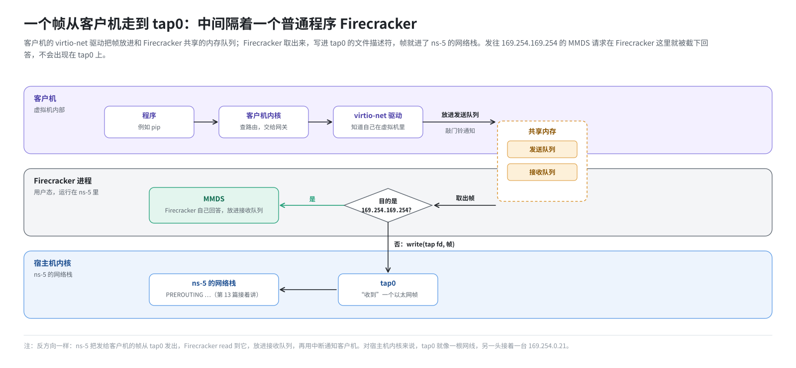
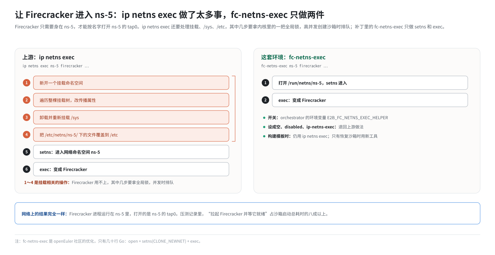

# 第 9 篇｜虚拟机的网卡：Firecracker、virtio-net 与 tap

> **本篇目标**：从最里面讲起，看清沙箱虚拟机的那块网卡。读完本篇，你会知道：客户机里的 `eth0` 是什么；一个以太网帧怎么从虚拟机走到宿主机的 `tap0`；orchestrator 怎么配置这块网卡；客户机的 IP 地址从哪来；Firecracker 为什么必须“住”进沙箱的网络命名空间，以及这套环境用什么方法让它更快地住进去；最后认识 Firecracker 内置的元数据服务 MMDS。

---

## 一、客户机里的那块网卡

### 1.1 从客户机内部看

假如你进入一个 E2B 沙箱，执行 `ip addr`，会看到这样一块网卡：

```
2: eth0: <BROADCAST,MULTICAST,UP,LOWER_UP> mtu 1500 ...
    link/ether 02:fc:00:00:00:05 brd ff:ff:ff:ff:ff:ff
    inet 169.254.0.21/30 brd 169.254.0.23 scope global eth0
```

再执行 `ip route`：

```
default via 169.254.0.22 dev eth0
169.254.0.20/30 dev eth0 proto kernel scope link src 169.254.0.21
```

从客户机的视角看，世界非常简单：

- 我有一块网卡 `eth0`，地址 `169.254.0.21`，MAC `02:fc:00:00:00:05`。
- 我的网关是 `169.254.0.22`。
- 所有不在本网段的包，都交给网关。

客户机完全不知道自己是一台虚拟机，不知道外面还有命名空间、veth、NAT、防火墙代理，也不知道同一台物理机上还有几百个“自己”，地址和 MAC 都一模一样。

### 1.2 这块网卡是虚拟的

客户机里的 `eth0` 不是真实的硬件，而是 Firecracker **模拟**出来的一块网卡，类型叫 **virtio-net**。

virtio 是一套专门为虚拟机设计的“半虚拟化”设备标准。和完整模拟一块真实网卡（比如 Intel e1000）相比，它的思路是：

- 客户机里装一个**知道自己在虚拟机里**的驱动（virtio-net 驱动，Linux 内核自带）。
- 驱动和虚拟机监控器（这里是 Firecracker）约定好一块**共享内存**，里面放着收发队列。
- 驱动要发包时，把包放进发送队列，“敲一下门铃”通知 Firecracker；Firecracker 收到包后，也放进接收队列，再用中断通知客户机。

省去了大量“假装是真硬件”的开销，所以又快又简单。

---

## 二、一个帧从客户机走到 tap0

把第 6 篇的 tap 设备和 virtio-net 连起来，客户机发出一个包的过程是：



反方向也一样：命名空间的内核把发给客户机的帧从 `tap0` 发出 → Firecracker `read` 到它 → 放进客户机的接收队列 → 通知客户机 → 客户机驱动收下。

所以从宿主机内核的角度看，`tap0` 就像一根网线，网线的另一头接着一台叫 `169.254.0.21` 的机器。

---

## 三、orchestrator 怎么配置这块网卡

### 3.1 通过 Firecracker 的 API

Firecracker 进程启动后，会在一个 Unix socket 上提供 HTTP API。orchestrator 通过这个 API 告诉 Firecracker：虚拟机要有一块网卡，配置如下（简化）：

```go
// 简化示意：orchestrator 调 Firecracker API 配置网卡
client.PutGuestNetworkInterface(NetworkInterface{
    IfaceID:     "eth0",              // 网卡在 Firecracker 里的编号
    HostDevName: "tap0",              // 接到宿主机上的哪个 tap 设备
    GuestMac:    "02:FC:00:00:00:05", // 客户机看到的 MAC 地址
})
```

三个值全都是**常量**，对每个沙箱都一样：tap 设备永远叫 `tap0`，客户机 MAC 永远是 `02:FC:00:00:00:05`。

注意 `HostDevName: "tap0"`：Firecracker 会按这个名字去打开 tap 设备。第 6 篇说过，程序只能打开**自己所在命名空间**里的 tap。所以 Firecracker 必须运行在沙箱的命名空间里，否则它要么找不到 `tap0`，要么打开了别人的。

### 3.2 只在“开机”那一次真正生效

还要强调一点：上面这些配置，以及下一节讲的 IP 地址，**真正被客户机读进去，只发生在虚拟机“开机”的那一次**，也就是构建模板的时候。

之后创建沙箱时，是从模板的**快照**恢复的：客户机的内核、网卡驱动、IP 配置、ARP 缓存，全都原样从快照里“醒过来”，不会重新开机，也不会重新配置。这就是第 10 篇要讨论的核心问题。

---

## 四、客户机的 IP 地址从哪来

### 4.1 不用 DHCP

普通电脑连上网络时，通常用 **DHCP** 向网络里的服务器“申请”一个地址。但对 E2B 来说 DHCP 太慢了，还需要额外跑一个 DHCP 服务。

E2B 的做法是：在**内核启动参数**里直接告诉客户机内核“你的地址是什么”。Linux 内核支持一个叫 `ip=` 的启动参数，内核启动时就按它配置网卡，不需要任何用户态程序参与。

### 4.2 拆解 `ip=` 参数

orchestrator 拼出的参数是这样的：

```
ip=169.254.0.21::169.254.0.22:255.255.255.252:instance:eth0:off:tap0
```

`ip=` 参数用冒号分成若干段，各段含义如下：

| 段 | 值 | 含义 |
|---|---|---|
| 1 本机地址 | `169.254.0.21` | 客户机的 IP |
| 2 服务器地址 | （空） | 网络启动用的服务器，这里不需要 |
| 3 网关 | `169.254.0.22` | 默认网关，也就是 `tap0` 的地址 |
| 4 子网掩码 | `255.255.255.252` | 即 `/30` |
| 5 主机名 | `instance` | 客户机主机名 |
| 6 网卡 | `eth0` | 配置哪块网卡 |
| 7 自动配置 | `off` | 不用 DHCP 等自动配置 |
| 8 DNS 服务器 | `tap0` | 本应是一个 DNS 服务器地址，这里填的并不是 |

第 8 段值得多说一句：它的位置本来是 DNS 服务器的 IP 地址，代码里填的却是 `tap0` 这个网卡名，并不是一个有效的地址。客户机实际使用的 DNS 服务器来自根文件系统里的 `/etc/resolv.conf`，即 `8.8.8.8`（第 14 篇）。

这串参数的结果，就是第一节看到的那块 `eth0`：地址 `169.254.0.21/30`，默认路由指向 `169.254.0.22`。

启动参数里还有 `ipv6.disable=0`、`ipv6.autoconf=1`，表示客户机启用 IPv6、允许自动配置。但宿主侧的整套沙箱网络只为 IPv4 设计，本书不讨论 IPv6。

---

## 五、让 Firecracker 住进命名空间

### 5.1 上游的做法：`ip netns exec`

orchestrator 启动 Firecracker，用的是一段 shell 脚本。上游 E2B 的脚本最后一行是：

```bash
ip netns exec ns-5 /fc-versions/<版本>/firecracker --api-sock <socket 路径>
```

`ip netns exec` 进入 `ns-5` 这个网络命名空间，再在里面启动 Firecracker。Firecracker 一启动就在 `ns-5` 里，打开的 `tap0` 自然就是 `ns-5` 的那个。

在这条命令之前，脚本还会用 `unshare -m` 给 Firecracker 开一个私有的**挂载命名空间**，在里面摆好快照需要的文件路径。这和网络无关，这里不展开。

### 5.2 `ip netns exec` 做了太多事

问题在于，`ip netns exec` 做的事远不止“进入网络命名空间”。它为了让命令看到一个“完整的”目标网络环境，还会：

- 再开一个新的挂载命名空间。
- 遍历整棵挂载树，修改挂载的传播属性。
- 卸载并重新挂载 `/sys`，让 `/sys` 里显示的网卡反映目标命名空间。
- 如果存在 `/etc/netns/<名字>/` 目录，把里面的文件覆盖到 `/etc` 上（比如给这个命名空间单独准备一份 `resolv.conf`）。

这些动作 Firecracker 一样都不需要：它只要打开 `tap0`。更糟的是，其中几步要拿内核里一把**全局锁**。高并发创建沙箱时，几十个 `ip netns exec` 排着队等这把锁，拉起 Firecracker 就成了最慢的一环。这套环境的压测记录显示，“拉起 Firecracker 并等它就绪”这一段，占了沙箱启动总耗时的八成以上。

### 5.3 这套环境的做法：`fc-netns-exec`

ARM 适配补丁收录了 openEuler 社区的一个优化：用一个只有几十行的 Go 小程序 **`fc-netns-exec`** 替换 `ip netns exec`。它只做两件事：

```go
// 简化示意：fc-netns-exec 的全部逻辑
fd := open("/run/netns/" + nsName)      // 1. 打开命名空间
setns(fd, CLONE_NEWNET)                 //    进入这个网络命名空间
exec(firecrackerPath, firecrackerArgs)  // 2. 把自己替换成 Firecracker
```

- `setns` 是一个系统调用，让当前线程进入指定的命名空间。
- `exec` 把当前进程整个替换成 Firecracker，这样 Firecracker 就继承了“身在 `ns-5`”这个状态。

于是启动脚本的最后一行变成：

```bash
/opt/e2b-infra/bin/fc-netns-exec ns-5 /fc-versions/<版本>/firecracker --api-sock <socket 路径>
```

两个细节：

- 这个开关由 orchestrator 的环境变量 **`E2B_FC_NETNS_EXEC_HELPER`** 控制。这套环境在 Nomad 任务配置 `template-manager.hcl` 里把它设为 `/opt/e2b-infra/bin/fc-netns-exec`。设成空、`disabled` 或 `ip-netns-exec`，就退回上游的 `ip netns exec`。
- **构建模板时仍用 `ip netns exec`**，只有从快照恢复沙箱时才用新工具。构建模板次数少，不在乎这点开销，保持原样更稳妥。

不管用哪种方式，网络上的结果完全一样：Firecracker 进程运行在沙箱的网络命名空间里，打开的是那个命名空间的 `tap0`。



---

## 六、MMDS：虚拟机里的元数据服务

### 6.1 沙箱怎么知道“我是谁”

沙箱是从同一个快照恢复出来的，醒来时每个都一模一样。那沙箱里的 envd 怎么知道自己的沙箱 ID、属于哪个模板、该把日志发到哪？

答案是 Firecracker 内置的 **MMDS**（MicroVM Metadata Service，微虚拟机元数据服务）。它模仿云厂商的元数据服务：

- orchestrator 通过 Firecracker API **写入**一份 JSON 元数据。
- 客户机里的程序通过 HTTP 访问 **`169.254.169.254`** 来**读取**它。

这套环境写入的元数据包括：

| 字段 | 含义 |
|---|---|
| `instanceID` | 沙箱 ID |
| `envID` | 模板 ID |
| `address` | 日志收集服务的地址 |
| `accessTokenHash` | envd 访问令牌的哈希，用来校验调用者 |

MMDS 使用 V2 版本：客户机要先用 PUT 请求换一个临时令牌，再带着令牌去读数据，防止被简单的请求伪造攻击。

### 6.2 MMDS 的包从不出虚拟机

关键在于，发往 `169.254.169.254` 的包是怎么被回答的：**Firecracker 在自己的 virtio-net 设备里就把它们截下来了**。

```
客户机 envd ── HTTP 请求 169.254.169.254 ──► virtio-net
                                              │
                         Firecracker 检查：目的地址是 MMDS？
                              ├─ 是：自己回答，不写进 tap0
                              └─ 否：照常写进 tap0
```

所以 MMDS 的流量**根本不会出现在 `tap0` 上**，命名空间里的防火墙也看不到它。第 15 篇会讲到，防火墙默认禁止访问 `169.254.0.0/16`（为的是挡住云厂商的元数据服务），但这完全不影响沙箱访问 Firecracker 自己的 MMDS，因为两者走的根本不是同一条路。

### 6.3 补丁里的一个小改动

envd 读 MMDS 用的是一个 HTTP 客户端。上游把它配置成“每次请求都新建连接”。这套环境的补丁去掉了这个限制，允许连接复用（保留最多 10 个空闲连接、90 秒超时），减少反复建立连接的开销。

---

## 本篇小结

| 概念 | 一句话解释 |
|---|---|
| 客户机 `eth0` | Firecracker 模拟的 virtio-net 网卡，地址 `169.254.0.21/30` |
| virtio-net | 半虚拟化网卡：驱动和 Firecracker 通过共享内存队列收发包 |
| 帧的路径 | 客户机驱动 → 共享队列 → Firecracker → write(tap) → `tap0` |
| 网卡配置 | `IfaceID=eth0`、`HostDevName=tap0`、`GuestMac=02:FC:00:00:00:05`，对所有沙箱都一样 |
| `ip=` 启动参数 | 内核开机时直接配好 IP、掩码、网关，不用 DHCP |
| 只在开机时生效 | 网络配置在构建模板时进入客户机，恢复沙箱时原样“醒来” |
| `ip netns exec` | 上游让 Firecracker 进入命名空间的方式，附带大量不必要的挂载操作 |
| `fc-netns-exec` | 补丁里的小工具：只做 `setns` + `exec`；由 `E2B_FC_NETNS_EXEC_HELPER` 控制 |
| MMDS | Firecracker 内置的元数据服务，客户机访问 `169.254.169.254` |
| MMDS 不出虚拟机 | Firecracker 在设备层截下 MMDS 请求，流量不经过 `tap0` |

**下一篇预告**：[《快照带来的难题：为什么每个沙箱都是 169.254.0.21》](10-snapshot-same-address.md)。本篇反复提到：所有沙箱的 IP、MAC、网关都一模一样。这在普通网络里是致命的。下一篇正面讨论这个问题：它是怎么来的，为什么不能简单地改掉，以及 E2B 用什么思路化解它。这是理解整套网络设计的钥匙。
