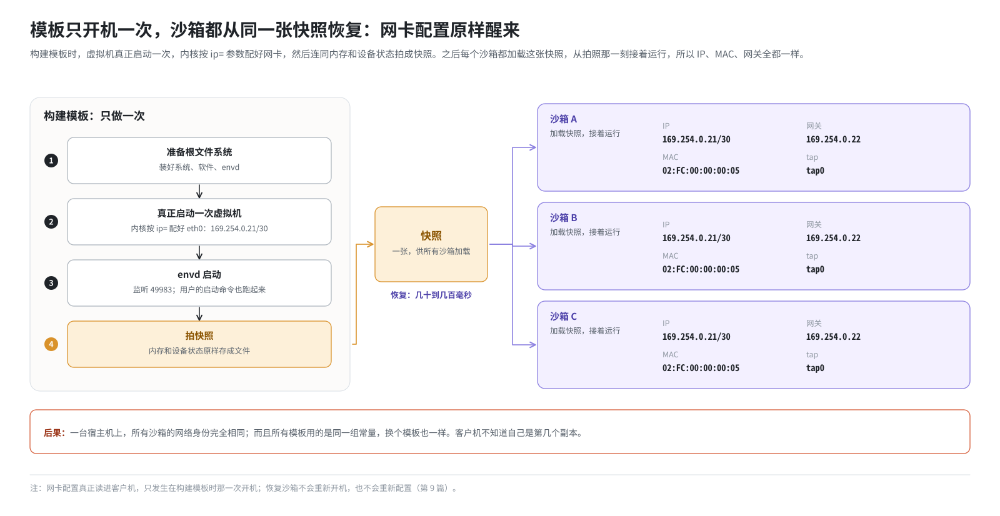
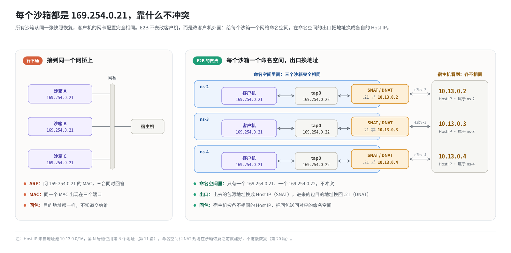

# 第 10 篇｜快照带来的难题：为什么每个沙箱都是 169.254.0.21

> **本篇目标**：本篇是理解整套 E2B 网络设计的钥匙。它要回答一个问题：**为什么所有沙箱的 IP、MAC、网关都一模一样？这么做不会出乱子吗？** 读完本篇，你会明白这个现象是“从快照恢复”带来的必然结果，为什么不能简单地给每个沙箱改个地址，以及 E2B 用“每个沙箱一个命名空间 + 出口做地址翻译”这个思路，把一个看似无解的问题变成了一个简单的问题。

---

## 一、先回顾：沙箱是怎么来的

### 1.1 模板：一台拍了照的虚拟机

第 1 篇提到，E2B 的沙箱不开机，而是从模板快照恢复。一个模板是这样做出来的：

1. 准备好根文件系统：装好系统、软件、envd。
2. **真正启动一次**虚拟机：内核按 `ip=` 参数配好网卡（第 9 篇），envd 启动并开始监听 49983 端口，用户指定的启动命令也跑起来。
3. 在虚拟机运行的状态下，**拍一张快照**：把整个虚拟机的内存和设备状态原封不动地存成文件。

### 1.2 沙箱：把照片“复活”

创建沙箱时，orchestrator 启动一个新的 Firecracker 进程，让它**加载这张快照**。虚拟机从拍照那一刻“接着运行”：

- 内存里的一切都还在：进程、打开的文件、内核数据结构。
- 网卡状态也都还在：IP 地址、路由表、ARP 缓存。
- 客户机不知道自己“睡”过一觉，更不知道自己是第几个被复活的副本。

整个过程只需要几十到几百毫秒，比真正开机快得多。这是 E2B 最核心的性能优势。

### 1.3 后果：一模一样的副本

同一个模板可以复活出任意多个沙箱，它们都来自**同一张照片**。所以：

| 项目 | 每个沙箱的值 |
|---|---|
| 客户机 IP | `169.254.0.21` |
| 子网 | `169.254.0.20/30` |
| 网关 | `169.254.0.22` |
| 客户机 MAC | `02:FC:00:00:00:05` |
| 网卡名 | `eth0` |
| Firecracker 要打开的 tap | `tap0` |

不仅同一个模板的沙箱如此，**所有模板**都一样：orchestrator 构建每个模板时用的都是同一组常量（第 9 篇）。所以在一台宿主机上，所有沙箱的网络身份**完全相同**。



---

## 二、如果直接把它们接到一起

### 2.1 想象一个网桥方案

假设我们用最直接的办法：建一个网桥（第 6 篇），把所有沙箱的 tap 都插上去，就像 Docker 那样。

```
沙箱A(169.254.0.21, MAC ...05) ─┐
沙箱B(169.254.0.21, MAC ...05) ─┼─ 网桥 ── 宿主机
沙箱C(169.254.0.21, MAC ...05) ─┘
```

会发生什么？回顾第 3 篇：

- **IP 冲突**：宿主机要给 `169.254.0.21` 发包，用 ARP 一问，三个沙箱同时回答。到底给谁？
- **MAC 冲突**：三个沙箱的 MAC 也一样。网桥学习 MAC 地址时会发现同一个 MAC 一会儿出现在这个口、一会儿出现在那个口，于是把包乱发。
- **回包找不到主人**：沙箱 A 访问了 `pypi.org`，回包的目的地址是 `169.254.0.21`，但网桥根本分不清该交给 A、B 还是 C。

这个方案从根本上行不通。

### 2.2 能不能复活后改地址？

一个自然的想法：沙箱复活后，进到客户机里把 IP 改掉，A 改成 `.21`，B 改成 `.25`，C 改成 `.29`……

听起来简单，实际上问题很多：

1. **慢**。要等客户机醒来、envd 能响应，再发命令修改网卡配置、刷新路由和 ARP。这些步骤加起来，可能比快照恢复本身还慢，直接抵消了“毫秒级恢复”的优势。
2. **鸡生蛋**。改地址要通过网络联系 envd，可地址没改之前，网络本身就是乱的。
3. **破坏快照里的状态**。快照里的某些进程可能已经记住了自己的地址，改了它们可能会出问题。
4. **对客户机有侵入**。要求客户机里有能配合改地址的程序，所有模板都得遵守这个约定。

E2B 选择了一条完全不同的路：**不改客户机，改客户机外面的世界**。

---

## 三、E2B 的思路：每人一个套间，门口换门牌

### 3.1 用命名空间隔开

既然冲突的根源是“同一个网络里有多个相同的身份”，那就**不让它们在同一个网络里**。

第 6 篇讲过，网络命名空间可以开出互相完全隔离的网络栈。E2B 给**每个沙箱一个独立的网络命名空间**：

```
┌── ns-2 ──────────────┐   ┌── ns-3 ──────────────┐   ┌── ns-4 ──────────────┐
│ 客户机 169.254.0.21   │   │ 客户机 169.254.0.21   │   │ 客户机 169.254.0.21   │
│ tap0   169.254.0.22   │   │ tap0   169.254.0.22   │   │ tap0   169.254.0.22   │
└───────────────────────┘   └───────────────────────┘   └───────────────────────┘
```

在每个命名空间内部，只有**一台**客户机和**一个**网关：`169.254.0.21` 是唯一的，`169.254.0.22` 也是唯一的，没有任何冲突。各个命名空间之间互相看不见，自然也不会冲突。

这就像一栋公寓楼：每个套间里都有一间叫“卧室”的屋子，每个套间里也都可以有一个叫“小明”的人。在套间内部，“卧室里的小明”是明确的。

### 3.2 出口换门牌：NAT

可是，这些沙箱终究要和外界通信。在外界看来，它们必须是**可以区分**的。

办法是在每个命名空间的**出口**做地址翻译：

- 包从命名空间出去时，源地址 `169.254.0.21` 换成这个沙箱**独有**的地址，比如 `10.13.0.2`、`10.13.0.3`……
- 外面的包发往这个独有地址时，在命名空间入口换回 `169.254.0.21`。



这个独有的地址就是**Host IP**，即“宿主机眼中这个沙箱的地址”。从宿主机往里看，每个沙箱都有一个不同的 Host IP，就像套间门口挂着不同的门牌号；进了门，里面的布局完全一样。

这正是第 7 篇讲的 SNAT 和 DNAT。地址翻译发生在命名空间**内部**，客户机完全感知不到。

### 3.3 这个思路的好处

回头看第 2 节列出的问题，这个方案全都避开了：

| 问题 | 怎么解决的 |
|---|---|
| IP / MAC 冲突 | 每个命名空间里只有一个客户机，冲突无从发生 |
| 回包找不到主人 | 外界只看到各不相同的 Host IP，内核按 conntrack 记录把回包送回正确的命名空间 |
| 慢 | 命名空间和 NAT 规则可以**提前**建好，沙箱复活时直接拿来用（第 20 篇） |
| 侵入客户机 | 客户机一行配置都不用改，所有模板都适用 |

---

## 四、“槽位”的概念

### 4.1 一个编号，一整套网络

既然每个沙箱都需要一套“命名空间 + 网卡 + 地址 + 规则”，E2B 就把这一整套东西打包成一个单位，叫**网络槽位**（slot）。

每个槽位有一个**编号**，比如 5。根据这个编号，就能推出这个槽位的一切：

| 东西 | 值（以编号 5 为例） |
|---|---|
| 命名空间名 | `ns-5` |
| 宿主机侧 veth 名 | `e2bv-5` |
| Host IP | 地址池里的第 5 个地址 |
| veth 对的地址 | 另一个地址池里的第 5 个 `/31` |
| 客户机地址、tap 地址 | 永远是 `169.254.0.21`、`169.254.0.22`，与编号无关 |

第 11 篇会画出一个槽位的完整拓扑，并演示怎么从编号算出所有地址。

### 4.2 槽位和沙箱的关系

槽位和沙箱是**分离**的：

- 槽位可以在没有沙箱的时候**提前建好**，放在池子里待命。
- 沙箱创建时，从池子里**领一个**槽位，把 Firecracker 放进它的命名空间。
- 沙箱结束后，槽位被**清理复位**，放回池子，给下一个沙箱用。

这就像酒店房间：客人入住前，房间已经打扫好、门牌也挂好了；客人走后，打扫一下，下一位客人接着住。第 20 篇详讲这个池子。

---

## 五、一个副作用：“同一个 Host IP，下一次可能是别人”

槽位可以复用，带来一个需要时刻警惕的副作用：**Host IP 不是沙箱的永久身份**。

今天 `10.13.0.5` 属于沙箱 A。A 结束后，槽位 5 被复用，`10.13.0.5` 就属于沙箱 B 了。如果有什么东西还记着“`10.13.0.5` 是 A”，就会把本该给 A 的东西交给 B。

E2B 在好几个地方专门防范了这一点：

- orchestrator 的代理复用到沙箱的 TCP 连接时，不以 Host IP 为准，而以沙箱的“生命周期 ID”为准（第 18 篇）。
- 槽位归还时要把用户的防火墙规则清空（第 20 篇）。

---

## 六、小结：一切从这里出发

回头看第 9 篇和后面要讲的内容，几乎所有设计都是从“快照里的地址改不了”推出来的：

| 设计 | 原因 |
|---|---|
| 客户机地址用 `169.254.0.21` 这种链路本地地址 | 它只在一根虚拟网线上有效，永远不需要被路由出去 |
| 每个沙箱一个网络命名空间 | 隔开相同的身份 |
| tap 永远叫 `tap0` | 快照里录的就是这个名字 |
| 命名空间出口做 SNAT/DNAT | 把相同的内部地址翻译成不同的外部地址 |
| 用“路由 + 点对点 veth”，不用网桥 | 每个命名空间独立接到宿主机，不共享二层网络 |
| 提前建好槽位、放进池子 | 让网络准备不拖慢毫秒级的恢复 |
| 槽位复用时清理状态 | Host IP 会换主人 |

---

## 本篇小结

| 概念 | 一句话解释 |
|---|---|
| 模板快照 | 启动好的虚拟机拍下的内存和设备状态 |
| 从快照恢复 | 新沙箱从拍照那一刻接着运行，网络配置原样“醒来” |
| 身份相同 | 所有沙箱的 IP、MAC、网关、tap 名都一样 |
| 直接接在一起 | IP 冲突、MAC 冲突、回包找不到主人，行不通 |
| 复活后改地址 | 慢、鸡生蛋、侵入客户机，E2B 不这么做 |
| 每人一个命名空间 | 在命名空间内部，相同的地址是唯一的 |
| 出口换门牌 | 命名空间出口 SNAT、入口 DNAT，把 `169.254.0.21` 翻译成各不相同的 Host IP |
| Host IP | 宿主机眼中某个沙箱的地址，跟着槽位走 |
| 网络槽位 | 一个编号对应的一整套网络：命名空间、网卡、地址、规则 |
| 槽位复用 | Host IP 会换主人，相关状态必须清理 |

**下一篇预告**：[《一个槽位的拓扑：几块网卡、几个地址》](11-slot-topology.md)。思路有了，下一篇把一个槽位“拆开”来看：它里面到底有哪几块网卡、几个地址、几条路由；怎么从槽位编号一步步算出所有地址；这套环境为什么把地址池从上游默认的 `10.11/10.12` 改成了 `10.13/10.14`，又为什么把网卡名从 `veth-` 改成了 `e2bv-`。
