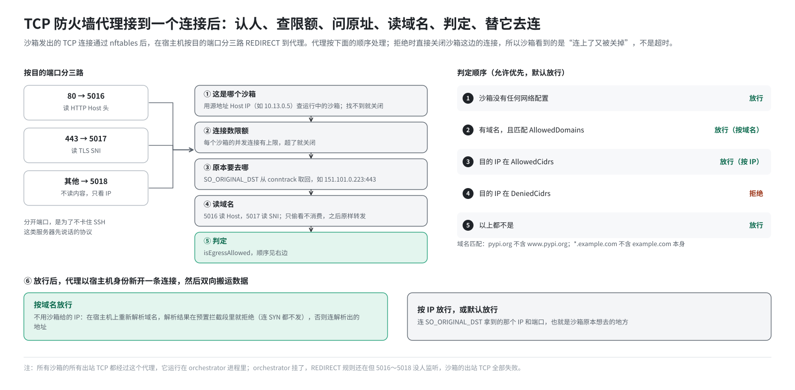
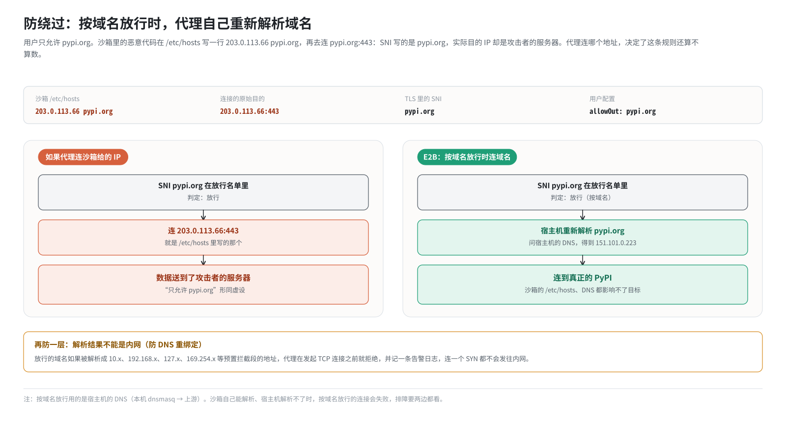

# 第 16 篇｜出站防火墙（二）：TCP 防火墙代理

> **本篇目标**：深入沙箱出站流量的第二道关：orchestrator 里的 TCP 防火墙代理。读完本篇，你会知道：所有沙箱的出站 TCP 是怎么被送进这个代理的；代理怎么知道连接来自哪个沙箱、原本要去哪；怎么在不解密的前提下读出域名；为什么要分三个端口；放行与拒绝的判定规则；以及它如何挡住“打着允许域名的旗号访问别处”这类绕过手段。

---

## 一、为什么需要一个代理

### 1.1 只看 IP 不够

第 15 篇讲的 nftables 只认 IP 地址。可用户想要的往往是“只允许访问 `pypi.org`”。光看 IP 有两个难处：

- **一个 IP 上住着很多网站。** `pypi.org` 托管在 CDN 上，同一个 IP 也服务着成千上万个别的网站。放行这个 IP，等于把它们全放行了。
- **IP 会变。** CDN 的 IP 经常调整，今天配好的 IP，明天可能就不是了。

### 1.2 只看 DNS 也不够

另一种思路是“只允许解析某些域名”。但沙箱完全可以绕过 DNS：直接连一个 IP，或者在 `/etc/hosts` 里随便写一个对应关系（第 14 篇）。

### 1.3 在连接里看域名

第 4 篇讲过，TCP 连接一开始，HTTP 请求的 `Host` 头、TLS 握手的 SNI，都**以明文**写着目标域名。所以最可靠的做法是：**让沙箱的每个 TCP 连接都先经过一个中间人**，由它读出域名，判断放不放行，放行了再替沙箱去连。

这个中间人就是 orchestrator 进程里的 **TCP 防火墙代理**（代码目录叫 `tcpfirewall`）。

---

## 二、连接是怎么进到代理里的

### 2.1 三条 REDIRECT

第 12 篇建网的第 10 步，在宿主机上为每个槽位加了三条规则：

```bash
iptables -t nat -A PREROUTING -i e2bv-5 -p tcp --dport 80  -j REDIRECT --to-port 5016
iptables -t nat -A PREROUTING -i e2bv-5 -p tcp --dport 443 -j REDIRECT --to-port 5017
iptables -t nat -A PREROUTING -i e2bv-5 -p tcp             -j REDIRECT --to-port 5018
```

从 `e2bv-5` 进来的 TCP 连接（也就是沙箱发出的、已经通过 nftables 的 TCP 连接），按目的端口分成三类，分别送到本机的三个端口：

| 原目的端口 | 送到 | 代理在这里做什么 |
|---|---|---|
| 80 | 5016 | 读 HTTP `Host` 头 |
| 443 | 5017 | 读 TLS SNI |
| 其他 | 5018 | 不读内容，只看 IP |

这三个端口可以通过环境变量 `SANDBOX_TCP_FIREWALL_HTTP_PORT`、`SANDBOX_TCP_FIREWALL_TLS_PORT`、`SANDBOX_TCP_FIREWALL_OTHER_PORT` 修改，默认就是 5016、5017、5018。代理在 `0.0.0.0` 上监听它们。

### 2.2 为什么要分三个端口

能不能只用一个端口，代理收到连接后自己判断是 HTTP、TLS 还是别的？

问题出在**服务器先说话**的协议上（第 4 篇）。比如 SSH：客户端连上后，是**服务器**先发一行版本号，客户端再回应。如果代理为了读出域名，傻等客户端先发数据，而客户端又在等服务器先说话，两边就**互相等着，连接卡死**。

所以 E2B 按**目的端口**来区分，把 80 和 443 之外的连接都送到“不读内容”的 5018 端口，直接放行或拒绝，不等待任何数据。用代码注释的话说：分开的规则是为了“防止协议检测卡住 SSH 这类服务器先说话的协议”。

代价是：如果有人在非标准端口（比如 8443）上跑 HTTPS，代理就不会读它的 SNI，只能按 IP 判断。

### 2.3 REDIRECT 之前已经过滤过一遍

再强调一次顺序：包在**命名空间里**先经过 nftables（规则 3 丢弃发往私有地址的包），然后才到宿主机被 REDIRECT。所以能走到代理这里的 TCP 连接，目的地都**已经不是**私有、环回、链路本地地址了。代理不需要再管这些。

---

## 三、代理接到一个连接后做什么



### 3.1 第一步：这是哪个沙箱

代理看到的对方地址，是 SNAT 之后的 **Host IP**，比如 `10.13.0.5`。代理拿着这个 IP，在本机所有正在运行的沙箱里查找“谁的 Host IP 是它”，就找到了对应的沙箱及其网络配置。

```go
// 简化示意
sbx := sandboxes.GetByHostIP(conn.RemoteAddr().IP)
```

找不到（比如沙箱刚被删掉）就直接关闭连接。

这也是第 10 篇的“出口换门牌”在这里的又一个用处：如果没有命名空间里那次 SNAT，所有连接的源地址都是 `169.254.0.21`，代理根本分不清谁是谁。

### 3.2 第二步：连接数限制

每个沙箱同时能通过代理的连接数有上限（由特性开关 `TCPFirewallMaxConnectionsPerSandbox` 控制）。超过上限的新连接直接关闭。这防止一个沙箱开海量连接，把代理拖垮、影响同机的其他沙箱。

### 3.3 第三步：原本要去哪

代理对这个连接调用 `SO_ORIGINAL_DST`（第 7 篇），从内核的 conntrack 记录里拿到 REDIRECT 之前的目的地址，比如 `151.101.0.223:443`。

### 3.4 第四步：读域名

- 5016 端口：代理“偷看”连接开头的数据，解析 HTTP 请求，找到 `Host:` 一行。
- 5017 端口：代理“偷看”TLS ClientHello，解析出 SNI。
- 5018 端口：不看。

“偷看”（peek）的意思是读出来、但不消费，这些数据之后还会原样转发给真正的服务器。

有时候读不到域名，比如 `curl https://1.1.1.1` 这种直接用 IP 的 HTTPS 请求，SNI 就是空的。这时代理按“没有域名”处理，只看 IP。

### 3.5 第五步：判定

判定逻辑（代码里叫 `isEgressAllowed`）按如下顺序：

```
1. 沙箱没有任何网络配置              → 放行
2. 有域名，且匹配 AllowedDomains 中任一项 → 放行（“按域名放行”）
3. 目的 IP 落在 AllowedCidrs 中        → 放行（“按 IP 放行”）
4. 目的 IP 落在 DeniedCidrs 中         → 拒绝
5. 以上都不是                          → 放行
```

和 nftables 一样，**允许优先于拒绝**，没有任何规则时**默认放行**。

域名匹配的规则：

| 配置 | 能匹配 | 不能匹配 |
|---|---|---|
| `pypi.org` | `pypi.org`（不区分大小写） | `www.pypi.org` |
| `*.example.com` | `a.example.com`、`a.b.example.com` | `example.com` 本身 |
| `*` | 任何有域名的连接 | 没有域名的连接 |

注意 `*.example.com` **不包含** `example.com` 本身。如果两个都要，就两个都写上。

### 3.6 第六步：替沙箱去连

判定为放行后，代理**以宿主机的身份**向目标发起一个新的 TCP 连接（超时 30 秒），然后在两个连接之间双向搬运数据。判定为拒绝，就直接关闭沙箱这边的连接。

这里有一个精妙之处：**按域名放行和按 IP 放行，去连的目标不一样。**

- **按 IP 放行，或默认放行**：连接沙箱原本想去的那个 IP（`SO_ORIGINAL_DST` 拿到的）。
- **按域名放行**：**不用**沙箱给的 IP，而是拿着**域名**，在宿主机上重新解析，连接解析出来的地址。

为什么？下一节讲。

---

## 四、防绕过：为什么按域名放行时要重新解析

### 4.1 一个攻击设想

假设用户配置了“只允许 `pypi.org`”。沙箱里的恶意代码这样做：

1. 在 `/etc/hosts` 里写：`203.0.113.66 pypi.org`，这是攻击者自己的服务器。
2. 连接 `pypi.org:443`。系统按 hosts 文件，实际连的是 `203.0.113.66:443`。
3. TLS 握手里的 SNI 写的是 `pypi.org`。

如果代理只看 SNI、然后连沙箱给的 IP，这个连接就会被当作“访问 pypi.org”放行，数据实际上送到了攻击者的服务器。“只允许 PyPI”形同虚设。

### 4.2 E2B 的做法

代理按域名放行时，**连接的是域名而不是 IP**：它在宿主机上自己解析 `pypi.org`，连到真正的 PyPI。沙箱在 `/etc/hosts` 里写什么、用什么 DNS，都影响不了最终的目标。代码注释说得很清楚：这是为了防止“沙箱修改 `/etc/hosts`，把允许的域名指向任意 IP”。



### 4.3 再防一层：解析结果不能是内网

还有一种绕过方式：某个被放行的域名（或用户用通配符放行的某个子域名）解析出来恰好是内网地址。可能是 DNS 被污染，也可能是攻击者控制了这个域名的解析，即所谓的 **DNS 重绑定**。代理就会替沙箱去连内网。

所以代理在“解析完成、真正发起 TCP 连接之前”还有一道检查：解析出的地址如果落在预置拦截列表里（私有、环回、链路本地等），**拒绝建立连接**，并记录一条告警日志。这一步发生在 TCP 握手之前，连一个 SYN 包都不会发往内网。

### 4.4 宿主机的 DNS 决定了“按域名放行”能不能用

由此带来一个运维上的推论：**按域名放行的连接，用的是宿主机的 DNS**。orchestrator 运行在宿主机上，它解析域名时问的是宿主机 `/etc/resolv.conf` 里的服务器，在这套环境里就是本机的 dnsmasq，dnsmasq 再转给上游（第 17 篇）。

所以可能出现这样的情况：沙箱自己能解析 `pypi.org`（通过 `8.8.8.8`），但宿主机的 dnsmasq 解析不了（上游不通），结果按域名放行的连接全部失败。排查时要两边都看。

---

## 五、几个运维上要知道的事

### 5.1 所有沙箱的所有出站 TCP 都经过它

不管有没有配置规则，**每一个**沙箱的**每一个**出站 TCP 连接都要经过这个代理。没有规则时，它只是判定“默认放行”、然后原样转发。这意味着：

- 代理的性能就是沙箱出站 TCP 的性能上限。
- **orchestrator 进程挂了，所有沙箱的出站 TCP 都会断。** REDIRECT 规则还在，但 5016～5018 端口没人监听，沙箱的连接会被直接拒绝。

### 5.2 目标服务器看到的是宿主机

代理以宿主机身份连接目标，目标服务器看到的源地址是宿主机的地址。这和 UDP 走 MASQUERADE 的效果一样，只是实现方式不同。

### 5.3 被拒绝时沙箱看到什么

被 REDIRECT 的连接，TCP 握手是**和代理**完成的。代理判定拒绝后关闭连接。所以沙箱里看到的通常是“连接建立了，然后立刻被对方关闭”，比如 curl 报 `Empty reply from server` 或连接被重置，而**不是**连接超时或“connection refused”。

这个特征在排障时很有用：看到这种现象，先怀疑出站规则。

### 5.4 被 AgentENV 误伤的历史

第 11 篇提过：同机部署的 AgentENV 会装一条规则，拒绝从 `veth-*` 网卡进来、发往本机的流量。E2B 沙箱的出站 TCP 被 REDIRECT 后，正是“发往本机”的流量（要进 INPUT 交给代理），在网卡还叫 `veth-<编号>` 时就被这条规则拒掉了。这套环境把网卡改名为 `e2bv-<编号>` 之后，问题才解决。

---

## 本篇小结

| 概念 | 一句话解释 |
|---|---|
| 为什么要代理 | 只有在 TCP 连接内容里才能可靠地看到域名 |
| 三条 REDIRECT | 80→5016（读 Host）、443→5017（读 SNI）、其他→5018（只看 IP） |
| 为什么分端口 | 防止 SSH 等“服务器先说话”的协议被卡死 |
| 找沙箱 | 用连接的源地址（Host IP）在运行中的沙箱里查找 |
| 连接数限制 | 每个沙箱的并发连接有上限，防止拖垮代理 |
| 原始目的地 | 用 `SO_ORIGINAL_DST` 从 conntrack 取回 |
| 判定顺序 | 无配置放行 → 域名匹配放行 → IP 放行 → IP 拒绝 → 默认放行 |
| 通配符 | `*.example.com` 匹配所有子域名，不含 `example.com` 本身 |
| 按域名放行时 | 在宿主机重新解析域名并连接，不用沙箱给的 IP |
| 防 DNS 重绑定 | 解析结果在内网段就拒绝，连 SYN 都不发 |
| 用宿主机 DNS | 宿主 dnsmasq 解析失败时，按域名放行的连接会失败 |
| 单点 | orchestrator 挂了，所有沙箱出站 TCP 中断 |
| 拒绝的表现 | 连接先建立再被关闭，而不是超时 |

**下一篇预告**：[《宿主机的入口：dnsmasq、Consul DNS 与 80→3002》](17-host-entry-dns-iptables.md)。出站讲完了，第四部分讲入站：外面的请求怎么进到沙箱里。下一篇从宿主机的入口讲起：SDK 访问 `49983-<沙箱ID>.e2b.app` 时，这个域名是怎么在本机“落地”的；dnsmasq 的几行配置各起什么作用；iptables 怎么把 80 端口改到 3002；以及那条曾经误伤了别人、也误伤了 E2B 自己的入口规则。
