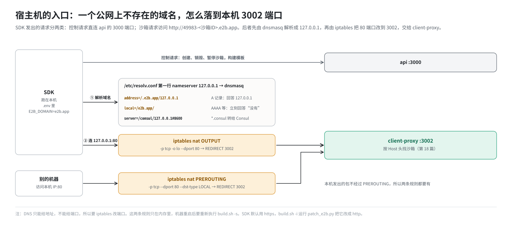
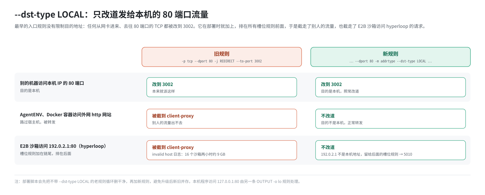

# 第 17 篇｜宿主机的入口：dnsmasq、Consul DNS 与 80→3002

> **本篇目标**：从这一篇开始讲入站方向。先看最外面的一层：SDK 在宿主机上访问 `http://49983-<沙箱ID>.e2b.app`，这个域名是怎么在本机“落地”、最后交到 client-proxy 手里的。读完本篇，你会知道：宿主机的 DNS 为什么要用 dnsmasq 当总机；`address=`、`local=`、`server=` 三条配置各管什么；为什么光有 DNS 不够、还要 iptables 把 80 改到 3002；那条入口规则为什么要写 `--dst-type LOCAL`；以及控制请求和沙箱请求为什么走的是两条路。

---

## 一、问题：一个“不存在”的域名

### 1.1 SDK 要访问什么

第 1 篇的场景二：

```python
sbx = Sandbox.create("base")
sbx.commands.run("whoami")
```

`commands.run` 背后，SDK 要和沙箱里的 envd（端口 49983）通信。SDK 拼出的地址是：

```
http://49983-<沙箱ID>.e2b.app
```

域名的格式是 `<端口>-<沙箱ID>.<域名>`。第 18 篇会讲，代理就是靠这个格式知道“要找哪个沙箱的哪个端口”。

### 1.2 这个域名在公网上不存在

`e2b.app` 是 E2B 官方云服务的域名。在官方云上，`*.e2b.app` 解析到官方的负载均衡器。

但这套环境是**私有化单机部署**，请求必须落到**本机**的代理上。如果让 SDK 去公网查 `49983-xxx.e2b.app`，要么查不到，要么查到官方的服务器，都不对。

所以要在本机“劫持”这个域名：凡是 `*.e2b.app`，一律解析成本机。这就是 dnsmasq 的工作。



---

## 二、宿主机 DNS 的三层

### 2.1 第一层：resolv.conf 指向 dnsmasq

部署脚本 `start-client.sh` 确保宿主机 `/etc/resolv.conf` 的**第一行**是：

```
nameserver 127.0.0.1
```

脚本写得很小心：

- 先删掉已有的 `nameserver 127.0.0.1` 行，再在文件第一行插入一行。这样重复执行也不会越积越多。
- 如果文件不存在或是空的（有的机器没配 DNS、靠 HTTP 代理上网），就直接写入这一行。

为什么必须是**第一行**？第 5 篇讲过，glibc 按顺序问 nameserver，第一个只要正常回答（哪怕回答“不存在”），就不会再问后面的。如果第一行是公网 DNS，它会回答“`49983-xxx.e2b.app` 不存在”，dnsmasq 根本没机会出场。

还有一个细节和同机的 AgentENV 有关：AgentENV 会读宿主机的 resolv.conf 来给**它自己的**沙箱选 DNS，并跳过环回地址。所以脚本在文件为空时只写 `127.0.0.1` 一行、不额外补上游，避免影响 AgentENV。

### 2.2 第二层：dnsmasq 按域名分流

dnsmasq 在 `build.sh -i`（安装阶段）被装上，监听 `127.0.0.1:53`。它收到查询后，按配置决定怎么办。这套环境给它加了三条规则，分两处写入。

**`build.sh -i` 写进 `/etc/dnsmasq.conf` 的两条：**

```
address=/.e2b.app/127.0.0.1
local=/e2b.app/
```

- `address=`：**自己代答**。所有 `*.e2b.app`（包括 `e2b.app` 本身）一律回答 `127.0.0.1`，不问任何人。
- `local=`：`e2b.app` 这个域**只用本地数据回答**，本地没有的记录直接回答“没有”，绝不转发给上游。

**`start-client.sh` 写进 `/etc/dnsmasq.d/consul.conf` 的一条：**

```
server=/consul/127.0.0.1#8600
```

- `server=`：**转给别人**。所有 `*.consul` 的查询，转给 `127.0.0.1` 的 8600 端口，也就是 Consul 的 DNS 接口。

### 2.3 第三层：其他域名交给上游

既不是 `e2b.app` 也不是 `consul` 的域名，比如 `pypi.org`，dnsmasq 会转给它的**默认上游**。

这套环境的脚本没有给 dnsmasq 显式配置默认上游，所以 dnsmasq 按自己的默认行为，读 `/etc/resolv.conf` 里的 nameserver 当上游，并跳过指向它自己的 `127.0.0.1`。结果是：

- 如果 resolv.conf 里，在 `127.0.0.1` 之后还有机器原来的 DNS 服务器（脚本是在第一行**插入**，原有的行保留），这些服务器就成为 dnsmasq 的上游，普通域名能正常解析。
- 如果 resolv.conf 里**只有** `127.0.0.1` 这一行，dnsmasq 就没有上游，普通域名在宿主机上解析不了。

宿主机能否解析普通域名，直接影响 TCP 防火墙代理“按域名放行”的功能（第 16 篇），也影响模板构建时拉取外部资源。部署后最好用 `dig pypi.org @127.0.0.1` 验证一下；需要时可以给 dnsmasq 显式配置一条默认的 `server=<上游DNS>`。

---

## 三、`local=` 解决的“白等 15 秒”问题

### 3.1 现象

部署初期遇到过一个怪现象：SDK 每次连接一个新沙箱，**第一条命令总要多等 15 秒左右**。之后的命令就正常了。

### 3.2 原因

第 5 篇讲过：客户端解析域名时，通常**同时**查 A 记录（IPv4）和 AAAA 记录（IPv6）。

当时 dnsmasq 只有 `address=/.e2b.app/127.0.0.1` 这一条。这条规则只给出了一个 IPv4 地址，于是：

- A 查询：dnsmasq 立刻回答 `127.0.0.1`。
- AAAA 查询：dnsmasq 手里没有 IPv6 的答案，于是按常规**转发给上游**。

如果上游不通，或者上游（比如公司的 DNS 网关）对这种查询不回应，AAAA 查询就石沉大海。客户端要等满超时：默认每次 5 秒，重试 3 轮，加起来 15 秒。每个新沙箱的域名都不一样，缓存帮不上忙，所以每个新沙箱的第一个连接都要白等。

### 3.3 解决

加一行：

```
local=/e2b.app/
```

告诉 dnsmasq：`e2b.app` 这个域的一切都由本地回答，**不许转发**。于是 AAAA 查询立刻得到“没有记录”的回答（DNS 术语叫 NOERROR + 空结果），客户端马上拿着 A 记录去连接。

这个案例很好地说明了 `address=` 和 `local=` 的分工：`address=` 管“答什么”，`local=` 管“答不上来时别乱转”。

---

## 四、为什么还需要 iptables：80 → 3002

### 4.1 DNS 只能给地址，不能给端口

DNS 把 `49983-xxx.e2b.app` 解析成了 `127.0.0.1`。SDK 的 URL 是 `http://...`，没写端口，所以按 HTTP 的默认端口去连 **`127.0.0.1:80`**。

可是 client-proxy 监听的是 **3002** 端口，80 端口上没有服务在听。

能不能在 DNS 里写上“端口 3002”？不能。DNS 的 A 记录里**只有 IP 地址，没有端口字段**。`address=/.e2b.app/127.0.0.1#3002` 这种写法是不存在的。（`server=/consul/127.0.0.1#8600` 里的 `#8600` 是“去哪个端口问 DNS”，和解析结果无关，第 5 篇讲过。）

所以需要 iptables 来“改端口”：把发往本机 80 端口的连接，改送到 3002。

### 4.2 两条规则

`build.sh -s` 部署的最后一步，加了两条 nat 规则：

```bash
# 规则一：从外部进来、目的地址是本机的 80 端口 TCP → 3002
iptables -w -t nat -A PREROUTING -p tcp --dport 80 -m addrtype --dst-type LOCAL \
         -j REDIRECT --to-port 3002

# 规则二：本机程序经环回网卡访问 80 端口 → 3002
iptables -w -t nat -A OUTPUT -p tcp -o lo --dport 80 -j REDIRECT --to-port 3002
```

两条规则覆盖两种来源：

| 来源 | 包走哪个钩子 | 由哪条规则改道 |
|---|---|---|
| 别的机器访问本机 80 端口 | PREROUTING（从网卡进来） | 规则一 |
| 本机程序访问 `127.0.0.1:80` | OUTPUT（本机发出，经 `lo`） | 规则二 |

为什么要两条？回顾第 7 篇的三条路径：**本机发出的包不经过 PREROUTING**。在单机部署里，SDK、测试脚本都跑在本机，访问的正是 `127.0.0.1:80`。只有规则一的话，“外面能访问、本机自己反而连不上”。

### 4.3 为什么规则一要写 `--dst-type LOCAL`

最早的规则一是这样写的：

```bash
iptables -t nat -A PREROUTING -p tcp --dport 80 -j REDIRECT --to-port 3002
```

它没有限制目的地址：**任何**从任何网卡进来的、去往 80 端口的 TCP，都被改到 3002。这造成了两个严重问题。

**问题一：截走了别人的流量。** 宿主机还在帮很多“别人”转发流量：同机 AgentENV 的沙箱、Docker 容器，它们访问外网的 `http://` 网站时，包会“路过”宿主机的 PREROUTING，结果全被截到了 E2B 的 client-proxy。

**问题二：截走了 E2B 自己的流量。** 第 12 篇讲过，每个槽位有一条规则，把沙箱访问 `192.0.2.1:80` 的流量改道到 hyperloop（5010 端口）。这些规则是**建槽位时**才追加到 PREROUTING 链末尾的，所以**永远排在这条全局规则后面**。规则从上往下匹配、命中即停，沙箱访问 hyperloop 的请求全被这条全局规则截到了 client-proxy。client-proxy 不认识这些请求，记了一条“invalid host”日志。部署记录里提到，16 个沙箱两小时就打出了大约 9 GB 的这种日志。

修复就是加上 `-m addrtype --dst-type LOCAL`（第 7 篇）：**只有目的地址是本机某个地址的包才改道**。

- 外部访问本机 IP 的 80 端口：目的地址是本机 → 改道。
- AgentENV、Docker 容器访问外网：目的地址是外网 → 不改道。
- 沙箱访问 `192.0.2.1:80`：`192.0.2.1` 不是本机任何网卡上的地址 → 不改道，留给后面的 hyperloop 规则。



部署脚本还会先把老规则（不带 `--dst-type LOCAL` 的那条）**循环删除干净**，再加新规则，确保升级后不会新旧并存。

### 4.4 规则不持久

iptables 规则只存在于内存里，**机器重启后就没了**。重启后症状是：DNS 解析正常，但连不上（80 端口没人听）。重新执行 `build.sh -s`，或者把这两条命令做成开机自动执行，都可以恢复。由于用的是 `-C ... || -A ...` 的写法（先检查、没有才加），重复执行是安全的。

---

## 五、控制请求与沙箱请求：两条路

到这里，`*.e2b.app` 的请求进到了 client-proxy。但 SDK 发出的请求其实有两类：

| 类别 | 例子 | 打到哪 |
|---|---|---|
| 控制请求 | 创建、销毁、暂停沙箱，构建模板 | api 服务，3000 端口 |
| 沙箱请求 | 执行命令、读写文件、访问沙箱里的服务 | client-proxy，3002 端口 → 沙箱 |

client-proxy 只处理第二类：它只认 `<端口>-<沙箱ID>.<域名>` 这种格式的地址，不负责转发控制请求。所以这套环境的 README 要求在 SDK 的 `.env` 里配置：

```bash
E2B_API_URL="http://<本机IP>:3000"   # 控制请求直连 api 的 3000 端口
E2B_DOMAIN="e2b.app"                 # 沙箱请求用的域名，要和 dnsmasq 规则一致
E2B_HTTP_SSL="false"
```

`E2B_DOMAIN` 必须和 dnsmasq 规则里的域名（`e2b.app`）一致，否则 SDK 拼出的沙箱地址就不会被解析到本机。

还有一点：SDK 默认用 HTTPS，而这套单机环境全程走明文 HTTP。`build.sh -i` 会运行 `patch_e2b.py`，把 SDK 源码里对外连接的 `https` 全部替换成 `http`。不打这个补丁，SDK 会去连 `https://49983-xxx.e2b.app`，即 443 端口，入口规则根本不管 443。

---

## 六、内部组件之间：不走入口

最后补充第三类流量：E2B 各组件**之间**的通信，比如 api 访问 Redis、client-proxy 查询沙箱目录。它们**不经过** 80/3002 入口，而是靠 Consul DNS 找到对方的当前地址，直接连接：

```
api ── redis.service.consul？──► dnsmasq ──► Consul:8600 ── 回答当前地址
api ─────────────── 直连 Redis ──────────────►
```

这套环境的 `.env` 里 `REDIS_URL="redis.service.consul"` 就是这种用法。

---

## 本篇小结

| 配置 | 在哪 | 作用 |
|---|---|---|
| `nameserver 127.0.0.1` 放第一行 | 宿主 `/etc/resolv.conf`，`start-client.sh` 写入 | 所有程序的 DNS 查询先到 dnsmasq |
| `address=/.e2b.app/127.0.0.1` | `/etc/dnsmasq.conf`，`build.sh -i` 写入 | `*.e2b.app` 一律解析成本机 |
| `local=/e2b.app/` | 同上 | AAAA 等本地没有的记录立即回答“没有”，避免白等 15 秒 |
| `server=/consul/127.0.0.1#8600` | `/etc/dnsmasq.d/consul.conf`，`start-client.sh` 写入 | `*.consul` 转给 Consul DNS |
| dnsmasq 默认上游 | 未显式配置，取 resolv.conf 中其他 nameserver | 影响宿主机解析普通域名 |
| PREROUTING 80→3002 + `--dst-type LOCAL` | iptables nat，`build.sh -s` 加 | 外部访问本机 80 端口时交给 client-proxy，不截别人的流量 |
| OUTPUT `-o lo` 80→3002 | 同上 | 本机自己访问 `127.0.0.1:80` 时交给 client-proxy |
| 规则不持久 | — | 重启后需重新执行 `build.sh -s` 或开机重放 |
| `E2B_API_URL` | SDK 的 `.env` | 控制请求直连 api:3000 |
| `E2B_DOMAIN` | SDK 的 `.env` | 必须是 `e2b.app`，与 dnsmasq 规则一致 |
| `patch_e2b.py` | `build.sh -i` 运行 | SDK 的 https 改成 http |

**下一篇预告**：[《从 SDK 到 envd：一次沙箱请求的完整路径》](18-sdk-to-envd.md)。请求到了 3002 端口的 client-proxy，接下来还要经过两层代理，最终到达沙箱里的 envd。下一篇把这条路完整走一遍：代理怎么从域名里解析出沙箱 ID 和端口，怎么找到沙箱的 Host IP，为什么连接池要按“生命周期 ID”区分，访问令牌在哪里校验，以及沙箱里只监听 localhost 的服务是怎么被访问到的。
