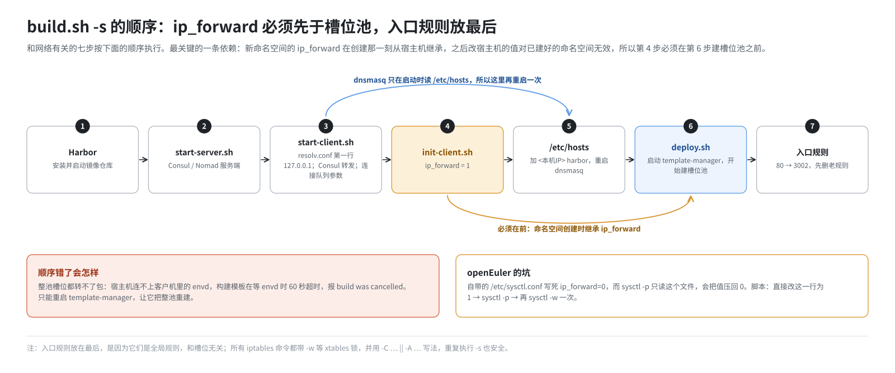
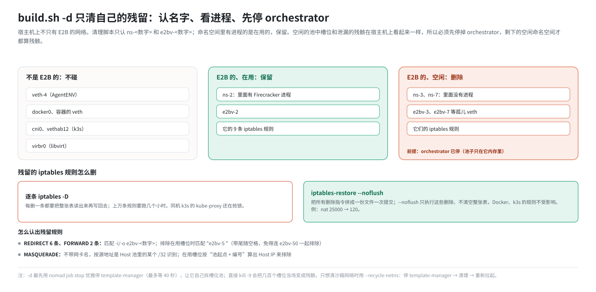

# 第 21 篇｜部署脚本里的网络配置：build.sh 的 -d、-i、-s

> **本篇目标**：从代码回到部署。这套环境用 `build.sh` 的三个参数完成部署：`-d` 停止并清理，`-i` 安装，`-s` 启动部署。本篇按执行顺序梳理三个参数分别对网络做了哪些事、为什么是这个顺序；详解残留的命名空间、veth 和上万条 iptables 规则是怎么被安全、快速地清掉的；把所有网络相关的配置项汇总成一张总表；最后讲和 AgentENV 同机部署时的注意事项。

---

## 一、部署流程回顾

这套环境的部署步骤是：

1. 下载仓库，构建 RPM 包。
2. 安装 RPM，所有文件铺到 `/opt/e2b-infra/`。
3. 依次执行：

```bash
bash /opt/e2b-infra/build.sh -d    # 停止旧服务，清理残留
bash /opt/e2b-infra/build.sh -i    # 安装依赖组件
bash /opt/e2b-infra/build.sh -s    # 启动并部署
```

`-d` 在脚本里对应的长参数是 `--stop`。它的主要工作是停服务，清理是停服务的一部分。下面按 `-i`、`-s`、`-d` 的顺序讲：先讲怎么“建”，再讲怎么“拆”。

---

## 二、`-i`（安装）：DNS 的准备

`-i` 主要是安装各种依赖组件：PostgreSQL、MinIO、Harbor 镜像仓库、nginx，以及 E2B 本身。其中和网络有关的有三件事。

### 2.1 安装 dnsmasq

脚本一开头就用 `yum install -y dnsmasq` 装上 dnsmasq，它将成为宿主机的 DNS 总机（第 17 篇）。

### 2.2 写入 `*.e2b.app` 的两条规则

`install_e2b` 函数的最后，往 `/etc/dnsmasq.conf` 追加两行（已存在就跳过），然后重启 dnsmasq：

```
address=/.e2b.app/127.0.0.1
local=/e2b.app/
```

作用见第 17 篇：所有 `*.e2b.app` 解析成本机，并且不把 AAAA 查询转给上游，避免白等 15 秒。

### 2.3 给 SDK 打补丁

`install_e2b` 还会用 pip 安装指定版本的 SDK，然后运行 `patch_e2b.py`，把 SDK 里对外连接的 `https` 改成 `http`（第 17 篇）。注意顺序：checkpoint 相关的 SDK 文件必须先装，`patch_e2b.py` 后运行，否则补丁做的替换会被覆盖。

### 2.4 nginx 与 80 端口

`-i` 还会安装 nginx，主要用途是在 443 端口上以 `harbor` 为主机名，反向代理本机的 Harbor 镜像仓库（2900 端口）。nginx 的默认配置里还有一个监听 80 端口的站点。但 `-s` 最后加的入口规则会把发往本机 80 端口的 TCP 全部改到 3002（第 17 篇），所以 nginx 的 80 端口实际上收不到通过 80 访问的请求。这一点在排查“80 端口归谁”时要心里有数。

---

## 三、`-s`（启动部署）：顺序很重要

`-s` 做的事情很多，和网络相关的步骤按执行顺序排列如下：



图中第 3～7 步依次对应下面的 3.1～3.5 节。

### 3.1 start-client.sh：DNS 和网络参数

三件事：

**一、resolv.conf 第一行改成 `nameserver 127.0.0.1`。** 幂等：先删已有的同名行，再插到第一行；文件不存在或为空时直接写这一行（第 17 篇）。

**二、加 Consul 的 DNS 转发**：往 `/etc/dnsmasq.d/consul.conf` 写入 `server=/consul/127.0.0.1#8600`，重启 dnsmasq。

**三、调网络相关的内核参数**：

```bash
sysctl -w net.core.somaxconn=65535            # 每个监听端口的连接等待队列上限
sysctl -w net.core.netdev_max_backlog=65535   # 网卡收包队列上限
sysctl -w net.ipv4.tcp_max_syn_backlog=65535  # 半连接（握手中）队列上限
```

几百个沙箱的流量都要经过本机的代理（3002、5007、5016～5018），连接数量大、突发多，默认的队列长度不够用，容易丢连接。`init-client.sh` 还会把这几项写进 `/etc/sysctl.conf`，让它们重启后依然生效。

### 3.2 init-client.sh：ip_forward 必须先于槽位池

这一步是整个部署里最容易踩坑的网络配置。第 3 篇和第 11 篇讲过：

- 命名空间要在 `tap0` 和 `eth0` 之间转发包，宿主机要在 `e2bv-*` 和物理网卡之间转发包，`net.ipv4.ip_forward` 都必须是 1。
- **新命名空间的 `ip_forward` 是在创建时从宿主机继承的**，之后改宿主机的值，对已建好的命名空间无效。

所以必须在第 6 步 orchestrator 建槽位池**之前**，把宿主机的 `ip_forward` 设好。如果顺序错了，整池槽位都转不了包。宿主机连不上客户机里的 envd，构建模板会在“等待 envd”那一步 60 秒超时，报 `build was cancelled`。这时只能重启 template-manager，让它把整池重建。

脚本还处理了 openEuler 的一个特殊情况：openEuler 24.03 自带的 `/etc/sysctl.conf` 里**写死了** `net.ipv4.ip_forward=0`。而脚本随后会执行一次 `sysctl -p`（加载 `/etc/sysctl.conf`），会把它压回 0。即使你把正确的值写在 `/etc/sysctl.d/` 下的文件里也没用，因为 `sysctl -p` 只读 `/etc/sysctl.conf`。所以脚本的做法是：

1. **直接改 `/etc/sysctl.conf` 里的这一行**为 `net.ipv4.ip_forward = 1`。没有这一行就追加。
2. 执行 `sysctl -p`。
3. 再执行一次 `sysctl -w net.ipv4.ip_forward=1`，以防别处又把它改回去。

### 3.3 /etc/hosts 里的 harbor

模板的 Dockerfile 写的是 `FROM harbor:443/e2b-orchestration/...`。构建模板时，orchestrator 要解析 `harbor` 这个主机名去拉镜像。脚本往宿主机 `/etc/hosts` 加一行 `<本机IP> harbor`，并重启 dnsmasq：dnsmasq 只在启动时读 `/etc/hosts`，第 3 步重启它的时候这一行还没加上。

### 3.4 deploy.sh：槽位池在这里诞生

`deploy.sh` 通过 Nomad 启动各个服务。其中 template-manager 任务的配置文件 `template-manager.hcl` 里，有这些和网络相关的环境变量：

```hcl
ORCHESTRATOR_SERVICES        = "orchestrator,template-manager"
E2B_FC_NETNS_EXEC_HELPER     = "/opt/e2b-infra/bin/fc-netns-exec"
SANDBOXES_HOST_NETWORK_CIDR  = "${SANDBOXES_HOST_NETWORK_CIDR}"   # 10.13.0.0/16
SANDBOXES_VRT_NETWORK_CIDR   = "${SANDBOXES_VRT_NETWORK_CIDR}"    # 10.14.0.0/16
ALLOW_SANDBOX_INTERNET       = "${ALLOW_SANDBOX_INTERNET}"        # true
ENVIRONMENT                  = "${ENVIRONMENT}"                   # local
```

- `ORCHESTRATOR_SERVICES="orchestrator,template-manager"`：一个进程同时担任 orchestrator 和模板构建两个角色。**全机只有这一个进程持有槽位池。**
- 进程启动后，立刻开始建槽位池（第 20 篇），300 个新槽位陆续出现在宿主机上。

### 3.5 最后加入口规则

所有服务就绪后，脚本加上 80 → 3002 的两条入口规则（第 17 篇）。它会先**循环删除**老版本那条不带 `--dst-type LOCAL` 的规则，再用 `-C ... || -A ...` 的方式加新规则。所有 iptables 命令都带 `-w`，等待 xtables 锁，避免和同机的 Docker、k3s 等抢锁失败。

为什么放在最后？这两条是全局规则，和槽位规则无关。放在最后，可以确保它们是“当前状态”的最终写入，重复执行 `-s` 也不会出问题。

---

## 四、`-d`（停止）：怎么安全地清理

### 4.1 停止的顺序

`-d` 的大致流程：

```
1. 优雅停止 template-manager（nomad job stop），等它自己拆槽位池
2. 停止 Consul、Nomad
3. 结束 redis、client-proxy、api、template-manager、orchestrator 进程
4. 结束所有残留的 firecracker 进程
5. 兜底：pkill nomad、consul
6. 清理残留的命名空间和 veth            ← purge_sandbox_netns
7. 清理残留的 iptables 规则              ← purge_sandbox_iptables
8. 检查各端口是否已释放                   ← check_ports_free
```

### 4.2 第 1 步为什么要“优雅”

第 20 篇说过：orchestrator 收到 SIGTERM 后会关闭槽位池，自己把所有空闲槽位拆干净，包括命名空间、veth 和 iptables 规则。如果直接 `kill -9`，这一步根本不会执行，几百个槽位当场变成残骸。

所以脚本**最先**用 `nomad job stop` 优雅地停 template-manager，最多等 40 秒。必须赶在停 Nomad 之前：Nomad 一停，就没人能优雅地停这个任务了。

但也不能指望它总能拆完：Nomad 给任务的退出时限只有 30 秒，槽位多时可能拆不完就被强杀。所以后面还有清理步骤兜底。

### 4.3 第 6、7 步：只清“自己的残留”

清理的难点在于：**宿主机上不只有 E2B 的网络**。同一台机器上可能还有：

- AgentENV 的 `veth-<编号>` 和它的命名空间。
- Docker 的 `docker0`、容器的 veth。
- k3s/flannel 的 `cni0`、`vethXXXX`。
- libvirt 的 `virbr0`。

误删任何一个，都会把别人的网络搞断。所以清理脚本严格锚定 E2B 自己的命名规则：

- 命名空间：只认 `ns-<数字>`。
- 宿主机侧 veth：只认 `e2bv-<数字>`（变量 `SANDBOX_VETH_PREFIX="e2bv-"`，与补丁里的 `VethName()` 保持一致）。

**跳过在用的槽位。** 怎么知道一个槽位“在用”？看它的命名空间里有没有进程（`ip netns pids ns-N`）。有进程，说明里面跑着 Firecracker，沙箱正在运行，它的命名空间、veth 和 iptables 规则都要保留。

这个判断方法有一个局限：**空闲的池中槽位**（命名空间里没有进程）和**泄漏的残骸**，在宿主机上看起来一模一样。第 6 篇讲过，命名空间建好后 orchestrator 就关掉了文件描述符，空闲槽位只靠 `/var/run/netns/` 下的挂载点维持。哪些是池子里的，只有 orchestrator 进程自己的内存知道。所以清理**必须在 orchestrator 停止之后**进行。停了之后，剩下的空闲命名空间按定义就都是残骸。

**删命名空间和 veth**：先 `ip netns delete` 删命名空间，再补删还留在宿主机上的孤儿 `e2bv-*`。

### 4.4 批量删除上万条 iptables 规则

第 12 篇讲过：每个槽位在宿主机上留 9 条 iptables 规则（7 条 nat、2 条 filter），**网卡删了规则也不会自动消失**。如果 orchestrator 多次被强杀，残留规则可以攒到几万条。

后果是：iptables 每改一条规则都要把整张表读出再写回（第 8 篇），规则越多越慢。部署收尾、新建槽位都会明显变慢。如果同机还有 k3s，它的 kube-proxy 也在频繁抢 iptables 锁，一个简单操作可能要等一两分钟。

清理脚本这样识别残留规则：

| 规则 | 识别方法 |
|---|---|
| nat PREROUTING 的 6 条 REDIRECT | 匹配 `-i e2bv-<数字>` |
| filter FORWARD 的 2 条 | 匹配 `-i e2bv-<数字>` 或 `-o e2bv-<数字>` |
| nat POSTROUTING 的 MASQUERADE | 这条不带网卡名，只能按源地址识别：源地址是 Host 池（`SANDBOXES_HOST_NETWORK_CIDR`）里的某个 `/32` |

在用的槽位要排除：按网卡名排除 `e2bv-<编号> `（带一个尾随空格，避免 `e2bv-5` 把 `e2bv-50` 也匹配掉）；MASQUERADE 按“Host 池起始地址 + 编号”算出它的 Host IP 来排除（第 11 篇的地址计算）。

最后是**怎么删**。如果用 `iptables -D` 逐条删除，每删一条都要整表读写一次，上万条要跑**几个小时**。脚本改用 `iptables-restore --noflush` 批量处理：把所有删除指令拼成一份文件，一次性交给内核。`--noflush` 表示只执行给出的这些删除，**不清空整张表**，所以同机 Docker、k3s 的规则不受影响。

脚本最后会打印清理前后规则数量的对比，例如 “nat 25000 → 120”。



### 4.5 `--recycle-netns`：只回收沙箱网络

如果只想清理沙箱网络的残留，不想重启全部服务，可以用：

```bash
bash /opt/e2b-infra/build.sh --recycle-netns
```

它只做三件事：优雅停 template-manager → 清命名空间、veth、iptables → 重新拉起 template-manager。为什么一定要停 template-manager？原因同上：空闲槽位和残骸分不清；而且第 20 篇讲过，orchestrator 启动时扫描的“别人的命名空间”名单在运行期不会更新，即使在线删掉了残骸，那些编号也要重启后才能重新使用。所以这件事天生就是“停、清、起”。

如果 template-manager 停不下来，脚本会**中止清理**，而不是强行继续：强行清理会删掉它手里正在用的槽位池，后续创建沙箱会连续失败。

### 4.6 端口检查

`-d` 的最后会检查一组端口是否都已释放：3000～3003、5007～5010、5016～5018、6379。如果还有被占用的，说明有残留进程没退出，直接执行 `-s` 时 orchestrator 会绑定端口失败。脚本会打印占用者，并提示处理办法。

---

## 五、配置项总表

把全书涉及的网络配置项汇总如下。

### 5.1 orchestrator（template-manager 任务）

| 配置项 | 默认值 | 这套环境 | 作用 | 篇目 |
|---|---|---|---|---|
| `SANDBOXES_HOST_NETWORK_CIDR` | `10.11.0.0/16` | `10.13.0.0/16` | Host IP 地址池 | 11 |
| `SANDBOXES_VRT_NETWORK_CIDR` | `10.12.0.0/16` | `10.14.0.0/16` | veth 对地址池，决定槽位上限 | 11 |
| `ALLOW_SANDBOX_INTERNET` | `true` | `true` | 请求未指定时是否允许上网 | 15 |
| `ENVIRONMENT` | — | `local` | `local`/`dev` 时用本地槽位存储 | 20 |
| `USE_LOCAL_NAMESPACE_STORAGE` | 未设置 | 未设置 | 强制使用本地槽位存储 | 20 |
| `E2B_FC_NETNS_EXEC_HELPER` | `/opt/e2b-infra/bin/fc-netns-exec` | 同左 | Firecracker 进入命名空间的方式 | 9 |
| `SANDBOX_ORCHESTRATOR_IP` | `192.0.2.1` | 默认 | 沙箱眼中的宿主服务地址 | 19 |
| `PROXY_PORT` | `5007` | 默认 | orchestrator 代理 | 18 |
| `SANDBOX_HYPERLOOP_PROXY_PORT` | `5010` | 默认 | hyperloop | 19 |
| `SANDBOX_NFS_PROXY_PORT` | `5011` | 默认 | NFS 代理 | 19 |
| `SANDBOX_PORTMAPPER_PORT` | `5012` | 默认 | portmap | 19 |
| `SANDBOX_TCP_FIREWALL_HTTP_PORT` | `5016` | 默认 | 防火墙代理（HTTP） | 16 |
| `SANDBOX_TCP_FIREWALL_TLS_PORT` | `5017` | 默认 | 防火墙代理（TLS） | 16 |
| `SANDBOX_TCP_FIREWALL_OTHER_PORT` | `5018` | 默认 | 防火墙代理（其他 TCP） | 16 |

### 5.2 代码里的常量（改了要重新编译）

| 常量 | 值 | 作用 | 篇目 |
|---|---|---|---|
| 客户机地址 | `169.254.0.21` | 快照里的客户机 IP | 9、10 |
| tap 地址 | `169.254.0.22/30` | 客户机网关 | 9、11 |
| 客户机 MAC | `02:FC:00:00:00:05` | 快照里的客户机 MAC | 9 |
| 宿主机侧 veth 前缀 | `e2bv-`（补丁改，上游 `veth-`） | 网卡名 | 11 |
| 沙箱 DNS | `8.8.8.8` | 写进模板的 resolv.conf | 14 |
| 预置拦截列表 | 10/8、172.16/12、192.168/16、127/8、169.254/16 等 | 出站防火墙 | 15 |
| 新建队列 | 300（补丁改，上游 32） | 预建槽位数 | 20 |
| 复用队列 | 1000（补丁改，上游 100） | 复用槽位上限 | 20 |

### 5.3 宿主机

| 配置 | 在哪 | 谁写的 | 篇目 |
|---|---|---|---|
| `nameserver 127.0.0.1` | `/etc/resolv.conf` 第一行 | `start-client.sh` | 17 |
| `address=/.e2b.app/127.0.0.1`、`local=/e2b.app/` | `/etc/dnsmasq.conf` | `build.sh -i` | 17 |
| `server=/consul/127.0.0.1#8600` | `/etc/dnsmasq.d/consul.conf` | `start-client.sh` | 17 |
| `<本机IP> harbor` | `/etc/hosts` | `build.sh -s` | 21 |
| `net.ipv4.ip_forward = 1` | `/etc/sysctl.conf` | `init-client.sh` | 3、21 |
| `somaxconn` 等三项 | `/etc/sysctl.conf` + 运行时 | `init-client.sh`、`start-client.sh` | 21 |
| 80 → 3002 两条规则 | iptables nat | `build.sh -s` | 17 |

### 5.4 SDK 一侧

| 配置 | 值 | 篇目 |
|---|---|---|
| `E2B_API_URL` | `http://<本机IP>:3000` | 17 |
| `E2B_DOMAIN` | `e2b.app`（要与 dnsmasq 规则一致） | 17 |
| `E2B_HTTP_SSL` | `false` | 17 |
| `patch_e2b.py` | SDK 的 https 改 http | 17 |

SDK 跑在别的机器上时，上面四项照样要配，`E2B_API_URL` 写宿主机的内网地址。另外还要在那台机器上把 `*.e2b.app` 解析到宿主机地址，比如装一个 dnsmasq 写 `address=/.e2b.app/192.168.10.23`；宿主机的防火墙也要放行 80 和 3000 端口（第 17 篇 5.1 节）。部署脚本不管这些，需要手动配。

---

## 六、与 AgentENV 同机部署

这台机器上还部署了 AgentENV，另一套设计几乎一样的沙箱系统。两者同机时的冲突和这套环境的对策，前面各篇零散提到过，这里集中整理：

| 冲突 | 表现 | 对策（全部在 E2B 一侧） | 篇目 |
|---|---|---|---|
| 网卡名都是 `veth-<n>` | 同名网卡创建失败 | 补丁改名 `e2bv-<n>` | 11 |
| 地址池都是 10.11/10.12 | 同一条 `/32` 路由冲突 | `.env` 改为 10.13/10.14 | 11 |
| AgentENV 拒绝 `veth-+` 进入本机的流量 | E2B 沙箱的出站 TCP（要进本机代理）被拒 | 网卡改名后不再匹配 | 16 |
| E2B 的 80 端口规则不限目的地 | 截走 AgentENV 沙箱和容器的 http 流量 | 加 `--dst-type LOCAL` | 17 |
| `-d` 清理所有 `veth-<n>` | AgentENV 的网卡被删、沙箱断网 | 清理只认 `e2bv-` 和 Host 池 | 21 |

地址和名字分开之后，两边仍然共用同一个内核里的这些东西：

- **conntrack 表**：两边沙箱的连接记录在同一张宿主机表里，表满了两边一起受影响。
- **邻居表**（ARP 缓存）。
- **网卡总数**：两边各几百个槽位，网卡数量相加。
- **`/etc/resolv.conf` 和 `ip_forward`**：E2B 的部署脚本会修改它们，AgentENV 也在读。脚本在改 resolv.conf 时已经照顾了 AgentENV 的读法（第 17 篇）。

以后如果要换网段或网卡前缀，需要同步修改的地方：`.env` 里的两个 CIDR；补丁里的 `VethName()` 与 `build.sh` 里的 `SANDBOX_VETH_PREFIX`，两者必须一致。改完重新打包、执行 `-d`、`-i`、`-s`。

---

## 本篇小结

| 阶段 | 对网络做的事 |
|---|---|
| `-i` | 安装 dnsmasq；写入 `*.e2b.app` 两条规则；给 SDK 打 http 补丁 |
| `-s` 第 3 步 | resolv.conf 首行指向 dnsmasq；加 Consul 转发；调连接队列参数 |
| `-s` 第 4 步 | 确保 `ip_forward=1`，必须先于槽位池；改掉 openEuler 写死的 0 |
| `-s` 第 5 步 | `/etc/hosts` 加 harbor，重启 dnsmasq |
| `-s` 第 6 步 | 启动 template-manager，开始建 300 个槽位 |
| `-s` 第 7 步 | 加 80→3002 两条入口规则，先删老规则 |
| `-d` 优雅停 | 先 `nomad job stop`，让 orchestrator 自己拆池子 |
| `-d` 清理 | 只认 `ns-<数字>`、`e2bv-<数字>` 和 Host 池地址；跳过有进程的槽位 |
| 批量删规则 | `iptables-restore --noflush`，几小时变几秒，不影响别人的规则 |
| `--recycle-netns` | 停 template-manager、清理、再拉起；停不下来就中止 |
| 同机 AgentENV | 改名、改网段、限定入口规则、限定清理范围 |

**下一篇预告**：[《全景、排障与安全》](22-big-picture-troubleshooting-security.md)。最后一篇，我们把全书串起来：跟着一次完整的“创建沙箱、安装软件、打开网页”走一遍全景；整理一套分层排障的思路和常见问题速查表；最后回顾这套网络在安全上挡住了什么、还剩什么。
