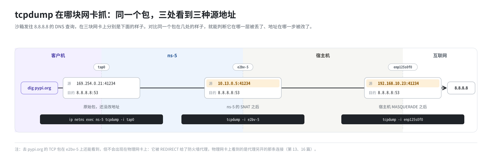

# 第 22 篇｜全景、排障与安全

> **本篇目标**：把全书串起来。先跟着一次完整的使用过程（创建沙箱、安装软件、打开网页）走一遍全景，看每一层在什么时候起作用；然后整理一套分层排障的思路、常用工具和常见问题速查表；最后回顾这套网络在安全上挡住了什么、还剩下哪些风险。篇末附中英对照的术语表。

---

## 一、全景复盘：一次完整的使用

假设你在宿主机上运行这段代码：

```python
sbx = Sandbox.create("base")                                  # ①
sbx.commands.run("pip install flask")                          # ②
sbx.commands.run("python app.py &")                            # ③ app.py 监听 127.0.0.1:8000
url = "http://" + sbx.get_host(8000)                           # ④ 浏览器打开这个地址
```

### ① 创建沙箱

1. SDK 读 `E2B_API_URL`，直接向 `http://<本机IP>:3000` 发控制请求，api 收到（第 17 篇）。
2. api 校验网络配置，把 `allowOut`、`denyOut`、`allow_internet_access` 转换成三个列表，交给 orchestrator（第 15 篇）。
3. orchestrator 从**槽位池**里取一个槽位，假设是 5 号（第 20 篇）。槽位早已建好：命名空间 `ns-5`、`tap0`、veth 对 `eth0` ↔ `e2bv-5`、Host IP `10.13.0.5`、NAT 规则、nftables 表、宿主机上的 9 条规则（第 11、12 篇）。
4. 往这个槽位的 nftables 用户集合里装载出站规则（默认没有，就什么也不做）。
5. 用 `fc-netns-exec` 在 `ns-5` 里启动 Firecracker，Firecracker 打开 `tap0`（第 9 篇）。
6. Firecracker 从模板快照恢复虚拟机。客户机醒来，地址 `169.254.0.21`，网关 `169.254.0.22`，和所有沙箱一模一样（第 10 篇）。
7. orchestrator 通过 Firecracker API 写入 MMDS 元数据：沙箱 ID、令牌哈希等（第 9 篇）。
8. orchestrator 连接 `10.13.0.5:49983`，调用 envd 的 `/init`。包经宿主机 `/32` 路由进入 `ns-5`，被 DNAT 成 `169.254.0.21`；envd 的回包被防火墙规则 1 当作已建立连接放行（第 13 篇）。`/init` 里带着 `hyperloopIP=192.0.2.1`，envd 据此写好 `/etc/hosts`（第 19 篇）。
9. api 把“沙箱在本节点”写进 Redis 里的沙箱目录（第 18 篇）。

### ② 在沙箱里安装软件

SDK 要和 envd 通信：

1. SDK 访问 `http://49983-<沙箱ID>.e2b.app`。dnsmasq 把它解析成 `127.0.0.1`（第 17 篇）。
2. iptables OUTPUT 规则把 `127.0.0.1:80` 改到 3002 端口（第 17 篇）。
3. client-proxy 从 Host 头解析出端口和沙箱 ID，查 Redis 得到节点 IP，转给节点的 5007 端口（第 18 篇）。
4. orchestrator 代理找到沙箱的 Host IP，转发到 `10.13.0.5:49983`，经 DNAT 进入 envd（第 18 篇）。

envd 开始执行 `pip install flask`：

5. pip 读沙箱的 `/etc/resolv.conf`，向 `8.8.8.8` 发 DNS 查询。UDP 包经 nftables 放行、命名空间 SNAT 成 `10.13.0.5`、宿主机 FORWARD 放行、MASQUERADE 成宿主机地址，到达 `8.8.8.8`（第 13、14 篇）。
6. pip 连接 `pypi.org:443`。TCP 包经 nftables 放行、SNAT，在宿主机被 REDIRECT 到 5017 端口（第 16 篇）。
7. TCP 防火墙代理按源地址 `10.13.0.5` 找到沙箱，用 `SO_ORIGINAL_DST` 拿到原始目的地，读出 SNI `pypi.org`，判定放行（默认无规则），以宿主机身份连接 `pypi.org`，两边对接（第 16 篇）。
8. 命令输出以流式响应返回 SDK。补丁开启的全双工模式，保证这个流不会中途被掐断（第 18 篇）。

### ③ 启动网页服务

`app.py` 只监听 `127.0.0.1:8000`。envd 的端口扫描发现了它，启动 socat，在 `169.254.0.21:8000` 上监听并转发（第 18 篇）。

### ④ 浏览器打开网页

浏览器访问 `http://8000-<沙箱ID>.e2b.app`，路径和 ② 的前 4 步一样，只是端口是 8000。orchestrator 代理检查这个端口是否需要流量访问令牌（默认不需要），然后转到 `10.13.0.5:8000` → DNAT → socat → `127.0.0.1:8000` → Flask（第 18 篇）。

### 沙箱结束

`sbx.kill()` 之后，Firecracker 退出，槽位被归还：清空用户集合，放回复用队列，等下一个沙箱来用（第 20 篇）。

---

## 二、分层排障

### 2.1 思路：按层次一段一段排除

网络问题最怕“不知道从哪下手”。这套环境的网络可以分成这样几层，从外到内依次检查：


**入站问题**（SDK 或浏览器访问不了沙箱）从 ① 往下查；**出站问题**（沙箱访问不了外部）从 ⑥ 往 ⑦ 查。

### 2.2 常用工具

下面只说明每个工具“看什么、怎么读”，不要求动手。

**进入命名空间看：**

```bash
ip netns exec ns-5 ip addr          # 三块网卡在不在、地址对不对（第 6 篇）
ip netns exec ns-5 ip route         # 默认路由在不在
ip netns exec ns-5 iptables -t nat -S   # SNAT、DNAT 两条规则在不在
ip netns exec ns-5 nft list ruleset     # 防火墙的集合与规则（第 8、15 篇）
ip netns exec ns-5 conntrack -L         # 这个沙箱当前的连接
ip netns pids ns-5                      # 有没有 Firecracker 进程
```

**宿主机上看：**

```bash
ip route get 10.13.0.5              # 宿主机打算怎么去这个 Host IP
iptables -t nat -S | grep e2bv-5    # 这个槽位的 REDIRECT、MASQUERADE 规则
iptables -t nat -S | wc -l          # 规则总数，判断有没有大量残留
conntrack -L -s 10.13.0.5           # 宿主机表里这个沙箱的连接
dig 49983-xxx.e2b.app @127.0.0.1    # dnsmasq 是否把 e2b.app 解析成 127.0.0.1
dig pypi.org @127.0.0.1             # dnsmasq 能否解析普通域名（有没有上游）
ss -lntp | grep -E '3002|5007|501[0-8]'   # 各个代理端口有没有在监听
```

**抓包：在哪块网卡抓**

`tcpdump` 是终极手段，关键是选对网卡：

| 想看什么 | 在哪抓 | 看到的地址 |
|---|---|---|
| 客户机发出的原始包 | `ip netns exec ns-5 tcpdump -i tap0` | `169.254.0.21` |
| 出命名空间之后的包 | `tcpdump -i e2bv-5` | Host IP `10.13.0.5` |
| 离开宿主机的包 | `tcpdump -i <物理网卡>` | 宿主机地址 |

对比同一个包在几块网卡上的样子，就能判断它在哪一层被丢了、地址在哪一步被改了。



### 2.3 常见问题速查

| 现象 | 可能原因 | 看哪里 | 篇目 |
|---|---|---|---|
| 建模板卡在等 envd，60 秒后报 `build was cancelled` | `ip_forward` 在建槽位池时是 0 | `sysctl net.ipv4.ip_forward`；`/etc/sysctl.conf` 有没有写死 0；改完要重启 template-manager | 3、21 |
| 沙箱上不了网（UDP 和 TCP 都不行） | 宿主机本身出不了外网；或被配置为断网 | 宿主机 `curl` 外网；沙箱的出站配置；`ALLOW_SANDBOX_INTERNET` | 15 |
| 沙箱解析不了域名 | 宿主机访问不到 `8.8.8.8:53`；沙箱 resolv.conf 被改 | 进沙箱看 resolv.conf；宿主机 `dig @8.8.8.8` | 14 |
| 沙箱能 ping 通但 HTTP/HTTPS 不通 | TCP 防火墙代理没在运行，或判定为拒绝 | `ss -lnt` 看 5016～5018；orchestrator 日志 | 16 |
| 某个域名的连接“建立后立刻断开” | 被出站规则拒绝 | 沙箱的 `allowOut`/`denyOut`；通配符是否覆盖 apex 域名 | 16 |
| 按域名放行的连接全部失败 | 宿主机 dnsmasq 解析不了这个域名（没有上游） | `dig <域名> @127.0.0.1` | 16、17 |
| 想访问内网服务，配了 `allowOut` 也不行 | 私有地址被预置规则拦截，`allowOut` 无效 | 设计如此 | 15 |
| SDK 每个新沙箱的第一条命令慢 15 秒 | AAAA 查询被转给不回应的上游 | dnsmasq 有没有 `local=/e2b.app/` | 17 |
| SDK 连不上沙箱，DNS 正常 | 80→3002 规则丢了（比如机器重启过） | `iptables -t nat -S` 找 3002 | 17 |
| 访问沙箱返回“沙箱不存在” | 沙箱已结束或已暂停；Redis 目录里没有 | api / client-proxy 日志 | 18 |
| 访问沙箱端口返回“端口未开放”或 502 | 沙箱里服务没起来；或刚起来、socat 还没就绪 | 进沙箱看监听；稍后重试 | 18 |
| 沙箱访问 hyperloop 失败，client-proxy 大量 “invalid host” 日志 | 老版本不带 `--dst-type LOCAL` 的 80 端口规则抢先截走 | `iptables -t nat -S PREROUTING` 的顺序 | 17、19 |
| 槽位编号从很大的数开始，或创建沙箱报“没有空槽位” | 残留的 `ns-*` 被记成“别人的” | `ip netns list` 数量；停服后清理 | 20、21 |
| 部署和建槽位越来越慢 | 残留 iptables 规则成千上万 | `iptables -t nat -S \| wc -l`；`build.sh -d` 或 `--recycle-netns` | 12、21 |
| 回滚后沙箱里的连接卡住不动 | conntrack 记录没清 | 回滚日志里的 conntrack 清理结果 | 20 |
| 同机 AgentENV 的沙箱访问外网 http 异常 | E2B 老版本的 80 端口规则截走了它们的流量 | 入口规则有没有 `--dst-type LOCAL` | 17、21 |

---

## 三、安全回顾

### 3.1 每一层挡住了什么

| 威胁 | 防线 | 怎么挡的 | 篇目 |
|---|---|---|---|
| 沙箱之间互相访问 | 命名空间 + 点对点 veth + nftables 规则 3 | 没有共享的二层网络；发往 `10.x` 的包在源头丢弃 | 11、13、15 |
| 沙箱访问宿主机、内网 | nftables 规则 3 | 私有、环回地址一律丢弃，`allowOut` 也放不开 | 15 |
| 沙箱访问云元数据服务 | nftables 规则 3 | `169.254.0.0/16` 一律丢弃 | 15 |
| 沙箱访问宿主服务 | 预置放行 + 精确的 REDIRECT | 只开放 `192.0.2.1` 的三个 TCP 端口 | 19 |
| 打着允许域名的旗号访问别处 | TCP 代理重新解析域名 | 不用沙箱给的 IP，连真正的域名 | 16 |
| DNS 重绑定到内网 | TCP 代理解析后检查 | 解析结果在内网段则拒绝，连 SYN 都不发 | 16 |
| 伪造身份（日志、hyperloop） | Host IP 作为身份 | 源地址由命名空间 SNAT 写入，沙箱碰不到 | 19 |
| 连接数滥用 | TCP 代理与 orchestrator 代理的连接数上限 | 每个沙箱的并发连接有上限 | 16、18 |
| 未授权访问沙箱 | envd 令牌、流量访问令牌 | 代理和 envd 分别校验 | 18 |
| 规则遗留给下一个用户 | 归还时清空用户集合 | 槽位复用前复位 | 15、20 |

### 3.2 还剩哪些风险

没有完美的系统，下面这些是这套环境当前设计下仍然存在、需要使用者心里有数的地方：

1. **UDP 默认放行。** 默认配置下，沙箱可以向任何公网地址发送 UDP 包，包括任意 DNS 服务器。这可能被用来通过 DNS 隧道等方式把数据带出去。需要严格控制时，应配置 `denyOut: ["0.0.0.0/0"]` 再按需放行（第 14、15 篇）。
2. **非标准端口的 HTTPS 不检查域名。** 只有 80 和 443 端口会读 Host 和 SNI，其他端口只按 IP 判断（第 16 篇）。在“按域名放行”的场景下，访问 `8443` 等端口上的服务会退化为按 IP 判断，而 `denyOut: 0.0.0.0/0` 会拒绝它们。
3. **预置拦截列表不含 `100.64.0.0/10`。** 这套环境基于的版本还没有这一段。如果内网使用了这段地址，沙箱可以访问到（第 15 篇）。
4. **单机明文 HTTP。** SDK 被打了补丁，全程走 HTTP。令牌在本机回环和本机网卡之间以明文传输。单机部署时风险有限，但如果从别的机器访问这台服务器，流量是明文的。
5. **TCP 代理是单点。** 所有沙箱的出站 TCP 都经过 orchestrator 进程。它的稳定性和性能直接决定沙箱的网络体验（第 16 篇）。
6. **入口规则不持久。** 机器重启后 80→3002 规则消失，访问中断（第 17 篇）。这虽不是安全漏洞，但要纳入运维检查。
7. **共享的内核资源。** 所有沙箱（以及同机的 AgentENV）共用宿主机的 conntrack 表等内核资源。一个沙箱制造大量连接，可能挤占别人的资源。连接数上限只限制了经过代理的 TCP。

---

## 四、写在最后

回头看，这套网络栈的所有设计，都可以从三个出发点推出来：

1. **快照里的地址改不了**（第 10 篇）→ 每个沙箱一个命名空间，出口换门牌，槽位可以预建和复用。
2. **沙箱里的代码不可信**（第 1 篇）→ 源头拦截内网，TCP 交给代理按域名判断，代理不信任沙箱给的任何地址，用 Host IP 作为不可伪造的身份。
3. **要快**（第 1 篇）→ 预建槽位池，用 nftables 集合，用 `fc-netns-exec` 替代 `ip netns exec`，套接字只开一次。

再加上这套环境自己的实际情况：单机部署、ARM 服务器、openEuler、和 AgentENV 同机，就有了网卡改名、换网段、限定入口规则、批量清理规则、处理 `ip_forward` 等一系列改动。

希望读完本书，你再看到 `ip netns list` 里那几百个 `ns-*`、`iptables -t nat -S` 里那几千条规则时，知道它们每一个都从哪来、为什么在那里。

---

## 术语表

| 中文 | 英文 | 一句话解释 | 首次出现 |
|---|---|---|---|
| 沙箱 | sandbox | 隔离运行不可信代码的环境，这里是一台 Firecracker 虚拟机 | 1 |
| 模板 | template | 预先启动并拍了快照的虚拟机，沙箱从它恢复 | 1、10 |
| 快照 | snapshot | 虚拟机内存与设备状态的完整保存 | 10 |
| 子网 / 子网掩码 | subnet / netmask | 一段连续的地址；掩码表示网络号有多长 | 2 |
| 无类别域间路由 | CIDR | `10.13.0.0/16` 这种写法 | 2 |
| 链路本地地址 | link-local address | `169.254.0.0/16`，不被路由 | 2 |
| 地址解析协议 | ARP | 已知 IP 查询 MAC | 3 |
| 路由表 | routing table | 决定包从哪块网卡发、交给谁 | 3 |
| 默认路由 / 网关 | default route / gateway | 兜底的路由及其下一跳 | 3 |
| IP 转发 | IP forwarding | 机器帮别人转发包，`ip_forward` | 3 |
| 五元组 | 5-tuple | 协议 + 源/目的 IP + 源/目的端口 | 4 |
| 服务器名称指示 | SNI | TLS 握手里明文写着的域名 | 4 |
| 递归解析器 | recursive resolver | 替客户端完整解析域名的 DNS 服务器 | 5 |
| 网络命名空间 | network namespace (netns) | 一整套独立的网络栈 | 6 |
| 虚拟以太网对 | veth pair | 一根两头的虚拟网线 | 6 |
| tap 设备 | TAP device | 对内核是网卡、对程序是文件描述符 | 6 |
| 网桥 | bridge | 内核里的虚拟交换机 | 6 |
| 钩子 | hook | Netfilter 里包经过的检查点 | 7 |
| 源地址转换 | SNAT | 修改源地址 | 7 |
| 伪装 | MASQUERADE | 自动用出口网卡地址的 SNAT | 7 |
| 目的地址转换 | DNAT | 修改目的地址 | 7 |
| 重定向 | REDIRECT | 改送本机某端口 | 7 |
| 连接跟踪 | conntrack | 内核对每条连接的记录，NAT 靠它工作 | 7 |
| 集合 | set | nftables 里一组地址，一条规则可整体匹配 | 8 |
| 半虚拟化网卡 | virtio-net | 为虚拟机设计的高效网卡 | 9 |
| 微虚拟机元数据服务 | MMDS | Firecracker 内置的元数据服务 | 9 |
| 网络槽位 | network slot | 一个编号对应的一整套沙箱网络 | 10 |
| 宿主可见地址 | Host IP | 宿主机眼中某个沙箱的地址 | 10 |
| vpeer | vpeer | 命名空间里那一头 veth（名字 `eth0`） | 6、11 |
| TCP 防火墙代理 | TCP firewall proxy | orchestrator 里按域名、IP 判定出站 TCP 的代理 | 16 |
| DNS 重绑定 | DNS rebinding | 让一个域名解析到内网地址的攻击手法 | 16 |
| DNS 转发器 | DNS forwarder | 如 dnsmasq，本机 DNS 总机 | 5、17 |
| 服务发现 | service discovery | 如 Consul，用名字找到服务当前地址 | 5、17 |
| 沙箱目录 | sandbox catalog | Redis 里记录“沙箱在哪个节点” | 18 |
| 生命周期 ID | lifecycle ID | 每个沙箱实例唯一的 ID，用于区分连接池 | 18 |
| 检查点 / 回滚 | checkpoint / rollback | 保存运行中沙箱的状态，之后恢复到那一刻 | 20 |
| 槽位池 | slot pool | 预建好的槽位队列 | 20 |
