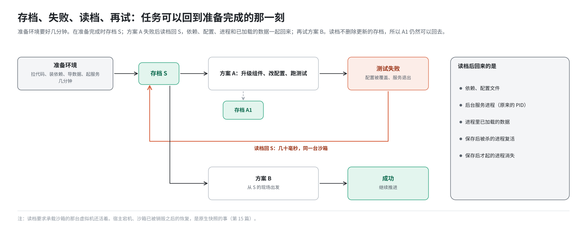
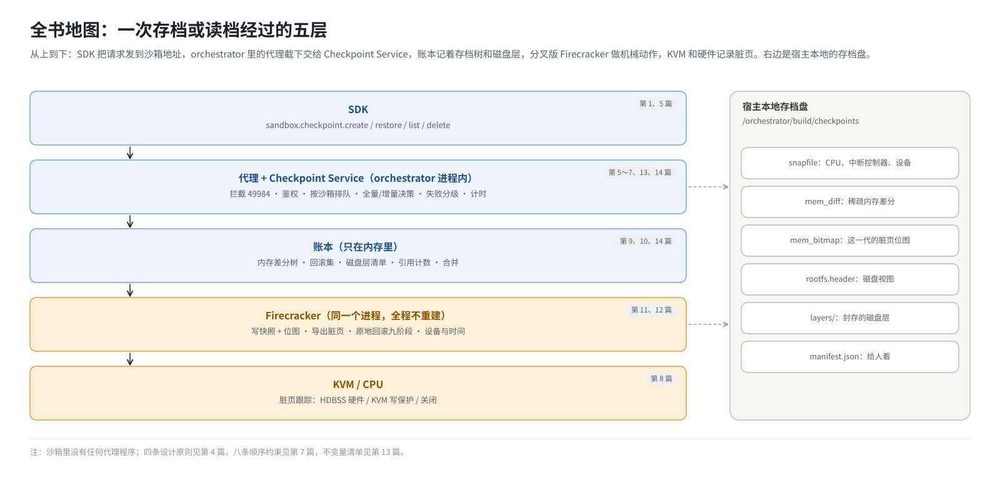

# 第 1 篇｜让沙箱能回到上一步

> **本篇目标**：先不钻细节，看清楚全书要讲的那件事：给一台**正在运行**的沙箱存个档，过一会儿再把**同一台**沙箱原地变回那一刻。它要解决什么问题，用起来长什么样，为什么难，做到了多快。读完这一篇，你手里会有一张全书地图，后面每一篇都在这张图上放大某一块。

---

## 一、一个场景

一个 AI Agent 接到任务：修好某个项目里的一个 bug。它在 E2B 沙箱里依次做了这些事：

1. 拉下项目代码；
2. 安装依赖，下载了几百 MB 的包；
3. 准备测试数据，导入一个小数据库；
4. 启动项目的后台服务，服务把数据加载进内存。

这几步花了好几分钟。现在环境准备好了，Agent 开始真正的工作：它决定升级某个组件、改两处配置，然后跑测试。

测试失败了。更糟的是，新版本组件改变了依赖关系，配置文件已经被覆盖，后台服务也因为配置错误退出了。Agent 还记得自己的目标，可它已经回不到“准备刚完成”的那个现场了。

这时候它有什么办法？

| 做法 | 怎么做 | 问题 |
|---|---|---|
| **重建沙箱** | 销毁这台，新开一台，把准备步骤再跑一遍 | 慢。前面几分钟的准备全部重做；如果中间有进程内算出来、还没写进文件的结果，也要重新算 |
| **应用层撤销** | 回退代码、卸载新装的包、恢复配置、重启服务 | 不知道一次操作到底改了什么：哪些文件被改、哪些子进程被起、内核里留下了什么缓存，往往没有完整记录。撤销得不干净，下一次尝试就建立在一个“半新半旧”的环境上 |
| **虚机级快照** | 在准备完成时把整台机器的现场存下来，失败了就整个读回来 | 要解决“怎么存、怎么读、怎么快”。这就是本书的内容 |

第三种就是游戏里的**存档 / 读档**。准备完成时存一个档 S；方案 A 失败，读档 S；再试方案 B。读档之后，依赖、配置、进程、进程里已经加载好的数据，一起回到 S 那一刻。



区别在于：游戏存的是一份数据，这里存的是**一整台正在运行的电脑**，包括它的内存、CPU 正执行到哪一条指令、磁盘上的每一个文件。而且要快到可以在一个任务里随手用十几次。

这里说的“失败”有明确的范围：沙箱里的程序崩了、文件被改坏了、依赖装失败了，或者一次尝试没达到目标。前提是**承载沙箱的那台虚拟机还活着**。宿主机宕机、沙箱已经被销毁之后的恢复，是另一个问题，书里会说明为什么本方案刻意不管它。

## 二、用起来长什么样

对使用者来说，这项能力就是 SDK 里沙箱对象上的四个方法：

| 方法 | 作用 |
|---|---|
| `sandbox.checkpoint.create(name=...)` | 存档，返回一个 checkpoint ID |
| `sandbox.checkpoint.restore(checkpoint_id)` | 读档：把这台沙箱原地变回那一刻 |
| `sandbox.checkpoint.list()` | 列出这台沙箱现有的存档 |
| `sandbox.checkpoint.delete(checkpoint_id)` | 删掉一个存档 |

一个最小的例子。控制程序在沙箱**外面**运行：

```python
sandbox.commands.run("echo v1 > /home/user/state.txt; echo v1 > /dev/shm/state.txt")
saved = sandbox.checkpoint.create(name="ready")          # 存档

sandbox.commands.run("echo v2 > /home/user/state.txt; echo v2 > /dev/shm/state.txt")
sandbox.checkpoint.restore(saved.checkpoint_id)         # 读档

print(sandbox.commands.run("cat /home/user/state.txt /dev/shm/state.txt").stdout)
# v1
# v1
```

两个文件放在不同的地方：`/home/user/state.txt` 在根文件系统上，也就是**磁盘**里；`/dev/shm/state.txt` 在一个内存文件系统里，只存在于**内存**中。读档之后两行都是 `v1`，说明磁盘和内存一起回去了。

再多说一点。保存时正在运行的进程，读档后以**原来的 PID** 继续运行；保存之后才启动的进程，读档后消失；保存之后被杀掉的进程，读档后又回来了。这不是“重放一遍操作”能做到的事，只有把整台机器的现场整个换回来才行。

存档不止一个。存了 S 之后试方案 A，A 的某个中间状态值得留着，可以再存一个 A1；读档回 S，再试 B，再存 B1。读档回旧的存档**不会删掉**更新的存档，所以你可以在 S、A1、B1 之间来回切换。这些存档之间的关系是一棵树，第 9 篇细讲。

## 三、三条硬要求

这个场景对实现提了三条要求，后面每一篇都在回应它们：

| 要求 | 具体含义 | 推出什么 |
|---|---|---|
| **高频** | 一个任务里十几次，不是一个沙箱一两次 | 单次成本必须低到可以随手用；“不管改了多少都要付一笔大钱”的固定开销不可接受 |
| **低延迟** | 发生在 Agent 的决策循环里，每一步都在等它 | 设计目标：增量存档 ≤ 200 ms、读档 ≤ 100 ms |
| **沙箱不能中断** | 沙箱有 ID、IP、端口映射，外部还有人拿着这些信息在连它 | 排除一切“先停掉、再重新拉起”的路线 |

第三条最硬。E2B 本来就有一套快照，叫 pause / resume：把沙箱停下、存盘、离场，以后再新起一台把它恢复出来。它恰好违反第三条，也违反第一条。第 4 篇专门讲为什么不能直接用它。

## 四、先给结论：做到了多快

在鲲鹏 950 服务器上，一台 2 GiB 内存的沙箱，两次存档之间改动 64 MiB（48 MiB 内存写入 + 16 MiB 文件写入）时：

| 操作 | 客户端耗时中位数 |
|---|---|
| 增量存档 | 41.4 ms |
| 读档 | 46.0 ms |
| 第一次存档（全量） | 约 0.5 s |

“客户端耗时”是从 SDK 发出调用到拿到返回的时间，包含网络往返和服务端的全部工作。第一次存档要把 2 GiB 内存完整写一遍，所以慢；之后每次只存改过的部分。改得越多越慢：改 128 MiB 时两项还在目标内，改 256 MiB 时读档中位数 105.6 ms，开始超过 100 ms。完整数据在第 17 篇。

这个数字是怎么来的？简单说是三件事：

- **只存改过的**：硬件或内核帮忙记下哪些内存页被写过，每次只存这些页；磁盘的改动本来就落在单独的一层里，存档时把这一层“封起来”，只改个名字，不搬数据。
- **原地读档**：读档时不新起虚拟机，而是在原来那个正在运行的虚拟机进程里，只把需要变回去的页写回去。宿主上的进程、网卡、磁盘设备、内存映射都不重建。
- **宿主侧做**：沙箱里不装任何代理程序，所有动作由宿主上的管理进程完成。

## 五、全书地图

下面这张图是全书的地图。从上往下：



| 层 | 是什么 | 在本方案里干什么 |
|---|---|---|
| **SDK** | 用户写的 Python 程序调用的库 | 把四个调用发到沙箱地址 |
| **代理 + Checkpoint Service** | 宿主上 orchestrator 进程里的两个部件 | 代理认出存档请求、截下来；Service 负责编排：鉴权、排队、决定全量还是增量、出错时分级 |
| **账本** | orchestrator 内存里的几张表 | 记着存档之间的树形关系、每个存档的磁盘层、谁引用谁 |
| **Firecracker** | 每台沙箱一个的虚拟机进程（加了三处扩展） | 暂停 / 恢复虚机、写快照文件、把指定的页写回内存、恢复 CPU 和设备状态 |
| **KVM / 硬件** | 宿主内核里的虚拟化模块和 CPU | 记录哪些页被写过 |
| **产物盘** | 宿主本地磁盘上的一个目录 | 存放快照文件、内存差分、磁盘层 |

orchestrator 是 E2B 在每台宿主机上运行的管理进程，管着这台机器上所有沙箱的生命周期、网络和存储。本方案的大部分代码都加在它里面。

全书分五部分：

| 部分 | 篇 | 讲什么 |
|---|---|---|
| 一、为什么要做 | 第 1～4 篇 | 场景；一台沙箱的“现场”由什么组成；页、脏页、位图、稀疏文件这些基础；为什么不用原生快照，定下了哪些原则 |
| 二、怎么做 | 第 5～14 篇 | 总体架构；一次存档和一次读档逐步走；脏页跟踪；内存差分树；磁盘分层；Firecracker 里的原地回滚；网络、设备与时间；失败分级；并发、生命周期与空间 |
| 三、和原生快照一起用 | 第 15 篇 | 两种快照的分工，原生快照怎么也做到只存改动 |
| 四、多快 | 第 16～18 篇 | 性能怎么量；在 950 上量出了什么；从单沙箱到多沙箱长时间运行，做过哪些优化 |
| 五、对不对、往后怎么走 | 第 19～20 篇 | 测试怎么证明它是对的；全景、现状和后续方向 |

阅读建议：

- 完全的新手，从头顺着读。第 2、3 篇是概念基础，后面大量用到。
- 熟悉虚拟机和操作系统内存管理的读者，可以跳过第 2、3 篇，从第 4 篇开始。
- 只想知道“到底是怎么做到又快又对的”，读第 4～9 篇和第 11 篇。
- 只关心数字，读第 16、17 篇。

## 六、名词对照

正文统一用下面这些说法：

| 本书说法 | 英文 / 接口名 | 一句话 |
|---|---|---|
| 存档、保存点 | checkpoint（`CreateCheckpoint`） | 把沙箱此刻的现场记下来 |
| 读档、回滚 | restore（`RestoreCheckpoint`） | 把**同一台活着的**沙箱原地变回那一刻 |
| 原生快照 | pause / resume | E2B 原有的“停下、存盘、离场、改天重建”的路径 |
| 冻结窗口 | frozen | 虚机被暂停的那段时间，业务真正感觉到的停顿 |
| 脏页 | dirty page | 被写过的内存页 |
| 纪元 | epoch | 两次“脏页记录清零”之间的那段时间 |
| 回滚集 | revert set | 读档时必须写回的那批页 |
| 账本 | Store | orchestrator 内存里记着树、层、引用计数的那几张表 |
| guest / 客户机 | guest | 沙箱这台虚拟机内部，与之相对的是宿主（host） |

checkpoint 和 restore 在正文里会和“存档”“读档”混用，指的是同一回事。

---

## 本篇小结

| 概念 | 一句话解释 |
|---|---|
| 沙箱级快照回滚 | 给正在运行的沙箱存档，之后把同一台沙箱原地变回那一刻 |
| 回滚的范围 | 内存、进程、CPU 执行位置、设备状态、整个根文件系统 |
| 回滚管不到的 | 沙箱外面的东西：外部数据库、已发出的请求、外部持有的连接 |
| 三条硬要求 | 高频、低延迟（≤ 200 ms / ≤ 100 ms）、沙箱不能中断 |
| 做到的量级 | 950 上改 64 MiB：存档 41.4 ms，读档 46.0 ms；首次全量约 0.5 s |
| 三个关键做法 | 只存改过的、原地读档、全部在宿主侧做 |

**下一篇预告**：[《基础一：一台沙箱的“现场”由什么组成》](02-what-is-the-state.md)。要存一台机器的“现场”，先得说清楚现场里有什么：内存、CPU、中断控制器、设备、磁盘、时间，还有外部世界对它的记忆。以及为什么这些东西必须在同一瞬间一起存。
